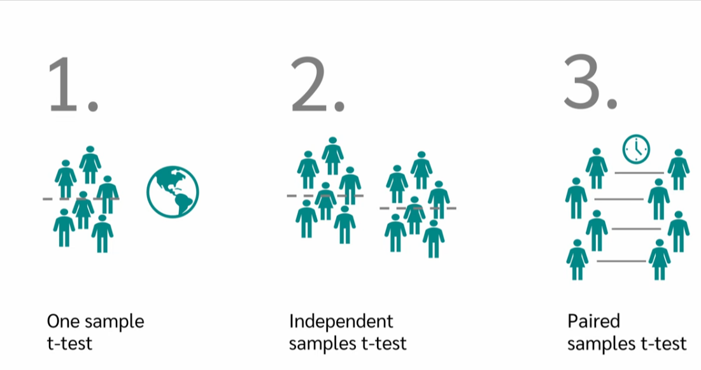
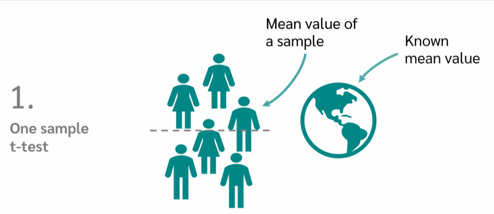
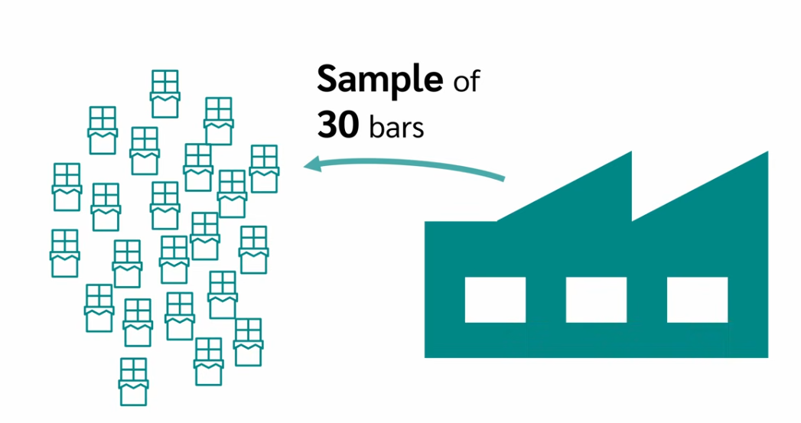
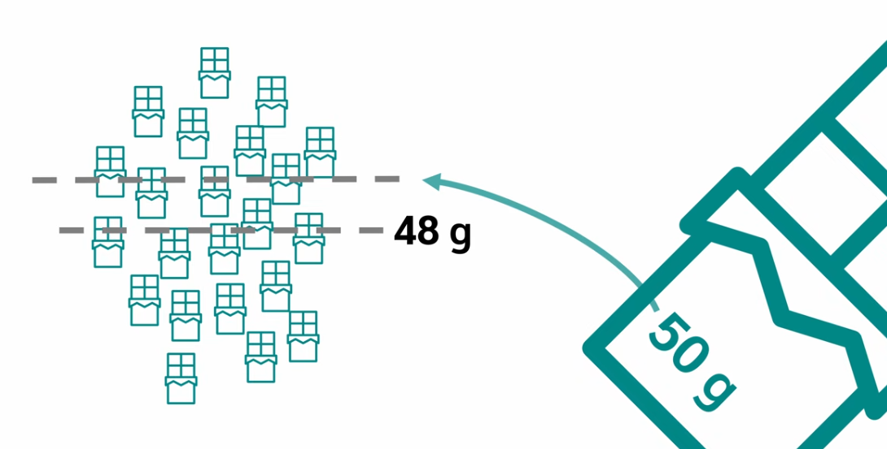
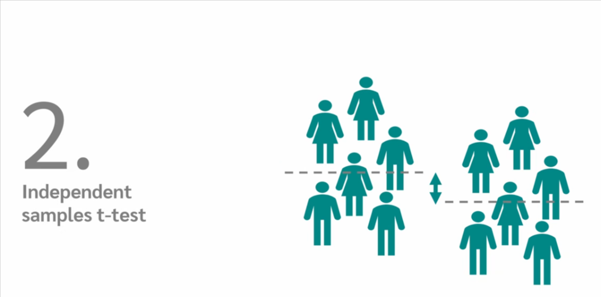
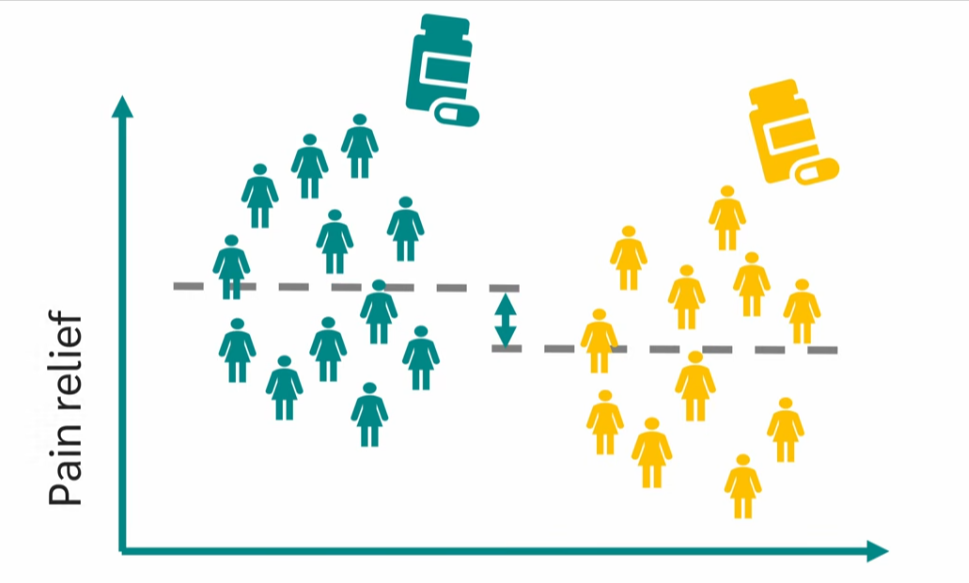

# T-test Revision

- What the T-test is.
- when to use it.
- what types of T-test there are.
- what the hypotheses and assumptions are.
- How a T-test is calculated.
- How you can interpret the results.

## What is a T-test?

The `T-test` is a statistical test procedure and what does the Test do? The `T-test` analyzes whether there is a `significant difference` between the `means` of two `groups`. For example, the two groups may be patients who receive blood test.

We would now like to know if there is a `difference` in `blood pressure` between these two groups.

> Types of T-test

Now there are three different types of tests:

- The One Sample t-test.
- The independent samples T-test.
- The paired sample t-test.
  

> When do we use a `one sample` t-test?

We use the one sample T-test when we want to compare the `mean of a sample` with a `known` reference `mean`.

For example, a chocolate bar manufacturer claims that its chocolate bars way an average of `50 grams`.

To check this, we take a sample of `thirty bars` and weigh them.

The mean value of this sample is `48 grams`. Now we can use the `One sample T-test` to check if the mean of `48 grams` is significantly different from the claim `50 grams`.

> When do we use the `independent sample t-test`.

We use the `T-test` for `independent samples` when we want to `compare the means of two independent groups` or `samples`.

We want to know if there is a significant difference between these `means`.

For example, we would like to compare the effectiveness of two painkillers.

We randomly divide 60 people into two groups. The first group receives Drug A, and the second group receives Drug B. Using an independent t-test, we can now test whether there is a significant difference in pain relief between the two drugs.

> When do we use the `paired samples` t-test?

We use the `paired samples T-test` to compare the `means` of `two dependent groups`.

For example, we want to know how effective a diet is.

To do this, we weigh thirty people `before the diet` and then weigh exactly `the same` people `after the diet`.

Now we can look at the `difference in weights` between `before` and `after` for each subject. We can now use a `paired sample T-test` to test whether there is a `significant difference` in a paired sample the measurements are away level in pairs.

The pairs result, for example, from repeated measurements with the same people independent samples are made up of people and measurements that are independent of each other. Here's a little interesting note the pair sample is very similar to the one sample T test. We can also think of the paired sample T test as having one sample that was measured at two different time points. We then calculate the difference between the pair values giving us a value for one sample. The difference is once minus five plus two minus one, and so on and so forth. Now we want to test whether the mean value of the difference is calculated deviates from a reference value. In this case zero, this is exactly what the one sample test last.
