# Model validation and over-fitting.

Building a machine learning model in a way where we can trust its predictive abilities on new data is extremely important. A model that works well only on the training data, but not on new data, is almost worthless.

We need to be able to rely on the model and understand what it will do when put into production.

At a high level. Model validation should be done in a way where we split all our data into two groups:

> A training set that we use to train the model.

> And a test revalidation set, which we use to get a true understanding of how accurate the predictions are on new or unseen data.

Assessing model accuracy on the same data that the model was trained with is problematic. The model can do something called `over-fitting`, a situation where it learns the patterns of the data so precisely that when given some new data in the real world, it finds that those rules don't really apply very well.

When we split out a training and a test set, we have a way to understand how much overfitting took place while training, and we can remedy this where possible.

Further to this, there is an even more advanced approach called `K-fold cross-validation`, which is a more powerful way to ensure that we are avoiding `over-fitting`.

Imagine that this is all of the data that we have available to us for some machine learning task., let's think of this data as rows and columns in a spreadsheet. This is tabular data consisting of both input variables, which we will use to predict the output, and our output variable itself.

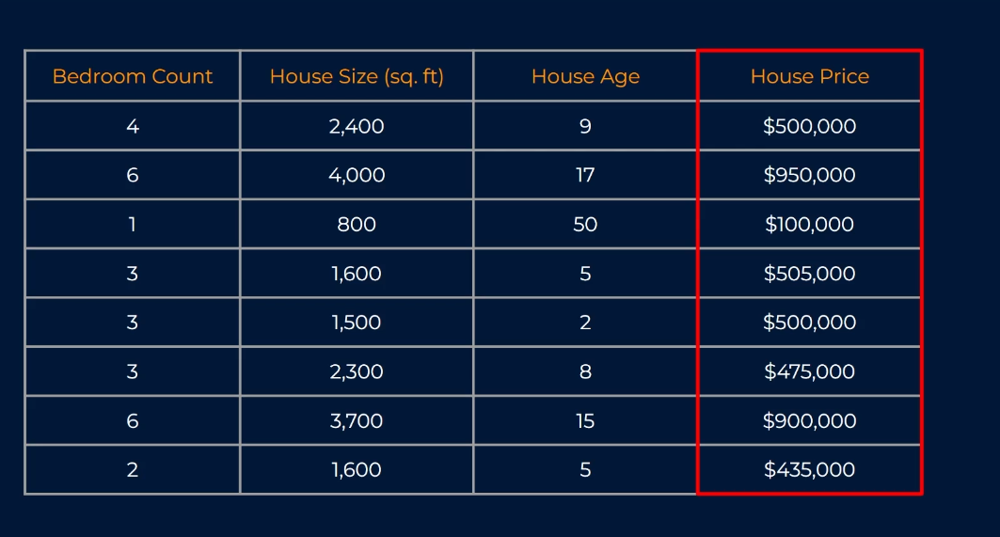

To perform a basic validation split on our data, we would take all of our data, and we would split it into two groups a training a test set. The one thing to note here is that it's really important to ensure that the data is `shuffled` before splitting.

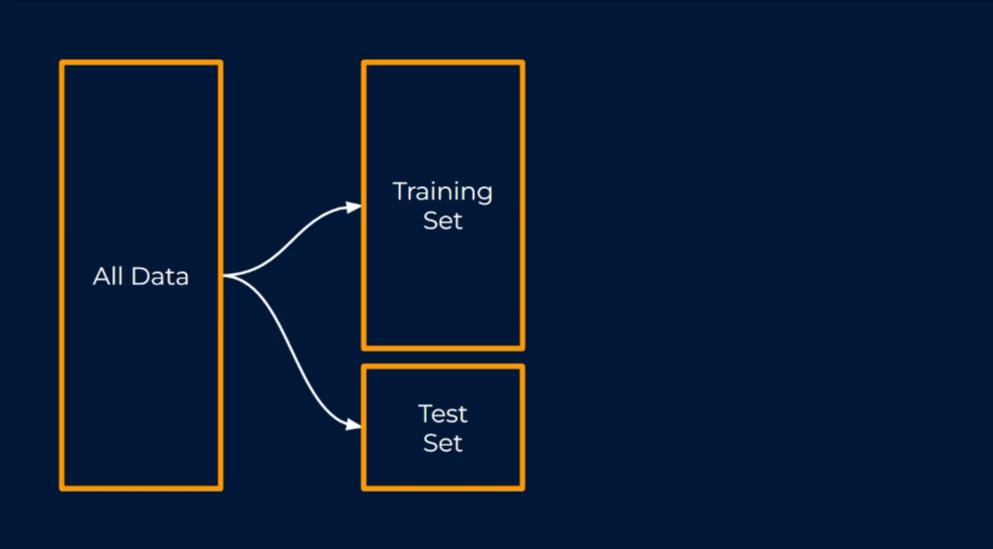

If our data was sorted in any way, we could end up with training and test sets that aren't really covering the same spread of data. Here in our example, we have the data sorted by house price. Our training set, which is colored in red, only contains houses `up to $500,000`. Our test set, which is in green, contains houses `over $500,000`.

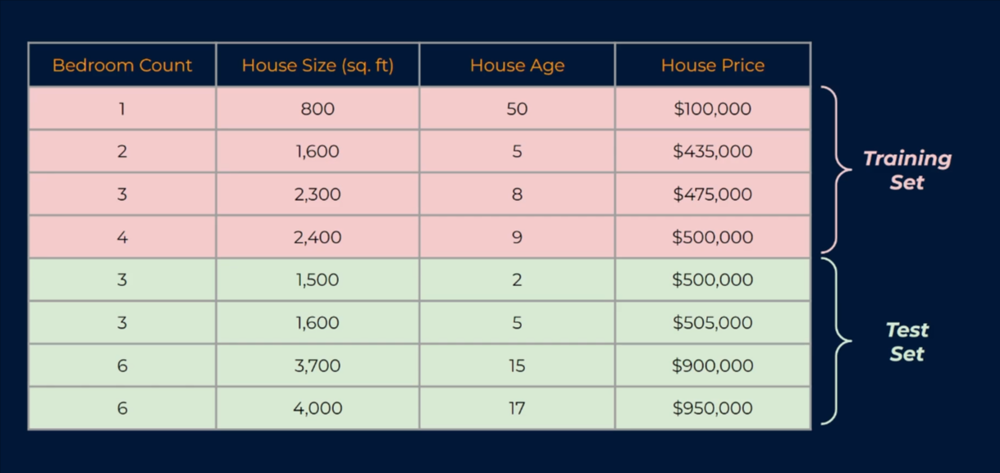

You can see why this would cause issues; our training data won't be learning ways to predict the full spectrum of houses, so it won't be of any use. Instead, if our data is indeed shuffled, both the training and the test sets should contain a mix of all house types and all values. Always remember to shuffle your data. The only exception to this would be for time series data, where the order is indeed important.

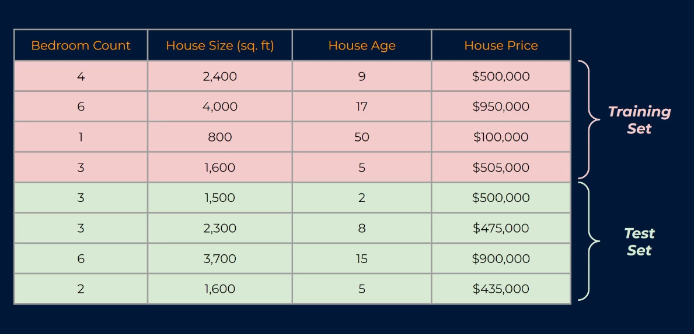

Anyway, back to our example here. We have our training and our test sets. Using only the training set, we would train our model.

In other words, during training, the model is learning to find patterns, relationships, and correlations within our data. But it's doing this by looking at only the data we've allocated into the training set. This is super important for the learning process. The learning process never gets to see what is in the test set,

This is why the testing is sometimes called a `holdout`, as we hold it back from training. Now, we want our training set to have plenty of data in it in order to successfully learn these patterns, so we often give it the majority of our data.

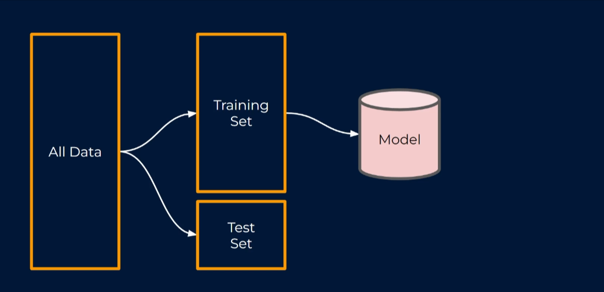

As a rule of thumb, we usually allocate around `70 to 80 percent` of our complete data to the training set, and the remaining `20 or 30 percent` to the test set.

After the model is trained, we want to understand how accurate the predictions are, and this is where the test set comes in. We pass the test set into our trained model, and the model uses these along with the data from the training set to provide some predictions for what the outputs might be.

So, if we were predicting house prices, this would be the predictions for each of the houses. We can then compare these predicted outputs with the actual outputs that we have from the data. This allows us to understand how good our predictions are.

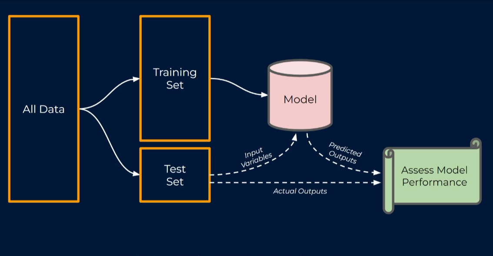

Now, at this stage, you might be sitting there nodding and saying, "Sure, that process makes sense, but why do we need to do this? Why can't we just build the model on all of our data?" Surely, this would give it the most data to learn from, and you're right, it would.

However, it adds a really `big risk`, and that risk is what I mentioned earlier: `over-fitting`. This occurs when a model learns the training data too well, resulting in poor performance on new data.

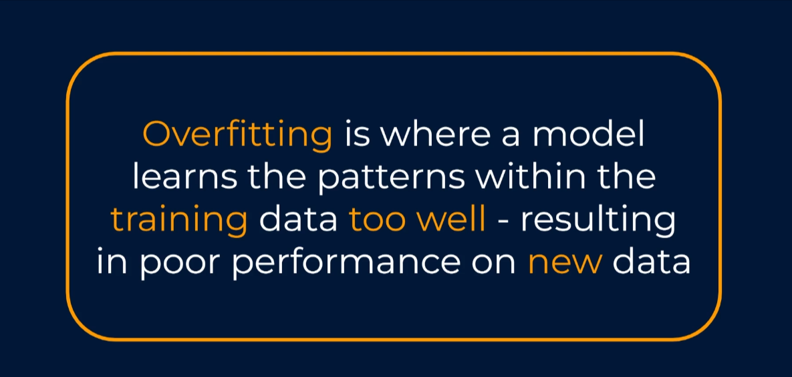

A famous analogy for `overfitting` is a student who's preparing for an end of year exam by repeatedly completing practice exams from previous years. The student learns precisely how to answer these questions, but when their end of year exam comes, he finds out that they're a new slightly different question, and he has no idea how to answer them. It's the same in machine learning.

`This is exactly the reason we don't train and validate our model on the same data`. We want to know that the model will be able to predict well on new data, as data is often the reason that we're building it in the first place.

Training our model on the training set and validating model on our testing validation set is a very good way to do this, but there is actually an even better way using a method called `cross validation` also referred to as `K-fold` cross validation. Don't worry, it is not too dissimilar from the training and test split that we've already covered. It is very intuitive once you see how it works.

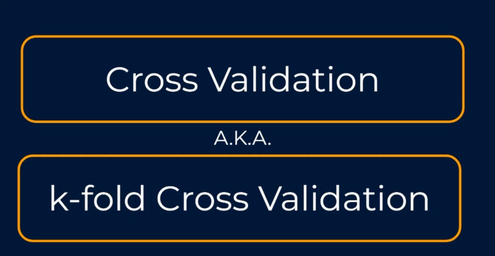

So let's take a look at a simple example of this in practice. Just like the training and test split scenario that we've just covered, we start with all of our data. We then split it into training and test sets, and then we train the model from the training data only. We use the unseen test data to assess the model performance, so it appears to work just the same as before. But the difference is that we do this multiple times.

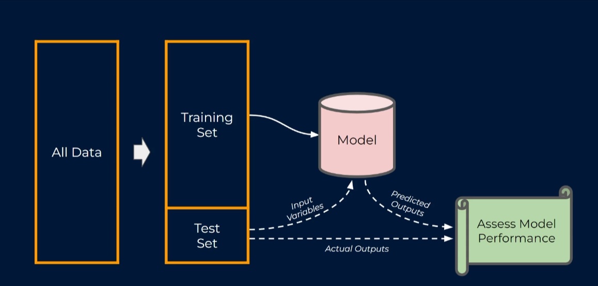

Let's go back a step or two, and I'll explain what I mean. In K-fold cross-validation, we start with the full data, and before we split into training and test sets, we split the data into evenly sized groups, like so. The number of groups that we choose is denoted by K, as in K-fold cross-validation. K denotes the number of evenly sized groups or folds that we divide our data into.

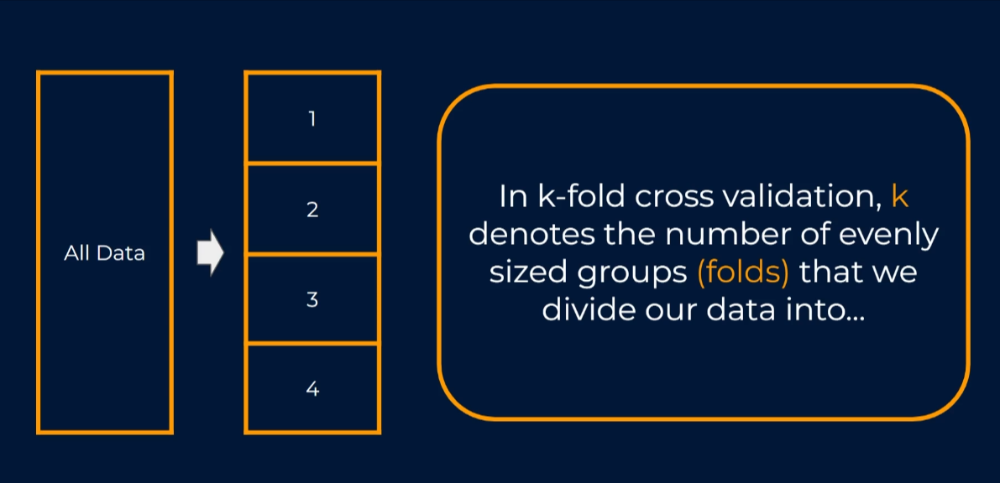

Here on screen, we must have set K equal to four, so we get four folds in the data. If we instead set K equal to two, our folds or splits would have looked like this. For now, however, let's stick with K being equal to four, and now we have our data divided up evenly.

The magic of K-fold cross-validation can be uncovered. We are going to iterate through and make training and test splits at each point. So firstly, we would split the data like this, where we train on three of the folds and validate on the fourth. Now, to make this a little bit easier to visualize, let's instead show the training set as red and the test set as green. This is going to make the rest of the logic far more intuitive.

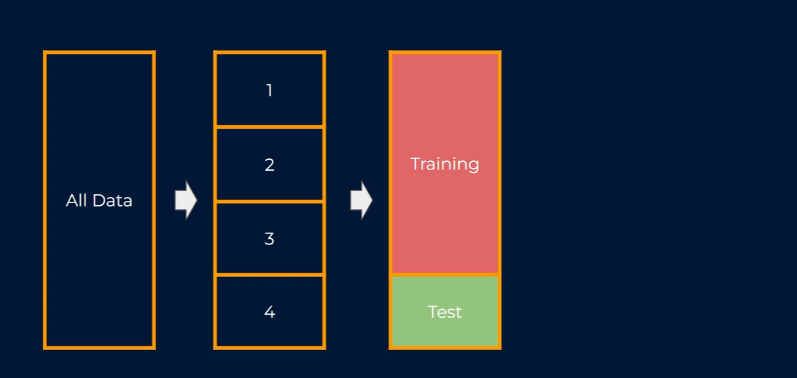

As we've now got a training and test set, we can train the model using the training data and validate with the test set.

Then we do this over again, but this time our training and test sets are split like this. We again train our model using the training data, and we validate with the test data.

We do this again and again until each of our folds has had a chance to be the test set. The result of all of this is that we have now trained and validated models on four different cuts of our data. It also means that we have four different sets of accuracy results, each based on the four test sets.

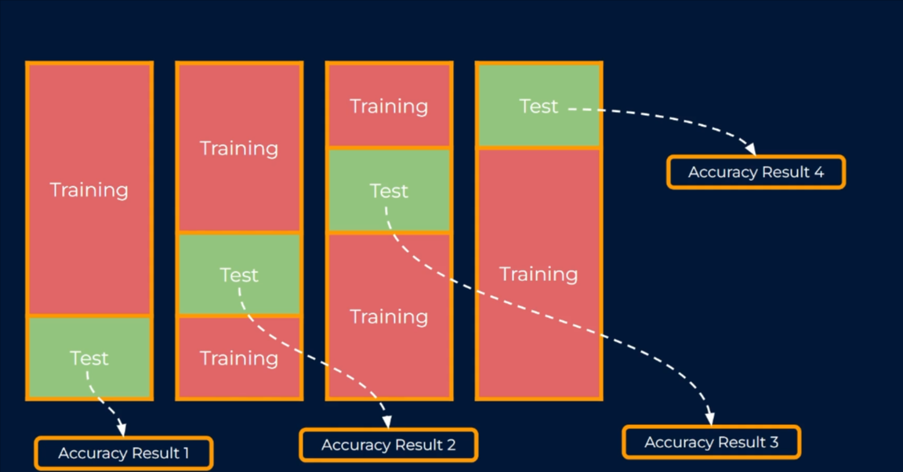

For example, let's say that we are working on a classification problem. For each validation, we had the percentage of correct predictions. We can take the average of these results to give a much more robust view of how accurate our model will be on new unseen data.

If there is a large discrepancy between these accuracy values, it shows how biased a single train-test split could have been, and it highlights the value of cross-validation as a procedure.

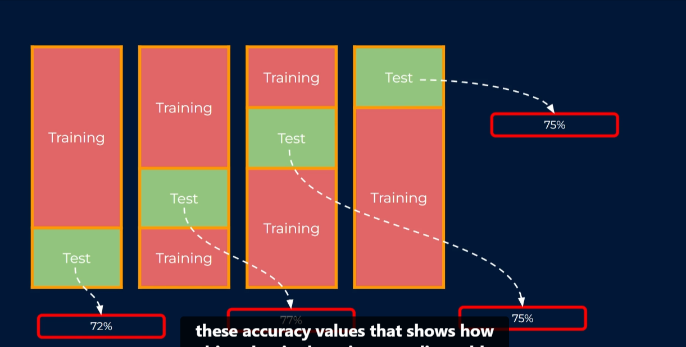
