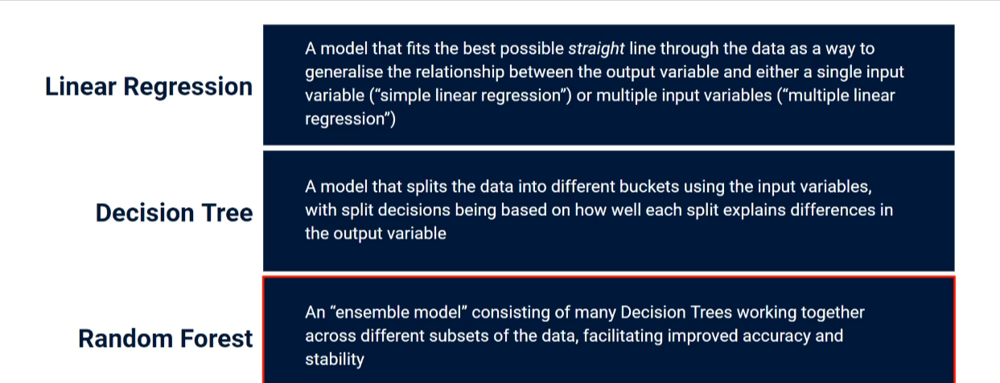

# Introduction to Machine Learning for Regression



## 1. What is Machine Learning?

**Machine Learning (ML)** is a branch of Artificial Intelligence where computers
learn patterns from data — instead of being explicitly programmed with rules.

Think of it like teaching a child to recognize fruit:

- You show the child many apples and bananas (data)
- The child learns the differences (patterns)
- The child can now recognize a fruit it has never seen before (prediction)

## 2. What is Regression?

**Regression** is a type of ML task where the goal is to **predict a continuous
number** (a value that can take any amount, not a category).

| Task                           | Type           | Prediction                   |
| ------------------------------ | -------------- | ---------------------------- |
| Predict the price of a house   | Regression     | 250,000 (any number)         |
| Predict tomorrow's temperature | Regression     | 21.5 °C                      |
| Predict if an email is spam    | Classification | Spam / Not Spam (a category) |

**The key difference:**

- **Classification** → predict a _category_ (e.g. cat vs dog)
- **Regression** → predict a _number_ (e.g. house price)

## 3. Key Concepts for Beginners

### 3.1 Features (X) and Target (y)

- **Features (X):** the input information you give the model.
  Example: house size, number of rooms, location.
- **Target (y):** the number you want the model to predict.
  Example: the house price.

### 3.2 Training vs Testing

- **Training set:** the data the model _learns_ from.
- **Test set:** the data we use to _check_ how well the model learned
  (data it has never seen before).

### 3.3 Overfitting vs Underfitting

- **Underfitting:** the model is too simple — it misses the pattern (like
  drawing a straight line through a curve).
- **Overfitting:** the model memorizes the training data but fails on new
  data (like memorizing exam answers instead of understanding the subject).

### 3.4 Common Regression Algorithms

| Algorithm                  | When to use                                               |
| -------------------------- | --------------------------------------------------------- |
| Linear Regression          | Simple, clear linear relationships — the best first model |
| Decision Tree Regression   | Non-linear patterns, easy to visualize                    |
| Random Forest Regression   | More accurate than a single tree, very popular            |
| k-Nearest Neighbors (k-NN) | Simple idea: "predict based on similar past examples"     |

### 3.5 How do we measure performance?

- **MAE (Mean Absolute Error):** average size of the mistakes.
- **RMSE (Root Mean Squared Error):** like MAE, but punishes big mistakes more.
- **R² Score:** how well the model explains the data — 1.0 is perfect,
  0 is no better than predicting the average.

## 4. The ML Workflow (always the same!)

```javascript
1. Get the data
2. Explore the data (look at it, plot it)
3. Split into training and test sets
4. Choose a model
5. Train the model (fit)
6. Evaluate the model on the test set
7. Use the model to make predictions
```

## 5. Practical Example 1 — Linear Regression from Scratch Idea

Imagine you collect data on houses: size in m² and price.
A linear regression finds the **best straight line**:

price = w \* size + b

where `w` (weight) and `b` (bias) are the numbers the model _learns_.

## 6. Practical Example 2 — Full Project: Predict House Prices

We will use a classic dataset: **California Housing**
(median house values in California districts, ~20,000 rows, 8 features such as
median income, house age, average rooms, etc.).

### Step-by-step code

```python
# ======================================================================
# Example 1: Simple Linear Regression on a synthetic dataset
# ======================================================================
import numpy as np
import matplotlib.pyplot as plt
from sklearn.linear_model import LinearRegression
from sklearn.model_selection import train_test_split
from sklearn.metrics import mean_absolute_error, mean_squared_error, r2_score

# 1. Create a simple synthetic dataset: hours studied vs exam score
np.random.seed(42)                                  # make results reproducible
hours = np.random.rand(100, 1) * 10                 # 100 random values 0-10 hours
scores = 50 + 5 * hours + np.random.randn(100, 1) * 5  # true pattern + some noise

# 2. Split the data into training (80%) and testing (20%) sets
X_train, X_test, y_train, y_test = train_test_split(
    hours, scores, test_size=0.2, random_state=42
)

# 3. Choose and train the model
model = LinearRegression()      # create a linear regression model
model.fit(X_train, y_train)     # learn the best line from training data

# 4. Evaluate the model on the test set
y_pred = model.predict(X_test)  # predict scores for the test data
mae = mean_absolute_error(y_test, y_pred)   # average error in points
r2 = r2_score(y_test, y_pred)               # 1.0 = perfect, 0 = useless

print(f"Learned: score = {model.coef_[0][0]:.2f} * hours + {model.intercept_[0]:.2f}")
print(f"MAE: {mae:.2f} points   R²: {r2:.3f}")

# 5. Visualize the result
plt.scatter(X_train, y_train, color="blue", label="Training data")
plt.scatter(X_test, y_test, color="green", label="Test data")
plt.plot(X_test, y_pred, color="red", linewidth=2, label="Learned line")
plt.xlabel("Hours studied"); plt.ylabel("Exam score")
plt.legend(); plt.title("Linear Regression: Hours vs Score")
plt.savefig("example1_simple_linear.png", dpi=100)
plt.show()
```

```python
# ======================================================================
# Example 2: Real dataset — California Housing Prices
# ======================================================================
import pandas as pd
import matplotlib.pyplot as plt
from sklearn.datasets import fetch_california_housing
from sklearn.model_selection import train_test_split
from sklearn.preprocessing import StandardScaler
from sklearn.linear_model import LinearRegression
from sklearn.ensemble import RandomForestRegressor
from sklearn.metrics import mean_absolute_error, mean_squared_error, r2_score

# 1. Load the dataset
housing = fetch_california_housing(as_frame=True)
X = housing.data          # 8 features (income, rooms, age, ...)
y = housing.target * 100_000   # median house value, scaled to dollars

print("Feature names:", list(X.columns))
print("Dataset size:", X.shape)

# 2. Quick data exploration
print(X.describe())       # statistics of each feature

# 3. Split into train (80%) and test (20%) sets
X_train, X_test, y_train, y_test = train_test_split(
    X, y, test_size=0.2, random_state=42
)

# 4. Scale the features (helps many algorithms work better)
scaler = StandardScaler()
X_train_scaled = scaler.fit_transform(X_train)  # learn scaling from train set
X_test_scaled = scaler.transform(X_test)        # apply same scaling to test set

# 5. Train a Linear Regression model
lr = LinearRegression()
lr.fit(X_train_scaled, y_train)
lr_pred = lr.predict(X_test_scaled)

print("\n--- Linear Regression ---")
print(f"MAE: ${mean_absolute_error(y_test, lr_pred):,.0f}")
print(f"RMSE: ${mean_squared_error(y_test, lr_pred) ** 0.5:,.0f}")
print(f"R²: {r2_score(y_test, lr_pred):.3f}")

# 6. Train a Random Forest (usually more powerful)
rf = RandomForestRegressor(n_estimators=100, random_state=42, n_jobs=-1)
rf.fit(X_train, y_train)    # trees don't need scaled data
rf_pred = rf.predict(X_test)

print("\n--- Random Forest ---")
print(f"MAE: ${mean_absolute_error(y_test, rf_pred):,.0f}")
print(f"RMSE: ${mean_squared_error(y_test, rf_pred) ** 0.5:,.0f}")
print(f"R²: {r2_score(y_test, rf_pred):.3f}")

# 7. Which features matter most? (feature importance)
importances = pd.Series(rf.feature_importances_, index=X.columns)
importances.sort_values().plot(kind="barh", title="Feature Importance")
plt.tight_layout()
plt.savefig("example2_feature_importance.png", dpi=100)
plt.show()

# 8. Predicted vs Actual plot (a great sanity check)
plt.scatter(y_test, rf_pred, alpha=0.3)
plt.plot([y_test.min(), y_test.max()],
         [y_test.min(), y_test.max()], "r--")   # perfect prediction line
plt.xlabel("Actual price"); plt.ylabel("Predicted price")
plt.title("Random Forest: Predicted vs Actual")
plt.savefig("example2_pred_vs_actual.png", dpi=100)
plt.show()
```

## 7. Practical Example 3 — Predicting with a New Data Point

```python
# Take the first 5 districts from the test set and predict their prices
sample = X_test.head(5)
predicted = rf.predict(sample)

for i, (idx, row) in enumerate(sample.iterrows()):
    actual = y_test.loc[idx]
    print(f"District {i+1}: predicted ${predicted[i]:,.0f} "
          f"| actual ${actual:,.0f}")
```

## 8. Tips for Beginners

1. **Always split your data** before training — never evaluate on data the
   model has already seen.
2. **Start with Linear Regression** — it is fast, interpretable, and a great
   baseline. Only try fancier models if the baseline is not good enough.
3. **Look at your data** — plot it. A simple scatter plot often reveals more
   than any metric.
4. **Compare MAE/RMSE against the average value of your target** — an MAE of
   $50,000 sounds bad until you learn average house prices are $200,000.
5. **Beware of data leakage** — never use information in training that would
   not be available at prediction time.
6. **Scale your features** for models sensitive to magnitudes (linear models,
   k-NN, neural networks); tree-based models (Random Forest) don't need it.

## 9. Exercises to Try

1. Change `test_size` to 0.3. Do the results change much?
2. In Example 1, try adding outliers to the data. What happens to the line?
3. Try `DecisionTreeRegressor` and `KNeighborsRegressor` on the housing data.
   Which works best?
4. Plot "Predicted vs Actual" for the Linear Regression model and compare it
   with the Random Forest plot.

## 10. Summary

- **Regression** = predicting a continuous number.
- The workflow is always: _split → train → evaluate → predict_.
- Linear Regression is the best first model; Random Forest is a strong,
  easy-to-use upgrade.
- Metrics like MAE, RMSE, and R² tell you how trustworthy your predictions are.

Happy learning! 🚀
