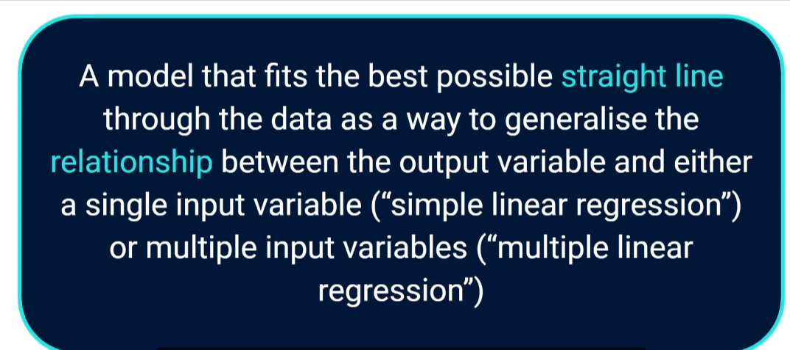
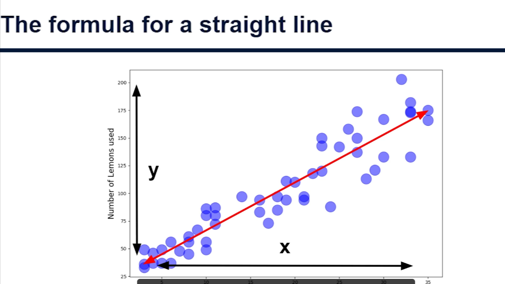
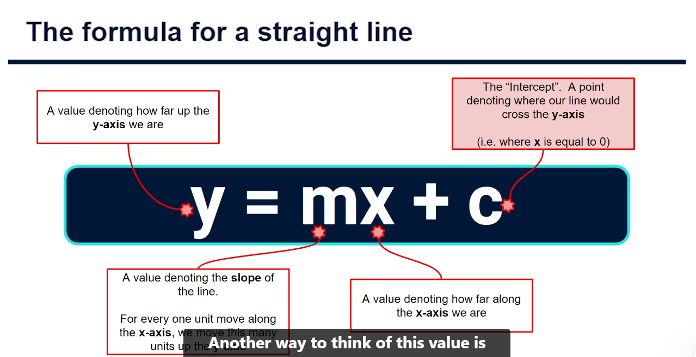
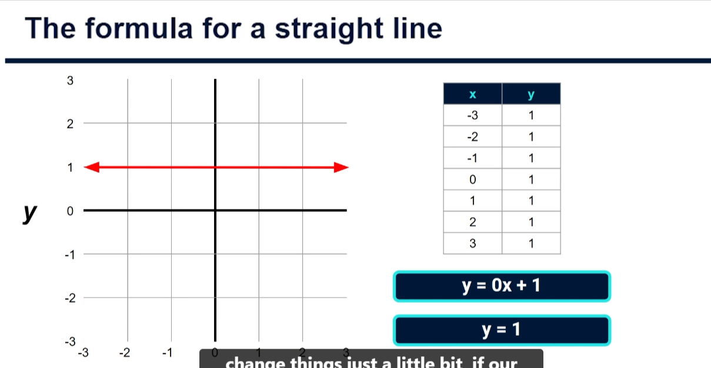

# LINEAR REGRESSION

> The Formula For A Straight Line

The formula for a straight line, as this is exactly what the `output` for a `linear regression model` will `give` us.

A linear `regression model` is a model that fits the `best possible straight line` through our `data` as a way to `generalize` the relationship between the `output variable` and either a `single input variable`, which is often referred to as `simple linear regression`, or `multiple input variables`, which is often called `multiple linear regression`.

> Example: Let's start by revisiting our example of Lucy's lemonade stand, where we're looking to understand how many lemons she will need each day based on historical data, which includes both the number of lemons that were used each day as well as the daily peak temperature in degrees Celsius. .

Now, another way of wording this would be to say that we are looking to find a value for Y based on a known value for X. Using linear regression, we'll do this by fitting the best possible straight line through our data.

Any straight line can be described using an equation, and this equation is what we use to represent our regression or line of best fit. This equation for a straight line is commonly written as `y = mx + c`.

Y is a value showing how far up the y-axis we are at any point, specifically in relation to how far along the x-axis we are at that point.

The value m gives us the slope of that line. Specifically, this value m represents the number of units we will move up the y-axis for every one unit we move along the x-axis.

Don't worry if this doesn't make sense right now; it absolutely will once we look at some examples.

Before we get to those, however, we have one other part of this equation to look at, and that is c, which tells us exactly where the regression line will cross through the y-axis. This is often referred to as the intercept or constant.

> Constant value of `y` with changes in `y`.

> 

This is extremely important in thinking about linear regression. We are looking to plot a straight line that best represents the relationship between $x$, our input value, and $y$, our output value. Once we have that, we can plug in any new values for $x$, and the line will provide us the prediction for our output.
