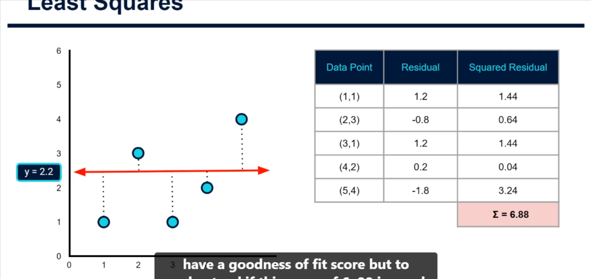

# Linear Regression: How Is the "Line of Best Fit" Found?

## Scenario

A lemonade stand records, for each day:

- the **daily peak temperature**
- the **number of lemons used**

## Observation

- Plotting lemons vs. temperature shows a clear relationship: on hotter days (right of the chart) more lemons are used, presumably because demand for lemonade is higher.

## Linear regression

- Running a linear regression over this data gives the formula of the **regression line** (the _line of best fit_):

  `lemons = intercept + slope × temperature`

## The key question

- Many lines could be drawn through the data. How does the algorithm know one line is **better** than any other?
- Understanding what happens under the hood matters because it helps you apply this type of model correctly in different scenarios as you build a career in data science. Courses often skip this.

## Goodness of fit and least squares

- To judge a line we need a metric for how well it fits (its _goodness of fit_).
- **Least squares** is an approach used in regression to approximate a solution by **minimising the sum of squared residuals**.
- A **residual** is the vertical distance between the regression line and an actual data point: `residual = line_y - actual_y`.
- Residuals can be positive or negative and would cancel out when summed, so we **square** each one (always positive) and then add them up.

### Example 1: flat line `y = 2.2`

| Data point | Residual | Squared residual |
| ---------- | -------- | ---------------- |
| 1          | 1.2      | 1.44             |
| 2          | -0.8     | 0.64             |
| 3          | 1.2      | 1.44             |
| 4          | 0.2      | 0.04             |
| 5          | 1.8      | 3.24             |

- Sum of squared residuals = **6.8** (the transcript says 6.88, but the values above add to 6.8).
- This number only means something when compared with other lines.

### Example 2: `y = 0.5x + 1`

- Intercept 1 (crosses the y axis at 1), slope 0.5 (half a unit up for each unit along x).
- First point (x = 1, y = 1): line y = 0.5 × 1 + 1 = 1.5, residual 0.5, squared 0.25.
- Repeating for every point gives a sum of squared residuals of **4.75**, a big improvement on 6.8, so this line fits better.

## Finding the best line

- Testing random lines is inefficient. If you plot the sum of squared residuals against the slope, you get a **curve**: it falls as the line steepens, reaches a minimum, then rises again as the line becomes too steep.
- **Gradient descent** uses differentiation to find the slope of that curve at each point. At the bottom the slope is **zero**, which is the point of least squares and the optimal solution.
- The computer does this for us (practical tutorials will show it).
- The optimal line here had the same slope (0.5) but a lower intercept (0.7), reducing the sum of squared residuals from 4.75 to 4.3.

## Summary

- Residuals measure how far each point is from the line.
- The sum of squared residuals scores a line; lower is better.
- Gradient descent finds the slope and intercept that minimise it (least squares).
