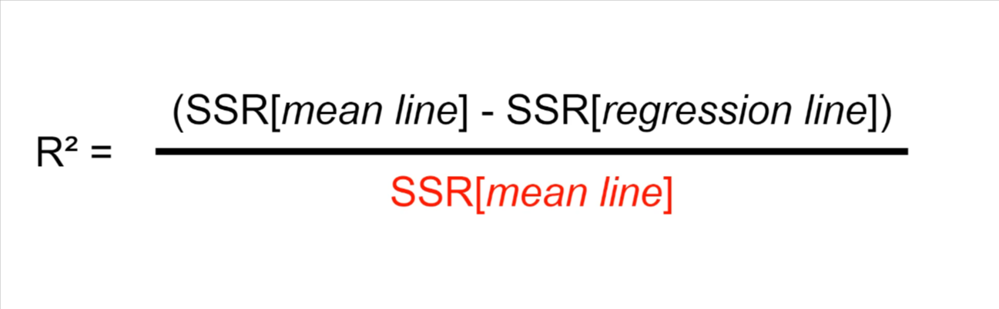
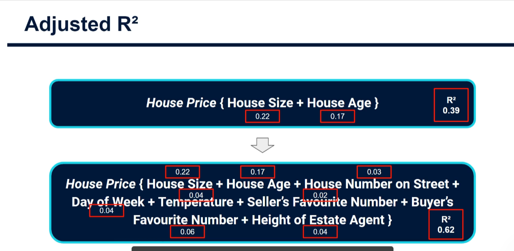
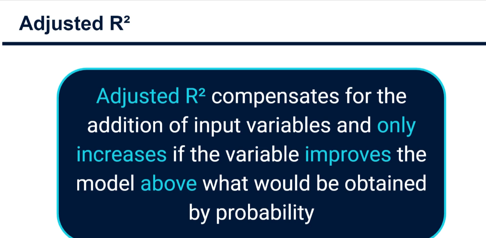
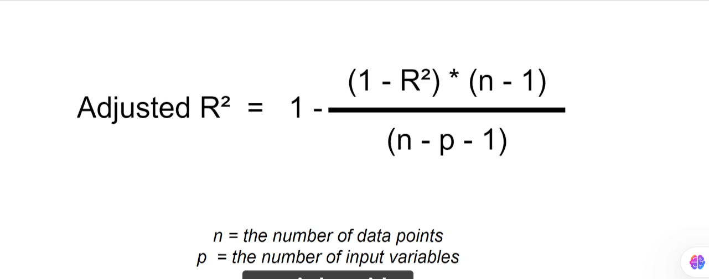

# Adjusted R-Squared

## R² recap

R² shows the percentage of the variance in the output variable `y` that is explained by the input variables `x`:

```
R² = (SSR_mean - SSR_fitted) / SSR_mean
```

- `SSR_fitted`: sum of squared residuals of the fitted regression line (or plane).
- `SSR_mean`: sum of squared residuals of the mean line.

It tells us how much better off we are using the inputs than using the mean of `y` alone. With multiple input variables it works the same way, with each input's contribution added together.



## The problem

Every input variable added to a model can only **increase** R², never decrease it, even if the increase is by pure chance.

Example: throw 100 variables into a model without thinking. Say 5 are truly useful and the other 95 are unrelated or only coincidentally related to `y`. Each small coincidental relationship still adds a little to R². Together they inflate the score with noise. The result is that:

- We overestimate how good the model is.
- On new data, it performs much worse than R² suggested.

## House price illustration

**Scenario 1: two sensible inputs.** Contributions to R² are 0.22 and 0.17, giving R² = 0.39. This is not a great model, but R² honestly says so, so we stay cautious with predictions.

**Scenario 2: many extra, mostly random inputs.** Their small chance relationships add up and R² is inflated (a fictional example, but it shows the effect). With 50 or 100 variables the effect gets worse. A model with many inputs will never have an R² lower than the simpler model's.





## The solution: adjusted R²

Adjusted R² compensates for the number of input variables. It only increases if a new variable improves the model **more than would be expected by chance**.

```
Adjusted R² = 1 - (1 - R²) * (n - 1) / (n - k - 1)
```

- `R²`: the original R² score.
- `n`: number of data points.
- `k`: number of input variables.



scikit-learn has no built-in adjusted R², so we translate the formula into Python.

## Python (scikit-learn) example

```python
import numpy as np
from sklearn.linear_model import LinearRegression
from sklearn.metrics import r2_score


def adjusted_r2(r2, n, k):
    return 1 - (1 - r2) * (n - 1) / (n - k - 1)


rng = np.random.default_rng(0)
n = 100
size = rng.uniform(500, 3500, n)
age = rng.integers(0, 60, n)
price = 240 * size - 2500 * age + 50_000 + rng.normal(0, 60_000, n)

# Scenario 1: two meaningful inputs
X1 = np.column_stack([size, age])

# Scenario 2: same inputs plus 30 pure-noise columns
noise = rng.normal(size=(n, 30))
X2 = np.column_stack([size, age, noise])

for label, X in [("2 useful inputs", X1), ("2 useful + 30 noise inputs", X2)]:
    model = LinearRegression().fit(X, price)
    r2 = r2_score(price, model.predict(X))
    adj = adjusted_r2(r2, n=X.shape[0], k=X.shape[1])
    print(f"{label}: R2 = {r2:.3f}, adjusted R2 = {adj:.3f}")
```

Expected behaviour: R² rises when the noise columns are added, but adjusted R² stays flat or drops.

## Key takeaway

Always use **adjusted R²** when assessing linear regression models with multiple input variables. It gives a fairer view of how well the model fits the data.
