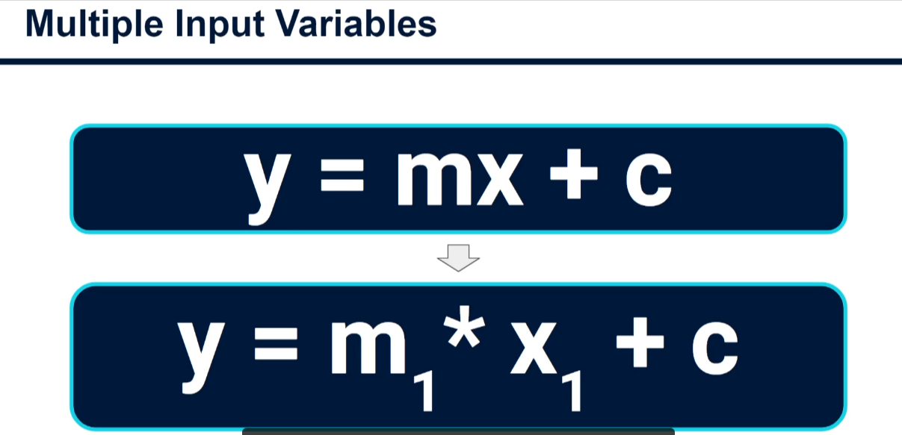
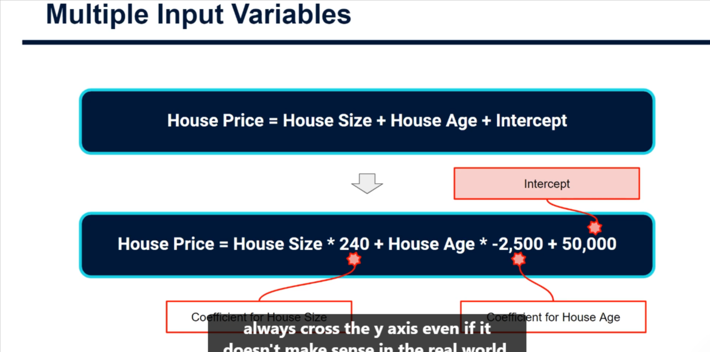

# Multiple Linear Regression: Multiple Input Variables

In real-world work, a linear regression model rarely uses a single input variable. It usually uses several inputs and looks at how they **together** explain the output variable. Everything from simple linear regression still applies, with a few tweaks.



## Line vs. plane

- **One input variable:** we fit the best **line**.
- **Multiple input variables:** we fit a **plane** (or hyperplane). Each extra input adds a dimension.
- Charts beyond three dimensions are hard to draw, so don't worry about visualising it.

## The equation

Simple linear regression:

```
y = mx + c
```

Multiple linear regression:

```
y = c + m1*x1 + m2*x2 + ... + mn*xn
```

- `y`: the output variable we want to explain or predict.
- `c`: the intercept (constant). This is the value of `y` where all inputs are 0.
- `x1 ... xn`: the input variables (e.g. number of bedrooms, house size).
- `m1 ... mn`: the **coefficients**, the values that multiply each input to get the prediction. They are no longer just called "slopes".

The simple formula is the same equation with `n = 1`.



## Example: house prices

```
house_price = 240 * house_size + (-2500) * house_age + 50000
```

- **240 (size coefficient):** each extra square foot raises the expected price by about $240.
- **-2500 (age coefficient):** each extra year of age lowers the expected price by about $2,500.
- **50,000 (intercept):** the price when size and age are both 0. This makes no sense in the real world, because the plane extends from -infinity to +infinity and so crosses the y-axis somewhere that may be meaningless.

## Python (scikit-learn) example

```python
import numpy as np
import pandas as pd
from sklearn.linear_model import LinearRegression
from sklearn.metrics import r2_score

# Synthetic data generated from the formula above, plus noise
rng = np.random.default_rng(42)
n = 200
df = pd.DataFrame({
    "house_size": rng.uniform(500, 3500, n),  # square feet
    "house_age": rng.integers(0, 60, n),      # years
})
df["house_price"] = (
    240 * df["house_size"] - 2500 * df["house_age"] + 50_000
    + rng.normal(0, 15_000, n)
)

X = df[["house_size", "house_age"]]  # multiple input variables
y = df["house_price"]                # output variable

model = LinearRegression()
model.fit(X, y)

print("Intercept (c):", round(model.intercept_, 2))
for name, coef in zip(X.columns, model.coef_):
    print(f"Coefficient for {name}: {coef:.2f}")

# Predict a 2000 sq ft, 10-year-old house
new_house = pd.DataFrame({"house_size": [2000], "house_age": [10]})
print("Predicted price:", round(model.predict(new_house)[0], 2))

print("R squared:", round(r2_score(y, model.predict(X)), 3))
```

The fitted intercept and coefficients should land close to 50,000, 240 and -2,500. They will not match exactly because of the noise added to the data.

## Summary

The equation is very similar to the single-variable case, but it expands to include the effects of other input variables.

**Next:** does R² still apply to multiple-variable models? (Next tutorial.)

Yes, R² works in the same way, with each input variable's contribution added together. However, adding more inputs can only ever increase R², even when the new variables are just noise. This is why we use **adjusted R²** instead. See [Adjusted_R-Squared.md](./Adjusted_R-Squared.md).
