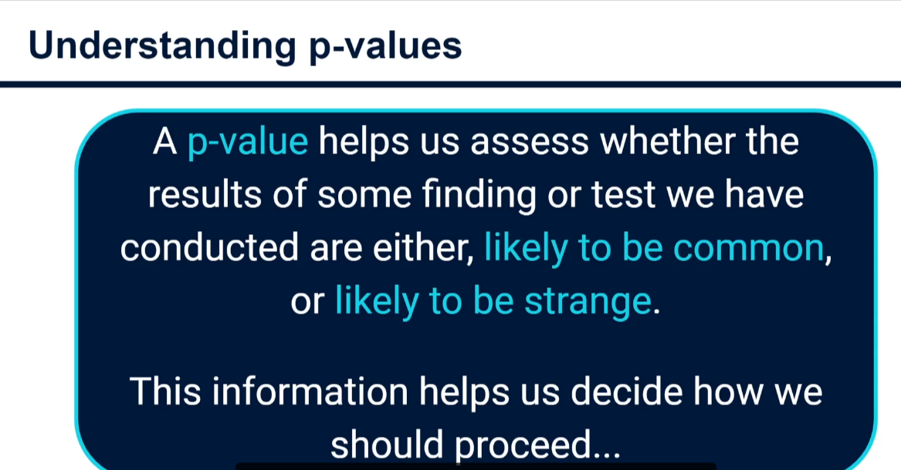
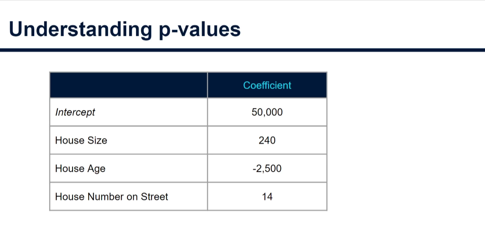
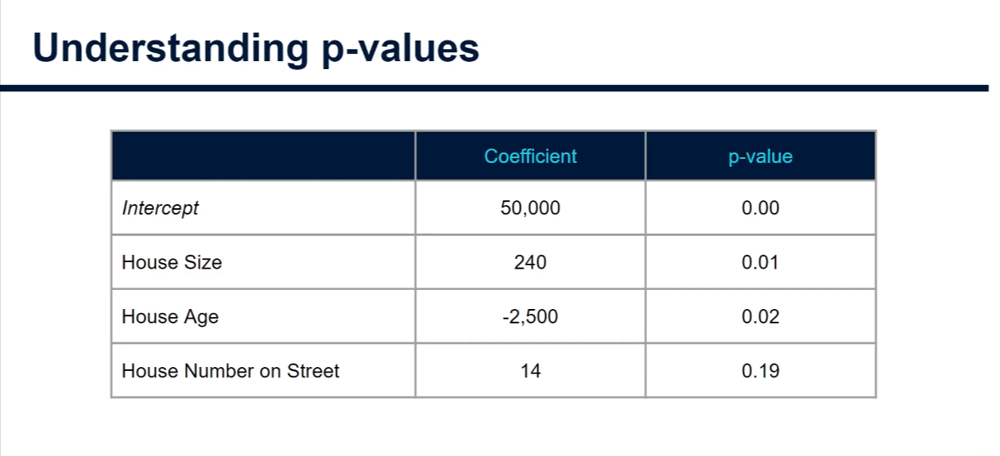
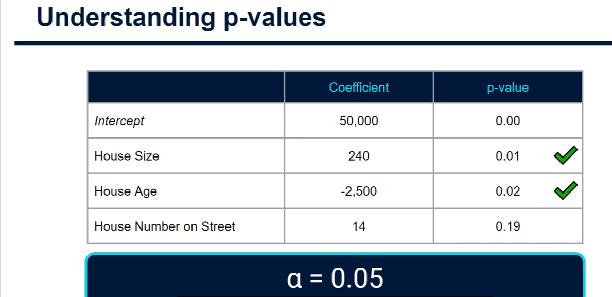

# Understanding P-Values in Linear Regression

This is a brief recap of what p-values mean when you see them in the output statistics of a model you built. They were covered in more depth in the earlier stats tutorials.

## What a p-value is for

A p-value helps us assess whether the result of a test is likely to be **common** (we would get similar results if we ran many more tests) or **strange** (a rarity). That helps us decide how to proceed: draw a conclusion, gather more data, or change our view of what we believe. In linear regression, the question is whether an input variable has a statistically significant and reliable effect on the output variable.



## Coefficients in the model summary

A model summary lists the intercept and each input variable, each with a coefficient (called the slope in single-input models). The coefficient says how many units the output changes for a one-unit change in the input.

House price example:

| Input                      | Coefficient | Meaning                                                 |
| -------------------------- | ----------- | ------------------------------------------------------- |
| House size                 | 240         | each extra square foot adds about $240                  |
| House age                  | -2,500      | each extra year of age lowers the price by about $2,500 |
| House number on the street | 14          | each higher house number adds about $14                 |

All three show a relationship with price, but which ones can we trust, and which might be down to chance?



## What the p-value tests

For each coefficient, the p-value tests the **null hypothesis** that the coefficient is actually 0, meaning the input has no relationship with the output.

- **Low p-value:** we can reject the null hypothesis, so we can be confident a relationship exists.
- **High p-value:** we cannot dismiss the null hypothesis, so there is not enough evidence of a relationship.

## Alpha level

The common threshold is **alpha = 0.05**, also called the acceptance criterion. You can set it to anything, but 0.05 is common.

- Confidence level = 1 - alpha, so 1 - 0.05 = 0.95, or **95% confidence**.
- p < 0.05: statistically significant relationship.
- p > 0.05: not statistically significant.



## Applying it to the example

| Input        | p-value | Significant at 0.05?                          |
| ------------ | ------- | --------------------------------------------- |
| House size   | 0.01    | Yes                                           |
| House age    | 0.02    | Yes                                           |
| House number | > 0.05  | No (the coefficient is likely down to chance) |



## What to do with this

P-values are commonly used to decide which inputs to **keep** and which to **discard**. Here we would likely remove house number and re-run the model with just house size and house age. The result is a similar model that we can be more confident about on new data, because the impact of noise and chance is reduced.

## Python (statsmodels) example

scikit-learn does not report p-values. `statsmodels` does.

```python
import numpy as np
import pandas as pd
import statsmodels.api as sm

rng = np.random.default_rng(1)
n = 200
df = pd.DataFrame({
    "house_size": rng.uniform(500, 3500, n),
    "house_age": rng.integers(0, 60, n),
    "house_number": rng.integers(1, 200, n),  # unrelated to price
})
df["house_price"] = (
    240 * df["house_size"] - 2500 * df["house_age"] + 50_000
    + rng.normal(0, 60_000, n)
)

X = sm.add_constant(df[["house_size", "house_age", "house_number"]])
model = sm.OLS(df["house_price"], X).fit()
print(model.summary())

# Keep only inputs significant at alpha = 0.05
significant = model.pvalues[model.pvalues < 0.05].index.drop("const", errors="ignore")
print("Keep:", list(significant))

X2 = sm.add_constant(df[list(significant)])
print(sm.OLS(df["house_price"], X2).fit().summary())
```

Look at the `P>|t|` column in the summary. `house_number` should have a high p-value, so it is dropped in the second fit.

## Summary

You will see these statistics over and over when training and tweaking linear regression models. P-values help you work out which input variables are worth keeping and which are best removed, giving a more accurate and stable model.
