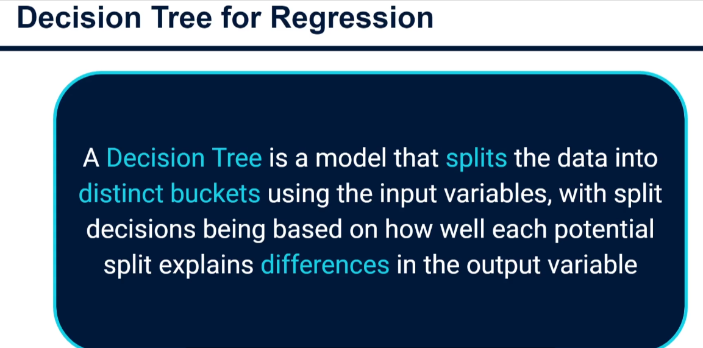
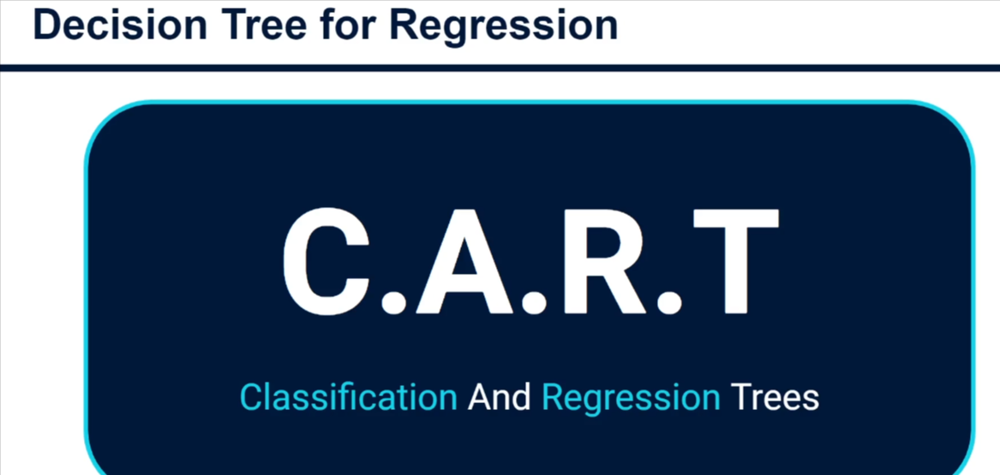
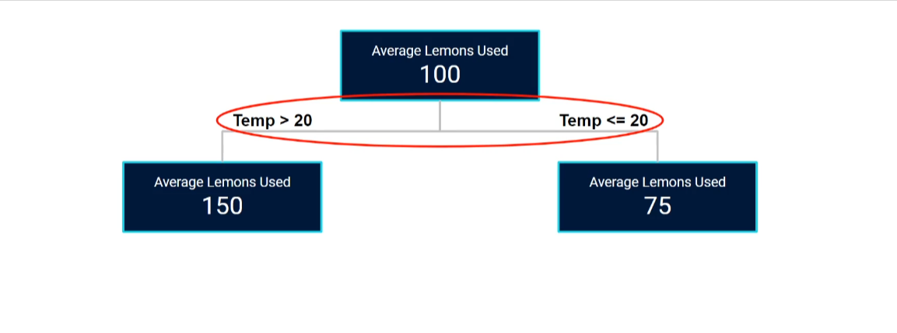
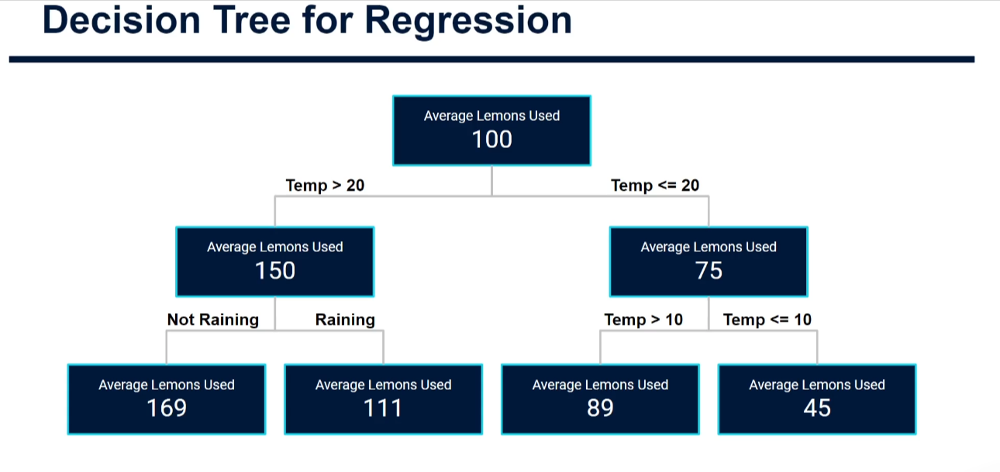
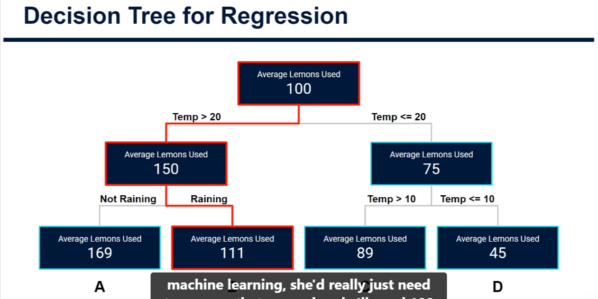
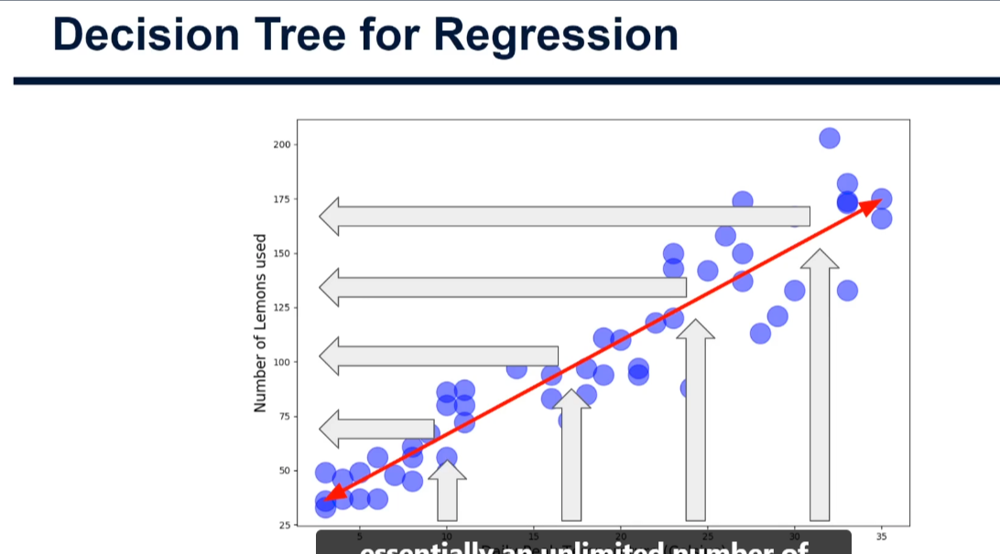
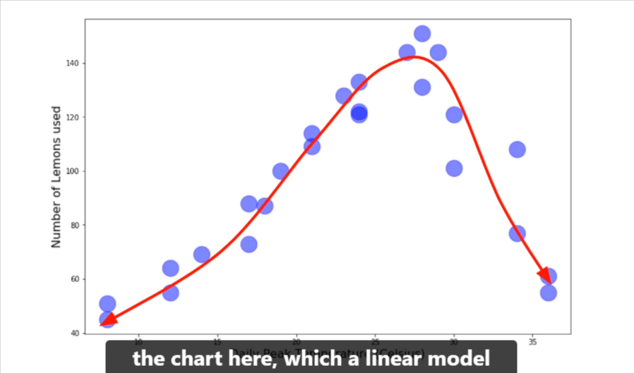
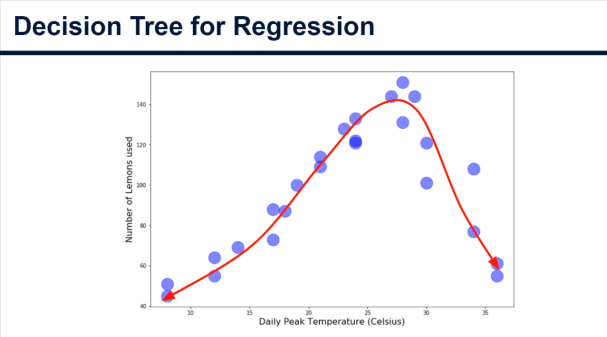
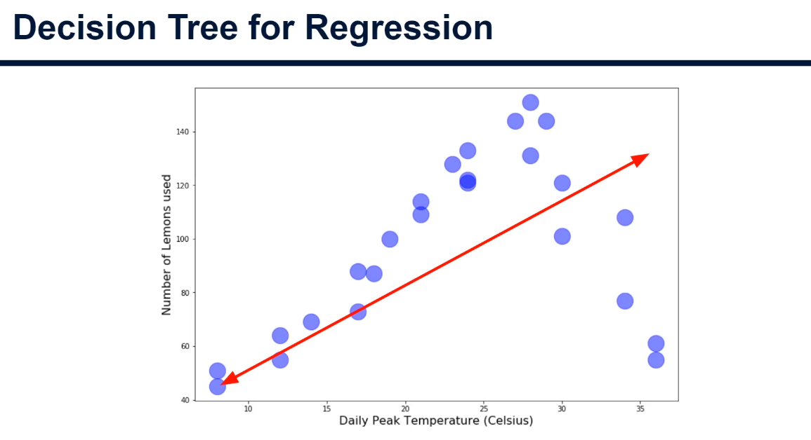
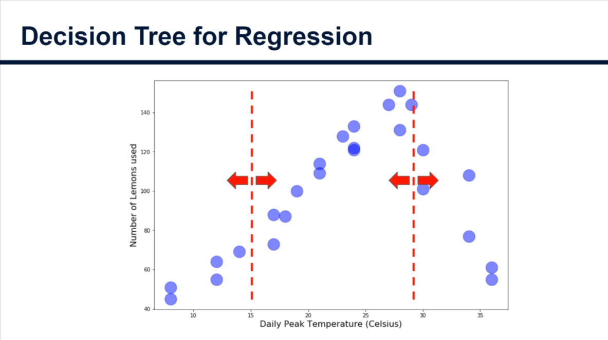

# Decision Trees for Regression

## What is a decision tree?



- A decision tree splits the data into distinct buckets using the input variables.
- Each split is chosen by how well it explains differences in the output variable.
- It resembles an upside-down tree: branches are the splits, and the leaves (leaf nodes) are the final buckets. It also looks like a flowchart.



- **CART** = Classification And Regression Trees. Both are decision trees and share many similarities, but they differ mostly in how they split the data.

## Example: Lucy's lemonade stand

Inputs per day: daily peak temperature (numeric) and whether it rained (yes/no). Output: number of lemons used.



- Start with all the data (no splits): the average is 100 lemons.
- The algorithm tests every possible split of every input variable and picks the one with the biggest difference in the output.
- The best first split was temperature at 20°C: above 20 averages 150 lemons, 20 or below averages 75.



- The process repeats inside each new bucket.
  - Left (Temp > 20): split on rain, giving 169 (not raining) and 111 (raining).
  - Right (Temp <= 20): split on temperature at 10°C, giving 89 (> 10) and 45 (<= 10).
- Trees split both numerical (temperature) and binary/categorical (rain) variables. This means there is no need for encoding such as one-hot encoding.
- Left unchecked, a tree keeps splitting until every data point is in its own bucket, which is overfitting. Stopping conditions prevent this:
  - Only allow a split if the difference in the output between left and right buckets exceeds a threshold.
  - Require a minimum number of data points in a bucket before it can split (e.g. at least 100).
- The final four leaf nodes (A–D): 169, 111, 89 and 45 lemons.

## Making a prediction



- Follow the tree with the known inputs. Forecast: rain, 27°C. Temp > 20 leads to the Raining branch, which gives about **111 lemons**.

## Strengths and weaknesses



- **Strength:** very easy to understand and explain which inputs drive the model. This is useful for clients and marketing teams.
- **Weakness:** predictions are less granular than linear regression. Here there are only four possible values (169, 111, 89, 45). Linear regression gives an essentially unlimited range along the line.
- Even so, four buckets beat assuming 100 lemons every day. That assumption means wasted lemons on some days and missed sales on others.

## Handling non-linear trends





- Suppose sales rise with temperature only up to about 30°C, then fall (e.g. it is too hot, workers go home).



- A linear model struggles here. It must fit a straight line through the middle, which is inaccurate for many points.
- Other ways to handle this are LOWESS curves or polynomial regression.



- A decision tree copes naturally. It splits the temperature into buckets (dotted lines, e.g. around 15°C and 30°C). Below 15°C is a low count, 15–30°C is a high count, and above 30°C is low again.

## Python (basic): decision tree regression with scikit-learn

Full script: [decision_tree_basic.py](decision_tree_basic.py). The lemonade data is made up so the code runs on its own.

### 1. Imports (bring in the tools we need)

```python
import numpy as np
import pandas as pd
from sklearn.tree import DecisionTreeRegressor, plot_tree
from sklearn.model_selection import train_test_split
from sklearn.metrics import r2_score
import matplotlib.pyplot as plt
```

- `import numpy as np`: NumPy handles numbers and random data. `as np` is a short nickname.
- `import pandas as pd`: pandas gives us the DataFrame, a table like an Excel sheet.
- `DecisionTreeRegressor`: the decision tree model for predicting numbers. `plot_tree` draws the tree.
- `train_test_split`: splits our data into a practice set and an exam set.
- `r2_score`: measures how accurate the predictions are.
- `matplotlib.pyplot as plt`: used for drawing charts.

### 2. Create the data

```python
rng = np.random.default_rng(42)
n = 200
temp = rng.uniform(5, 36, n)
rain = rng.integers(0, 2, n)
lemons = 3 * temp + 20 - 30 * rain + rng.normal(0, 8, n)
data = pd.DataFrame({"temp": temp, "rain": rain, "lemons": lemons})
```

- `rng = ...default_rng(42)`: a random number generator. The `42` is a seed, so you get the same numbers every run.
- `n = 200`: we make 200 days of data.
- `temp = rng.uniform(5, 36, n)`: 200 random temperatures between 5 and 36°C.
- `rain = rng.integers(0, 2, n)`: 200 random 0s or 1s (0 = no rain, 1 = rain). The upper limit 2 is not included.
- `lemons = ...`: lemons used rise with temperature (`3 * temp`), fall by 30 on rainy days, and have some random noise (`rng.normal(0, 8, n)`) like real life.
- `data = pd.DataFrame({...})`: puts the three columns into one table.

With real data you would load it instead, e.g. `data = pd.read_csv("file.csv")`.

### 3. Separate inputs and output

```python
X = data[["temp", "rain"]]
y = data["lemons"]
```

- `X` (capital) holds the input columns the model learns from.
- `y` (lowercase) holds the output we want to predict: lemons used.

### 4. Train/test split

```python
X_train, X_test, y_train, y_test = train_test_split(
    X, y, test_size=0.2, random_state=42
)
```

- Splits the rows into 80% for training and 20% for testing. This gives four pieces: inputs and outputs for each.
- `test_size=0.2`: 20% is held back. The model never sees it while learning, so testing on it is fair.
- `random_state=42`: makes the shuffle repeatable.

### 5. Create and train the model

```python
model = DecisionTreeRegressor(max_depth=3, random_state=42)
model.fit(X_train, y_train)
```

- The first line creates an empty tree. `max_depth=3` allows at most 3 levels of splits, which stops overfitting (a tree that memorises the data).
- `model.fit(X_train, y_train)`: the learning step. The tree tries every split and keeps the best ones, as in the theory above.

### 6. Predict and measure accuracy

```python
y_pred = model.predict(X_test)
print("R-squared:", round(r2_score(y_test, y_pred), 3))
```

- `model.predict(X_test)`: the model guesses the lemons for the test days.
- `r2_score(y_test, y_pred)`: compares the guesses with the real answers. 1.0 is perfect and 0 is no better than always guessing the average.
- `round(..., 3)` shortens the number to 3 decimals. `print` shows it. We got about **0.855**.

### 7. Predict for tomorrow

```python
tomorrow = pd.DataFrame({"temp": [27], "rain": [1]})
print("Lemons for tomorrow:", round(model.predict(tomorrow)[0]))
```

- Builds a one-row table for tomorrow's forecast (27°C, raining). The columns must match the training inputs.
- `model.predict(tomorrow)` returns a list with one prediction. `[0]` takes the first item, and `round` makes it a whole number. We got about **67 lemons**.

### 8. Draw the tree

```python
plt.figure(figsize=(14, 6))
plot_tree(model, feature_names=["temp", "rain"], filled=True)
plt.savefig("decision_tree_basic.png", bbox_inches="tight")
```

- `plt.figure(figsize=(14, 6))`: makes a wide canvas (14 by 6 inches).
- `plot_tree(...)`: draws the splits. `feature_names` labels the boxes with column names and `filled=True` colours them by predicted value.
- `plt.savefig(...)`: saves the picture. In a notebook you would use `plt.show()` instead.

## Next steps

1. **Python (basic):** done above.
2. **Theory (in depth):** what happens under the hood of the algorithm, including the stopping conditions that limit overfitting.
3. **Python (advanced):** code an advanced version of the model.
