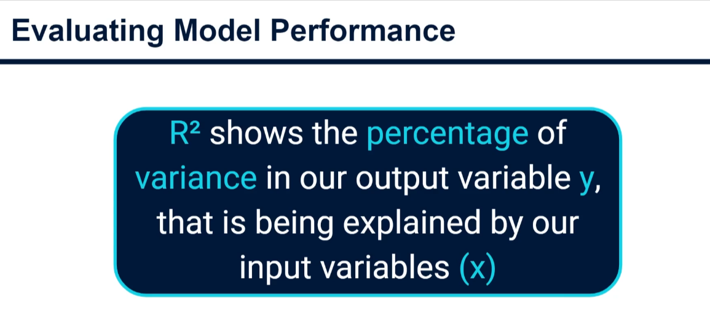
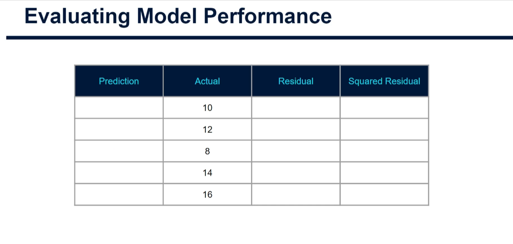
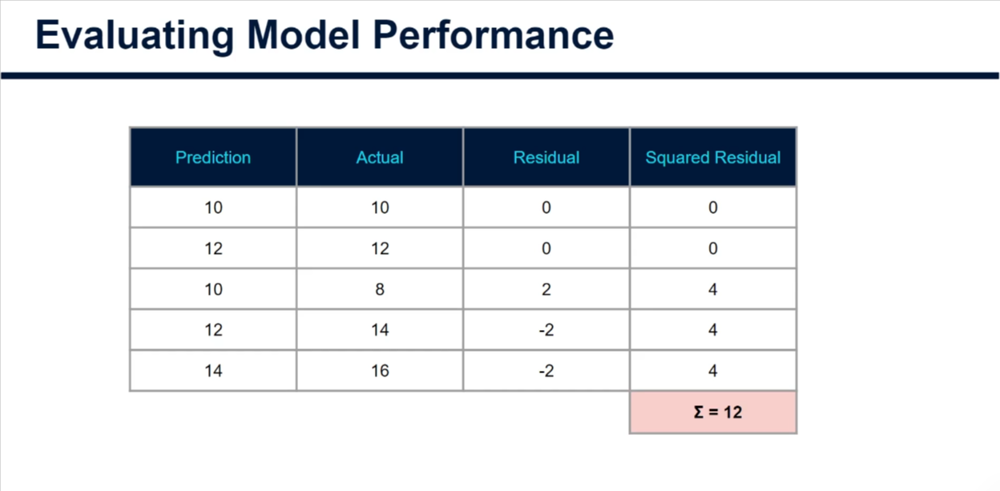
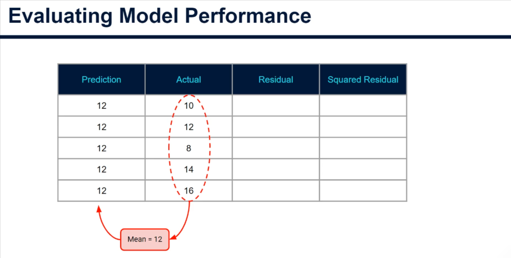
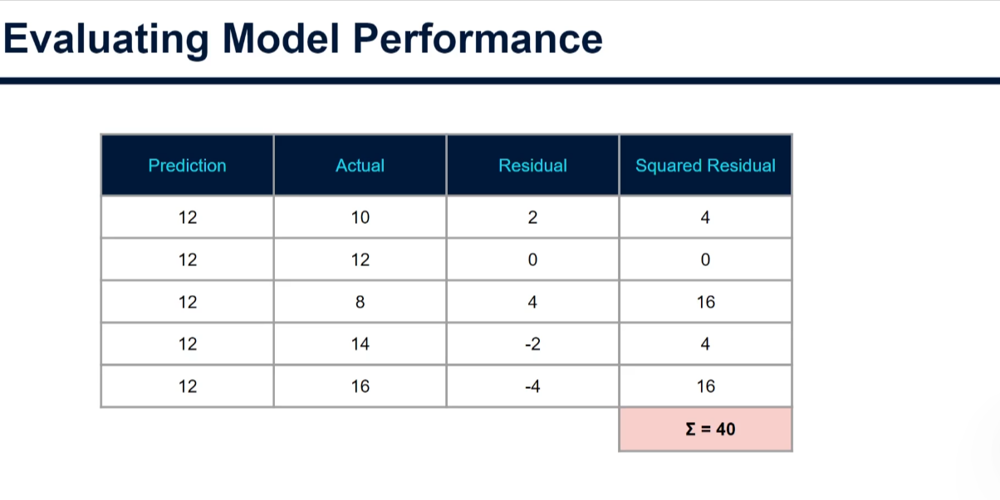
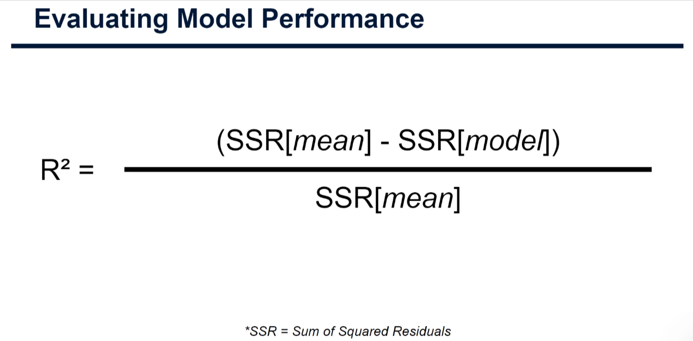
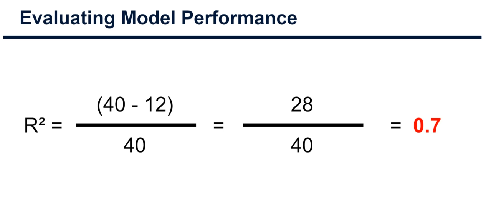

# Evaluating Model Performance

For regression models, **R² (the coefficient of determination)** describes how much better the model predicts the output than a simple baseline that always predicts the mean of the actual outputs. It is often expressed as the percentage of variance in the output variable \(y\) explained by the input variables \(x\).

## Comparing model predictions with actual values

Suppose we train a decision tree on ten data points and evaluate it on five held-out test points. Since this is supervised learning, the actual output for each test point is known. We compare those actual values with the model's predictions.

A **residual** is the prediction error for one data point: the predicted value minus the actual value. It tells us both how far off the prediction was and which direction it missed:

- If a model predicts a house will cost \$205,000 when its actual price is \$200,000, the residual is \(205{,}000 - 200{,}000 = 5{,}000\). The positive residual means the model overpredicted by \$5,000.
- If it predicts \$195,000 for a house that actually costs \$200,000, the residual is \(195{,}000 - 200{,}000 = -5{,}000\). The negative residual means it underpredicted by \$5,000.
- If it predicts exactly \$200,000, the residual is \(0\): the prediction was correct.

Residuals are not the original values; they are the errors left over after making predictions. In this regression-evaluation example, **residual** means prediction error. The related term **residual learning** is different: it describes a method where a model is trained to predict or correct errors made by an earlier prediction.

Here, residuals are calculated as prediction minus actual. Squaring each residual removes its sign, so overpredictions and underpredictions do not cancel one another out. Adding the squared residuals gives the model's **sum of squared residuals (SSR)**.

The example's five actual output values are 10, 12, 8, 14, and 16:

The decision tree's predictions for those examples are 10, 12, 10, 12, and 14:

For example, when the prediction is 10 and the actual value is 8, the residual is \(10 - 8 = 2\), and its squared residual is \(2^2 = 4\). When the prediction is 10 and the actual value is 12, the residual is \(10 - 12 = -2\), and its squared residual is also \((-2)^2 = 4\). Do this for each test point and add the squared residuals. For this model, \(SSR_{\text{model}} = 12\).

## Comparing against the mean baseline

To measure improvement, compare the model with a baseline that predicts the mean of the actual test outputs for every example. Their mean is 12, so the baseline prediction is 12 for all five test points.

Applying the same residual and squared-residual calculation to this baseline gives \(SSR_{\text{mean}} = 40\).

## Calculating R²

R² is the reduction in squared error relative to the mean baseline:

$$
R^2 = \frac{SSR_{\text{mean}} - SSR_{\text{model}}}{SSR_{\text{mean}}}
$$

For this example:

$$
R^2 = \frac{40 - 12}{40} = \frac{28}{40} = 0.7
$$

The model reduces the baseline's sum of squared errors by 70%, so its R² is **0.7**. This is a useful measure of fit, though it does not by itself tell us whether predictions are appropriate for a particular application.

