# Splitting Criteria in Regression Decision Trees

## Recap: Lucy's Lemonade Stand

Lucy wants to know how many lemons she needs each day, based on historical data with two inputs:

- Daily peak temperature (°C)
- Whether it was raining (yes/no)

The tree starts with all the data. The algorithm tests every possible split on each input variable, assesses how much the output variable differs at each split point, and selects the split where that difference is most pronounced.

For Lucy, the biggest difference in lemons used was a split on daily peak temperature at 20 °C. On days above 20 °C, lemons used was significantly higher than on days at or below 20 °C. That split beat every other candidate, so it became the first split.

**How does it decide that one split is better than the others?** There is no single rule, but for regression trees the most common metric is **Mean Squared Error (MSE)**.

## Mean Squared Error (MSE)

MSE = (1/N) · Σ (yᵢ − ŷᵢ)², summed from i = 1 to N.

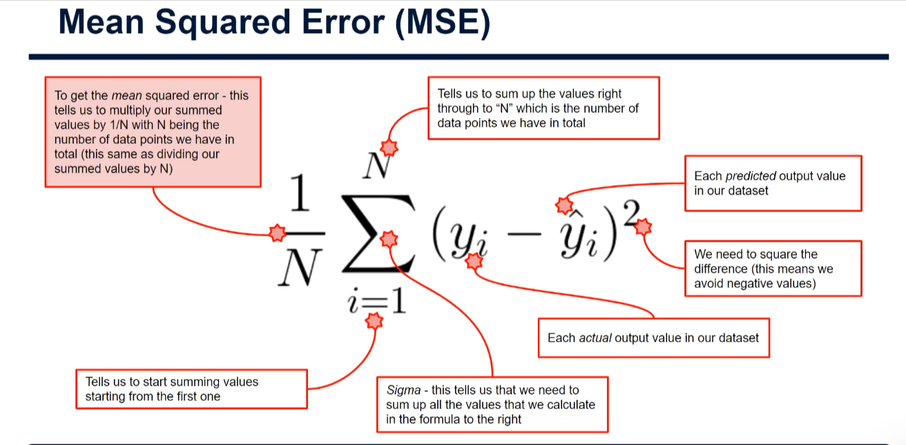

Reading it right to left:

- **yᵢ**: the actual output for each data point (actual lemons used that day).
- **ŷᵢ** ("y hat"): the predicted output for each data point, i.e. the value of the leaf node the data point falls into.
- **(yᵢ − ŷᵢ)**: the prediction error, how far the prediction was from the actual value.
- **² (squared)**: guarantees every error is positive. Without squaring, over-predictions and under-predictions would cancel out. For example, errors of −5, −5, +5, +5 would sum to 0 even though every prediction was wrong. We only care about how far out we were, not the direction.
- **Σ (sigma)**: sum all the squared errors.
- **i = 1 to N**: start from the first data point and continue to N, the total number of data points.
- **1/N**: multiplying by 1/N is the same as dividing by N, which turns the total into a mean.

## Worked Example

To keep it simple, use one input (daily peak temperature) and only four days of data. (This mini dataset is only for illustration, not a real model.)

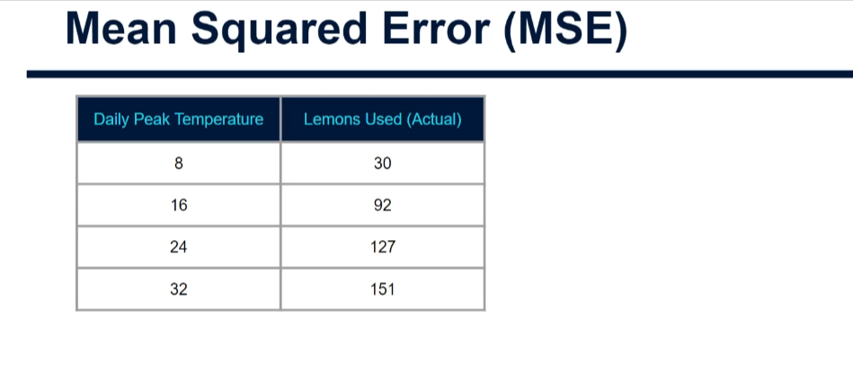

| Daily Peak Temp (°C) | Lemons Used (Actual) |
|---|---|
| 8 | 30 |
| 16 | 92 |
| 24 | 127 |
| 32 | 151 |

The model tests every possible split point. The root node's average is 100 lemons.

### Split 1: temperature ≤ 8 vs > 8

The right bucket (≤ 8) holds one data point, so its average is simply 30.

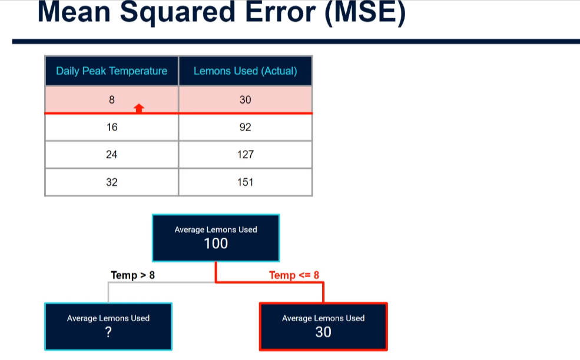

The left bucket (> 8) holds the three highlighted rows. The average of 92, 127 and 151 is 123.

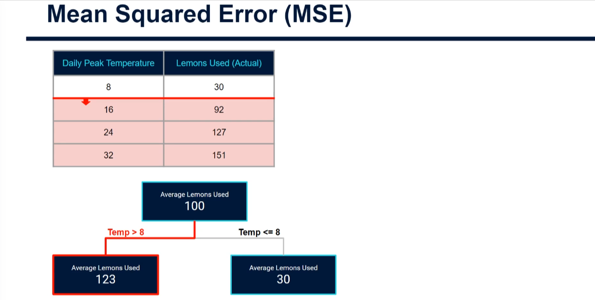

Next, add the predicted values and the error (actual − predicted):

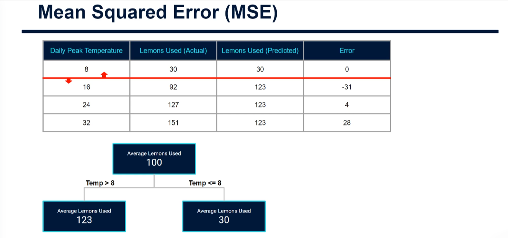

- 30 − 30 = 0
- 92 − 123 = −31
- 127 − 123 = 4
- 151 − 123 = 28

Then square each error: 0, 961, 16 and 784.

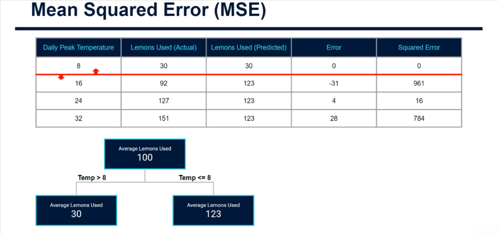

Sum the squared errors: Σ = 1761.

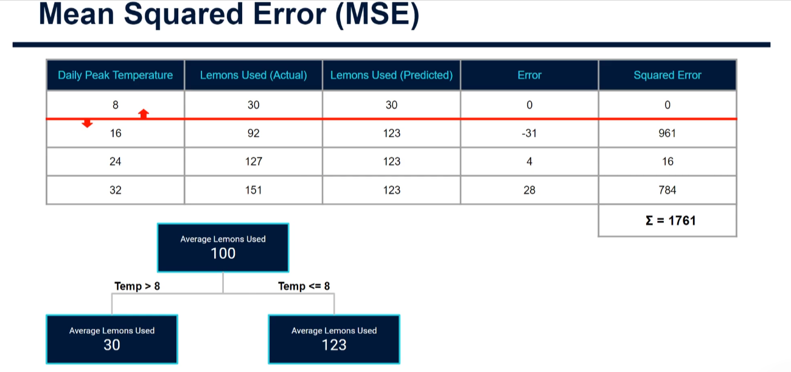

Divide by N = 4: 1761 / 4 ≈ **440 MSE**.

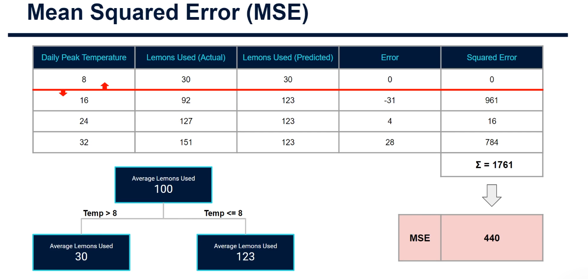

### Split 2: temperature ≤ 16 vs > 16

Two data points land in each bucket. The averages are 61 (the mean of 30 and 92) and 139 (the mean of 127 and 151).

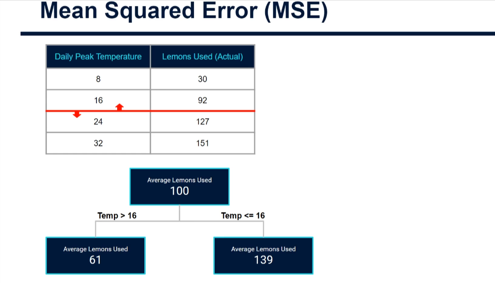

The same process gives Σ = 2210, so **MSE = 553**. This is higher than the split at 8, so it is worse (MSE is an error score).

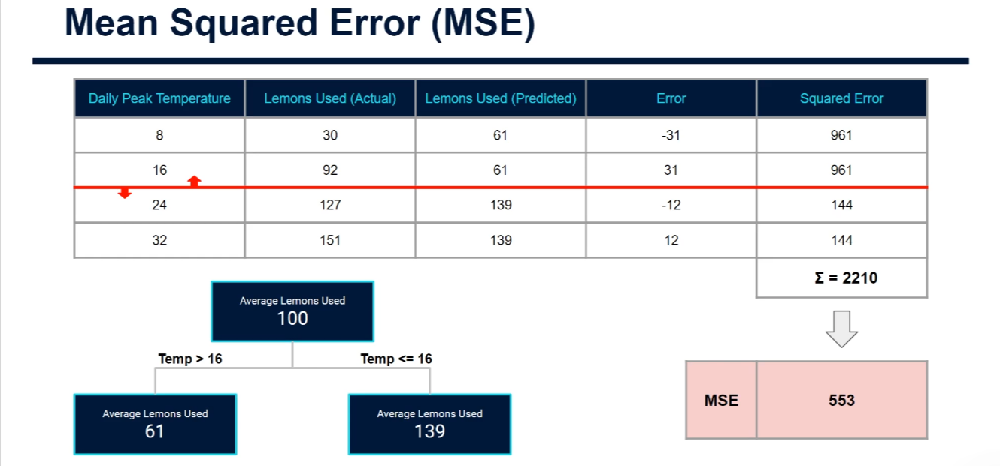

### Split 3: temperature ≤ 24 vs > 24

Σ = 4826, so **MSE = 1,027**. This is the highest of the three splits.

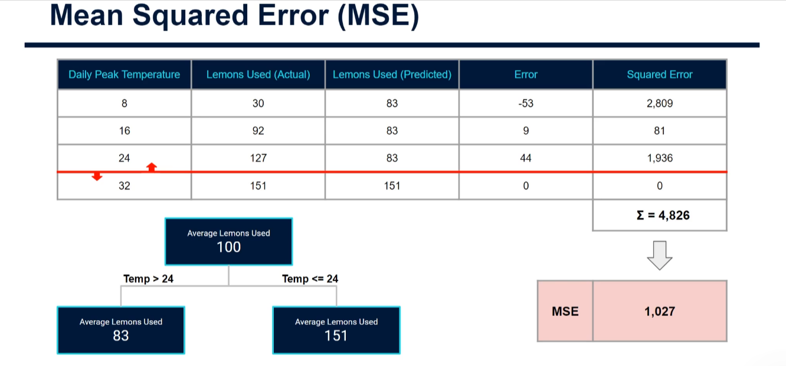

### Comparing the splits

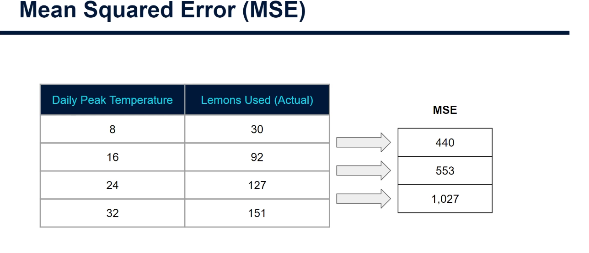

| Split point | MSE |
|---|---|
| 8 °C | **440** (best) |
| 16 °C | 553 |
| 24 °C | 1,027 |

The split at 8 °C gives the smallest error between predicted and actual lemons used, so it becomes the tree's first split.

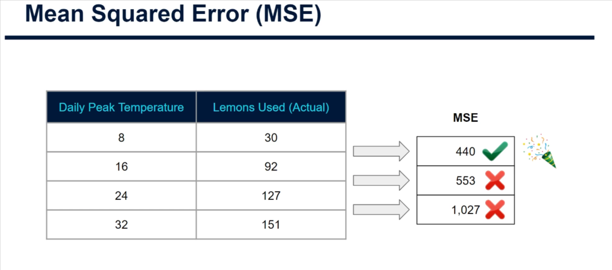

### Continuing the process

The algorithm repeats the same process on each resulting bucket. In this mini example the right bucket (≤ 8) has no further splits available. The left bucket (> 8) could split again, for example at 24 °C, which would give three leaf nodes (the MSE calculations would confirm whether that is chosen).

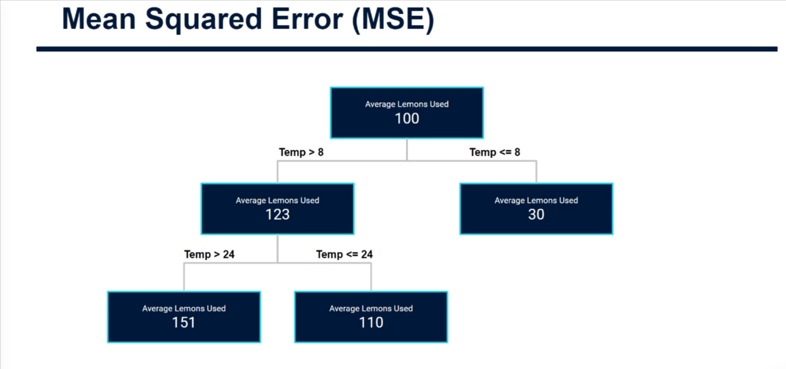

> **Note:** the slide shows 1,027 for the 24 °C split, but 4,826 ÷ 4 = 1,206.5. The slide's figure looks like a typo. The conclusion is unchanged: 8 °C is still the best split.

## Code Sample 1: Calculating the MSE of each split by hand

```python
import numpy as np

temps = np.array([8, 16, 24, 32])
lemons = np.array([30, 92, 127, 151])

for split in [8, 16, 24]:
    left = lemons[temps <= split]
    right = lemons[temps > split]
    predictions = np.where(temps <= split, left.mean(), right.mean())
    mse = np.mean((lemons - predictions) ** 2)
    print(f"Split at {split}: MSE = {mse:.1f}")
```

Output:

```text
Split at 8: MSE = 440.2
Split at 16: MSE = 552.5
Split at 24: MSE = 1206.5
```

What each line does:

- `import numpy as np`: loads NumPy, a library for working with lists of numbers quickly. `as np` is a short nickname so we can type `np` instead of `numpy`.
- `temps = np.array([8, 16, 24, 32])`: stores the four daily peak temperatures in a NumPy array (a list of numbers we can do maths on all at once).
- `lemons = np.array([30, 92, 127, 151])`: stores the actual lemons used on each of those days. Position matters: 8 °C goes with 30 lemons, 16 °C with 92, and so on.
- `for split in [8, 16, 24]:`: starts a loop that tries each candidate split point in turn. Each time round, `split` holds the next value. We skip 32 because nothing is above it, so it can't divide the data.
- `left = lemons[temps <= split]`: `temps <= split` gives True/False for each day. Using that to index `lemons` keeps only the lemon counts for days at or below the split (the "≤" bucket).
- `right = lemons[temps > split]`: the same, but for days above the split.
- `predictions = np.where(temps <= split, left.mean(), right.mean())`: this gives each day its predicted value. A day at or below the split gets the average of the `left` bucket. Every other day gets the average of the `right` bucket. This is exactly how a leaf node predicts.
- `mse = np.mean((lemons - predictions) ** 2)`: the MSE formula in one line. `lemons - predictions` is the error for each day. `** 2` squares each error. `np.mean(...)` adds them up and divides by how many there are.
- `print(f"Split at {split}: MSE = {mse:.1f}")`: shows the result. The `f` before the quotes lets us put variables inside `{}`, and `:.1f` rounds to one decimal place.

The smallest MSE (split at 8) wins, matching the worked example above.

## Code Sample 2: Letting scikit-learn choose the split

```python
import numpy as np
from sklearn.tree import DecisionTreeRegressor, export_text

X = np.array([8, 16, 24, 32]).reshape(-1, 1)
y = np.array([30, 92, 127, 151])

model = DecisionTreeRegressor(criterion="squared_error", max_depth=1, random_state=42)
model.fit(X, y)

print(export_text(model, feature_names=["temp"]))
print(model.predict([[20]]))
```

Output:

```text
|--- temp <= 12.00
|   |--- value: [30.00]
|--- temp >  12.00
|   |--- value: [123.33]

[123.33333333]
```

What each line does:

- `import numpy as np`: loads NumPy (see above).
- `from sklearn.tree import DecisionTreeRegressor, export_text`: loads two tools from scikit-learn. `DecisionTreeRegressor` is the regression tree model. `export_text` prints a tree as readable text.
- `X = np.array([8, 16, 24, 32]).reshape(-1, 1)`: the input data (temperatures). scikit-learn expects inputs as a table with one row per day and one column per input variable. `.reshape(-1, 1)` turns our flat list into a single column; `-1` means "work out the number of rows for me".
- `y = np.array([30, 92, 127, 151])`: the output we want to predict (lemons used). By convention, capital `X` is the inputs and lowercase `y` is the outputs.
- `model = DecisionTreeRegressor(criterion="squared_error", max_depth=1, random_state=42)`: creates an untrained tree. `criterion="squared_error"` tells it to judge splits using MSE, which is the default. `max_depth=1` allows only one split so we can see the first one. `random_state=42` makes results repeatable.
- `model.fit(X, y)`: trains the model. Here it tries every split, calculates the MSE for each and keeps the best.
- `print(export_text(model, feature_names=["temp"]))`: prints the learned tree. `feature_names` labels our one input column "temp".
- `print(model.predict([[20]]))`: asks for a prediction for a 20 °C day. The double brackets are needed because the input must be a table (one row, one column).

The tree splits at 12 °C, not 8 °C. scikit-learn places the threshold halfway between neighbouring values (between 8 and 16). It is the same split: 8 on one side and 16, 24, 32 on the other.

## Summary

- The example used only 4 data points. A real regression tree would have many more data points and input variables, and so many more candidate splits.
- The process is exactly the same: for every candidate split, compute the MSE and choose the split with the lowest one.
