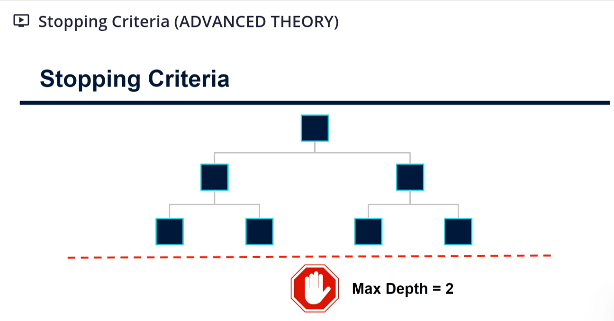
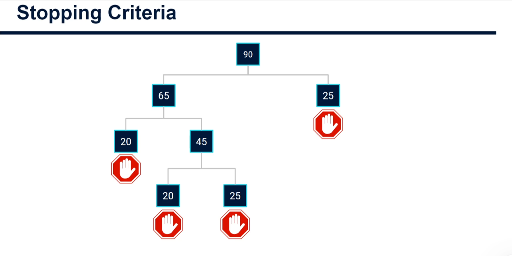

# Stopping Criteria in Regression Decision Trees (Advanced Theory)

## Why we need stopping criteria

Left alone, the decision tree algorithm keeps splitting until:

- there is only one data point in each leaf node, or
- it cannot find a split that reduces the splitting criterion (e.g. mean squared error), or
- it is told to stop.

We want to stop the tree going too deep because deep trees often **overfit**. The model finds the exact rules that apply to the training data, and when it is applied to new data it naively assumes the new data will fit those same patterns. Overfitting is a big problem in machine learning, so we control it with stopping criteria. Which ones to use depends on the scenario.

## 1. Maximum depth

Specifies a depth threshold. Once it is reached, no further splitting is allowed.



With `max_depth = 2`, the tree can split once (depth 1) and split again (depth 2), but no further.

Note: a maximum depth is only an upper limit. If the tree cannot find splits that reduce the splitting metric, it may stop earlier. A max depth of 2 does not guarantee four leaf nodes.

## 2. Minimum number of data points to split a node

Set a threshold on the minimum number of data points a node must contain before it is allowed to split.

Example: never allow a node to split if it has fewer than 30 data points, starting with 90 data points.



- The root node (90) is allowed to split. It sends 65 data points one way and 25 the other.
- The node with 25 is below the threshold, so it becomes a leaf node.
- The node with 65 can still split. It sends 20 one way and 45 the other. The 20 node becomes a leaf.
- The node with 45 can still split. It splits into 20 and 25. Both are below 30, so both become leaf nodes.
- No nodes can split any further, so the tree is complete.

## 3. Minimum number of data points in each child (leaf) bucket

A similar approach is to set a minimum number of data points that must exist in both the left and right buckets when a split happens.

This ensures any split is somewhat balanced, rather than heavily biased towards one side.

## In scikit-learn

Stopping criteria are passed as parameters when instantiating the regression tree model object:

- `max_depth`: maximum depth of the tree.
- `min_samples_split`: minimum data points a node needs to be allowed to split.
- `min_samples_leaf`: minimum data points required in each leaf after a split.

## Code Sample

```python
import numpy as np
from sklearn.tree import DecisionTreeRegressor

rng = np.random.default_rng(42)
X = rng.uniform(0, 40, size=(90, 1))
y = 4 * X[:, 0] + rng.normal(0, 10, size=90)

settings = [
    {},
    {"max_depth": 2},
    {"min_samples_split": 30},
    {"min_samples_leaf": 10},
]

for params in settings:
    model = DecisionTreeRegressor(random_state=42, **params)
    model.fit(X, y)
    print(params, "-> depth:", model.get_depth(), "leaves:", model.get_n_leaves())
```

Output:

```text
{} -> depth: 10 leaves: 90
{'max_depth': 2} -> depth: 2 leaves: 4
{'min_samples_split': 30} -> depth: 2 leaves: 4
{'min_samples_leaf': 10} -> depth: 3 leaves: 8
```

What each line does:

- `import numpy as np`: loads NumPy, a library for working with numbers. `np` is its nickname.
- `from sklearn.tree import DecisionTreeRegressor`: loads the regression tree model from scikit-learn.
- `rng = np.random.default_rng(42)`: creates a random number generator. The `42` is a seed, so you get the same "random" numbers every time you run the code.
- `X = rng.uniform(0, 40, size=(90, 1))`: makes 90 fake temperatures between 0 and 40, as a table with 90 rows and 1 column. This matches the 90 data points in the example above.
- `y = 4 * X[:, 0] + rng.normal(0, 10, size=90)`: makes fake lemon counts. Each is 4 times the temperature (`X[:, 0]` means "all rows of the first column"), plus some random noise (`rng.normal`) so the data isn't perfectly neat, like real data.
- `settings = [...]`: a list of different stopping rules to compare. Each `{...}` is a dictionary of parameter names and values. `{}` is empty, meaning no stopping rules.
- `for params in settings:`: loops over each set of rules in turn.
- `model = DecisionTreeRegressor(random_state=42, **params)`: creates a new untrained tree. `**params` unpacks the dictionary into named arguments, so `{"max_depth": 2}` becomes `max_depth=2`.
- `model.fit(X, y)`: trains the tree on the data, obeying the stopping rules.
- `print(params, "-> depth:", model.get_depth(), "leaves:", model.get_n_leaves())`: shows the rules used, how deep the tree grew (`get_depth()`) and how many leaf nodes it ended with (`get_n_leaves()`).

How to read the results:

- With **no rules**, the tree grows to depth 10 with 90 leaves, one for each data point. This is classic overfitting: it has memorised the training data.
- `max_depth=2` stops the tree at 2 levels, giving at most 4 leaves.
- `min_samples_split=30` stops any node with fewer than 30 data points from splitting, as in the 90-point example above.
- `min_samples_leaf=10` means a split is only allowed if both resulting buckets keep at least 10 data points, which keeps splits balanced.
