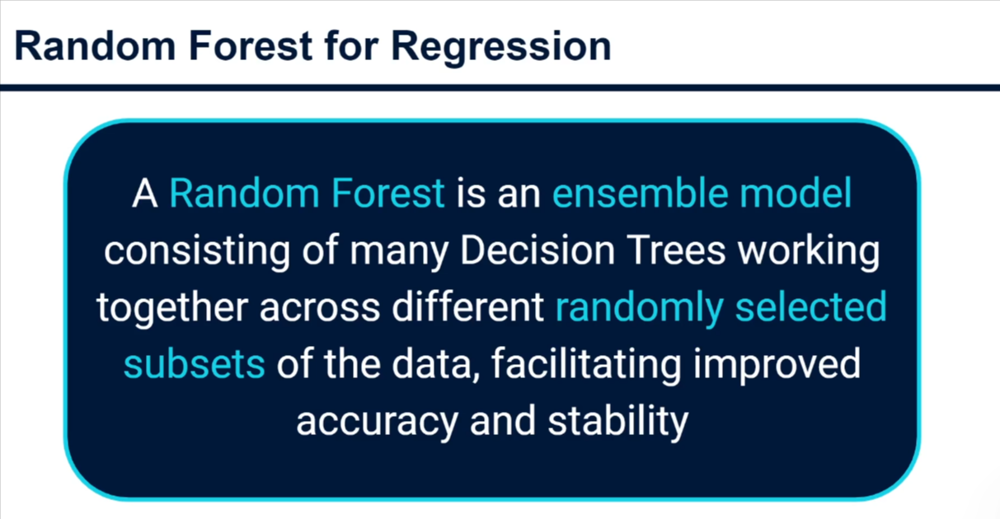
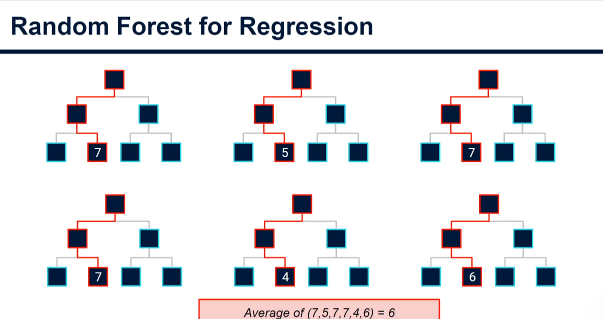
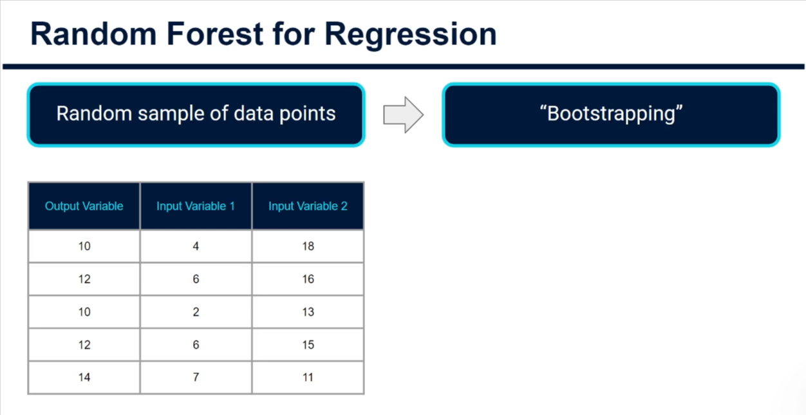
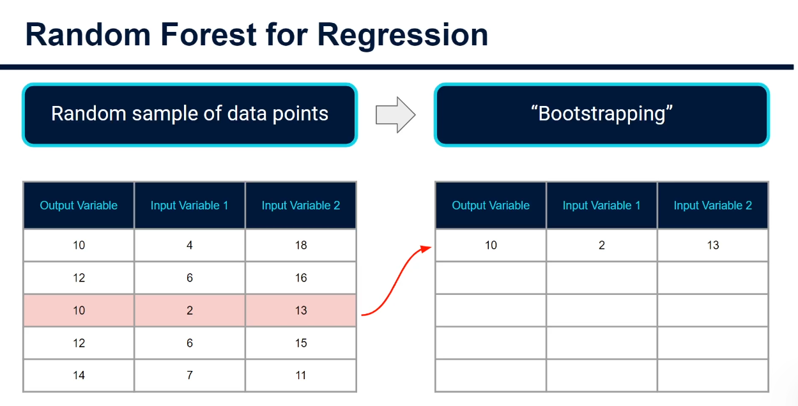
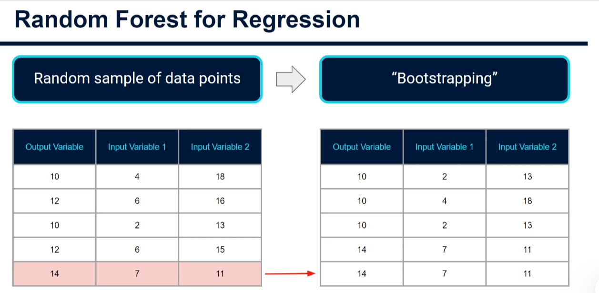
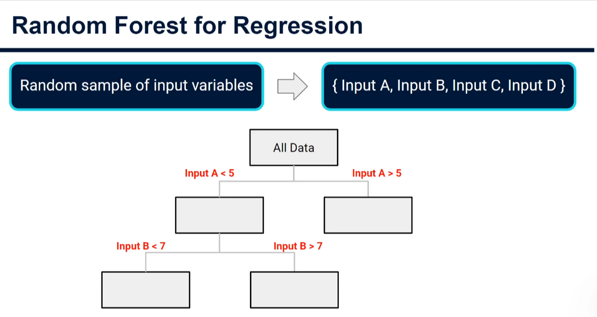
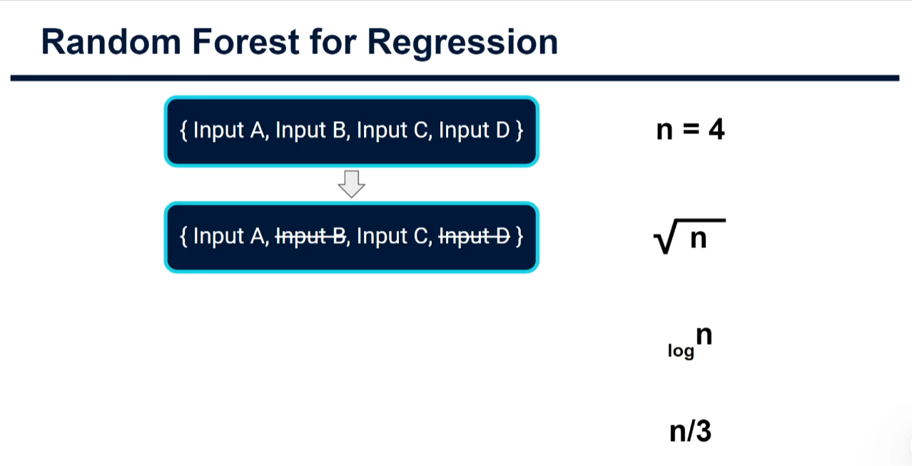

# Random Forests for Regression

Random forests are one of the most commonly used and powerful machine learning approaches. They frequently give very good prediction accuracy and are renowned for their robustness, meaning they need very little tuning to work well.

Plan for this section:

1. Intro/theory (this note): the high-level intuition.
2. Python: a basic template for coding up a model and assessing its accuracy.
3. Theory: what is going on under the hood.
4. Python: an advanced version of the model.

## What is a random forest?

- A random forest is an **ensemble model**: a model made up of a number of other models, which combines their predictions into one overall prediction.
- In a random forest the models are the same **decision trees** learned in the previous tutorials. Instead of training one tree, we train many at once (tens, hundreds or even thousands).

## How the prediction is made

- A single tree gives one prediction for a set of input values (e.g. 7).
- In a forest, each tree gives its own prediction, and the **average** of these is the final prediction.
- Why do the trees differ? Because of the randomness in the forest, which comes in two forms:
  1. Each tree is built from a random sample of the data points.
  2. Each split is only offered a random sample of the input variables.

## Randomness 1: random sample of data points (bootstrapping)

Bootstrapping is a sampling method that iteratively **resamples data with replacement**. The aim is to build a new dataset of the same size as the original by randomly selecting rows.

- Each iteration randomly picks a row and adds it to the bootstrap dataset.
- "With replacement" means a selected row stays available and can be picked again, so the same row can appear more than once.

- In the example, the final bootstrap dataset contains rows (10,2,13) and (14,7,11) twice, and leaves some original rows out entirely.
- This is repeated for every tree in the forest, so each tree is trained on a similar but slightly different dataset.

## Randomness 2: random sample of input variables

- A normal regression tree considers all input variables (A, B, C, D) at every split and picks the best split point by mean squared error.
- In a random forest, each split only considers a **random subset** of the input variables (e.g. only A and C at the first split, then A and B at the next). The best split is chosen from those only.
- This seems like it would hurt performance, but that is the point: trees are forced to predict the output in different ways, and averaging hundreds or thousands of them gives a really strong overall prediction.

### How many input variables per split?

- Common rules of thumb for the subset size (n = number of input variables): **√n**, **log n**, or **n/3**.
- With n = 4, the square root gives 2, so two variables are used for each split.
- Note: scikit-learn's default is to use **all** variables rather than a random subset, but this is easy to change.

## Recap and other notes

- A random forest is an ensemble of many decision trees, working across randomly selected subsets of the data and using a randomly selected set of input variables at each split.
- In practice every tree looks quite different, with a different structure, so the same input values flow down each tree differently.
- We generally don't need to worry much about stopping conditions on each tree (as we did for a single decision tree), because each tree is already limited in the input variables it can use.

## Analogy: guessing jelly beans

In a competition to guess the number of jelly beans in a jar, your guess is likely too high or too low, as are everyone else's. But the **average** of all the guesses is likely to be pretty close to the correct amount. Ensemble models work the same way: many weaker models combine into one stronger model.

Next: coding a basic random forest for regression with scikit-learn.
