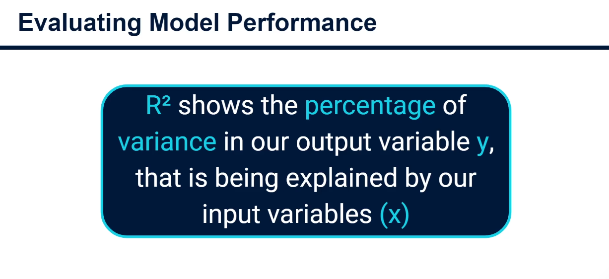
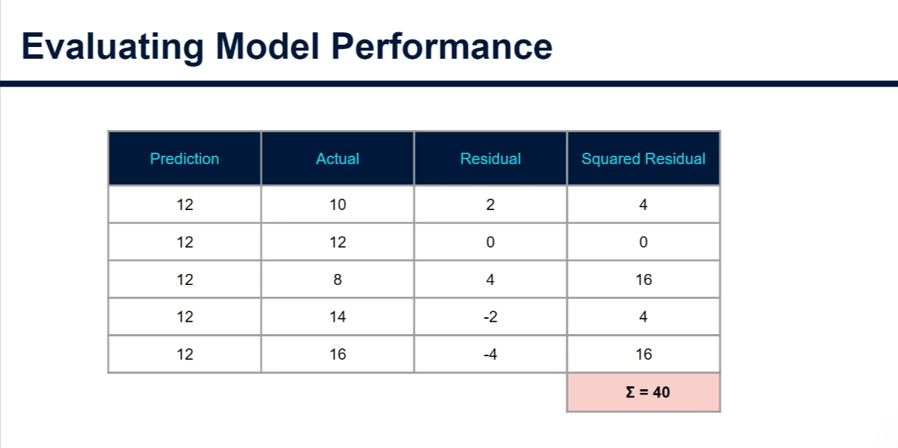

# Evaluating Model Performance: Random Forest for Regression

## 1. The main metric: R²

Just like in linear regression and decision trees for regression, the main metric for judging how well a random forest fits the data is **R² (R-squared)**, also called the *coefficient of determination*.



> **R² shows the percentage of variance in the output variable (y) that is explained by the input variables (x).**

In plain words: *how much better is our model than doing nothing clever?* An R² of 0.70 means the input variables explain 70% of the ups and downs in the output. The other 30% is unexplained (noise or missing information).

---

## 2. Worked example (by hand)

Imagine a tiny dataset: **10 training points** and **5 test (validation) points**. Real projects use far more data; this is just to show the intuition.

### Step 1: Train and predict

1. Train the random forest on the 10 training points. It learns the mapping from inputs to output.
2. Predict the output for the 5 test points.
3. Compare predictions with the actual values.

### Step 2: Residuals and the sum of squared residuals (model)

- **Residual** = predicted − actual (the error).
- Residuals can be positive or negative and would cancel each other out, so we **square** them.
- Add them up: the **sum of squared residuals (SSR)**.

In our example the model's SSR is **12**.

### Step 3: The baseline, "just predict the mean"

Now ignore the model. Predict the **mean of the actual outputs** for every row. Here the mean is **12**.



| Prediction (mean) | Actual | Residual | Squared residual |
|---|---|---|---|
| 12 | 10 | 2 | 4 |
| 12 | 12 | 0 | 0 |
| 12 | 8 | 4 | 16 |
| 12 | 14 | -2 | 4 |
| 12 | 16 | -4 | 16 |
| | | **Σ** | **40** |

The baseline sum of squared residuals is **40**. This is the total variance in the output.

### Step 4: Compute R²

```
R² = (SSR_mean − SSR_model) / SSR_mean
```

Plug in the numbers:

```
R² = (40 − 12) / 40 = 28 / 40 = 0.7  →  70%
```

**Interpretation:** the input variables explain **70%** of the variance in the output. The remaining **30%** is unexplained.

(Equivalent common form: `R² = 1 − SSR_model / SSR_mean = 1 − 12/40 = 0.7`.)

---

## 3. How to read R² values

| R² | Meaning |
|---|---|
| 1.0 | Perfect predictions |
| close to 1 | Very good fit |
| 0 | No better than always predicting the mean |
| negative | Worse than predicting the mean (on test data this can happen) |

Always compute R² on the **test set** (data the model hasn't seen). A high R² on training data but low on test data means **overfitting**.

---

## 4. Practical example in Python (beginner friendly)

We reuse the California housing dataset from the feature importance notes.

### 4.1 Load and split the data

```python
import numpy as np                      # numbers and arrays
import pandas as pd                     # tables
import matplotlib.pyplot as plt         # charts

from sklearn.datasets import fetch_california_housing    # practice dataset
from sklearn.model_selection import train_test_split     # split data
from sklearn.ensemble import RandomForestRegressor       # the model
from sklearn.metrics import r2_score, mean_squared_error, mean_absolute_error

# Load data: X = inputs, y = output (median house value)
housing = fetch_california_housing(as_frame=True)
X, y = housing.data, housing.target

# 80% to train, 20% to test; random_state makes the split repeatable
X_train, X_test, y_train, y_test = train_test_split(
    X, y, test_size=0.2, random_state=42
)
```

### 4.2 Train the model and predict

```python
model = RandomForestRegressor(
    n_estimators=100,  # 100 trees
    random_state=42,   # repeatable randomness
    n_jobs=-1,         # use all CPU cores
)
model.fit(X_train, y_train)          # learn from the training data

y_pred = model.predict(X_test)       # predict outputs for unseen test rows
```

### 4.3 Calculate R² by hand (same steps as the example above)

```python
# Residuals = prediction - actual
residuals = y_pred - y_test

# Sum of squared residuals for the model
ssr_model = np.sum(residuals ** 2)

# Baseline: always predict the mean of the actual test values
ssr_mean = np.sum((y_test - y_test.mean()) ** 2)

# R² = (baseline error - model error) / baseline error
r2_manual = (ssr_mean - ssr_model) / ssr_mean

print("SSR (model):", round(ssr_model, 2))
print("SSR (mean): ", round(ssr_mean, 2))
print("R² (manual):", round(r2_manual, 4))
```

### 4.4 Check with scikit-learn

```python
# r2_score does the same calculation for us; the two numbers should match
print("R² (sklearn):", round(r2_score(y_test, y_pred), 4))

# model.score() also returns R² for regression models
print("R² (model.score):", round(model.score(X_test, y_test), 4))
```

### 4.5 Other useful error metrics

```python
# MSE: average squared error (penalizes big mistakes heavily)
mse = mean_squared_error(y_test, y_pred)

# RMSE: square root of MSE, in the same units as the output
rmse = np.sqrt(mse)

# MAE: average absolute error, easiest to explain to non-technical people
mae = mean_absolute_error(y_test, y_pred)

print(f"MSE : {mse:.3f}")
print(f"RMSE: {rmse:.3f}  (typical error size, in units of y)")
print(f"MAE : {mae:.3f}")
```

R² tells you the *proportion* of variance explained; RMSE and MAE tell you the *size* of the errors in real units.

### 4.6 Spot overfitting: training vs test R²

```python
train_r2 = model.score(X_train, y_train)   # score on data the model learned from
test_r2 = model.score(X_test, y_test)      # score on unseen data

print(f"Train R²: {train_r2:.3f}")
print(f"Test R² : {test_r2:.3f}")
# A big gap (e.g. 0.97 vs 0.80) means the model memorized the training data
```

### 4.7 Out-of-bag (OOB) score: a free validation

Each tree never sees about a third of the rows (its out-of-bag rows, see the feature importance notes). We can score the forest using only those rows.

```python
oob_model = RandomForestRegressor(
    n_estimators=100,
    oob_score=True,    # compute the OOB R² during training
    random_state=42,
    n_jobs=-1,
)
oob_model.fit(X_train, y_train)

# R² estimated from OOB rows; usually close to the test R²
print("OOB R²:", round(oob_model.oob_score_, 3))
```

### 4.8 Visualize: predicted vs actual

```python
plt.figure(figsize=(6, 6))
plt.scatter(y_test, y_pred, alpha=0.3)            # each dot is one test row

# Diagonal line = perfect predictions
lims = [y_test.min(), y_test.max()]
plt.plot(lims, lims, color="red", linestyle="--")

plt.xlabel("Actual value")
plt.ylabel("Predicted value")
plt.title(f"Predicted vs actual (R² = {r2_score(y_test, y_pred):.2f})")
plt.show()
```

The closer the dots hug the red line, the higher the R².

---

## 5. Key takeaways

1. **R² = (SSR_mean − SSR_model) / SSR_mean**, the share of output variance explained by the inputs.
2. In the example: (40 − 12) / 40 = **0.70**, so 70% of the variance is explained.
3. Residual = prediction − actual; we square them so positives and negatives don't cancel.
4. Always evaluate on **test data** (or OOB rows) and compare with training R² to detect overfitting.
5. Pair R² with **RMSE / MAE** to understand error size in real units.
6. Next step: use feature importance (see [Feature_Importance.md](./Feature_Importance.md)) to see *which* inputs drive that R².
