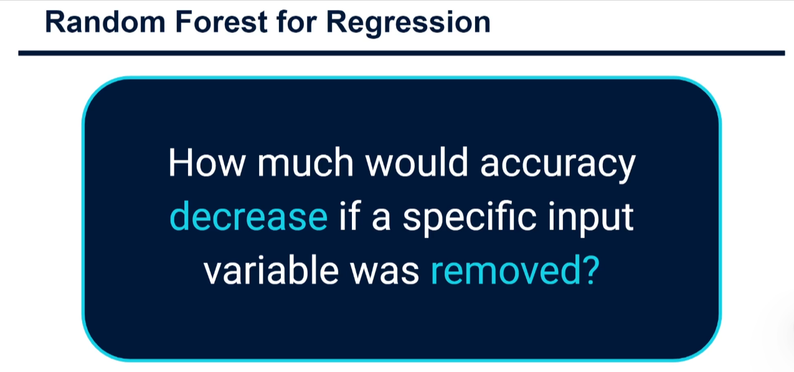
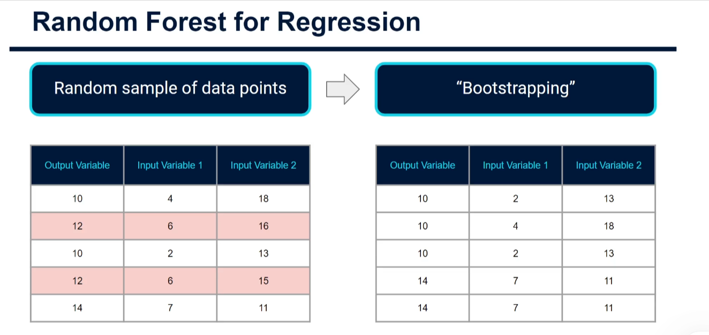
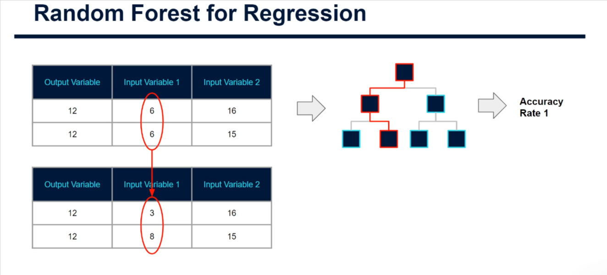

# Feature Importance in Random Forest for Regression

## 1. What is feature importance?

A random forest is an **ensemble** of many decision trees. Each tree is different because:

- it is trained on a random sample of the rows (**bootstrapping**), and
- at each split it can only choose from a random subset of the input variables.

Because of this randomness, some variables are "held back" in some trees. That lets us compare how good the model is **with** a variable and **without** it. This gives us **feature importance**: a score telling us how much each input variable helps the model predict the output.



> **The core question:** *How much would accuracy decrease if a specific input variable was removed (or randomized)?*

- **Large drop in accuracy** → the variable is **important**.
- **Small drop in accuracy** → the variable is **less important**.

Why care? Random forests are powerful but hard to interpret (unlike a single decision tree). Feature importance helps you **explain the model to stakeholders**, and is also widely used for **feature selection** (keep the useful variables, drop the rest, then train other models).

There are two common ways to measure it.

---

## 2. Method 1: Impurity-based importance (improvement in MSE)

1. Find every node in every tree where a given variable (e.g. *Input Variable 1*) was used to split the data.
2. At each of those nodes, compare the **mean squared error (MSE) before the split** with the MSE **after the split**. The reduction is the improvement.
3. Average (sum) these improvements across the whole forest.
4. Repeat for every variable and compare the scores.

A variable that produces large MSE reductions is adding a lot of predictive power.

**Caveat:** this method can *inflate* the importance of numerical features with many unique values (they offer more possible split points). That's why Method 2 is often preferred. In scikit-learn this is `model.feature_importances_`.

---

## 3. Method 2: Permutation importance (using out-of-bag rows)

### Step A: Bootstrapping and out-of-bag (OOB) rows

For each tree we randomly pick rows **with replacement**, so the same row can appear more than once, and some rows are never picked.



In the picture, the original sample (left) became the bootstrap sample (right). The rows `12 | 6 | 16` and `12 | 6 | 15` (highlighted) were **not selected** and the row `14 | 7 | 11` was selected twice. The rows not selected are called **out-of-bag (OOB) rows**. The tree has never seen them, so they work as a free test set for that tree.

### Step B: Score the tree, then shuffle one column

1. Pass the OOB rows through the tree and compute an accuracy score (for regression: MSE or R²). Call it **Accuracy Rate 1**.
2. **Randomize (shuffle) the values of one column**, e.g. Input Variable 1. This destroys any relationship between that variable and the output.
3. Pass the modified rows through the same tree and compute a new score.



In the picture the values `6, 6` of *Input Variable 1* were replaced by `3, 8`, while everything else stayed the same. The tree is then scored again.

### Step C: Importance = drop in performance

```
importance(variable) = original score − score after shuffling that variable
```

Repeat for every variable and every tree, then average. A big drop means the model relied heavily on that variable. This is called **permutation importance**.

---

## 4. Summary table

| | Impurity-based (MSE improvement) | Permutation importance |
|---|---|---|
| Idea | How much do splits on the variable reduce error? | How much does the score drop when the variable is shuffled? |
| Computed from | Training process (inside the trees) | Scoring data (OOB or a test set) |
| Speed | Very fast (free after training) | Slower (needs re-scoring) |
| Weakness | Biased towards numeric / high-cardinality features | Correlated features can share/hide importance |
| scikit-learn | `model.feature_importances_` | `sklearn.inspection.permutation_importance` |

In practice both usually give **very similar rankings**.

---

## 5. Practical example in Python (beginner friendly)

We use scikit-learn's built-in **California housing** dataset: predict the median house value from features such as income, house age and location. (The first run downloads the dataset.)

Install the libraries once:

```bash
pip install scikit-learn pandas matplotlib
```

### 5.1 Load the data

```python
# pandas: table (DataFrame) handling; matplotlib: charts
import pandas as pd
import matplotlib.pyplot as plt

# fetch_california_housing: built-in practice dataset
from sklearn.datasets import fetch_california_housing
# train_test_split: splits data into training and testing parts
from sklearn.model_selection import train_test_split
# RandomForestRegressor: the model
from sklearn.ensemble import RandomForestRegressor
# permutation_importance: Method 2
from sklearn.inspection import permutation_importance

# Load the dataset as a pandas DataFrame
housing = fetch_california_housing(as_frame=True)

# X = input variables (features); y = output variable (what we predict)
X = housing.data
y = housing.target

# Peek at the first 5 rows to understand the data
print(X.head())
```

### 5.2 Split into training and test sets

```python
# Keep 20% of the data hidden from the model so we can test it fairly.
# random_state makes the split the same every run (reproducible).
X_train, X_test, y_train, y_test = train_test_split(
    X, y, test_size=0.2, random_state=42
)
```

### 5.3 Train the random forest

```python
model = RandomForestRegressor(
    n_estimators=100,  # number of decision trees in the forest
    random_state=42,   # reproducible randomness
    oob_score=True,    # also score the model using out-of-bag rows
    n_jobs=-1,         # use all CPU cores to train faster
)

# Learn the relationship between X_train and y_train
model.fit(X_train, y_train)

# R² on the test set: 1.0 is perfect, 0 is no better than guessing the mean
print("Test R²:", round(model.score(X_test, y_test), 3))
# R² computed from out-of-bag rows (no test set needed!)
print("OOB R²: ", round(model.oob_score_, 3))
```

### 5.4 Method 1: impurity-based importance

```python
# One score per feature; the scores add up to 1 (100%)
impurity_importance = pd.Series(
    model.feature_importances_,  # scores from the MSE improvements
    index=X.columns,             # label each score with its feature name
).sort_values(ascending=False)   # most important first

print(impurity_importance)
```

### 5.5 Method 2: permutation importance

```python
perm = permutation_importance(
    model,
    X_test, y_test,     # score on data the model did not train on
    n_repeats=10,       # shuffle each column 10 times and average (less noise)
    random_state=42,
    n_jobs=-1,
)

# perm.importances_mean = average drop in R² when a column is shuffled
perm_importance = pd.Series(
    perm.importances_mean, index=X.columns
).sort_values(ascending=False)

print(perm_importance)
```

### 5.6 Plot both side by side

```python
# Create a figure with 2 charts next to each other
fig, axes = plt.subplots(1, 2, figsize=(14, 5))

# Left chart: impurity-based. [::-1] reverses order so the biggest is on top
impurity_importance[::-1].plot.barh(ax=axes[0], color="steelblue")
axes[0].set_title("Impurity-based importance")
axes[0].set_xlabel("Importance score")

# Right chart: permutation-based
perm_importance[::-1].plot.barh(ax=axes[1], color="darkorange")
axes[1].set_title("Permutation importance")
axes[1].set_xlabel("Drop in R² when shuffled")

plt.tight_layout()  # stop labels overlapping
plt.show()          # display the chart
```

### 5.7 Doing permutation importance by hand (to see what it really does)

```python
import numpy as np

# Baseline score before we damage anything
baseline = model.score(X_test, y_test)

feature = "MedInc"                    # median income: try other columns too
X_shuffled = X_test.copy()            # copy so the original stays untouched

# Shuffle only this column: breaks its link with the target
rng = np.random.default_rng(42)
X_shuffled[feature] = rng.permutation(X_shuffled[feature].values)

# Score again with the damaged column
shuffled_score = model.score(X_shuffled, y_test)

print(f"Baseline R²:        {baseline:.3f}")
print(f"After shuffling:    {shuffled_score:.3f}")
print(f"Importance (drop):  {baseline - shuffled_score:.3f}")
```

This is exactly what the third image shows, just repeated automatically for every column.

### 5.8 Use importance for feature selection

```python
# Keep only the top 4 features
top_features = perm_importance.head(4).index.tolist()
print("Keeping:", top_features)

# Retrain a smaller model using only those columns
small_model = RandomForestRegressor(n_estimators=100, random_state=42, n_jobs=-1)
small_model.fit(X_train[top_features], y_train)

# If the score is close to the full model, the dropped features added little
print("Smaller model R²:", round(small_model.score(X_test[top_features], y_test), 3))
```

---

## 6. How to read the results

- The feature at the top (typically `MedInc`, median income, for this dataset) is the one the model depends on most; shuffling it hurts accuracy the most.
- Features with scores near **0** can often be dropped without hurting the model.
- If the two methods disagree, trust **permutation importance on the test set** more, as it is less biased.
- Importance says a variable is **useful for prediction**, not that it **causes** the output.
- Correlated features (e.g. `AveRooms` and `AveBedrms`) can split the credit between them, so each may look less important than it really is.

## 7. Key takeaways

1. Feature importance answers: *how much worse does the model get without this variable?*
2. **Impurity-based**: average MSE improvement from splits on the variable (fast, can favor numeric features).
3. **Permutation**: shuffle one column of out-of-bag/test rows and measure the score drop (more reliable).
4. Use it to **explain** the model and to **select features** for other models.
5. scikit-learn does the heavy lifting: `feature_importances_` and `permutation_importance`.
