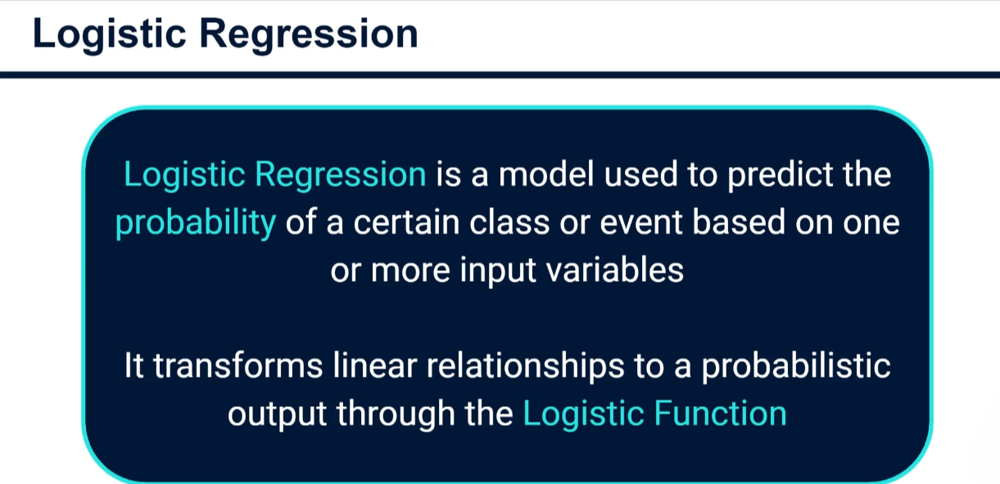
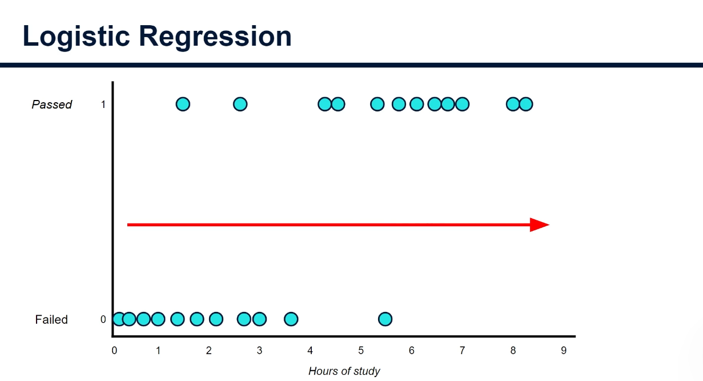
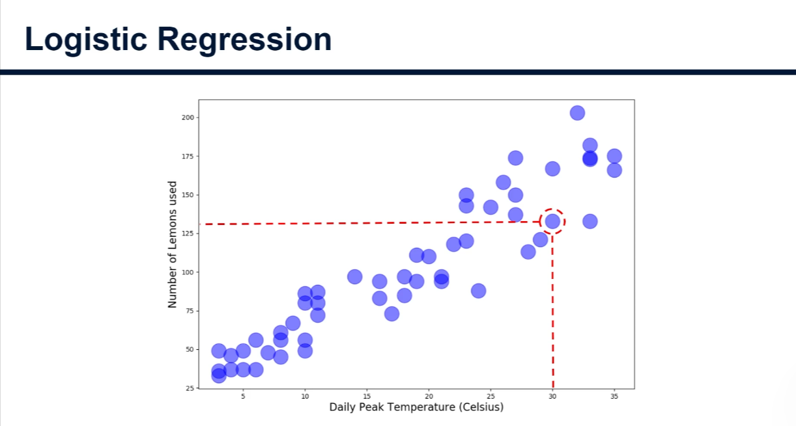
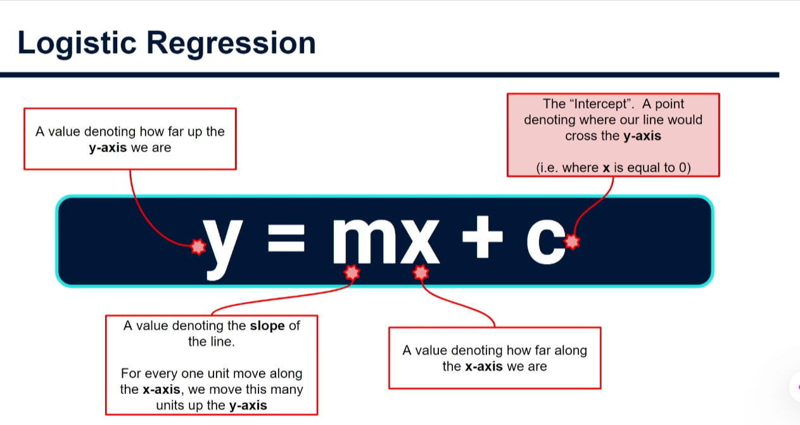
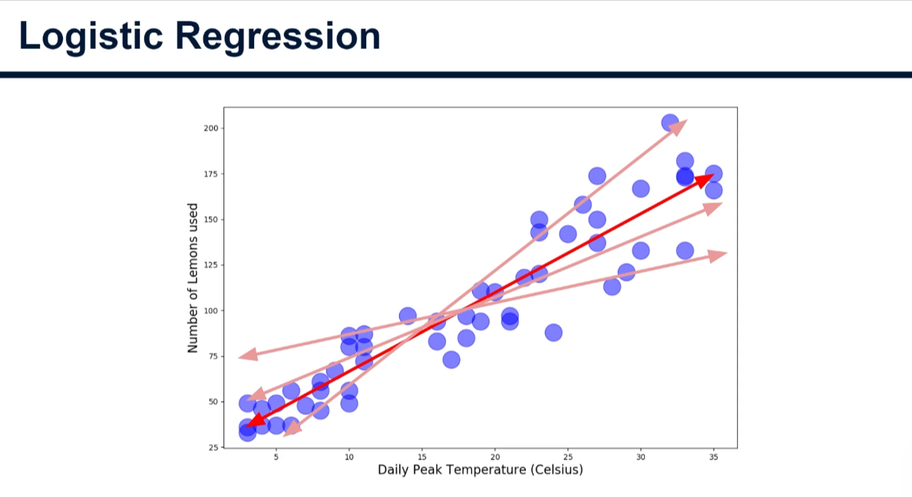
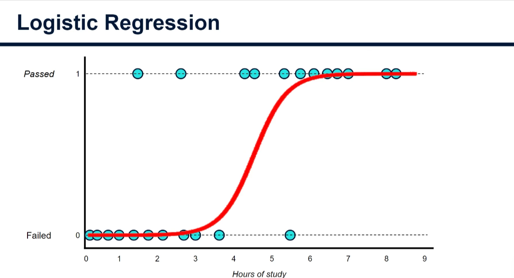
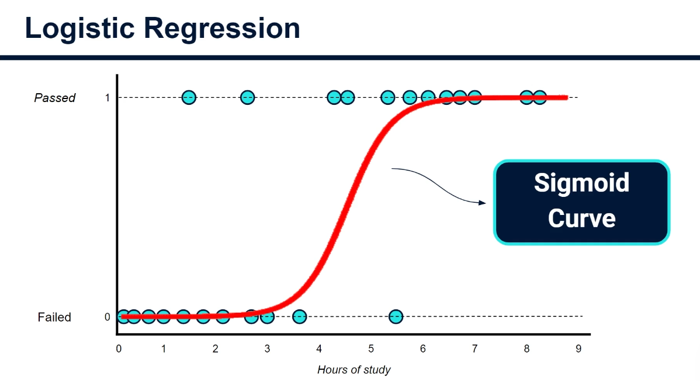
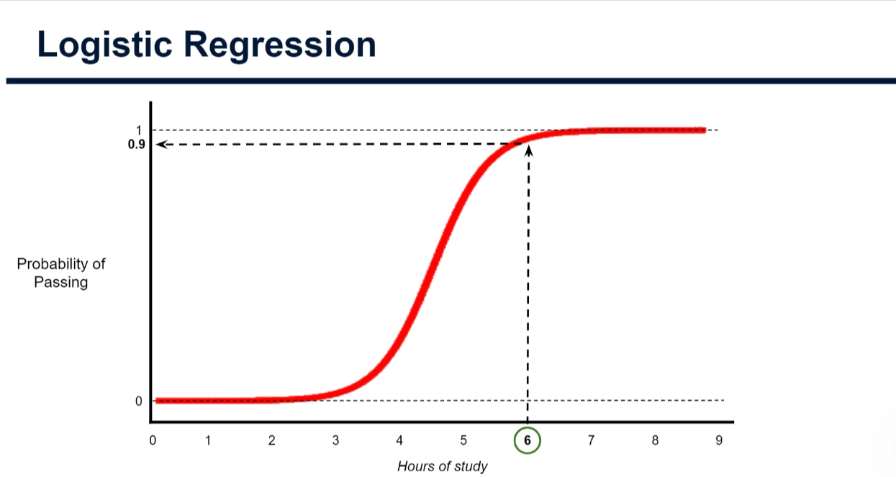
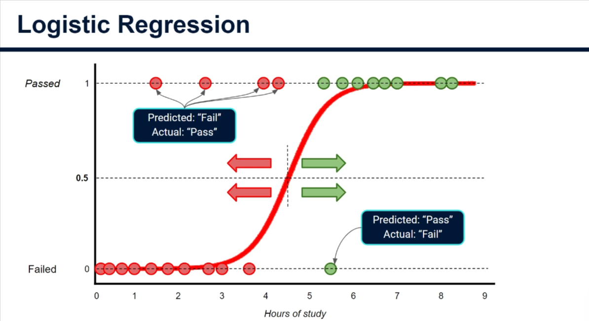

# Logistic Regression: A Beginner-Friendly Practical Tutorial

Logistic regression is a supervised machine-learning method commonly used for
**classification**. It estimates the probability that an observation belongs
to a class. For example, it might estimate the probability that a student
passes an exam, a customer cancels a subscription, or a medical image is
classified as benign or malignant.



Despite the word _regression_ in its name, logistic regression is often used
to make classification predictions. This tutorial starts with the intuition,
then walks through a practical Python example.

> **Learning goals:** understand the sigmoid curve, probabilities, thresholds,
> and coefficients; train a logistic-regression classifier; and evaluate its
> predictions without leaking information from the test set.

The complete, commented Python example is in
[`logistic_regression_practical.py`](logistic_regression_practical.py).

## 1. Start with a simple story

Imagine Lucy wants to estimate whether a student will pass an exam based on
how many hours that student studied. Each dot below represents one student's
study time and result:



The result is a category: **passed** or **failed**. We can encode those
categories as `1` and `0` so a computer can work with them.

The dots suggest a pattern: students who study longer tend to pass more often.
Lucy wants a model that can answer a question such as, “Given six hours of
study, what is the estimated probability of passing?”

## 2. Why not just use a straight line?

Linear regression finds a straight line through data. In the lemonade example
below, temperature is used to predict the number of lemons sold. That output
can be any number, which makes sense for a regression problem:



The basic equation for a straight line is:





But an exam result is not an unrestricted number. A probability must be
between `0` and `1` (or `0%` and `100%`). A straight line can predict a value
below zero or above one, so it is not a suitable probability model on its own.

## 3. The sigmoid curve turns a score into a probability

Logistic regression first combines the input features into a score. For one
feature, such as study hours, the score has the same general shape as a line:

```text
score = slope * study_hours + intercept
```

It then passes that score through the **sigmoid function**:

```text
probability = 1 / (1 + exp(-score))
```

The sigmoid maps any score to a value strictly between `0` and `1`. The
S-shaped curve below shows how predicted passing probability can change as
study hours increase:



The curve is also called the **logistic curve**. Its center is the region where
the estimated probability changes most quickly. Far to either side, the
probability approaches zero or one.



For example, the model might estimate a `20%` chance of passing for one
student and a `90%` chance for another. These are model estimates, not
guarantees or explanations of what caused an outcome.



## 4. A probability becomes a class through a threshold

To turn a probability into a category, choose a **classification threshold**.
The common starting point is `0.5`:

- probability at or above `0.5` -> predict **pass**;
- probability below `0.5` -> predict **fail**.

This threshold is a decision rule, not a law. If missing a positive case is
especially costly, a lower threshold may be appropriate. If false alarms are
costly, a higher threshold may be preferable. Choose it based on the real
problem and validation data.

Some predictions will be wrong. A false positive is a failed student
predicted to pass; a false negative is a passing student predicted to fail.
The image illustrates mistakes on either side of the threshold:



## 5. A practical example with scikit-learn

The script uses scikit-learn's built-in breast-cancer dataset so it can run
without downloading a CSV. Each row describes measurements from a cell-nucleus
image, and the target is either _benign_ or _malignant_. This is a teaching
example only: it is **not** a medical diagnostic tool.

### The workflow

1. **Inspect the data.** Count rows, columns, and missing values.
2. **Separate inputs from the answer.** `X` contains measurements; `y` contains
   the class. Never include the target in `X`.
3. **Split before preprocessing.** Keep a test set aside to represent unseen
   observations.
4. **Fit preprocessing on training data only.** The pipeline learns training
   medians for missing values and training means and scales for standardizing
   features. It then applies those learned values to the test set.
5. **Train and evaluate.** Examine more than accuracy, including precision,
   recall, ROC-AUC, and a confusion matrix.
6. **Predict one new row.** The fitted pipeline applies preprocessing before
   producing a class and probability.

Here is the central scikit-learn pattern used by the full script:

```python
# Import the pipeline that runs preparation and classification steps in order.
from sklearn.pipeline import Pipeline
# Import a tool that fills missing values using a statistic learned from data.
from sklearn.impute import SimpleImputer
# Import a tool that scales numeric features to comparable units.
from sklearn.preprocessing import StandardScaler
# Import logistic regression, the classification algorithm used here.
from sklearn.linear_model import LogisticRegression

# Build one object that applies preprocessing before the classifier.
pipeline = Pipeline(
    steps=[
      # Give this step a name and replace missing values with the median.
        ("imputer", SimpleImputer(strategy="median")),
      # Give this step a name and standardize the feature columns.
        ("scaler", StandardScaler()),
      # Name the prediction step; allow up to 2,000 training iterations.
        ("classifier", LogisticRegression(max_iter=2_000)),
    ]
)
# Learn imputation values, scaling values, and classifier parameters from train data.
pipeline.fit(X_train, y_train)
```

`fit` is the learning step: the imputer learns its replacement values, the
scaler learns the feature means and standard deviations, and the classifier
learns its coefficients. Because `fit` receives only `X_train` and `y_train`,
the held-out test data does not influence those learned values.

When predicting, call `pipeline.predict(...)` for a class or
`pipeline.predict_proba(...)` for class probabilities. The pipeline applies
the already-fitted preprocessing steps automatically.

### Run the example

From the repository root, run:

```powershell
python DSI\Day-121\logistic_regression_practical.py
```

The example requires `scikit-learn`, `pandas`, and `numpy`. Use the
repository's established Python environment and dependency workflow if those
packages are not already available.

## 6. Understand the evaluation

**Accuracy** is the fraction of predictions that are correct. It can be
misleading when one class is much more common than another.

| Metric           | Beginner-friendly meaning                                                             |
| ---------------- | ------------------------------------------------------------------------------------- |
| Precision        | Of the rows predicted as a class, how many truly belong to it?                        |
| Recall           | Of the rows that truly belong to a class, how many did the model find?                |
| F1 score         | A combined measure of precision and recall.                                           |
| ROC-AUC          | How well the model ranks positive examples above negative examples across thresholds. |
| Confusion matrix | Counts correct and incorrect predictions for each class.                              |

The positive class and the cost of mistakes matter. In a screening scenario,
missing a true case may be more serious than requesting an extra review. In
another task, false alarms may be the greater burden. Metrics and thresholds
should reflect those trade-offs.

## 7. What do the coefficients mean?

Logistic regression learns a coefficient for each feature. A positive
coefficient tends to push predictions toward the model's positive class; a
negative coefficient tends to push them away. The exact interpretation depends
on the other features and how the data was prepared.

Coefficients do not prove that a feature causes an outcome. Correlated
features, data quality, and the population represented in the training data
can all affect them. Standardizing numeric features, as the example does,
also changes the units in which coefficients are expressed.

## 8. Common beginner mistakes

1. **Preprocessing the full dataset before splitting.** This leaks information
   from the test set. Split first; fit preprocessing on training data only.
2. **Using accuracy as the only metric.** Consider class balance and the cost of
   false positives and false negatives.
3. **Treating a probability as certainty.** A predicted probability is an
   estimate, not a promise.
4. **Assuming `0.5` is always the right threshold.** The threshold should fit
   the task.
5. **Ignoring missing data.** Count missing values and decide how to handle
   them; the example uses the training median for numeric inputs.
6. **Assuming a model proves cause and effect.** A predictive relationship
   alone does not establish causation.
7. **Forgetting how labels are encoded.** Check which class a numeric or text
   label represents before interpreting probabilities and metrics.

## Summary

Logistic regression is a classification method that converts a learned score
into a probability using the sigmoid function. A threshold turns that
probability into a predicted class. It is a useful baseline for binary
classification because it is relatively simple and can provide probabilities,
but its results still need careful evaluation and context.

For a reliable first experiment, inspect the data, separate features from the
target, split before fitting preprocessing, train a pipeline, and review
metrics that match the cost of mistakes. Run
[`logistic_regression_practical.py`](logistic_regression_practical.py) to see
that workflow end to end.
