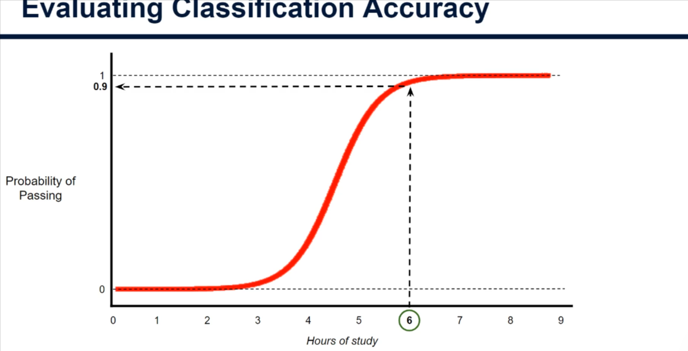
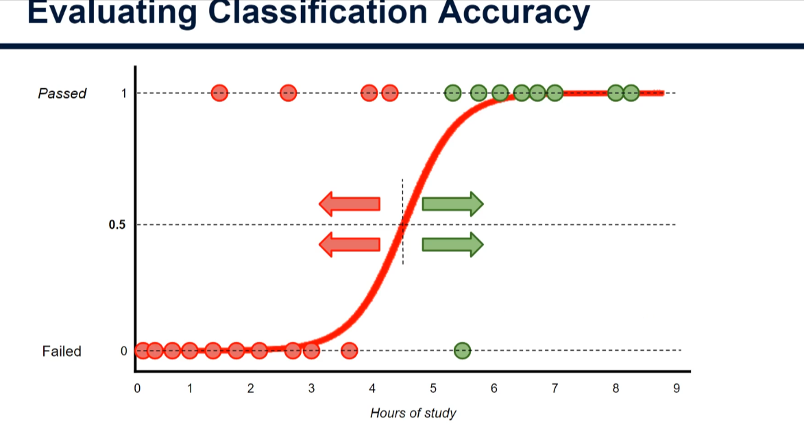
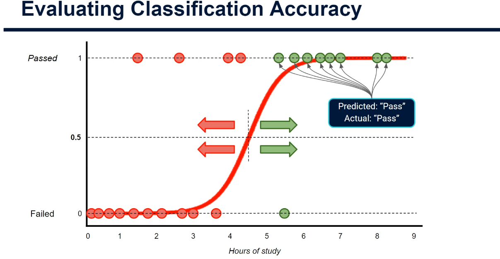
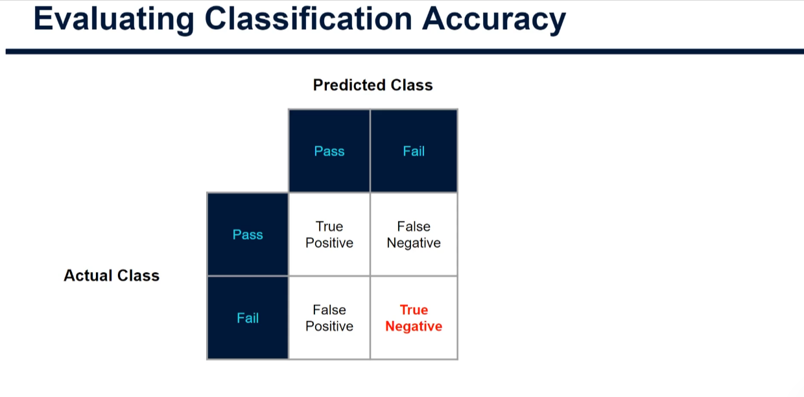
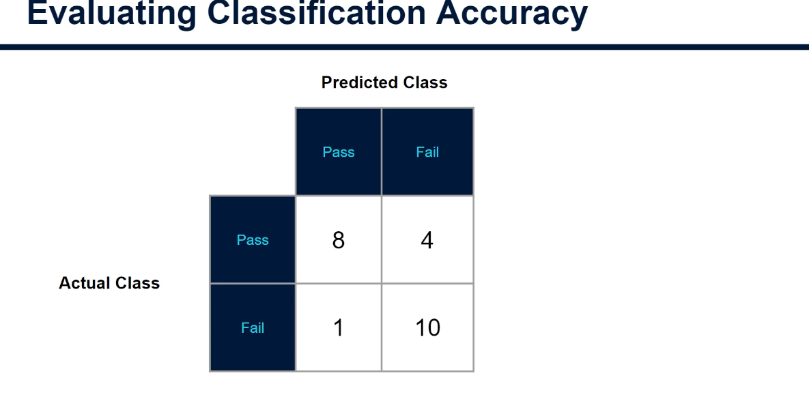
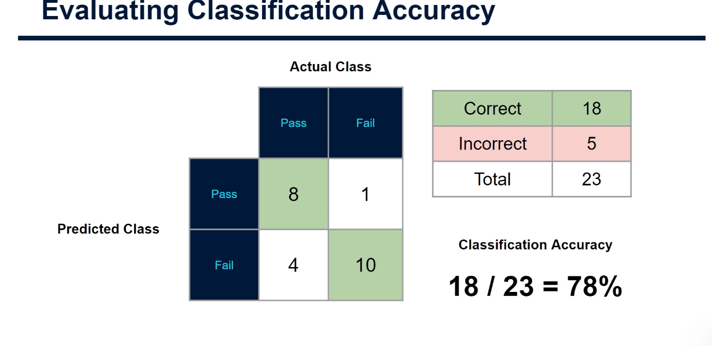
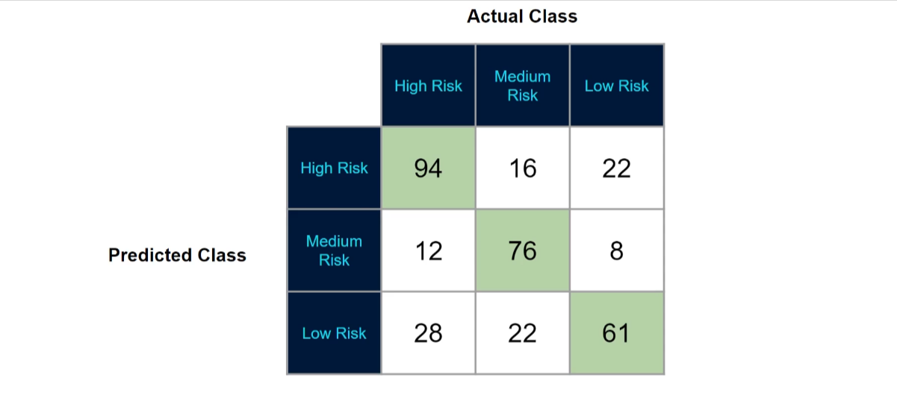

# Evaluating Classification Accuracy (Confusion Matrix) — A Beginner's Practical Guide

> Companion code: [evaluating_classification_accuracy_demo.py](./evaluating_classification_accuracy_demo.py)
> Previous notes: [Maximum_Likelihood_Estimation.md](./Maximum_Likelihood_Estimation.md), [Probability_Odds_Logs.md](./Probability_Odds_Logs.md)

These techniques are **not only for logistic regression** — they are used to assess *any* classification model (yes/no, cat/dog, true/false, ...).

## 1. From probability to a prediction

After all the log odds and sigmoid maths, it is easy to forget the goal: **classification**. The sigmoid curve gives the **probability** of the positive class. In Lucy's exam example, 6 hours of study gives a 90% probability of passing.



To get an actual yes/no answer we draw a **line in the sand** (the *threshold*), usually at a probability of **0.5**:

- probability ≥ 0.5 → predict **Pass**
- probability < 0.5 → predict **Fail**



Most students are classified correctly, but the model will **always** get some wrong. Measuring how many is the heart of accuracy assessment.

> **Caveat:** here we assess accuracy on the *training* data to keep the theory simple. In real projects always evaluate on a separate **test set** (train/test split) — see section 6.

## 2. The four kinds of prediction

| Name | Model predicted | Reality | Example | Notes |
|------|-----------------|---------|---------|-------|
| **True Positive (TP)** | Pass | Pass | Correct | |
| **True Negative (TN)** | Fail | Fail | Correct | |
| **False Positive (FP)** | Pass | Fail | Wrong | **Type I error** ("false alarm") |
| **False Negative (FN)** | Fail | Pass | Wrong | **Type II error** ("missed case") |

Memory trick: the second word is what the model *predicted* (positive/negative); the first word says whether it was *right* (true/false).

On the chart, the green points at the top right are students predicted to pass who actually passed (TP):



## 3. The confusion matrix

A **confusion matrix** is a table that counts how many data points fall into each of the four outcomes, split by actual class.



Counting the example's 23 students:

- 8 predicted pass and passed → **TP = 8**
- 1 predicted pass but failed → **FP = 1**
- 4 predicted fail but passed → **FN = 4**
- 10 predicted fail and failed → **TN = 10**



## 4. Accuracy

```
Accuracy = correct predictions / total predictions = (TP + TN) / (TP + TN + FP + FN)
```

The correct predictions sit on the **diagonal** of the matrix: 8 + 10 = **18** correct, 5 incorrect, 23 total → 18 / 23 = **78%**.



> **Careful with orientation!** Slides and textbooks differ: the slide above puts *predicted* on the rows. **scikit-learn puts *actual* on the rows and *predicted* on the columns, with classes in order 0, 1**, so its 2×2 output is `[[TN, FP], [FN, TP]]`. Always check which axis is which.

## 5. More than two classes

The same idea works for any number of classes. For an insurer classifying customers as High / Medium / Low risk, the matrix is 3×3. The diagonal (green) is correct; everything else shows **which classes the model confuses** — hence the name.



Accuracy = (94 + 76 + 61) / 339 = 231 / 339 ≈ **68%**.

> Accuracy can be **very misleading** in some situations (for example when one class is very rare). That is the topic of the next tutorial.

## 6. Practical code

Full script: [evaluating_classification_accuracy_demo.py](./evaluating_classification_accuracy_demo.py). Key parts:

### 6.1 Data and model

```python
import numpy as np
from sklearn.linear_model import LogisticRegression

passed = np.array([1.5, 2.6, 4.0, 4.3, 5.3, 5.75, 6.1, 6.45, 6.7, 7.0, 8.0, 8.25])
failed = np.array([0.1, 0.35, 0.65, 1.0, 1.4, 1.75, 2.15, 2.7, 3.0, 3.6, 5.5])
X = np.concatenate([passed, failed]).reshape(-1, 1)               # 2-D feature matrix
y = np.concatenate([np.ones(len(passed)), np.zeros(len(failed))]).astype(int)  # 1=pass

model = LogisticRegression(C=np.inf).fit(X, y)                    # plain maximum likelihood
```

### 6.2 Probabilities → predictions

```python
probs = model.predict_proba(X)[:, 1]        # P(pass) per student
y_pred = (probs >= 0.5).astype(int)         # apply the 0.5 threshold
```

(`model.predict(X)` does the same thing with a 0.5 threshold.)

### 6.3 Confusion matrix and accuracy

```python
from sklearn.metrics import confusion_matrix, accuracy_score

cm = confusion_matrix(y, y_pred)            # rows = actual, cols = predicted
tn, fp, fn, tp = cm.ravel()                 # unpack the four cells
print(cm)
print("Accuracy:", (tp + tn) / cm.sum(), accuracy_score(y, y_pred))
```

Output from the script (our model fitted to approximate slide data):

```
[[ 9  2]
 [ 2 10]]
Accuracy: 19/23 = 83%
```

The slide's curve gives TP=8, FN=4, FP=1, TN=10 (78%). Our numbers differ a little because we *re-fitted* a model to hand-estimated data points — the method is identical.

### 6.4 Honest evaluation with a train/test split

```python
from sklearn.model_selection import train_test_split

X_train, X_test, y_train, y_test = train_test_split(
    X, y, test_size=0.3, random_state=42, stratify=y)   # hold out 30% for testing
m = LogisticRegression(C=np.inf).fit(X_train, y_train)  # learn from training data only
print(m.score(X_train, y_train), m.score(X_test, y_test))
```

With only 23 rows the test score is very noisy (we saw 75% train vs 100% test). Treat tiny-data results with suspicion; with real datasets use hundreds or thousands of rows or cross-validation.

### 6.5 Changing the threshold shifts the errors

```python
for t in (0.3, 0.5, 0.7):
    pred = (probs >= t).astype(int)
    tn, fp, fn, tp = confusion_matrix(y, pred).ravel()
    print(t, "FP:", fp, "FN:", fn)
```

| Threshold | FP | FN | Accuracy |
|-----------|----|----|----------|
| 0.3 | 4 | 1 | 78% |
| 0.5 | 2 | 2 | 83% |
| 0.7 | 1 | 4 | 78% |

A lower threshold predicts "pass" more eagerly (more false positives); a higher one is stricter (more false negatives). Which error is worse depends on the problem: for cancer screening a false negative is far worse; for spam filtering a false positive (real mail in spam) hurts more.

### 6.6 Multi-class accuracy and plotting

```python
multi = np.array([[94, 16, 22], [12, 76, 8], [28, 22, 61]])
print(np.trace(multi) / multi.sum())        # diagonal / total = 0.68
```

The script also plots both matrices with `ConfusionMatrixDisplay` and saves `confusion_matrices.png`.

## 7. Quick summary

- A classifier outputs a probability; a **threshold** (default 0.5) turns it into a class.
- Outcomes: **TP, TN, FP (Type I), FN (Type II)**.
- The **confusion matrix** counts them; the **diagonal** is correct predictions.
- **Accuracy = correct / total** (18/23 = 78%).
- Works for any number of classes and any classifier.
- Check matrix **orientation**, evaluate on **test data**, and remember accuracy alone can mislead — next tutorial.

## 8. Try it yourself

```bash
pip install numpy scikit-learn matplotlib
python evaluating_classification_accuracy_demo.py
```
