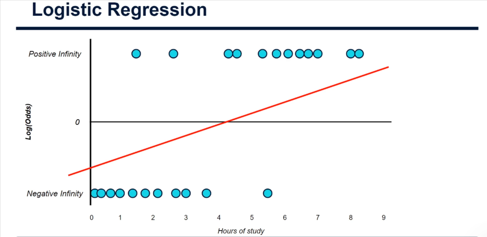
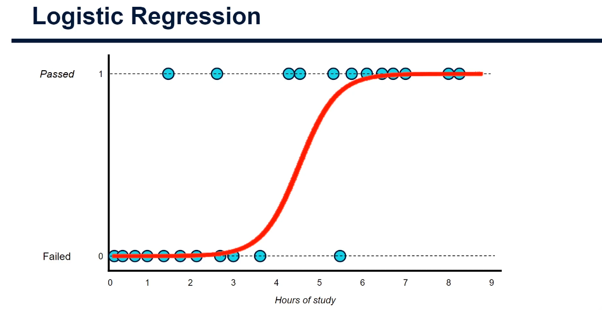
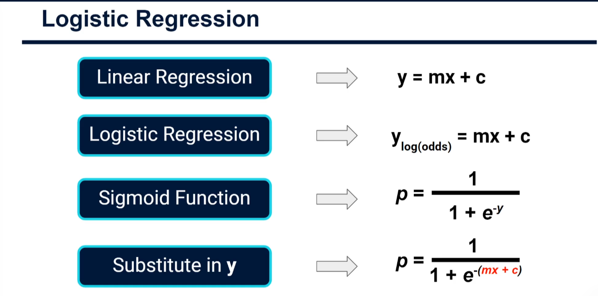
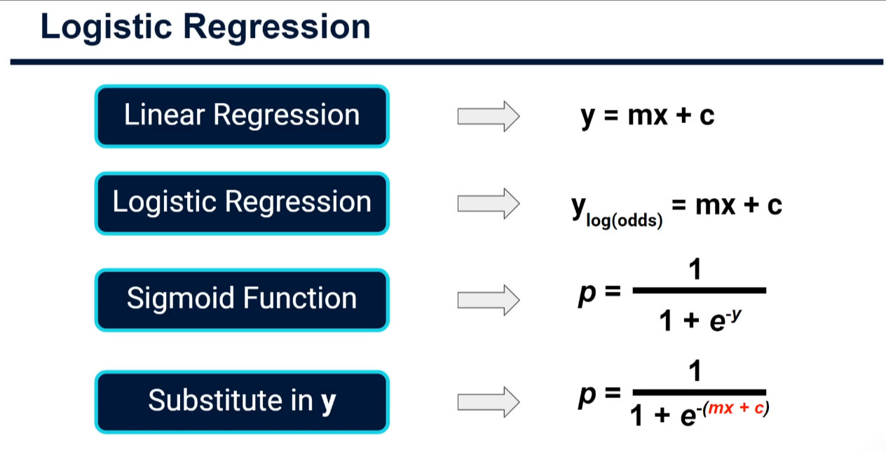
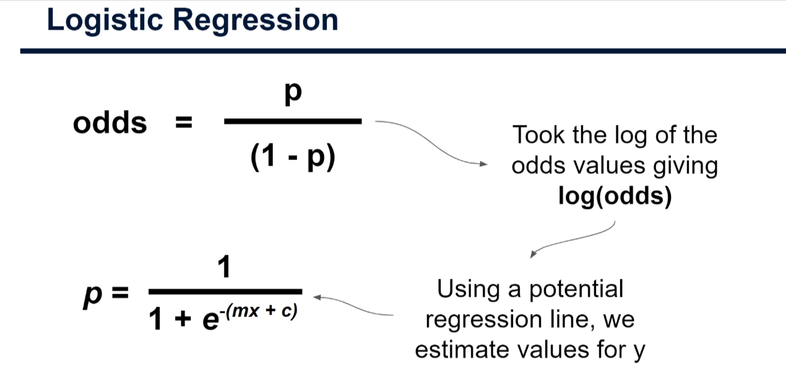
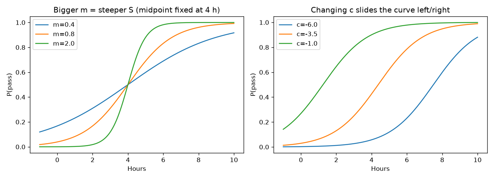
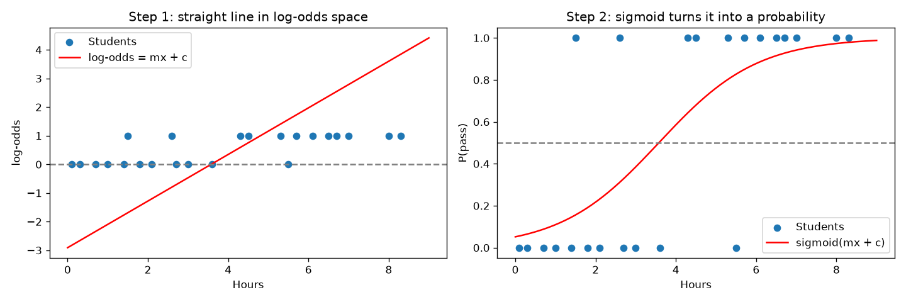

# The Formula for a Sigmoid Curve (Practical) in Machine Learning

> Companion code: [sigmoid_formula_demo.py](./sigmoid_formula_demo.py). Every snippet below comes from that file and can be run as-is.

## Where we are

In the previous tutorials we built up logistic regression step by step:

1. Our data has only two outcomes: **failed (0)** or **passed (1)**.
2. A straight line can't fit 0/1 data well, so we convert the y-axis to **log(odds)**, where 0 → −∞ and 1 → +∞.
3. We fit a **straight line** through the data in log(odds) space and read off a **predicted log(odds)** for every student.



Now we need the last step: turn those predicted log(odds) **back into probabilities between 0 and 1**, so we can judge how good the line is. The tool for this is the **sigmoid function**, which produces the S-shaped curve:



---

## 1. The formulas, one at a time



| Model                           | Formula                       | Meaning                                                        |
| ------------------------------- | ----------------------------- | -------------------------------------------------------------- |
| Linear regression               | `y = mx + c`                  | `m` = slope, `c` = constant (intercept)                        |
| Logistic regression (line part) | `y_log(odds) = mx + c`        | Still a straight line, but its output `y` is the **log(odds)** |
| Sigmoid function                | `p = 1 / (1 + e^(-y))`        | Converts log(odds) `y` into probability `p`                    |
| Substitute `y`                  | `p = 1 / (1 + e^(-(mx + c)))` | The complete logistic regression formula                       |

The same content on a second slide, for reference:



### What is `e`?

`e` is **Euler's number**, about **2.71828**, a special constant like π. Raising `e` to a power is the exact opposite of taking the natural log (`ln`). That is why it can **undo** the log we applied to the odds. The `p` stands for **probability**.

### Why substitute?

We already have a formula for `y`: it's the straight line `mx + c`. So instead of two steps, we drop it straight into the sigmoid:

```
p = 1 / (1 + e^(-(mx + c)))
```



Read the slide as a story: we started with `odds = p / (1 − p)`, **took the log** to get log(odds), fitted a **potential regression line** to estimate `y`, and now the sigmoid takes `y` **back to `p`**.

---

## 2. The formula in code

```python
import numpy as np

def straight_line(x, m, c):
    return m * x + c                 # y (log-odds) = slope * input + intercept

def sigmoid(y):
    return 1 / (1 + np.exp(-y))      # p = 1 / (1 + e^(-y)); works on numbers and arrays

def predict_probability(x, m, c):
    return sigmoid(straight_line(x, m, c))   # substitute y = mx + c into the sigmoid
```

### Example A: the sigmoid squashes everything into 0..1

```python
for y in [-10, -4, -2, 0, 2, 4, 10]:
    print(y, sigmoid(y))
```

| log(odds) `y` | probability `p` |
| ------------- | --------------- |
| −10           | 0.0000          |
| −4            | 0.0180          |
| −2            | 0.1192          |
| **0**         | **0.5000**      |
| 2             | 0.8808          |
| 4             | 0.9820          |
| 10            | 1.0000          |

Takeaways: very negative `y` gives `p` near 0, very positive `y` gives `p` near 1, and `y = 0` gives exactly 0.5. The output **never** leaves the range 0 to 1, no matter how extreme `y` gets.

### Example B: the sigmoid undoes the log(odds)

```python
p = 0.8
odds = p / (1 - p)          # 4.0
log_odds = np.log(odds)     # 1.386 (np.log is the natural log)
print(sigmoid(log_odds))    # 0.8, we are back where we started
```

### Example C: predict exam results by hand

Suppose someone gave us the line `log(odds) = 0.8 × hours − 3.5` (so `m = 0.8`, `c = −3.5`):

```python
m, c = 0.8, -3.5
for hours in range(10):
    y = straight_line(hours, m, c)           # predicted log-odds
    p = predict_probability(hours, m, c)     # probability after the sigmoid
    print(hours, round(y, 2), round(p, 3))
```

| Hours | log(odds) | P(pass) |
| ----- | --------- | ------- |
| 0     | −3.50     | 0.029   |
| 1     | −2.70     | 0.063   |
| 2     | −1.90     | 0.130   |
| 3     | −1.10     | 0.250   |
| 4     | −0.30     | 0.426   |
| 5     | 0.50      | 0.622   |
| 6     | 1.30      | 0.786   |
| 7     | 2.10      | 0.891   |
| 8     | 2.90      | 0.948   |
| 9     | 3.70      | 0.976   |

The straight line climbs steadily, but the probability changes quickly in the middle and flattens at the ends: that's the S shape. The **50% point** is where `mx + c = 0`, so `x = −c / m = 3.5 / 0.8 ≈ 4.38 hours`.

---

## 3. What do `m` and `c` do to the curve?

- **`m` (slope)** controls how **steep** the S is. A big `m` means the model flips quickly from "probably fail" to "probably pass".
- **`c` (intercept)** **slides** the curve left or right (the 50% point sits at `−c/m`).

Running the script saves this picture:



---

## 4. Let the machine find `m` and `c`

In practice we don't guess `m` and `c`: scikit-learn finds the best ones from the data, and we confirm our formula reproduces its probabilities.

```python
import numpy as np
from sklearn.linear_model import LogisticRegression

hours = np.array([0.1, 0.3, 0.7, 1.0, 1.4, 1.8, 2.1, 2.7, 3.0, 3.6, 5.5,
                  1.5, 2.6, 4.3, 4.5, 5.3, 5.7, 6.1, 6.5, 6.7, 7.0, 8.0, 8.3])
passed = np.array([0] * 11 + [1] * 12)             # 0 = failed, 1 = passed

model = LogisticRegression().fit(hours.reshape(-1, 1), passed)  # learn the line in log-odds space
m, c = model.coef_[0][0], model.intercept_[0]      # learned slope and intercept

ours = predict_probability(hours, m, c)            # our own sigmoid formula
theirs = model.predict_proba(hours.reshape(-1, 1))[:, 1]   # scikit-learn's P(pass)
print(np.allclose(ours, theirs))                   # True: same numbers
```

Output:

```
Learned: m = 0.814, c = -2.909
Formula matches scikit-learn: True
Accuracy on training data: 83%
```

Left: the straight line in log(odds) space. Right: the same line passed through the sigmoid, giving the probability curve.



To get a **class** (pass/fail) from a probability, apply a threshold, usually 0.5: `predicted = (p >= 0.5)`.

---

## 5. Putting it all together

```
data (0/1) → log(odds) space → straight line  y = mx + c
                                      │
                                      ▼
                  sigmoid:  p = 1 / (1 + e^-(mx + c))
                                      │
                                      ▼
                  probability between 0 and 1 for each student
```

Now we can compare each predicted probability with the actual outcome (0 or 1) to see how good the line is. The next tutorial uses this to judge and improve the fit.

## Cheat sheet

| Idea                     | Formula                         |
| ------------------------ | ------------------------------- |
| Straight line (log-odds) | `y = mx + c`                    |
| Sigmoid                  | `p = 1 / (1 + e^(-y))`          |
| Full logistic regression | `p = 1 / (1 + e^(-(mx + c)))`   |
| Midpoint (p = 0.5)       | `x = -c / m`                    |
| Output range             | always strictly between 0 and 1 |

## Try it yourself

```powershell
pip install numpy matplotlib scikit-learn
python sigmoid_formula_demo.py
```

Exercises:

1. Compute `sigmoid(3)` by hand: `1 / (1 + e^-3) ≈ 0.953`.
2. With `m = 1.5` and `c = −6`, at what number of hours is the chance of passing 50%?
3. Change `m` in `demo_effect_of_m_and_c` and watch how the curve's steepness changes.
