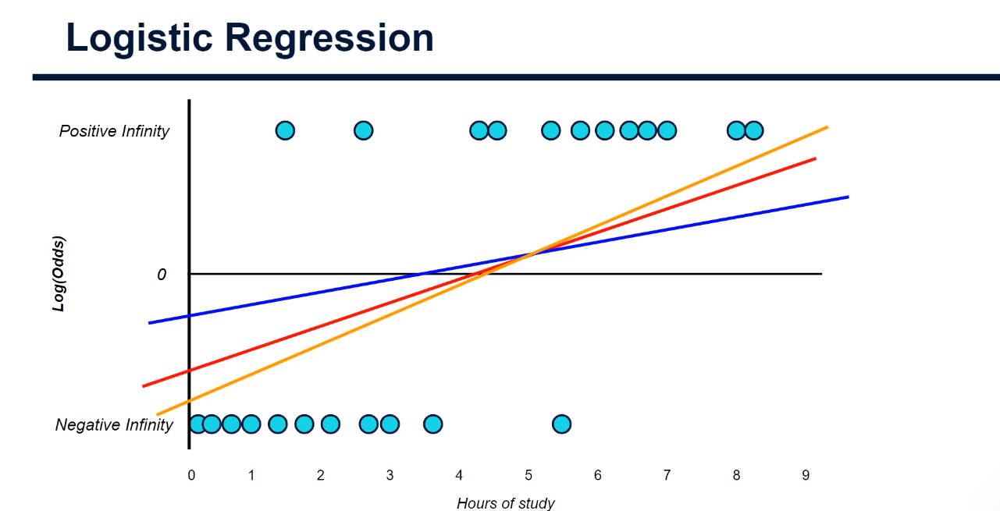
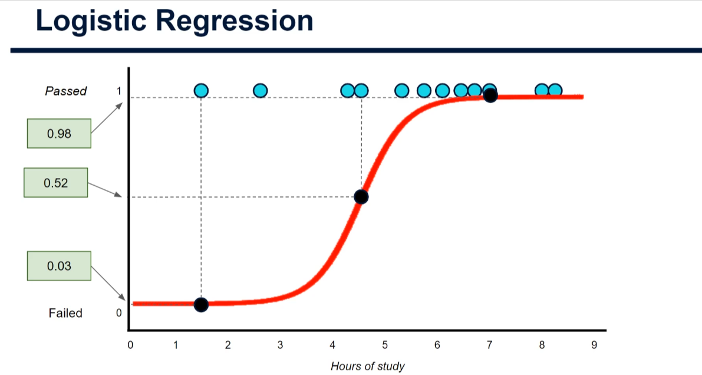
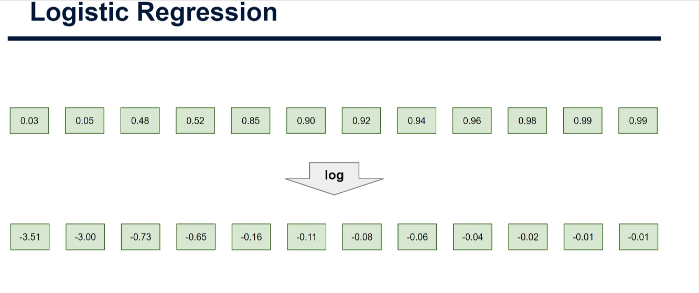
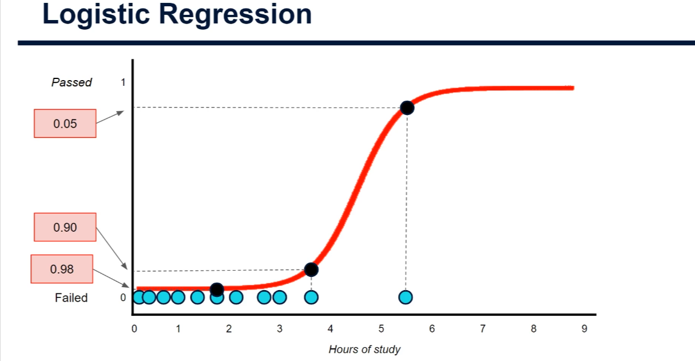
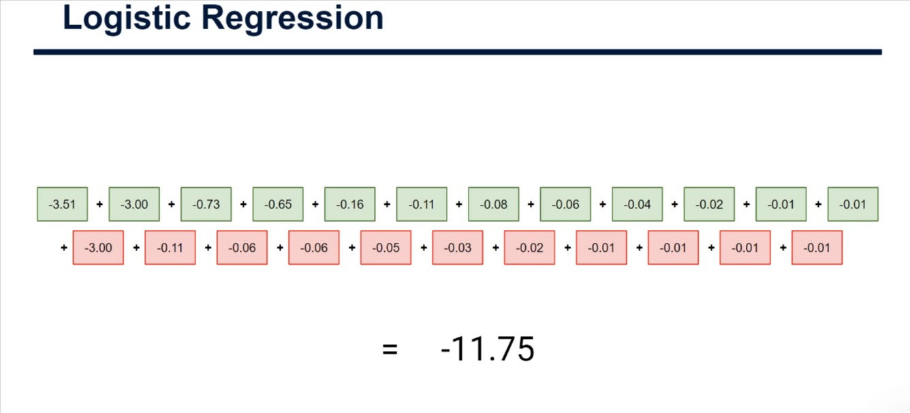
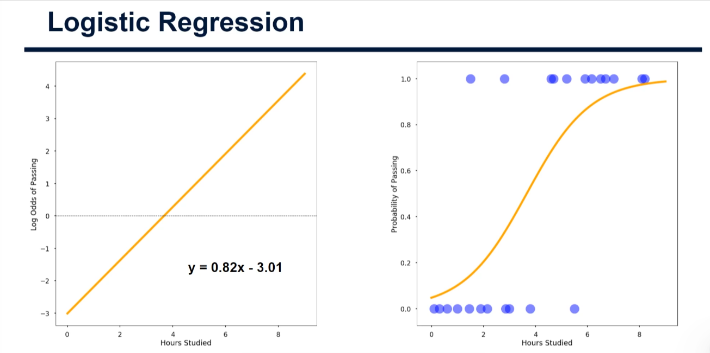

# Maximum Likelihood Estimation (MLE) in Logistic Regression — A Beginner's Practical Guide

> Companion code: [mle_logistic_regression_demo.py](./mle_logistic_regression_demo.py)
> Previous notes: [Probability_Odds_Logs.md](./Probability_Odds_Logs.md), [Formula_for_Sigmoid_Curve.md](./Formula_for_Sigmoid_Curve.md)

## 1. The problem: how do we find the "best" line?

In **linear regression** we use **least squares**: try lots of lines, square and sum the residuals (actual − predicted), and pick the line with the smallest sum.

In **logistic regression** this breaks down. Our target values are converted to **log odds**, which range from −∞ to +∞. A passer (probability 1) has log odds of +∞, a failer (probability 0) has −∞. Every residual is therefore "infinity minus a number" = infinity, so every candidate line scores **infinity** and we cannot tell which is better.



**Solution: Maximum Likelihood Estimation.** Instead of measuring distance to the points, we ask:

> *"How likely is it that this line would have produced the classes we actually observed?"*

The line that makes our observed data **most likely** wins.

## 2. The MLE recipe (5 steps)

For one candidate line:

1. Project each point onto the line → predicted **log odds**.
2. Convert log odds to **probability** with the sigmoid: `p = 1 / (1 + e^(−log_odds))`.
3. Take each student's **likelihood** = probability of the class they *actually* belong to.
4. Take the **log** of every likelihood.
5. **Add** them up → *total log likelihood*. Repeat for other lines; the **highest** total wins.

### Step 3a — Students who passed (likelihood = p)

For each student who passed, read off the predicted probability of passing from the sigmoid curve at their study hours.



Few study hours but passed → low value (0.03, 0.05). Many hours and passed → high value (0.98, 0.99). Then take the **log**:



> Why log? Likelihoods are between 0 and 1; the log turns multiplications into additions and avoids tiny numbers that computers struggle with. Because log is increasing, the line with the highest likelihood also has the highest log likelihood.
> Notice: log of a number below 1 is **negative**. Closer to 0 (e.g. −0.01) = better. Very negative (e.g. −3.51) = bad.

### Step 3b — Students who failed (likelihood = 1 − p)

For failers we want the probability they **failed**, but the curve gives the probability of **passing**. So use `1 − p`.



A failer who studied little has p(pass) ≈ 0.02, so likelihood = 0.98 — the model got it right. A failer who studied 5.5 hours has p(pass) = 0.95, so likelihood = 0.05 — the model got it badly wrong. This is why we say *likelihood* rather than just *probability*: it measures how well each point fits **its own correct class**.

### Step 5 — Add everything up



Green = passers, red = failers. Here the total is **−11.75**. Now try other lines; the one with the total closest to zero (the maximum) is the best fit. That is the name: **maximum** **likelihood**.

## 3. The result

Running this on the same data in scikit-learn gives the best line in log-odds (left) and the same line squashed into a sigmoid curve (right):



`log odds = 0.82 × hours − 3.01`

Remember: coefficients from a logistic regression are always in **log odds**, not probabilities.

## 4. The maths (optional, but short)

For one student with hours `x` and label `y` (1 = pass, 0 = fail), with `p = sigmoid(b0 + b1·x)`:

```
likelihood = p        if y = 1
           = 1 - p    if y = 0
           = p^y · (1-p)^(1-y)          (one formula for both)
```

Total log likelihood over `n` students:

```
LL(b0, b1) = Σ [ y·log(p) + (1-y)·log(1-p) ]
```

MLE picks `b0, b1` that maximise `LL`. Machine-learning libraries minimise the **negative** log likelihood, also called **log loss / cross-entropy**.

## 5. Practical example in code

The full runnable script is [mle_logistic_regression_demo.py](./mle_logistic_regression_demo.py). Key parts below.

### 5.1 Data and sigmoid

```python
import numpy as np

hours_passed = np.array([1.5, 2.6, 4.3, 4.55, 5.3, 5.75, 6.1, 6.45, 6.7, 7.0, 8.0, 8.25])
hours_failed = np.array([0.1, 0.35, 0.65, 1.0, 1.4, 1.75, 2.15, 2.7, 3.0, 3.6, 5.5])
x = np.concatenate([hours_passed, hours_failed])                                  # all hours
y = np.concatenate([np.ones(len(hours_passed)), np.zeros(len(hours_failed))])    # 1=pass, 0=fail

def sigmoid(z):
    return 1.0 / (1.0 + np.exp(-z))   # log odds -> probability
```

### 5.2 Score any candidate line

```python
def total_log_likelihood(intercept, slope, x, y):
    log_odds = intercept + slope * x                         # project onto the line
    p_pass = sigmoid(log_odds)                               # predicted P(pass)
    likelihood = np.where(y == 1, p_pass, 1.0 - p_pass)      # p for passers, 1-p for failers
    return np.sum(np.log(likelihood))                        # log then add up
```

### 5.3 Compare lines — the highest score wins

```python
for name, (b0, b1) in {"blue": (-2, 0.4), "red": (-3, 0.7), "orange": (-3, 0.82)}.items():
    print(name, total_log_likelihood(b0, b1, x, y))
```

Output from the script:

| Line | Intercept | Slope | Total log likelihood |
|------|-----------|-------|----------------------|
| blue | −2.0 | 0.40 | −11.26 |
| red | −3.0 | 0.70 | −9.50 |
| orange | −3.0 | 0.82 | **−8.93** (best of these) |
| bad (negative slope) | 1.0 | −0.50 | −32.29 |

### 5.4 Let the computer search for the maximum

```python
from scipy.optimize import minimize

result = minimize(lambda w: -total_log_likelihood(w[0], w[1], x, y), x0=[0.0, 0.0])
print(result.x)   # [intercept, slope]  ->  about [-3.21, 0.90]
```

We minimise the **negative** because optimisers minimise; minimising −LL is the same as maximising LL.

### 5.5 Or use scikit-learn

```python
from sklearn.linear_model import LogisticRegression

model = LogisticRegression(C=np.inf)        # no regularisation => pure MLE
model.fit(x.reshape(-1, 1), y)
print(model.intercept_, model.coef_)         # about -3.21 and 0.90
```

> By default scikit-learn applies L2 regularisation (`C=1.0`), which slightly shrinks coefficients. Setting `C=np.inf` gives the textbook MLE.
> The slide's line (0.82, −3.01) differs a little from ours because our data values are approximated from the chart.

### 5.6 Predict

```python
hours = np.array([[2.0], [4.0], [6.0]])
print(model.predict_proba(hours)[:, 1])     # probability of passing
print(model.predict(hours))                 # class using a 0.5 threshold
```

## 6. Common pitfalls

| Pitfall | What to know |
|---------|--------------|
| Perfectly separable data | If one threshold splits the classes perfectly, the MLE slope tends to infinity. Use regularisation (default `C=1.0`). |
| `log(0)` | A probability of exactly 0 or 1 gives −∞. Libraries clip probabilities for safety. |
| Reading coefficients | Slope = change in **log odds** per unit of x. `exp(slope)` = odds ratio (e.g. `exp(0.9) ≈ 2.5×` odds per extra hour). |
| Local vs global maximum | Logistic regression's log likelihood is concave, so there is a single peak — optimisation reliably finds it. |

## 7. Quick summary

- Least squares fails in logistic regression because log-odds residuals are infinite.
- MLE scores a line by the **likelihood of the true classes**: `p` for positives, `1 − p` for negatives.
- Take logs and **sum** → total log likelihood; **highest wins**.
- The computer does the search for you (`LogisticRegression`), but knowing this helps when a model misbehaves.
- Next topic: **assessing the accuracy of a classification model**.

## 8. Try it yourself

```bash
pip install numpy scipy scikit-learn matplotlib
python mle_logistic_regression_demo.py
```

It prints each step and saves `mle_logistic_regression_result.png` and `mle_likelihood_surface.png` (a heat map of the log-likelihood "hill" whose peak is the MLE).
