# Probability, Odds and log(Odds): Logistic Regression for Beginners

> Companion code: [logistic_regression_demo.py](./logistic_regression_demo.py). Every snippet below comes from that file and can be run as-is.

## Why do we need this?

Logistic regression predicts a **category** (pass/fail, spam/not spam, sick/healthy), not a number. Under the hood it works with three connected ideas: **probability → odds → log(odds)**. This note explains each one, then shows how they combine into a working model.

**Running example (Lucy's exam data):** each student studied some number of hours and either **failed (0)** or **passed (1)**. We want to predict the chance of passing from the hours studied.

---

## 1. Probability

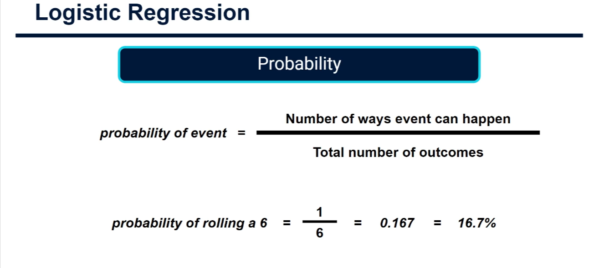

Probability is how many ways an event can happen divided by the total number of outcomes. It always lies between **0** (impossible) and **1** (certain).

```
probability = ways the event can happen / total outcomes
```

Rolling a die: one way to get a six, six outcomes → `1/6 = 0.167 = 16.7%`.

```python
def probability(ways_event_can_happen, total_outcomes):
    return ways_event_can_happen / total_outcomes  # simple division

print(probability(1, 6))  # 0.1666...
```

Other everyday examples: a fair coin landing heads = 1/2 = 0.5; drawing a heart from a 52-card deck = 13/52 = 0.25.

---

## 2. Odds

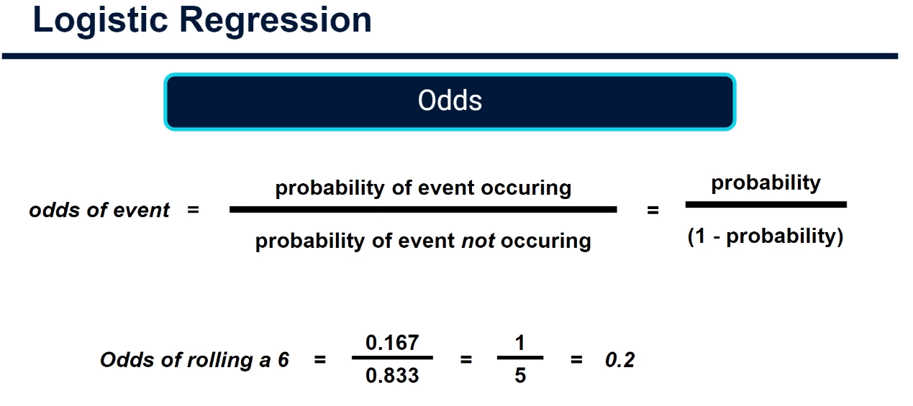

Odds compare the chance the event **happens** with the chance it **does not happen**:

```
odds = P(event) / P(not event) = p / (1 - p)
```

For the die: `0.167 / 0.833 = 1/5 = 0.2`. Another way to see it: there is **1 way to roll a six and 5 ways not to**, so the odds are 1 to 5.

> Probability ≠ odds. Probability of a six = 0.167, odds of a six = 0.2.

```python
def odds(p):
    if p >= 1:                 # certain event -> dividing by zero
        return float("inf")    # odds are infinite
    return p / (1 - p)         # the odds formula

print(odds(1 / 6))  # 0.2
```

More examples: p = 0.5 → odds = 1 (an even chance, "1 to 1"); p = 0.8 → odds = 4 ("4 to 1 in favour"); p = 0.2 → odds = 0.25 ("1 to 4 against").

### Probability vs odds table

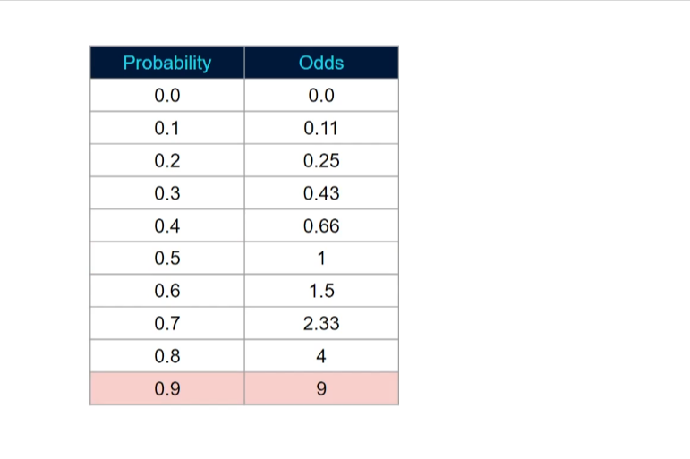

| Probability | Odds                        |
| ----------- | --------------------------- |
| 0.0         | 0.0                         |
| 0.1         | 0.11                        |
| 0.2         | 0.25                        |
| 0.3         | 0.43                        |
| 0.4         | 0.67 (slide rounds to 0.66) |
| 0.5         | 1                           |
| 0.6         | 1.5                         |
| 0.7         | 2.33                        |
| 0.8         | 4                           |
| 0.9         | 9                           |
| 1.0         | ∞                           |

### The lopsided relationship

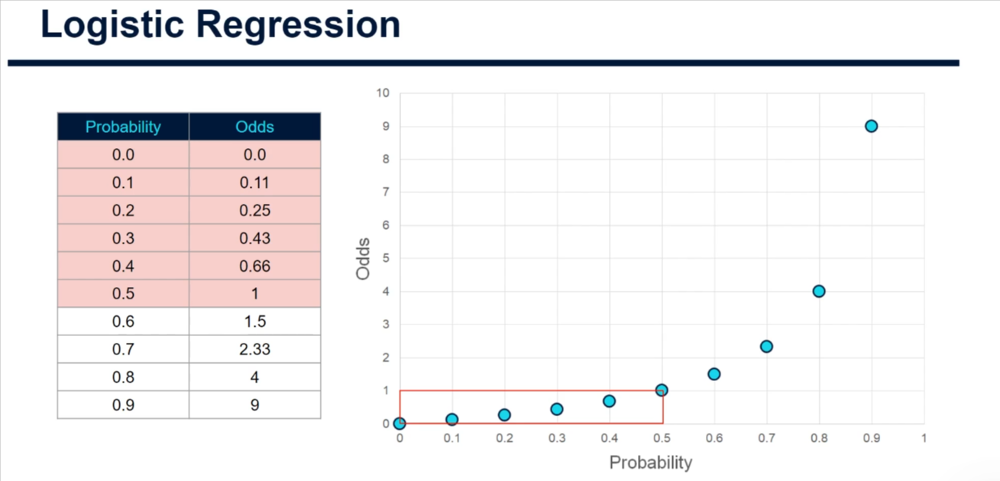

When the probability is **below 0.5** (event unlikely) the odds are squeezed between **0 and 1**.

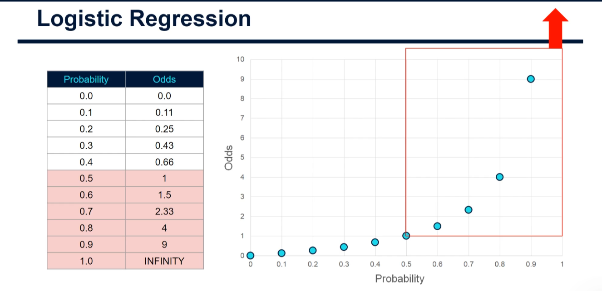

When the probability is **above 0.5** (event likely) the odds stretch from **1 up to infinity**. That is why the table has no row for p = 1: its odds are infinite.

The problem: the "against" side has only a tiny range (0 to 1) while the "for" side has an enormous one (1 to ∞), so it is hard to compare equally likely/unlikely events fairly.

---

## 3. log(Odds) (the "logit")

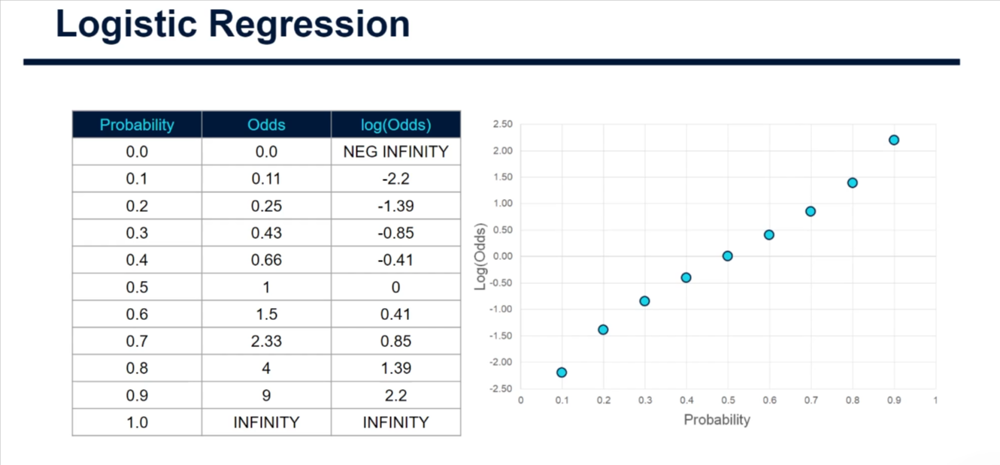

Taking the **natural log** of the odds fixes the lopsidedness. It spreads values evenly around "even chance" (p = 0.5 → log(odds) = 0):

```
log(odds) = ln( p / (1 - p) )
```

| Probability | Odds | log(Odds) |
| ----------- | ---- | --------- |
| 0.0         | 0.0  | −∞        |
| 0.1         | 0.11 | −2.20     |
| 0.2         | 0.25 | −1.39     |
| 0.3         | 0.43 | −0.85     |
| 0.4         | 0.67 | −0.41     |
| 0.5         | 1    | 0         |
| 0.6         | 1.5  | 0.41      |
| 0.7         | 2.33 | 0.85      |
| 0.8         | 4    | 1.39      |
| 0.9         | 9    | 2.20      |
| 1.0         | ∞    | +∞        |

Key facts:

- p = 0 → log(odds) = **−∞**; p = 1 → log(odds) = **+∞**.
- log(odds) < 0 means "more likely not to happen"; > 0 means "more likely to happen".
- The curve approaches, but never reaches, probabilities of 0 and 1.

```python
import numpy as np

def log_odds(p):
    if p <= 0:
        return float("-inf")    # log of 0 is negative infinity
    if p >= 1:
        return float("inf")     # p = 1 -> infinite odds -> +infinity
    return float(np.log(odds(p)))  # natural log of the odds

print(log_odds(0.5))  # 0.0
print(log_odds(0.9))  # 2.197...
```

Running the full script also saves `prob_odds_logodds.png`, comparing both curves:

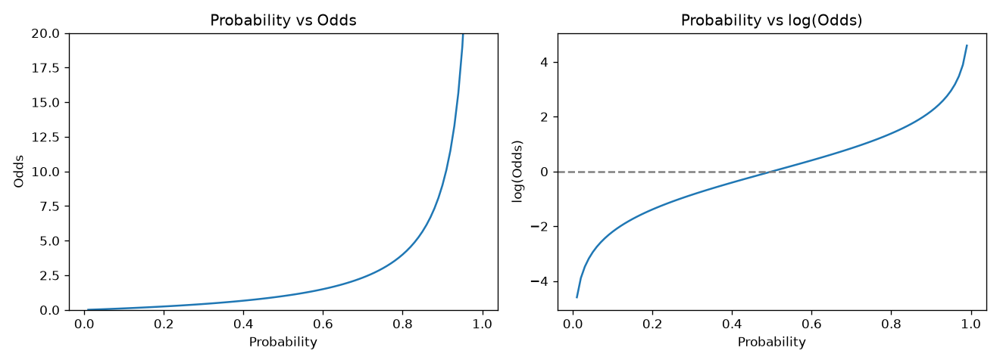

---

## 4. Applying it to the exam data

### Step 1: the raw data

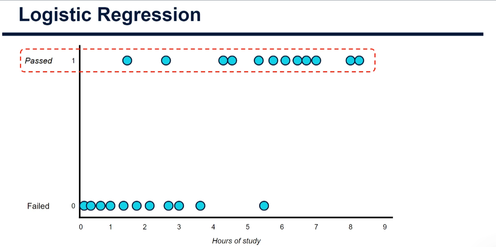

The y-axis only has two values: **0 (failed)** and **1 (passed)**. A straight line cannot sensibly fit that directly.

### Step 2: convert 0 and 1 to log(odds)

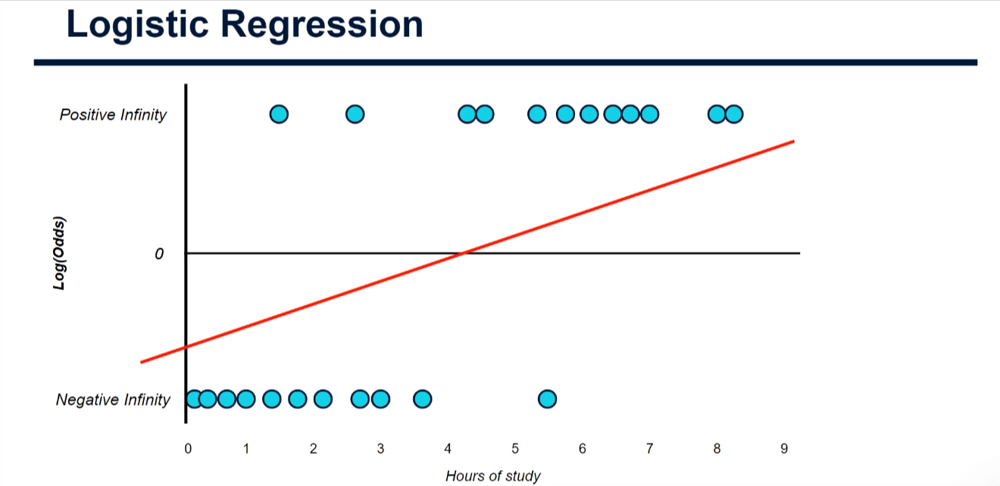

Since p = 0 ↔ log(odds) = −∞ and p = 1 ↔ +∞, logistic regression treats "failed" as **negative infinity** and "passed" as **positive infinity**. We then place a candidate **straight line of best fit** in this log(odds) space:

```
log(odds of passing) = b0 + b1 × hours
```

### Step 3: predicted log(odds) per student

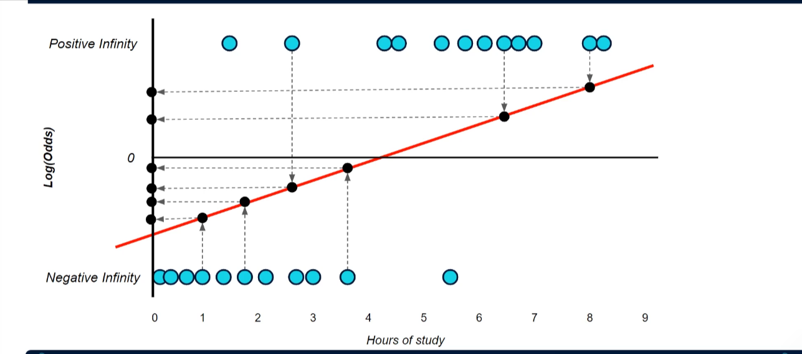

Plug each student's hours into the line (just as in linear regression) to get the **predicted log(odds)**. Now each student has an _actual_ value (±∞) and a _predicted_ value, and we know the _actual_ probability (0 or 1).

### Step 4: convert back to probability with the sigmoid

To judge how good the line is we turn predicted log(odds) back into probabilities. The function that does this is the **sigmoid**:

```
probability = 1 / (1 + e^(-log_odds))
```

```python
def sigmoid(z):
    return 1 / (1 + np.exp(-z))  # works on numbers and numpy arrays

print(sigmoid(log_odds(1 / 6)))  # 0.1666... (we are back to the die probability)
```

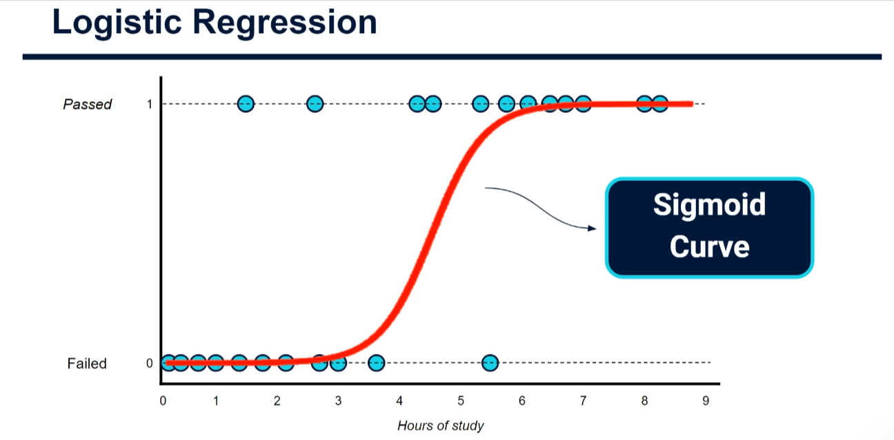

Plotting these probabilities against hours gives the familiar S-shaped **sigmoid curve**: near 0 for little study, near 1 for lots of study. (The next tutorial covers this in detail.)

---

## 5. Practical example: train a model in Python

```python
import numpy as np
from sklearn.linear_model import LogisticRegression

hours = np.array([0.1, 0.3, 0.7, 1.0, 1.4, 1.8, 2.1, 2.7, 3.0, 3.6, 5.5,
                  1.5, 2.6, 4.3, 4.5, 5.3, 5.7, 6.1, 6.5, 6.7, 7.0, 8.0, 8.3])
passed = np.array([0] * 11 + [1] * 12)   # 0 = fail, 1 = pass

X = hours.reshape(-1, 1)                 # sklearn wants a 2D array (rows = students)
model = LogisticRegression().fit(X, passed)  # learn b0 and b1 in log(odds) space

b0, b1 = model.intercept_[0], model.coef_[0][0]
print(f"log(odds) = {b0:.3f} + {b1:.3f} * hours")
print(model.predict_proba([[4.0]])[0][1])    # P(pass) after 4 hours
```

Output from running [logistic_regression_demo.py](./logistic_regression_demo.py):

```
log(odds) = -2.909 + 0.814 * hours
Each extra hour multiplies the odds of passing by e^0.814 = 2.26
Break-even point (p = 0.5): 3.57 hours

 Hours  log(odds)     Odds  P(pass)
     1      -2.09     0.12     0.11
     2      -1.28     0.28     0.22
     3      -0.47     0.63     0.39
     4       0.35     1.41     0.59
     5       1.16     3.19     0.76
     6       1.97     7.20     0.88
     7       2.79    16.24     0.94
     8       3.60    36.63     0.97
```

How to read it:

- **Slope (0.814):** every extra hour of study adds 0.814 to the log(odds), i.e. multiplies the odds of passing by about 2.26.
- **Intercept (−2.909):** the log(odds) at 0 hours (very likely to fail).
- **Break-even (3.57 h):** where log(odds) = 0, i.e. a 50% chance.
- **Decision rule:** predict "pass" when probability ≥ 0.5.

Generated plot of the fitted sigmoid:

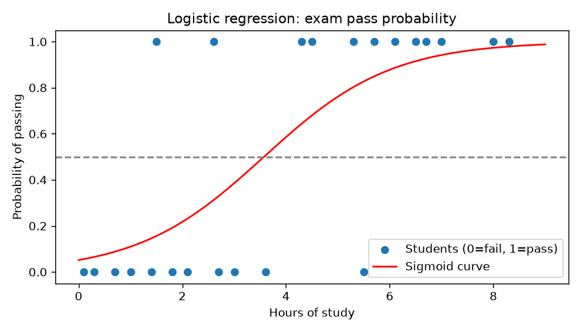

---

## Cheat sheet

| Concept           | Formula            | Range                      |
| ----------------- | ------------------ | -------------------------- |
| Probability `p`   | ways / total       | 0 to 1                     |
| Odds              | `p / (1 - p)`      | 0 to +∞                    |
| log(Odds)         | `ln(p / (1 - p))`  | −∞ to +∞                   |
| Sigmoid (inverse) | `1 / (1 + e^(-z))` | maps log(odds) back to 0–1 |

**Big picture:** logistic regression fits a straight line in **log(odds)** space, then uses the **sigmoid** to turn the result into a **probability**.

## Try it yourself

```powershell
pip install numpy matplotlib scikit-learn
python logistic_regression_demo.py
```

Exercises: change the `hours`/`passed` data, try `LogisticRegression(C=...)`, and compute the odds of a 70% chance by hand (0.7 / 0.3 = 2.33).
