# Advanced Evaluation Techniques (PRACTICAL) in ML

Runnable code for this note: [advanced_evaluation.py](./advanced_evaluation.py)

## Lecture slides

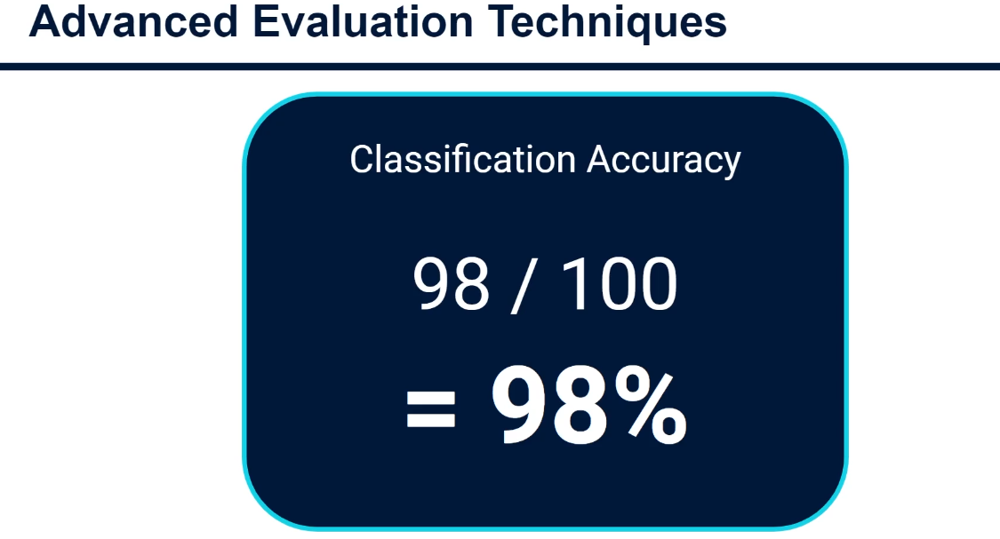

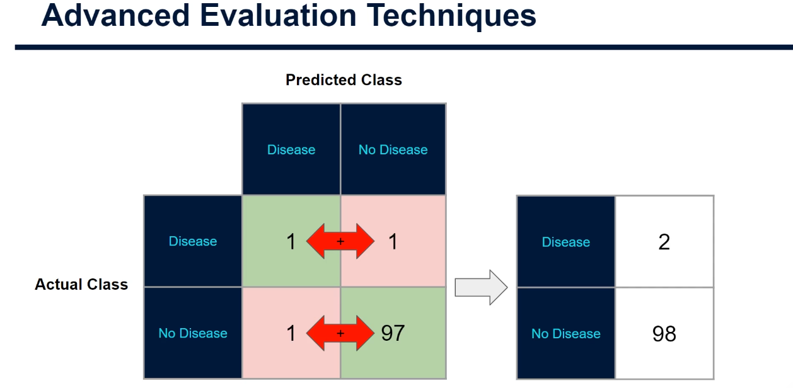

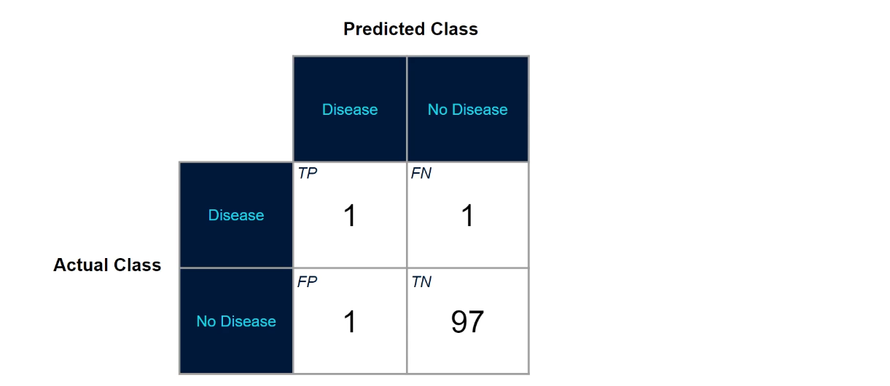

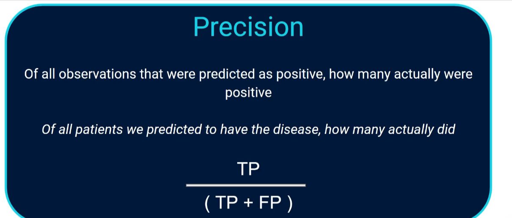

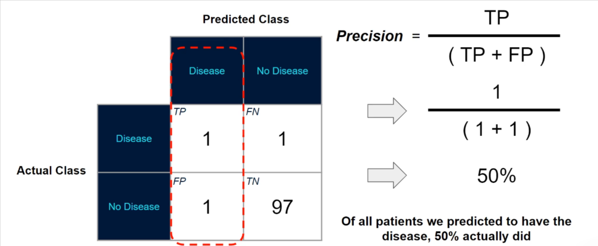

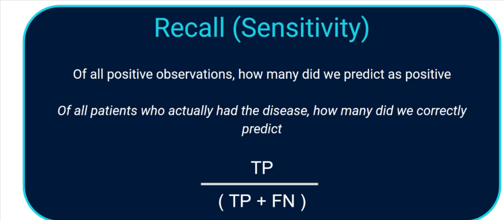

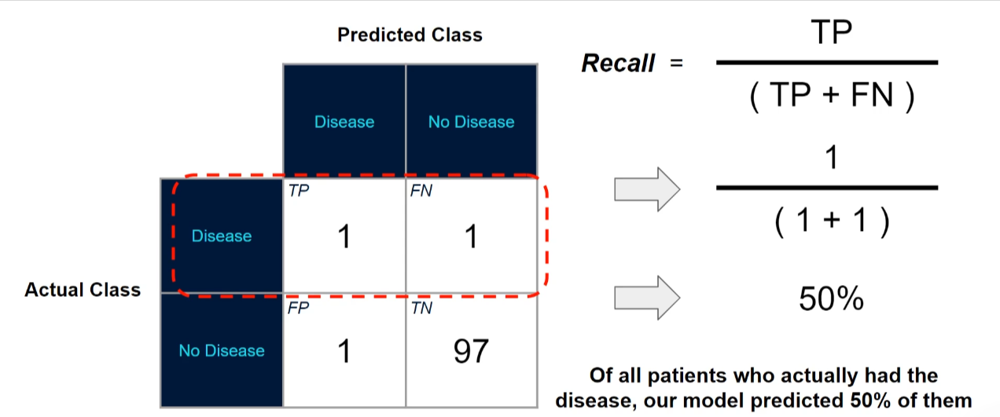

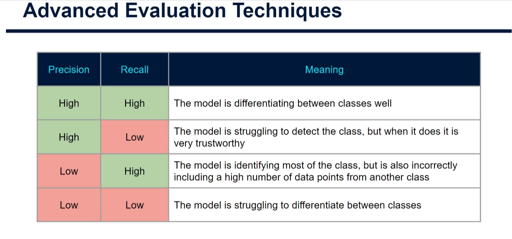

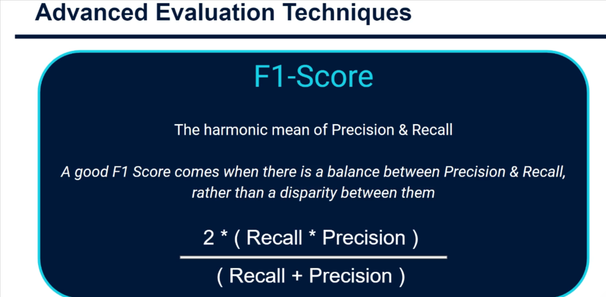

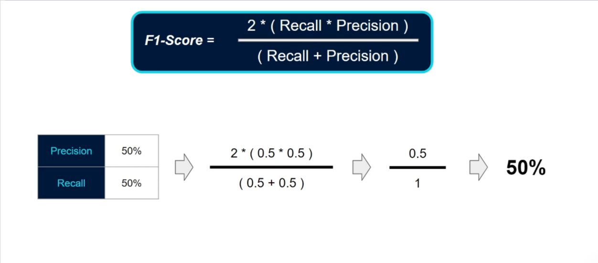

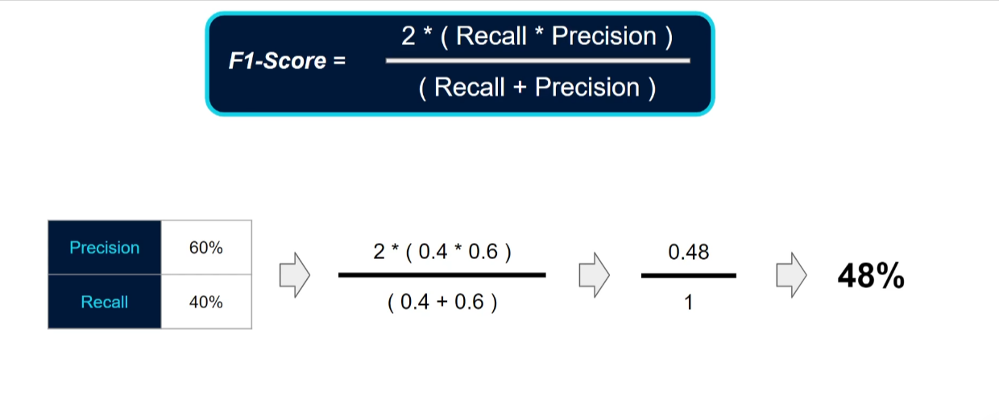

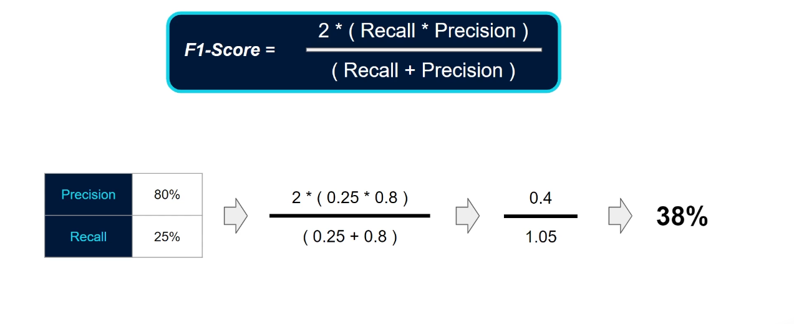

## 1. Why accuracy alone can mislead

In the previous tutorial we used the **confusion matrix** to measure classification accuracy:

```
accuracy = correct predictions / all predictions
```

This breaks down with **imbalanced data**, where one class is far more common than the other.

**Example:** predict whether a patient has a rare disease. In a test set of 100 patients, 98 are healthy and only 2 are sick. Our model gets 98 right, so accuracy is **98%**. It looks amazing, but a "model" that says _everyone is healthy_ would also score 98%. Accuracy hides the fact that we may be missing the sick patients, which are the ones we care about.

## 2. The four outcomes (confusion matrix)

|                      | Predicted sick      | Predicted healthy   |
| -------------------- | ------------------- | ------------------- |
| **Actually sick**    | True Positive (TP)  | False Negative (FN) |
| **Actually healthy** | False Positive (FP) | True Negative (TN)  |

- **TP / TN**: correct predictions.
- **FN**: sick patient told they are healthy. Very serious in medicine.
- **FP**: healthy patient told they are sick. Less serious, but causes stress and unnecessary tests.

In our example: TP = 1, FP = 1, FN = 1, TN = 97.

## 3. Precision

> Of everything we **predicted positive**, how much really was positive?

```
precision = TP / (TP + FP)
```

Example: 1 / (1 + 1) = **50%**. Half the patients we diagnosed did not have the disease.

Use it when **false alarms are costly** (e.g. spam filters: you don't want real email in the spam folder).

## 4. Recall (sensitivity)

> Of everything that **really was positive**, how much did we find?

```
recall = TP / (TP + FN)
```

Example: 1 / (1 + 1) = **50%**. We found only half of the sick patients. This is usually the key metric for disease detection, where missing a case is dangerous.

## 5. Precision vs recall trade-off

You can't usually maximise both: improving one tends to lower the other (the decision threshold controls this). Predicting _everyone_ is sick gives 100% recall but terrible precision.

| Precision | Recall | Meaning                                                           |
| --------- | ------ | ----------------------------------------------------------------- |
| High      | High   | Great: finds most positives and rarely raises false alarms        |
| High      | Low    | Cautious: right when it says positive, but misses many positives  |
| Low       | High   | Over-eager: finds nearly all positives but with many false alarms |
| Low       | Low    | Poor model                                                        |

Memory trick: **P**recision looks at what the model **P**redicted; **R**ecall looks at what is **R**eally positive.

## 6. F1 score

The F1 score blends the two using the **harmonic mean**, which rewards balance and punishes a big gap:

```
F1 = 2 * (precision * recall) / (precision + recall)
```

| Precision | Recall | F1                                                         |
| --------- | ------ | ---------------------------------------------------------- |
| 0.50      | 0.50   | **0.50**                                                   |
| 0.60      | 0.40   | **0.48** (average is still 0.50, but the gap is penalised) |
| 0.80      | 0.25   | **0.38** (bigger gap, bigger penalty)                      |

## 7. Practical code

Full, commented, runnable script: [advanced_evaluation.py](./advanced_evaluation.py).

```bash
pip install scikit-learn numpy
python advanced_evaluation.py
```

Key parts:

```python
from sklearn.metrics import (accuracy_score, confusion_matrix,
                             precision_score, recall_score, f1_score)

y_pred = model.predict(X_test)           # predicted classes
confusion_matrix(y_test, y_pred)         # [[TN FP] [FN TP]]
accuracy_score(y_test, y_pred)           # overall correctness
precision_score(y_test, y_pred)          # TP / (TP + FP)
recall_score(y_test, y_pred)             # TP / (TP + FN)
f1_score(y_test, y_pred)                 # harmonic mean of the two
```

### What the script shows (5000 patients, ~2% sick)

| Model                                          | Accuracy | Precision | Recall | F1   |
| ---------------------------------------------- | -------- | --------- | ------ | ---- |
| Always "healthy" baseline                      | 0.975    | 0.00      | 0.00   | 0.00 |
| Logistic regression (default)                  | 0.975    | 0.00      | 0.00   | 0.00 |
| Logistic regression, `class_weight="balanced"` | 0.743    | 0.07      | 0.72   | 0.12 |

1. The default model has 97.5% accuracy but **never detects a sick patient**, identical to the useless baseline.
2. Using `class_weight="balanced"` lowers accuracy but raises recall from 0 to 72%.
3. **Moving the threshold** (`probs >= threshold`) shows the trade-off directly: at 0.1 recall is 0.28, at 0.5 nobody is predicted sick.

(Exact numbers may vary slightly with library versions.)

## 8. Key takeaways

- Never trust accuracy alone on imbalanced data; compare against a "predict the majority class" baseline.
- Always look at the confusion matrix, precision, recall and F1.
- Pick the metric by cost of errors: recall for missed diagnoses, precision for costly false alarms, F1 for balance.
- Ways to handle imbalance: class weights, resampling, more minority data, threshold tuning.

**Next:** ROC curves and AUC, which let us compare different classification models fairly.
