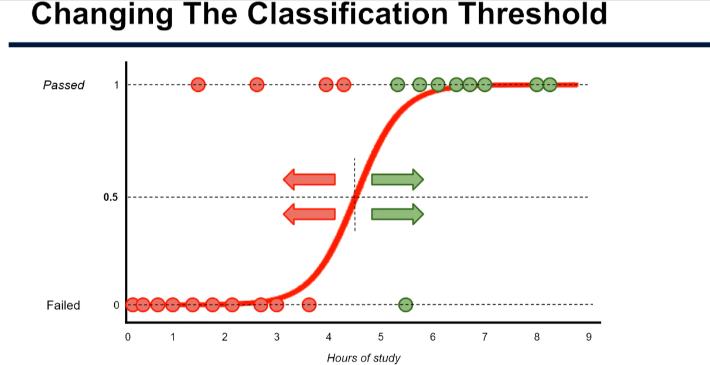

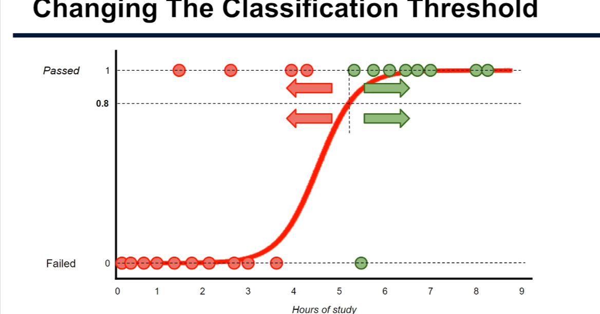

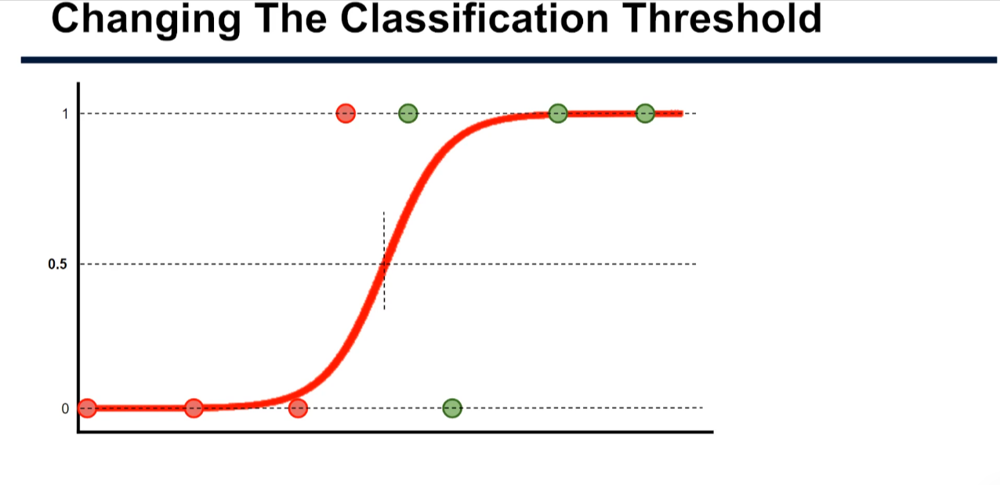

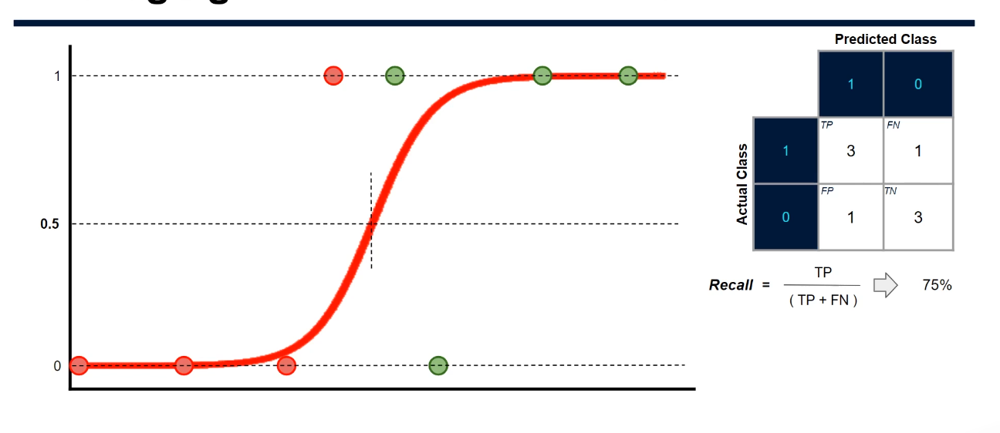

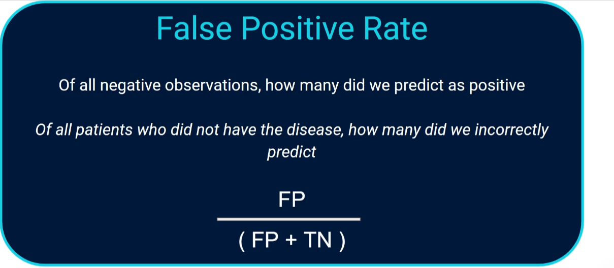

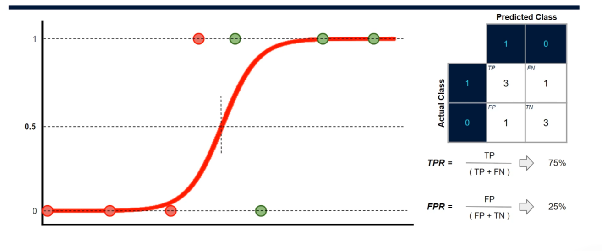

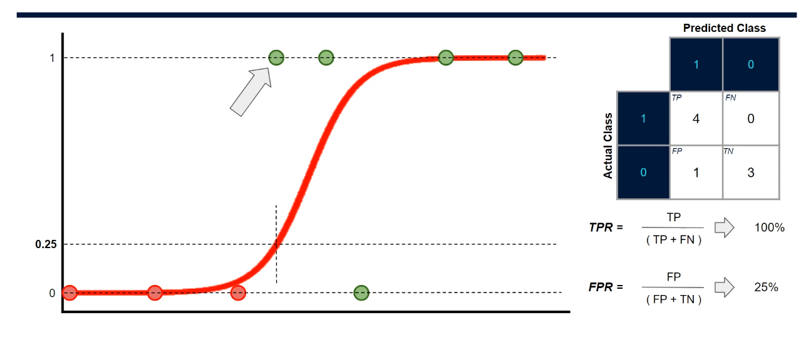

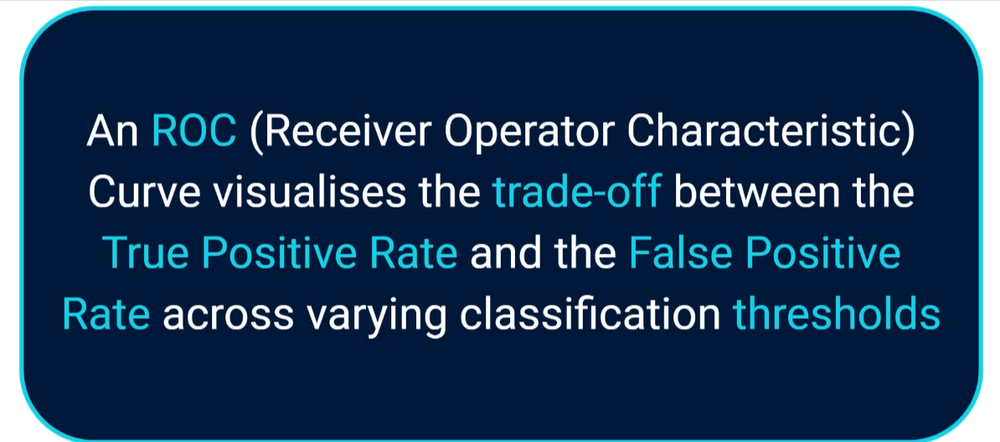

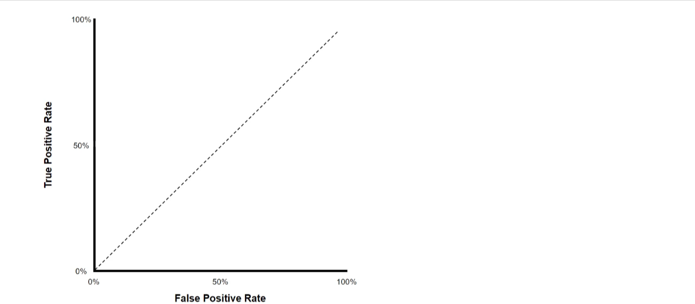

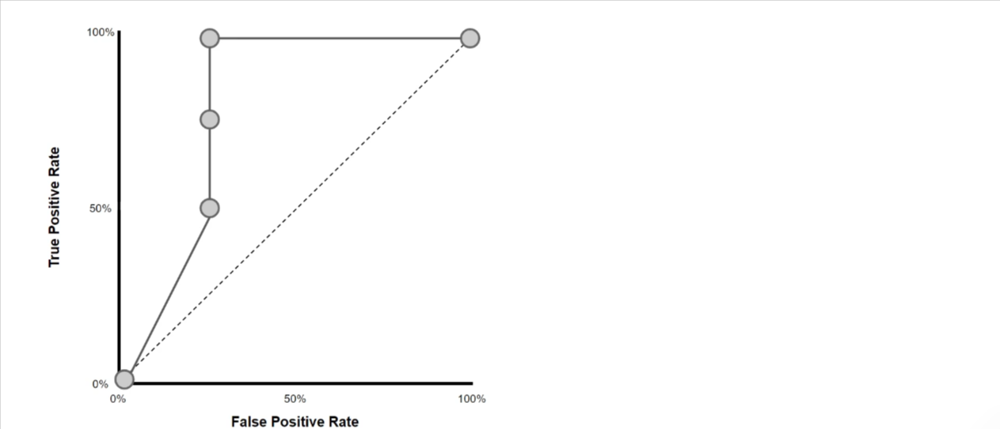

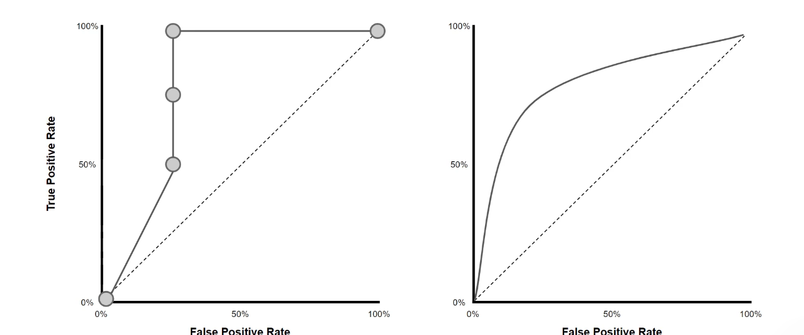

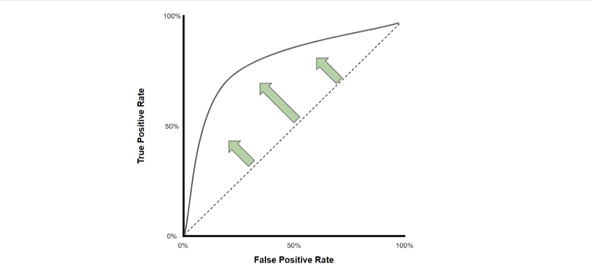

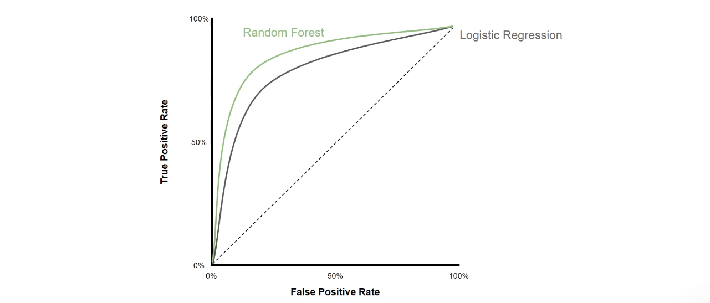

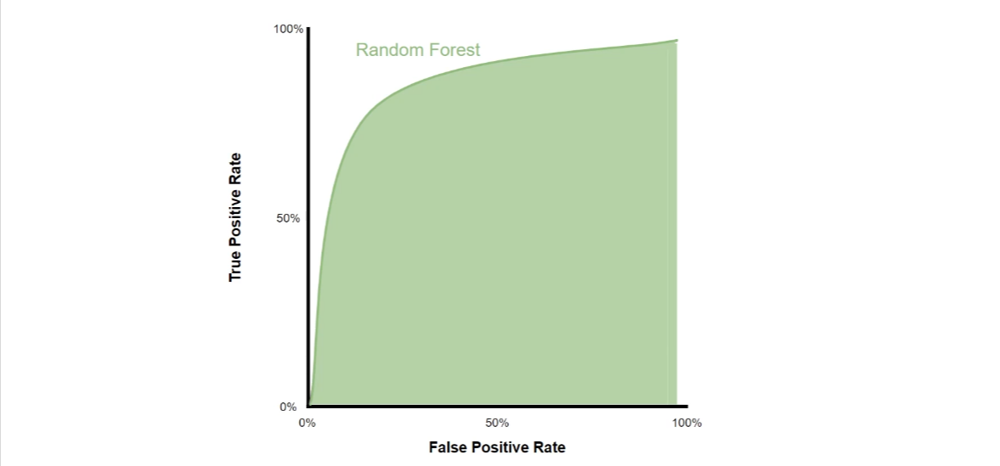

## 1. The idea: the 50% threshold is just a default

A classifier such as logistic regression outputs a **probability**. To get a class (0 or 1) we pick a **threshold**: probability ≥ threshold means 1, otherwise 0. We have always used **0.5**, but nothing forces that.

- **Lower threshold (e.g. 0.3):** more points become positive → more true positives _and_ more false positives.
- **Higher threshold (e.g. 0.8):** the model must be very sure → fewer false positives, but more missed positives.

When is this useful? With a deadly disease you may lower the bar to catch as many cases as possible. For a costly intervention you may raise it so you only act when very confident. Ideally you pick the threshold giving the best balance (e.g. the best F1 score).

## 2. Two rates you need

From the confusion matrix (TP, FP, FN, TN):

```
True positive rate  (TPR) = TP / (TP + FN)   # same as recall / sensitivity
False positive rate (FPR) = FP / (FP + TN)   # of real negatives, how many we wrongly flagged
```

Lecture example (4 positives, 4 negatives):

| Threshold                | TPR  | FPR  |
| ------------------------ | ---- | ---- |
| 0% (everything positive) | 1.00 | 1.00 |
| 25%                      | 1.00 | 0.25 |
| 50%                      | 0.75 | 0.25 |
| 75%                      | 0.25 | 0.00 |
| 100% (nothing positive)  | 0.00 | 0.00 |

## 3. The ROC curve

**ROC** (Receiver Operating Characteristic) plots **TPR (y-axis)** against **FPR (x-axis)**, one point per threshold.

- The **dotted diagonal** is random guessing (TPR = FPR).
- Points **above/left** of the diagonal are good: more correct positives than false alarms.
- The point **furthest from the diagonal** (largest TPR − FPR, called Youden's J) is a good "optimal" threshold.
- A perfect model hugs the top-left corner.

With only a few thresholds the curve is jagged; with many real data points it becomes smooth.

## 4. AUC: comparing models

**AUC** (Area Under the Curve) is the area under the ROC curve: 0.5 = random guessing, 1.0 = perfect. A curve further to the top-left has a larger AUC, so we can compare models fairly (e.g. logistic regression vs random forest).

## 5. Caveat: imbalanced data

ROC/AUC works best when classes are roughly balanced. With rare positives (e.g. a rare disease) it can look flattering, just like accuracy. Instead, use **precision, recall and F1**, and find the threshold that **maximises F1**.

## 6. Practical code

Full commented script: [changing_classification_threshold.py](./changing_classification_threshold.py)

```bash
pip install scikit-learn numpy matplotlib
python changing_classification_threshold.py
```

Key snippets:

```python
probs = model.predict_proba(X_test)[:, 1]        # probability of class 1
y_pred = (probs >= 0.3).astype(int)              # custom threshold instead of 0.5

fpr, tpr, thr = roc_curve(y_test, probs)         # ROC points, one per threshold
auc = roc_auc_score(y_test, probs)               # area under the curve
best = np.argmax(tpr - fpr)                      # furthest point above the diagonal
best_threshold = thr[best]

precision, recall, thr = precision_recall_curve(y_test, probs)
f1 = 2 * precision[:-1] * recall[:-1] / (precision[:-1] + recall[:-1] + 1e-12)
best_threshold = thr[np.argmax(f1)]              # threshold that maximises F1
```

### Results from the script

Balanced data, logistic regression:

| Threshold | TP  | FP  | FN  | TN  | TPR  | FPR  |
| --------- | --- | --- | --- | --- | ---- | ---- |
| 0.2       | 245 | 151 | 5   | 99  | 0.98 | 0.60 |
| 0.5       | 188 | 61  | 62  | 189 | 0.75 | 0.24 |
| 0.8       | 27  | 17  | 223 | 233 | 0.11 | 0.07 |

Lower thresholds catch nearly all positives but raise many false alarms; higher thresholds do the reverse.

Model comparison: logistic regression **AUC 0.804** vs random forest **AUC 0.969**, so the random forest is clearly better on this data. The best ROC threshold for logistic regression was about **0.44**. The script also saves `roc_curve.png`.

Imbalanced data (5% positive): F1 at the default 0.50 threshold was **0.574**; at the tuned threshold (**0.431**) it rose to **0.615**.

(Exact numbers may vary slightly across library versions.)

## 7. Key takeaways

- The threshold converts probabilities into classes; 0.5 is only a default.
- Lowering it raises recall/TPR and FPR; raising it does the opposite.
- ROC curve = TPR vs FPR across thresholds; AUC summarises it and lets you compare models.
- For imbalanced data, tune the threshold on F1 (or precision/recall) rather than ROC.
- Choose the threshold on validation data, not the test set, in real projects, to avoid over-optimistic results.
