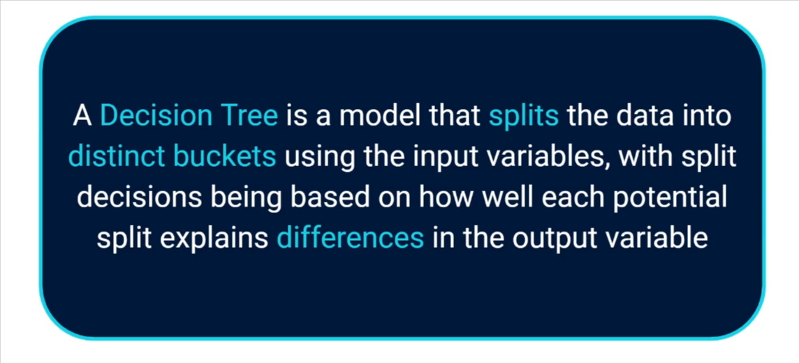
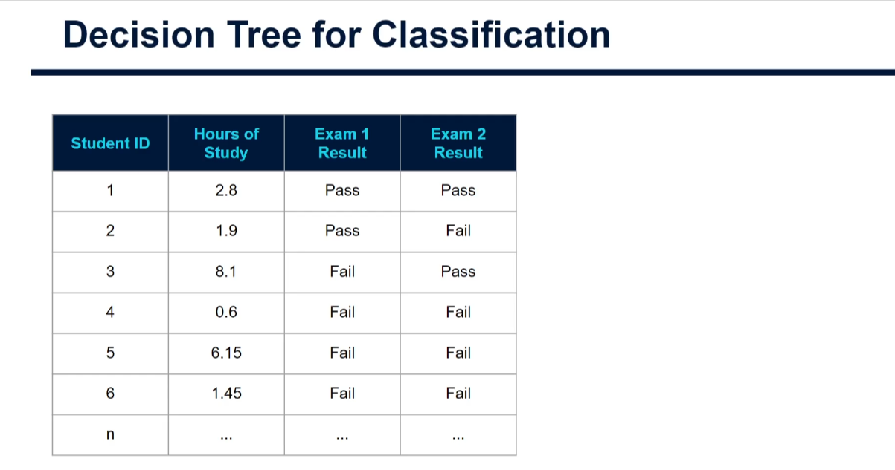
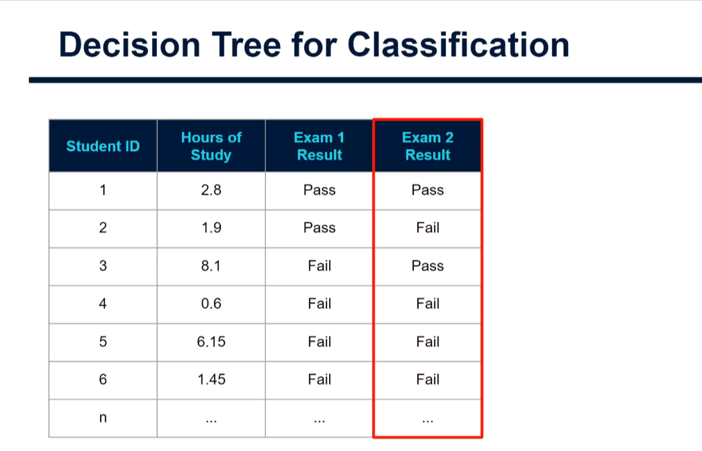
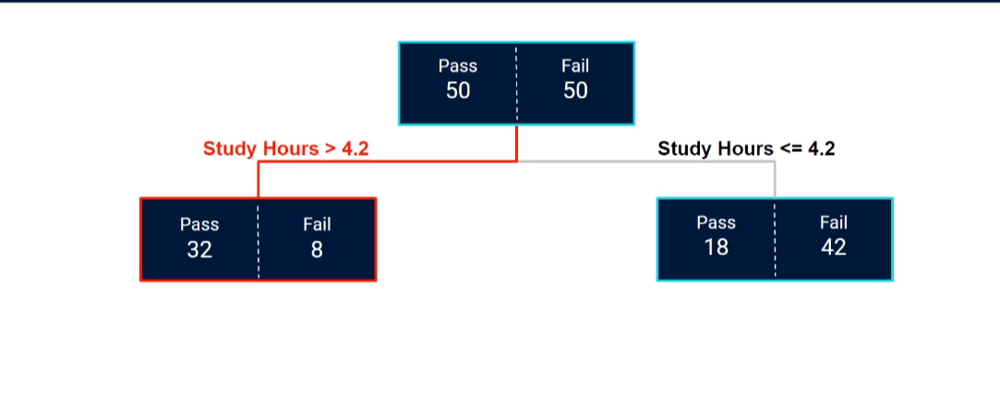
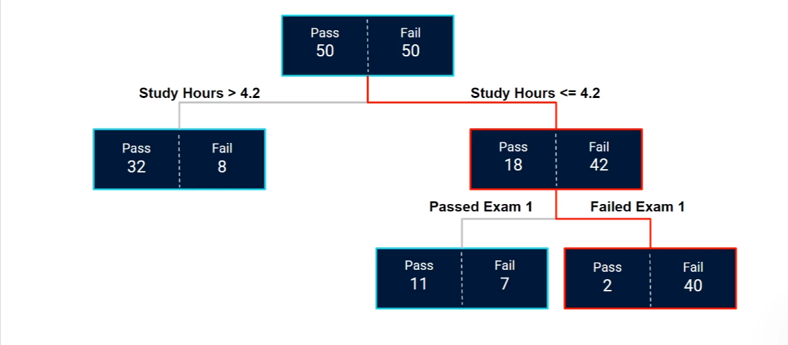

# Decision Trees for Classification (Classification Trees) (PRACTICAL) in ML


Runnable, fully commented example: [decision_trees_classification.py](./decision_trees_classification.py)

## Lecture images and the story they tell

The images below illustrate the tutorial's student-exam example. The later code uses a larger, reproducible **synthetic** student dataset to demonstrate training and evaluation; it is not the same dataset as the slides.



_The input features are study hours and Exam 1 result. Exam 2 result is the target the tree will learn to predict._



_The highlighted Exam 2 column is what the model is trying to predict. It must not be included among the input features._



_At the root, the example considers a split at 4.2 study hours. The group studying more than 4.2 hours contains 32 passes and 8 fails (80% pass); the other group contains 18 passes and 42 fails (30% pass)._



_The group studying at most 4.2 hours is split again by Exam 1 result. The resulting leaves have different pass rates: 11/18 (about 61%) for students who passed Exam 1, and 2/42 (about 5%) for students who failed it._

## 1. What is a classification tree?

A **decision tree** predicts an outcome by asking a sequence of questions about input features. Each question sends a row down one branch; the final destination is a **leaf** (also called a terminal node), where the model gives its prediction.

For the exam example:

1. Is study time greater than 4.2 hours?
2. If not, did the student pass Exam 1?
3. Use the pass/fail examples in the reached leaf to estimate the chance of passing Exam 2.

The model is called a **classification** tree when its target is a category, such as pass/fail, spam/not spam, or churn/stay. CART means **Classification and Regression Trees**: the same broad family of tree methods can predict either categories or numbers.

| Tree part        | Meaning                                                           |
| ---------------- | ----------------------------------------------------------------- |
| Root             | The first node, containing the training examples before any split |
| Split / decision | A question about a feature, such as `study_hours <= 4.2`          |
| Branch           | One possible answer to a split question                           |
| Leaf             | A final group that makes a prediction                             |
| Depth            | Number of split levels from the root to a leaf                    |

Unlike a regression tree, which typically predicts a number such as a house price, a classification tree predicts a class and can also report class probabilities.

## 2. How the tree learns its questions

During training, the algorithm searches for a feature and split that make the child groups **more pure** than the parent group. A pure group mostly (or entirely) contains one class.

For example, the root in the slide has 50 passes and 50 fails, so it is mixed. Splitting on study hours creates groups with pass rates of 80% and 30%, making both groups more informative than the original 50% pass rate.

For every candidate split, the algorithm calculates the weighted impurity of the child nodes:

```text
weighted child impurity =
    (left rows / parent rows) * left impurity
  + (right rows / parent rows) * right impurity
```

It chooses the split that reduces impurity the most. Common impurity measures are:

### Gini impurity

```text
Gini = 1 - sum(p(class) ** 2)
```

Gini is zero when every row in the node belongs to one class. For a node with 50% pass and 50% fail, Gini is `1 - (0.5² + 0.5²) = 0.5`.

### Entropy and information gain

```text
Entropy = -sum(p(class) * log2(p(class)))
Information gain = parent entropy - weighted child entropy
```

Entropy is also zero for a pure node. Both Gini and entropy reward splits that separate classes; they often produce similar trees. In scikit-learn, `criterion="gini"` is the default, and `"entropy"` and `"log_loss"` are other supported choices.

For numeric features, candidate thresholds are considered between observed values. A split such as `study_hours <= 4.2` sends qualifying rows left and the rest right. The process repeats within each child until a stopping rule applies, such as reaching a maximum depth or having too few rows to split.

> **Important:** a tree is greedy. It picks the best split available at the current node, then continues on each child. It does not generally search every possible complete tree to find a globally optimal one.

## 3. What a leaf prediction means

The model stores the class counts in each leaf. In the slide's Exam 1-passed leaf, 11 of 18 students passed Exam 2, so the observed pass proportion is:

```text
11 / 18 = 0.611...  (about 61%)
```

The tree's estimated class probabilities for a row in that leaf are based on those class proportions. With the usual two-class prediction rule, the class with the larger probability is selected; an exact tie is resolved by the model's class ordering. Thus a leaf with 61% pass is predicted as **pass**, while a leaf with 5% pass is predicted as **fail**.

Probabilities from a small leaf can be uncertain. A leaf containing 2 rows should not be treated as equally reliable as one containing 200 rows, even if both show the same pass percentage.

## 4. A hand-worked prediction from the slides

Suppose Lucy studied for 3.5 hours and passed Exam 1:

1. `3.5 <= 4.2`, so follow the branch to the lower-study group.
2. Lucy passed Exam 1, so follow the branch to the Exam 1-passed leaf.
3. That leaf contains 11 Exam 2 passes and 7 fails.
4. Estimated Exam 2 pass rate: `11 / (11 + 7) = 61%`.
5. At a 50% class decision threshold, the predicted class is **pass**.

This is a simple example, not a guarantee about an individual student's result. A classifier learns patterns in historical data; it does not establish that studying a certain number of hours causes an outcome.

## 5. A runnable Python example

The companion script creates a reproducible synthetic dataset with:

- study hours;
- whether the student passed Exam 1;
- attendance percentage;
- whether the student passed Exam 2 (the target).

It introduces a small amount of missing feature data and imputes it using a preprocessing pipeline fit only on the training data. It then compares a majority-class baseline, a depth-limited tree, and an unconstrained tree; prints confusion matrices and precision/recall/F1; predicts one new student's class and probability; and saves a plot of the shallow tree.

On the current fixed-seed run, the majority-class baseline gets about 0.58 test accuracy, the depth-limited tree gets about 0.76, and the unconstrained tree gets 1.00 training accuracy but about 0.73 test accuracy. This illustrates both the value of a baseline and the training/test gap caused by overfitting. These values describe only the generated example, not a real student population.

From the repository root, run:

```bash
python DSI/Day-125/decision_trees_classification.py
```

The dependencies (`numpy`, `pandas`, `scikit-learn`, and `matplotlib`) are listed in [DSI/pyproject.toml](../pyproject.toml). If using `uv`, run:

```bash
uv run --project DSI python DSI/Day-125/decision_trees_classification.py
```

The script uses a fixed random seed, so the generated data and results are repeatable for the same library versions. It saves the tree plot as `decision_tree_classification_tree.png` beside the script.

### Why compare more than accuracy?

- **Accuracy** is the fraction of all predictions that are correct.
- **Precision for pass** answers: among students predicted to pass, how many passed?
- **Recall for pass** answers: among students who passed, how many did the model identify?
- **F1** balances precision and recall.
- **Confusion matrix** shows the error counts. With labels `Fail=0` and `Pass=1`, its layout is `[[true fail predicted fail, true fail predicted pass], [true pass predicted fail, true pass predicted pass]]`.

The majority-class baseline shows how well a trivial model would do by always predicting the most common training class. A decision tree should be compared to that baseline, not just judged by its raw accuracy.

The unconstrained tree can memorize training examples. If its training score is much higher than its test score, that is evidence of **overfitting**. The shallow, minimum-leaf-size-limited tree is a regularized model intended to generalize more reliably. Exact scores can vary if the synthetic data-generation logic or library versions change.

### Important parts of the script

```python
train_test_split(X, y, test_size=0.25, stratify=y, random_state=42)
```

The test set is held out before fitting the model or the imputer. `stratify=y` keeps the pass/fail proportions similar across the splits.

```python
Pipeline([
    ("imputer", SimpleImputer(strategy="median")),
    ("tree", DecisionTreeClassifier(max_depth=3, min_samples_leaf=15)),
])
```

The pipeline learns median values from training data and applies the same values to test data. This prevents **data leakage** from using test-set information during preprocessing. Median imputation is a simple demonstration; choose a missing-data strategy based on what missingness means in the real application.

```python
tree.predict_proba(new_student)
```

This returns estimated class probabilities for the new row. They are proportions based on training examples in its leaf, not automatically well-calibrated real-world probabilities.

## 6. Preventing overfitting

A tree can keep splitting until it has memorized individual training rows. Such a tree may score nearly perfectly on training data and poorly on new examples. Control its complexity using:

| Setting             | What it controls                                           |
| ------------------- | ---------------------------------------------------------- |
| `max_depth`         | Maximum number of split levels                             |
| `min_samples_split` | Minimum rows needed in a node before it can split          |
| `min_samples_leaf`  | Minimum rows allowed in a leaf                             |
| `max_leaf_nodes`    | Maximum number of final leaves                             |
| `ccp_alpha`         | Cost-complexity pruning strength; larger values prune more |

The script uses a maximum depth and minimum leaf size as an accessible starting point. For a real project, select settings with cross-validation on the training data, then evaluate the chosen model once on a held-out test set. Do not tune against the test set repeatedly.

## 7. Practical workflow for your own classification data

1. **Define the target.** Choose the column to predict and identify which class is positive for your use case.
2. **Check the data.** Inspect target class counts, missing values, invalid rows, feature types, and possible leakage. Do not use an ID or information recorded only after the outcome as a feature.
3. **Split before fitting preprocessing.** Use a stratified random split for ordinary classification. For time-dependent records, split chronologically instead.
4. **Build preprocessing with the model.** Impute missing values and encode categorical features inside a pipeline. Decision trees do not need feature standardization, but scikit-learn trees require numeric inputs; one-hot encode nominal categories.
5. **Establish a baseline.** Compare against a majority-class predictor and choose metrics that reflect the cost of false positives and false negatives.
6. **Train and regularize.** Start with a shallow tree, then adjust depth, leaf size, or pruning using training-only validation or cross-validation.
7. **Evaluate held-out examples.** Report confusion matrix and suitable metrics, not just training accuracy. Review which kinds of mistakes matter most.
8. **Inspect the rules carefully.** Visualize a small tree, check its paths, and treat feature importance as a clue rather than proof of causation.

## 8. Strengths and limitations

**Strengths**

- Easy to explain as a sequence of if/then rules.
- Captures nonlinear patterns and feature interactions without manually creating them.
- Usually does not require feature scaling.
- Can provide class probabilities from leaf proportions.

**Limitations**

- A small change in training data can produce a different tree.
- Deep trees can overfit.
- A single tree may be less accurate than an ensemble such as a random forest or gradient-boosted trees.
- Axis-aligned splits can need many questions to represent diagonal or smooth boundaries.
- Impurity-based feature importance can favor features with many possible split points and does not show causal effects.
- Predicted probabilities may be poorly calibrated, especially for small leaves.
- Class imbalance can make accuracy misleading; use a baseline and class-appropriate metrics.

## 9. Key takeaways

- A classification tree repeatedly splits rows into purer groups using feature-based questions.
- The root is the first split; leaves contain the final class counts and predictions.
- A leaf probability is the fraction of training examples of a class in that leaf.
- Control tree complexity to reduce overfitting and use training-only validation to select settings.
- Hold out test data before fitting preprocessing, compare against a baseline, and evaluate with the confusion matrix and relevant metrics.
- The student slides illustrate the logic; the companion script is a separate synthetic-data demonstration that can be run and modified.
