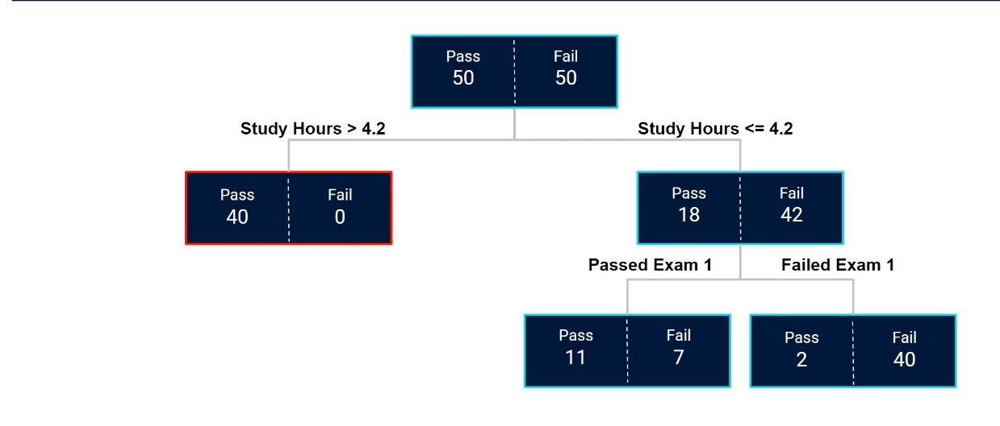
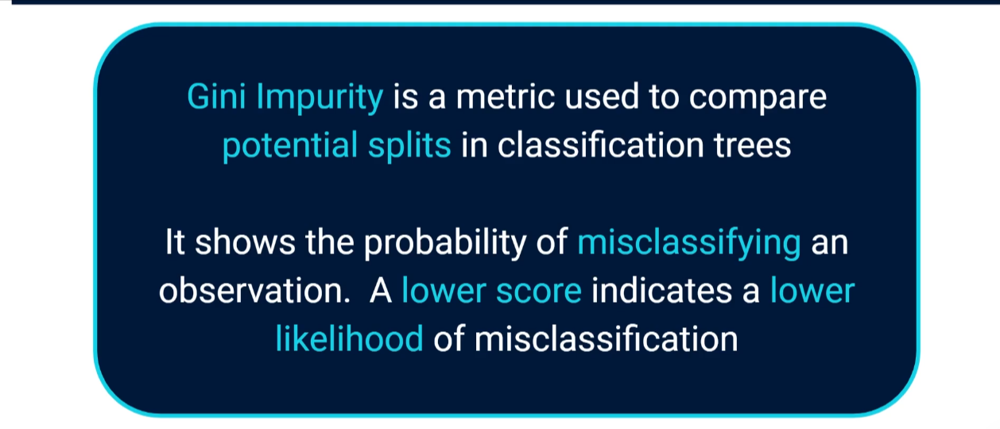
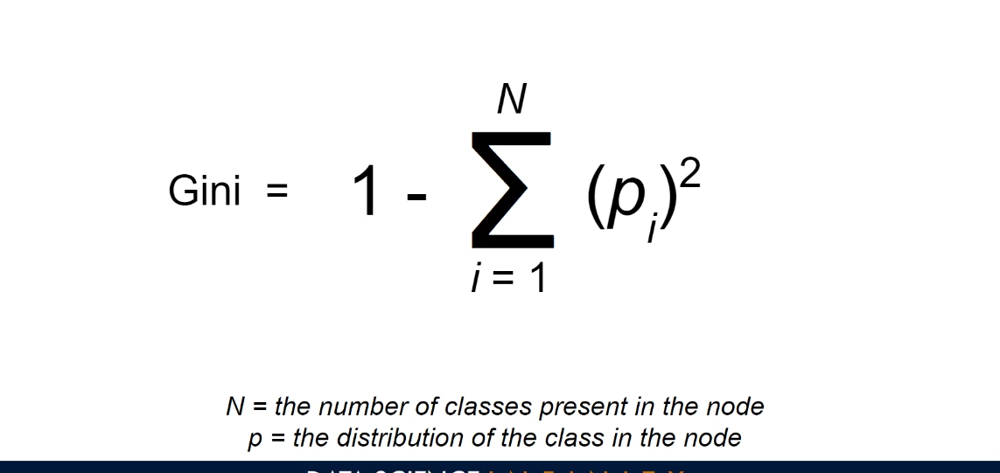
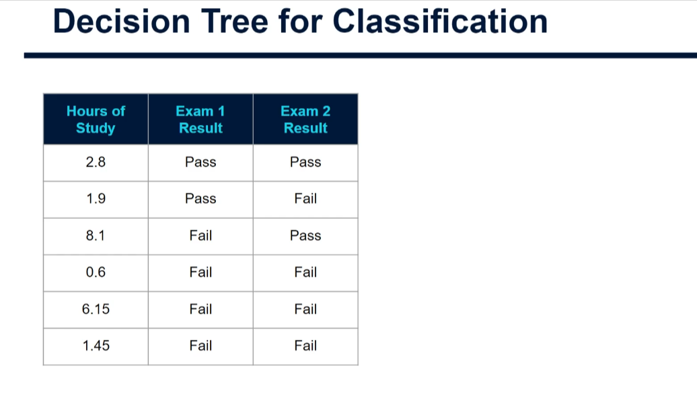
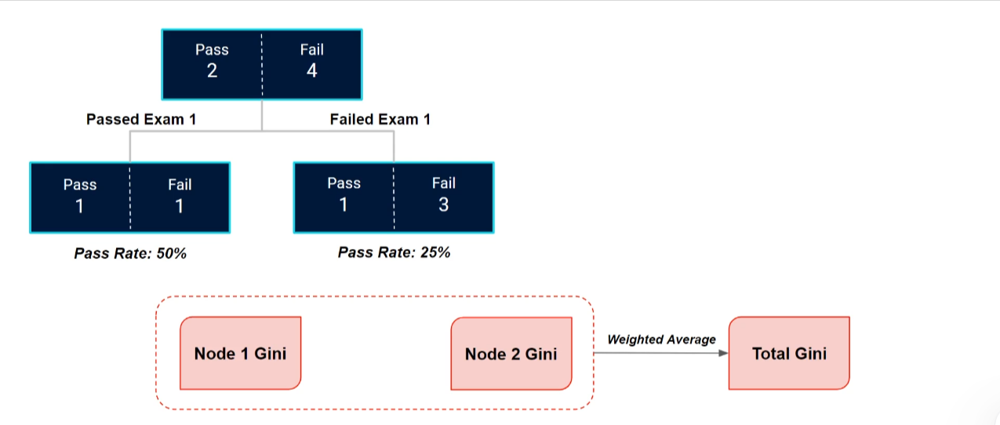
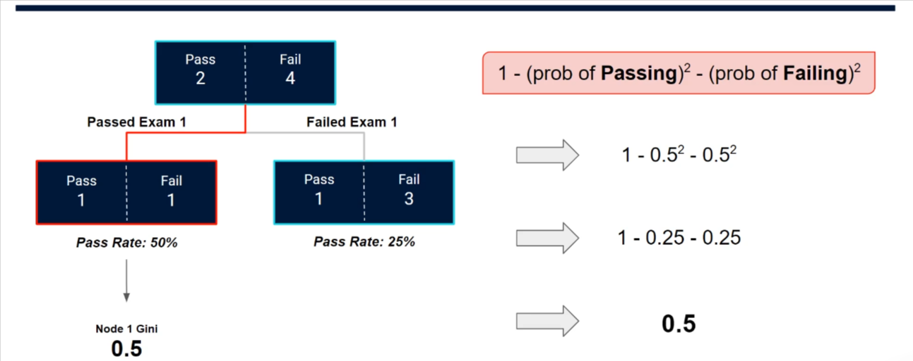
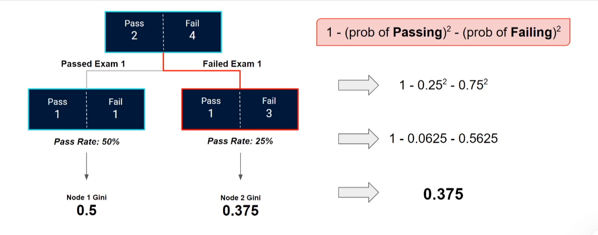
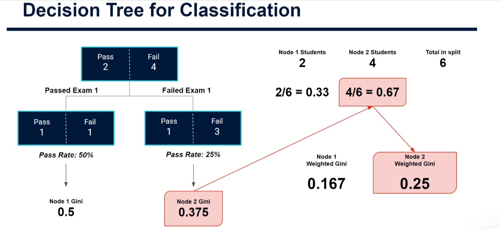
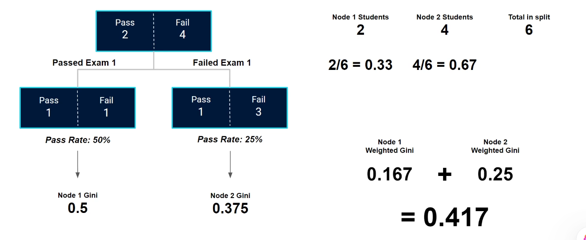
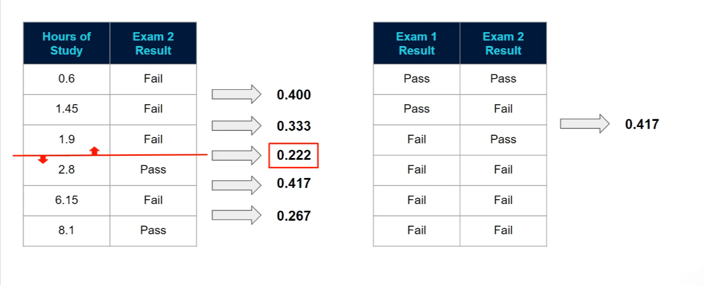

# Decision Trees for Classification: Splitting Criteria (Gini Impurity)

This tutorial goes deeper into **how a classification tree decides which split to use at each point in the tree**.

In the introductory tutorial we saw the high-level process: start with all the data, test every possible split on every input variable, and keep the best one. In Lucy's data science exam example the best first split was on hours of study, at **4.2 hours**. But what does "best" actually mean?



*Why this matters:* the first split sends 40 students who studied more than 4.2 hours into a node where all of them pass (a **pure** node, outlined in red). The remaining node (18 pass / 42 fail) is still mixed, so the tree splits it again on the Exam 1 result.

## Why not Mean Squared Error?

In regression trees we used **Mean Squared Error (MSE)**: for each candidate split we measured the size of the prediction errors and chose the split with the smallest error.

MSE only makes sense when the output is **numeric**. In classification the output is a **class** (e.g. Pass / Fail), so we need a different metric to compare split points. Several exist, but the most common, and the **default in scikit-learn**, is **Gini impurity**.

## What is Gini impurity?



- Gini impurity compares potential splits in classification trees.
- It represents the **probability of misclassifying an observation**.
- **Lower score = lower likelihood of misclassification**, so the algorithm picks the split with the **lowest** Gini impurity.

### The formula



$$
Gini = 1 - \sum_{i=1}^{N} (p_i)^2
$$

- **N** = the number of classes present in the node
- **p<sub>i</sub>** = the proportion of observations in the node that belong to class *i*

For two classes (Pass / Fail) this simplifies to:

$$
Gini = 1 - (\text{prob of passing})^2 - (\text{prob of failing})^2
$$

### Pure vs. impure nodes

- A node containing observations from **both** classes is **impure**. Every node in the tree above (apart from the red one) has some impurity.
- A node containing only **one** class is **pure** and has a Gini of **0**. For example, 40 pass / 0 fail gives `1 - 1² - 0² = 0`.
- The worst case for two classes is a 50/50 mix, which gives `1 - 0.5² - 0.5² = 0.5`.

The algorithm's goal is to find the split that produces the **lowest overall Gini impurity**, meaning the child nodes are as pure as possible.

## Worked example: calculating Gini from scratch

To keep the arithmetic manageable we use a tiny subset of the exam data: just six students.



| Hours of Study | Exam 1 Result | Exam 2 Result (target) |
|---|---|---|
| 2.8 | Pass | Pass |
| 1.9 | Pass | Fail |
| 8.1 | Fail | Pass |
| 0.6 | Fail | Fail |
| 6.15 | Fail | Fail |
| 1.45 | Fail | Fail |

At the root node we have **2 students who passed** Exam 2 and **4 who failed**. The algorithm must check every possible split in both input variables and find the one with the lowest Gini impurity.

### Step 0: Build the candidate split (Exam 1 result)

Exam 1 result is **binary**, so there is only one possible split: those who passed Exam 1 versus those who failed it.



- **Passed Exam 1** (2 students): 1 passed Exam 2, 1 failed. Pass rate **50%**.
- **Failed Exam 1** (4 students): 1 passed Exam 2, 3 failed. Pass rate **25%**.

This is only a *temporary* tree: we are assessing the split, not yet committing to it.

The calculation has three steps:

1. Gini impurity of node 1
2. Gini impurity of node 2
3. Combine them into a **weighted average** to get the Gini impurity of the whole split

### Step 1: Gini of Node 1 (passed Exam 1)



P(pass) = 1/2 = 0.5 and P(fail) = 1/2 = 0.5

```
1 - 0.5² - 0.5²
= 1 - 0.25 - 0.25
= 0.5
```

### Step 2: Gini of Node 2 (failed Exam 1)



P(pass) = 1/4 = 0.25 and P(fail) = 3/4 = 0.75

```
1 - 0.25² - 0.75²
= 1 - 0.0625 - 0.5625
= 0.375
```

### Step 3: Weighted Gini for the split

The two nodes contain different numbers of students, so a simple average would be misleading. A node with more students should count for more. We weight each node's Gini by the **proportion of observations** it holds.



- Node 1: 2 students, so the weight is 2/6 ≈ **0.33**
- Node 2: 4 students, so the weight is 4/6 ≈ **0.67**

Weighted Gini per node:

- Node 1: 0.5 × 0.33 ≈ **0.167**
- Node 2: 0.375 × 0.67 ≈ **0.25**

Add them together:



```
Total Gini = 0.167 + 0.25 = 0.417
```

So **splitting on Exam 1 result gives a Gini impurity of 0.417**. On its own this number means little; it only becomes useful when compared with every other candidate split.

## Comparing all candidate splits

Exam 1 result is binary, so it has just one split. **Hours of study** is numeric, so it has many candidate splits. The easiest way to picture this is to **sort the data by hours of study** (smallest to largest) and place a split between each pair of adjacent values. Six rows give five possible splits.



| Split position (between hours...) | Weighted Gini |
|---|---|
| 0.6 and 1.45 | 0.400 |
| 1.45 and 1.9 | 0.333 |
| **1.9 and 2.8** | **0.222** (lowest) |
| 2.8 and 6.15 | 0.417 |
| 6.15 and 8.1 | 0.267 |
| *Exam 1 result (for comparison)* | 0.417 |

You can verify the winner by hand. Splitting between 1.9 and 2.8 hours gives:

- Left node: 0.6, 1.45, 1.9 are all Fail, so it is pure and **Gini = 0**.
- Right node: 2.8 (Pass), 6.15 (Fail), 8.1 (Pass) gives P(pass) = 2/3 and P(fail) = 1/3, so Gini = 1 - 0.444 - 0.111 = **0.444**.
- Weighted: (3/6 × 0) + (3/6 × 0.444) = **0.222**.

### Choosing the threshold

The lowest impurity (**0.222**) lies between **1.9 hours** and **2.8 hours**. In practice the algorithm takes the **midpoint** of the two values as the threshold:

```
(1.9 + 2.8) / 2 = 2.35
```

So the first split in this tree is: **studied ≤ 2.35 hours vs. studied > 2.35 hours**.

## Putting it together

1. Start with all the data at the root node.
2. For every input variable, list every candidate split (one for a binary variable; one between each pair of adjacent sorted values for a numeric variable).
3. For each candidate, compute the Gini impurity of both child nodes, then take their **weighted average** by number of observations.
4. Choose the split with the **lowest** weighted Gini and use the midpoint as the threshold for numeric variables.
5. **Repeat** the process inside each new node, looking for further splits that reduce impurity and separate the classes of the output variable. Stop when nodes are pure or another stopping rule is met (for example, a maximum depth).

## Key takeaways

- Regression trees use **MSE**; classification trees typically use **Gini impurity** (scikit-learn's default).
- Gini = `1 - Σ pᵢ²`. It is 0 for a pure node and 0.5 at worst for two classes.
- A split's score is the **weighted average** of its child nodes' Gini scores, weighted by node size.
- The best split is the one with the **lowest** weighted Gini.
- For numeric features, thresholds are the **midpoints** between adjacent sorted values.
