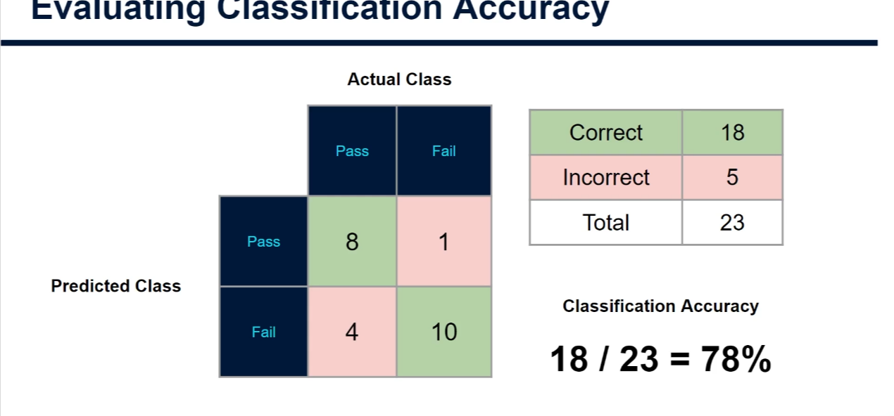
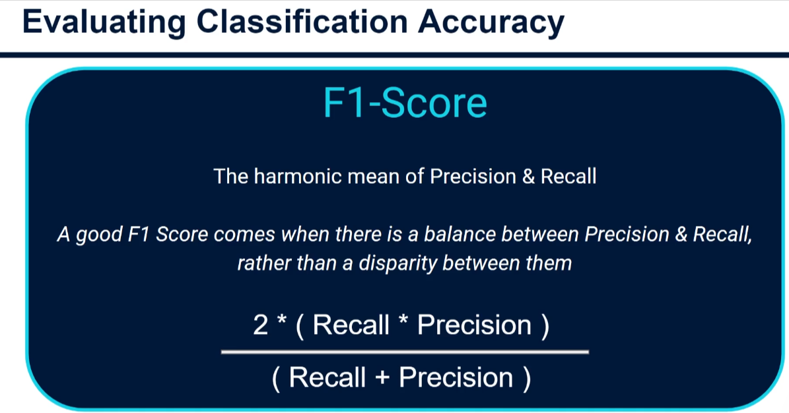
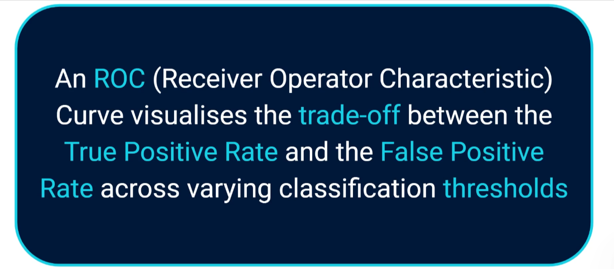
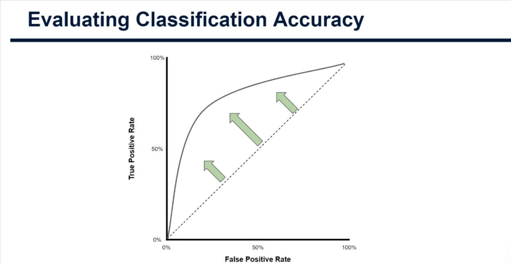
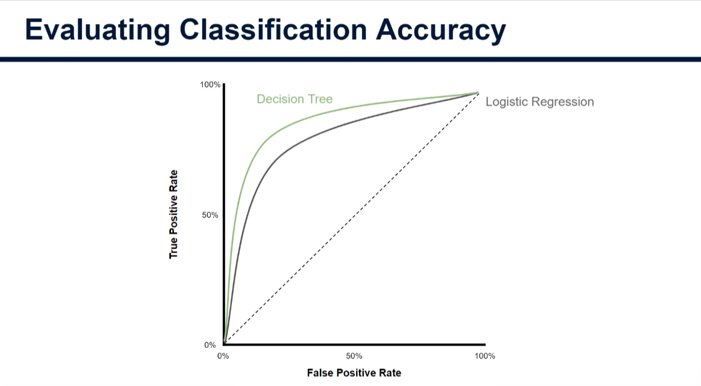

# Evaluating Classification Accuracy (Decision Trees)

The methods for assessing a classification tree are **exactly the same as for logistic regression**. This note is a recap of the key ideas and how they apply to decision trees. We use the running example of predicting whether a student **passes or fails** an exam (positive class = **Pass**).

## 1. The confusion matrix

A 2×2 table showing how many data points were predicted in each class versus their actual class.



| | Actual Pass | Actual Fail |
|---|---|---|
| **Predicted Pass** | **True Positive (TP)** = 8 | **False Positive (FP)** = 1 |
| **Predicted Fail** | **False Negative (FN)** = 4 | **True Negative (TN)** = 10 |

- **True positive:** model predicts positive and is correct (predicts Pass, student passed).
- **True negative:** model predicts negative and is correct (predicts Fail, student failed).
- **False positive (Type I error):** model predicts positive but is wrong (predicts Pass, student actually failed).
- **False negative (Type II error):** model predicts negative but is wrong (predicts Fail, student actually passed).

## 2. Metrics from the confusion matrix

### Classification accuracy

Correct classifications out of all classifications attempted. The most intuitive measure.

```
Accuracy = (TP + TN) / (TP + TN + FP + FN) = (8 + 10) / 23 = 18 / 23 ≈ 78%
```

**Caution:** accuracy alone can mislead with **highly imbalanced data** (e.g. a rare disease), where one class dominates. A model that always predicts the majority class can score high accuracy yet be useless. In that case use precision, recall and F1.

### Precision

Of all observations **predicted positive**, how many really were positive? (Of all patients we predicted to have the disease, how many actually did?)

```
Precision = TP / (TP + FP) = 8 / (8 + 1) ≈ 0.89
```

### Recall (sensitivity)

Of all **actual positive** observations, how many did we correctly predict? (Of all patients who actually had the disease, how many did we catch?)

```
Recall = TP / (TP + FN) = 8 / (8 + 4) ≈ 0.67
```

Precision looks at it from the predicted-positive side; recall looks at it from the actual-positive side. They tend to work **against each other**: raising one often lowers the other.

### F1-score



The **harmonic mean** of precision and recall. A good F1 comes from a **balance** between the two, not a big gap.

```
F1 = 2 × (Precision × Recall) / (Precision + Recall) = 2 × (0.89 × 0.67) / (0.89 + 0.67) ≈ 0.76
```

## 3. ROC curve



An **ROC (Receiver Operating Characteristic) curve** plots the trade-off between the **True Positive Rate** (y-axis) and the **False Positive Rate** (x-axis) across different classification probability thresholds.



- Each point on the curve is a probability threshold.
- The dotted diagonal is a model guessing at random (no skill).
- The **further a point is above the diagonal** (towards the top-left), the better: a higher true positive rate for a lower false positive rate.
- The curve helps you choose the **optimal probability threshold**.

## 4. Comparing models with AUC



You can plot ROC curves for different models on the same problem. Here the decision tree's curve sits further towards the top-left than logistic regression's, suggesting it is the better model for this task.

To compare fairly, use **AUC (Area Under the Curve)**: the area beneath the ROC line. A larger area means a better model. The decision tree's area is larger than the logistic regression's, so we deem it superior.

## 5. Imbalanced data

- ROC curves work best when classes are **well balanced** (similar proportion of positives and negatives).
- With **imbalanced data** (e.g. rare disease), ROC can be misleading, just like accuracy.
- Instead, plot the **precision-recall curve** and find the probability threshold that **maximises the F1-score**.

## Summary

| Metric | Question it answers | Formula |
|---|---|---|
| Accuracy | How often is the model right overall? | (TP + TN) / total |
| Precision | When it predicts positive, how often is it right? | TP / (TP + FP) |
| Recall | Of all real positives, how many did it find? | TP / (TP + FN) |
| F1 | Balance of precision and recall | 2PR / (P + R) |
| ROC / AUC | Performance across all thresholds (balanced data) | Area under TPR vs FPR |
| Precision-recall curve | Performance across thresholds (imbalanced data) | Precision vs recall |

We will code all of these (confusion matrix, ROC, AUC, precision-recall curve) in the upcoming practical tutorial in Python.
