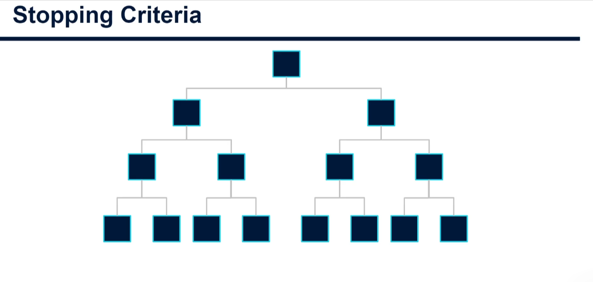
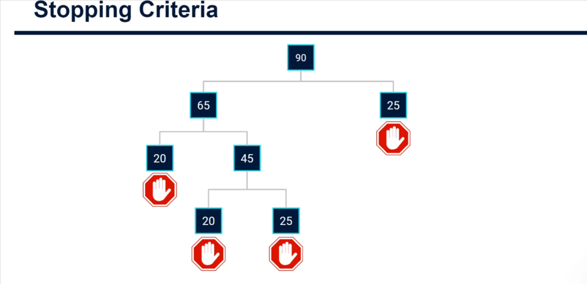

# Stopping Criteria for Decision Trees (Classification)

So far we have looked at how classification trees work at a high level and how the algorithm decides how to split the data for the best result (similar to regression trees, but worth reinforcing). This note covers the ways we can tell a decision tree to **stop splitting**.

## Why we need stopping criteria

The algorithm keeps splitting and splitting until:

1. There is only **one data point** in each leaf node, or
2. It **cannot find a split** that reduces the splitting criterion (e.g. **Gini impurity**), or
3. It is **told to stop** (the stopping criteria below).

An unrestricted tree goes too deep and **overfits**: it learns the exact rules of the training data. On new data, rather than generalising, the model naively expects the same exact patterns it was trained on, which causes real problems. Overfitting is a big problem in machine learning.



_A tree left to grow freely: every node keeps splitting until the leaves are fully separated._

## Ways to stop the tree

### 1. Maximum depth (`max_depth`)

Sets a limit on how many levels of splitting are allowed.

- `max_depth = 2`: the tree splits once (depth 1), then again (depth 2), and goes no further.
- It is a **ceiling, not a guarantee**: if the tree cannot find a split that reduces the impurity metric, it stops earlier, so leaves are not necessarily at depth 2.

### 2. Minimum samples to split (`min_samples_split`)

A node must contain **at least this many data points** before it is allowed to split.

Worked example with a threshold of **30** (see the diagram):



| Node             | Samples   | Allowed to split? | Result                               |
| ---------------- | --------- | ----------------- | ------------------------------------ |
| Root             | 90        | Yes (> 30)        | Splits into 65 (left) and 25 (right) |
| Right child      | 25        | No (< 30)         | Becomes a **leaf**                   |
| Left child       | 65        | Yes (> 30)        | Splits into 45 and 20                |
| 65's left child  | 20        | No (< 30)         | Becomes a **leaf**                   |
| 65's right child | 45        | Yes (> 30)        | Splits into 20 and 25                |
| Grandchildren    | 20 and 25 | No (< 30)         | Both become **leaves**               |

Every remaining node is below the threshold, so there are no options left and the tree is complete. The stop signs in the diagram mark the leaf nodes.

### 3. Minimum samples per leaf (`min_samples_leaf`)

Instead of a threshold on the node being split, set a minimum number of data points that must exist in **both the left and right buckets** after a split.

- A split that would leave either side with fewer points than the minimum is not allowed.
- This keeps splits **reasonably balanced**, rather than being heavily biased toward the left or right.

## In scikit-learn

Stopping criteria are set as hyperparameters when instantiating the model object, for example:

```python
from sklearn.tree import DecisionTreeClassifier

model = DecisionTreeClassifier(
    max_depth=2,           # maximum number of levels
    min_samples_split=30,  # min samples a node needs to be allowed to split
    min_samples_leaf=10,   # min samples required in each child after a split
)
```

(`min_samples_leaf=10` is an illustrative value.) We will do this in the next practical tutorial in Python.

## Key takeaways

- Unrestricted trees overfit; stopping criteria control tree complexity and improve generalisation.
- `max_depth` limits depth; `min_samples_split` limits which nodes can split; `min_samples_leaf` limits how small the resulting leaves can be.
- These are upper limits: the tree may stop sooner if no split reduces impurity.
