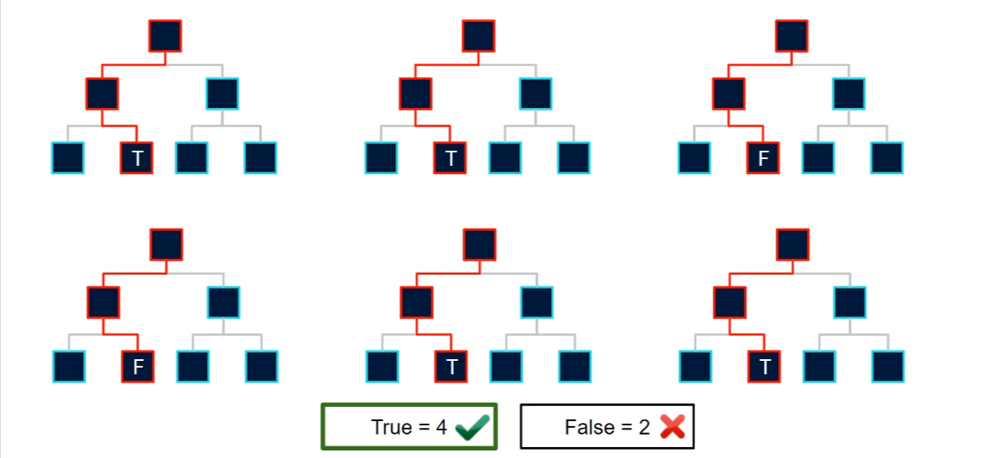
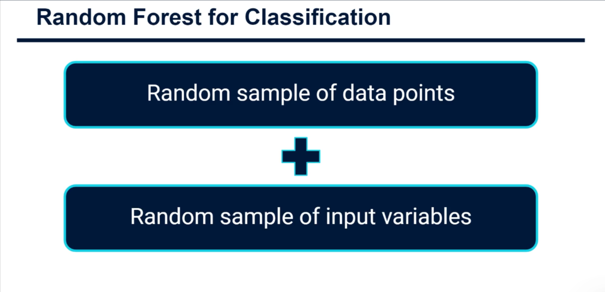
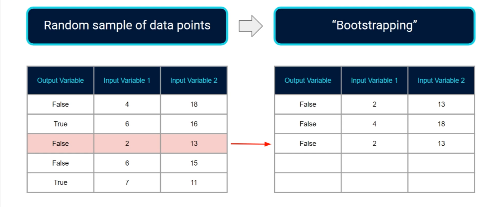
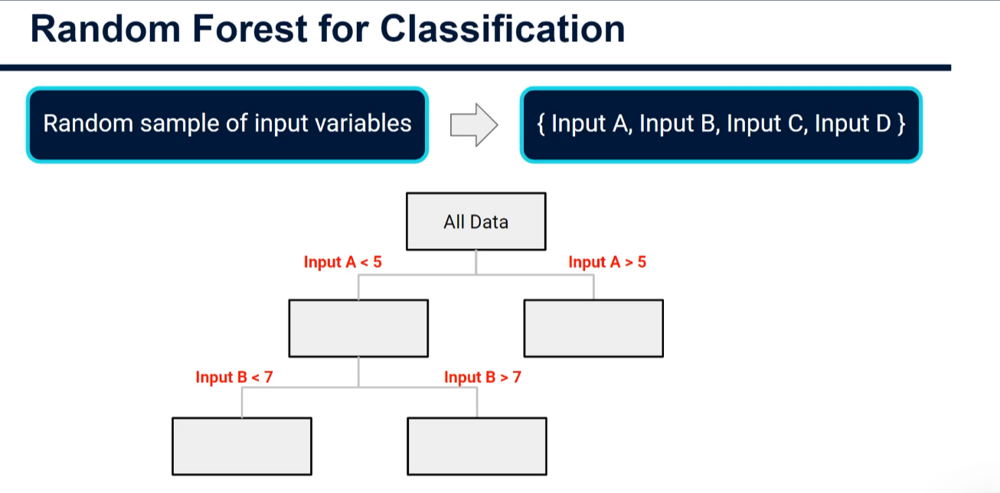
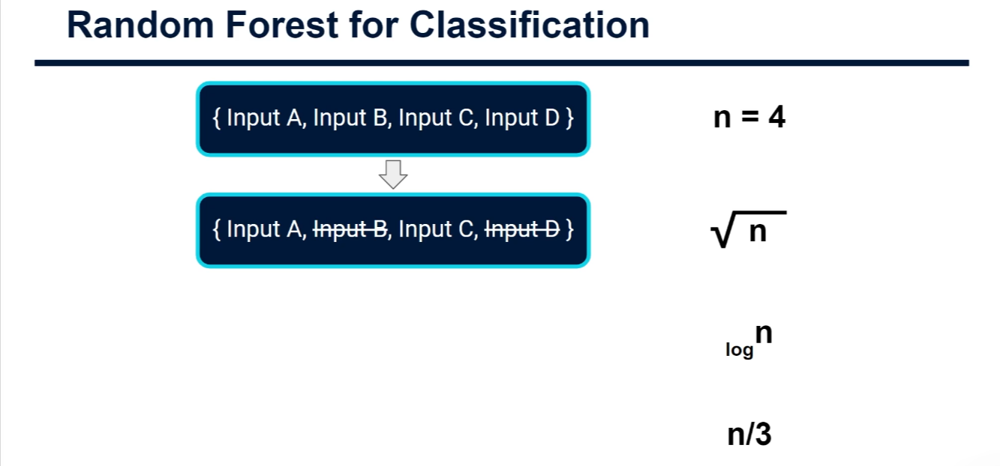

# Random Forests for Classification

## What is a random forest?

A random forest is an ensemble classifier: it combines predictions from many
decision trees rather than relying on one tree. Each tree is trained with
randomness in both the rows and the features it can consider. This makes the
trees different from one another, and combining their predictions usually gives
a more stable model than using a single decision tree.

For classification, each tree votes for a class. The forest predicts the class
with the most votes. For example, if four trees vote for `True` and two vote for
`False`, the forest predicts `True`. Implementations may also report class
probabilities by combining the trees' probability estimates or vote fractions.



## Where the randomness comes from

Each tree gets randomness from two sources: a bootstrap sample of data rows and
a randomly selected subset of input features. These choices give the trees
different training experiences and split opportunities.



### Bootstrap samples of rows

Each tree is trained on its own bootstrap sample of the training data. A
bootstrap sample is made by drawing rows at random **with replacement** until
the new sample is the same size as the original training set. Because sampling
is with replacement, a row can appear more than once in a tree's sample, while
other rows may not appear in it at all.



This gives each tree a slightly different view of the training data. Rows left
out of a tree's bootstrap sample are called _out-of-bag_ (OOB) rows for that
tree. They can be used to estimate performance without a separate validation
set, although a dedicated validation or test set is still useful for a final,
unbiased assessment.

### Random subsets of features

At each split in a tree, the algorithm considers a randomly selected subset of
the available features, rather than searching every feature for the best split.
It then chooses the best split from that subset, according to the tree's split
criterion (commonly Gini impurity or entropy for classification).



Feature sampling reduces the chance that the same strong feature dominates
every tree. Along with bootstrapping, it helps produce diverse trees. The number
of features considered at each split is a model setting; common defaults vary by
library and task. For classification, `sqrt(number of features)` is a common
choice, not a universal rule.



## Why combine trees?

A single decision tree can change substantially when its training data changes.
In a forest, averaging votes across many trees reduces this instability. The
randomized row and feature samples also make the trees less alike, which helps
the combined prediction benefit from their differences.

Random forests often work well with modest tuning and do not require scaling
numeric features for the tree splits. They are not guaranteed to outperform
every alternative, however, and large forests can require substantial memory
and prediction time.

## A basic scikit-learn example

Assuming `X` contains the input features and `y` contains the class labels:

```python
from sklearn.ensemble import RandomForestClassifier
from sklearn.metrics import accuracy_score, classification_report, confusion_matrix
from sklearn.model_selection import train_test_split

X_train, X_test, y_train, y_test = train_test_split(
    X,
    y,
    test_size=0.2,
    random_state=42,
    stratify=y,
)

model = RandomForestClassifier(
    n_estimators=200,
    random_state=42,
)
model.fit(X_train, y_train)

predictions = model.predict(X_test)
print("Accuracy:", accuracy_score(y_test, predictions))
print("Confusion matrix:\n", confusion_matrix(y_test, predictions))
print(classification_report(y_test, predictions))
```

`n_estimators` controls the number of trees. A fixed `random_state` makes the
randomized training repeatable, and `stratify=y` helps preserve class
proportions in the train/test split. Accuracy alone can be misleading when
classes are imbalanced, so inspect per-class precision, recall, F1-score, and
the confusion matrix as well.

## Further model settings

- `max_features` controls the number of candidate features considered at each
  split.
- `max_depth` limits how deep each tree can grow.
- `min_samples_leaf` requires a minimum number of training rows in each leaf.
- `class_weight` can help when some classes occur much less often than others.

These settings affect tree complexity and the balance between fitting the
training data and generalizing to new data. Tune them using training and
validation data, then reserve the test set for final evaluation.
