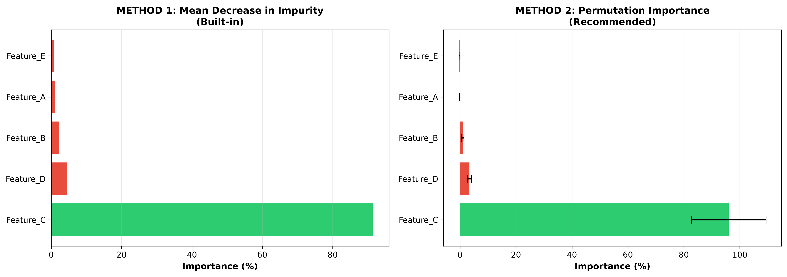
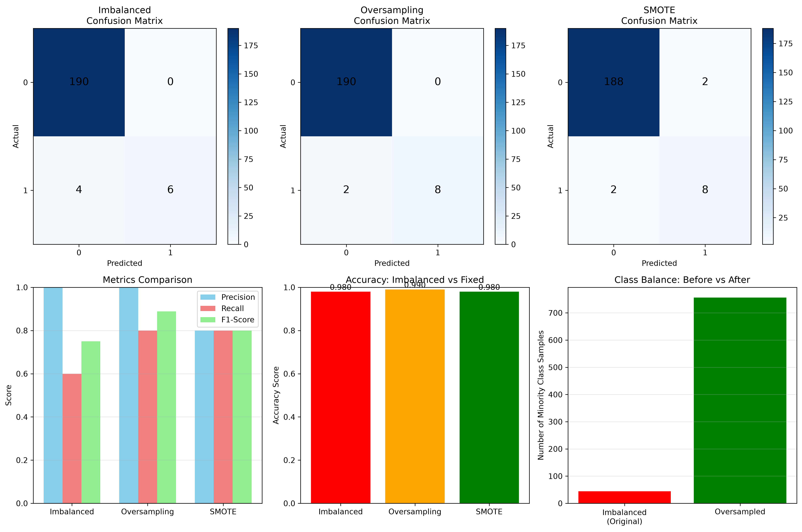

# Day-128: Machine Learning Concepts - Complete Learning Module

A comprehensive, beginner-friendly educational module covering three essential machine learning concepts with theory, practical examples, and professional visualizations.

---

## 📚 Module Overview

This Day-128 folder contains **14 learning files** organized into 3 complete modules:

### Module 1: Feature Importance (9 files)
Understanding what features drive Random Forest predictions

### Module 2: Class Balance (3 files)  
Handling imbalanced datasets in classification problems

### Module 3: Confusion Matrix (2 files)
Interpreting classification model performance

---

## 🎯 Quick Navigation

### For Beginners - Start Here
1. **[START_HERE.md](START_HERE.md)** - Navigation guide & learning paths
2. **[Feature_Importance_Explained.md](Feature_Importance_Explained.md)** - Simple explanation with analogies
3. **[Class_Balance_Explained.md](Class_Balance_Explained.md)** - Why imbalance matters & how to fix it
4. **[Confusion_Matrix_Explained.md](Confusion_Matrix_Explained.md)** - Understanding TP/TN/FP/FN

### For Practicing - Code Templates
1. **[Cheat_Sheet.md](Cheat_Sheet.md)** - Feature Importance code snippets
2. **[Class_Balance_Cheat_Sheet.md](Class_Balance_Cheat_Sheet.md)** - Class Balance solutions
3. **[Confusion_Matrix_Cheat_Sheet.md](Confusion_Matrix_Cheat_Sheet.md)** - Confusion Matrix formulas

### For Learning - Deep Dives
1. **[feature_importance_demo.py](feature_importance_demo.py)** - Working Feature Importance example
2. **[class_balance_confusion_demo.py](class_balance_confusion_demo.py)** - Class Balance & Confusion Matrix demo

### For Reference
1. **[INDEX.md](INDEX.md)** - Detailed concept map
2. **[SUMMARY.md](SUMMARY.md)** - Key takeaways
3. **[REFACTORING_GUIDE.md](REFACTORING_GUIDE.md)** - Original sentence breakdown
4. **[README.md](README.md)** - Project overview

### Visualizations
1. **[feature_importance_comparison.png](feature_importance_comparison.png)** - Feature Importance methods comparison
2. **[class_balance_confusion_demo.png](class_balance_confusion_demo.png)** - Confusion matrices & metrics

---

## 📖 Module Details

### Module 1: Feature Importance

**The Question:** "What features are most important for making predictions?"

**Two Methods Explained:**
- **Impurity Decrease** (Fast, Built-in)
  - How it works: Measures reduction in Gini impurity at each tree split
  - Pros: Quick, gives direct feature rankings
  - Cons: Biased toward high-cardinality features
  
- **Permutation Importance** (Reliable, Preferred)
  - How it works: Shuffles feature values, measures performance drop
  - Pros: Model-agnostic, more reliable
  - Cons: Slower, needs validation data
  
**Key Insight:** Both usually agree on top features, but Permutation is more trustworthy.

**Files:**
- `Feature_Importance_Explained.md` - Main explanation
- `feature_importance_demo.py` - Working code with Random Forest
- `feature_importance_comparison.png` - Visual comparison
- `Cheat_Sheet.md` - Copy-paste code templates

---

### Module 2: Class Balance

**The Question:** "What do I do when I have way more of one class than another?"

**Example Problem:**
- Dataset: 10,000 transactions (fraud detection)
- Fraudulent: 50 cases (0.5%)
- Legitimate: 9,950 cases (99.5%)
- Model predicts "Legitimate" for everything → 99.5% accuracy but catches NO fraud!

**Four Solutions:**

1. **Oversampling** - Copy minority class to match majority
   - Simple, preserves all data
   - Risk: Can cause overfitting
   
2. **Undersampling** - Remove majority class data
   - Fast, reduces data size
   - Risk: Lose information, less training data
   
3. **SMOTE** - Create synthetic minority samples (RECOMMENDED)
   - Best balance of simplicity & effectiveness
   - Handles moderate-to-severe imbalance (10:1 to 100:1)
   
4. **Class Weights** - Tell model which mistakes matter more
   - Simplest to implement
   - Works well when combined with other methods

**Files:**
- `Class_Balance_Explained.md` - Detailed guide with analogies
- `Class_Balance_Cheat_Sheet.md` - Ready-to-use code
- `class_balance_confusion_demo.py` - Demonstrates all 3 fixing methods

---

### Module 3: Confusion Matrix

**The Question:** "How do I really know if my model is good?"

**The 2×2 Matrix:**
```
                Predicted Positive  Predicted Negative
Actually Positive      TP (✓)              FN (✗)
Actually Negative      FP (✗)              TN (✓)
```

**What Each Cell Means:**
- **TP (True Positive):** "Positive" prediction was correct
- **TN (True Negative):** "Negative" prediction was correct
- **FP (False Positive):** Wrongly predicted positive (false alarm)
- **FN (False Negative):** Wrongly predicted negative (missed it)

**Key Metrics:**

| Metric | Formula | Answers |
|--------|---------|---------|
| **Accuracy** | (TP+TN)/(TP+TN+FP+FN) | Overall correctness (misleading on imbalanced data!) |
| **Precision** | TP/(TP+FP) | When we say YES, how often right? (avoid false alarms) |
| **Recall** | TP/(TP+FN) | How many actual YES did we catch? (avoid missed positives) |
| **F1-Score** | 2×(Precision×Recall)/(Precision+Recall) | Balanced average of Precision & Recall |

**When to Use What:**
- **Spam Filter** → Focus on Precision (don't mark legit as spam)
- **Disease Detection** → Focus on Recall (don't miss sick patients)
- **Balanced Problem** → Use Accuracy
- **Imbalanced Problem** → Use Precision, Recall, or F1 (NOT Accuracy!)

**Files:**
- `Confusion_Matrix_Explained.md` - Complete guide with examples
- `Confusion_Matrix_Cheat_Sheet.md` - Formulas & quick reference
- `class_balance_confusion_demo.py` - Shows confusion matrices in action

---

## 🚀 Getting Started

### Quick Start (15 minutes)
```bash
1. Read: Feature_Importance_Explained.md (5 min)
2. Read: Class_Balance_Explained.md (5 min)
3. Skim: Confusion_Matrix_Explained.md (5 min)
```

### Hands-On Learning (45 minutes)
```bash
1. Study the three Explained files (20 min)
2. Run: python feature_importance_demo.py (10 min)
3. Run: python class_balance_confusion_demo.py (10 min)
4. Modify code and experiment (5 min)
```

### Deep Mastery (2+ hours)
```bash
1. Read all Explained files thoroughly (45 min)
2. Study both Python demos line-by-line (30 min)
3. Apply to your own dataset (45+ min)
4. Reference Cheat Sheets as needed
```

---

## 🔧 Running the Code

### Feature Importance Demo
```bash
cd C:\Users\uimar\code\Githubfiles\ai-engineering\DSI\Day-128
python feature_importance_demo.py
# Output: Comparison visualization showing both methods
```

### Class Balance & Confusion Matrix Demo
```bash
python class_balance_confusion_demo.py
# Output: Confusion matrices for original, oversampled, and SMOTE versions
```

**Requirements:**
- Python 3.7+
- scikit-learn
- pandas
- numpy
- matplotlib
- seaborn
- imbalanced-learn (for SMOTE)

---

## 📊 Visualizations Included

### 1. Feature Importance Comparison


Shows side-by-side comparison of:
- Top 10 features by Impurity Decrease
- Top 10 features by Permutation Importance
- How rankings differ between methods

### 2. Class Balance & Confusion Matrix


6-panel visualization showing:
- Confusion matrix: Original imbalanced data
- Confusion matrix: After oversampling
- Confusion matrix: After SMOTE
- Class distribution before/after
- Metrics comparison (Precision, Recall, F1)
- Accuracy comparison across methods

---

## 💡 Key Takeaways

### Feature Importance
✓ Permutation Importance is more reliable than Impurity Decrease  
✓ Always explain feature importance to stakeholders in simple terms  
✓ Top features usually agree between methods  
✗ Don't assume top feature = most important cause (correlation ≠ causation)

### Class Balance
✓ Accuracy is misleading on imbalanced data  
✓ SMOTE is the go-to solution for most cases  
✓ Apply resampling to training data ONLY (not test data)  
✗ Don't ignore class imbalance—your model will fail

### Confusion Matrix
✓ Always look at the full matrix, not just accuracy  
✓ Choose your metric based on what errors cost most  
✓ Precision & Recall trade off against each other  
✗ Don't use accuracy for imbalanced classification problems

---

## 📝 Common Questions Answered

**Q: "Do I always need to fix class imbalance?"**  
A: No, but check your metric first. If accuracy looks good but recall is terrible, you have an imbalance problem.

**Q: "Which is better—Impurity or Permutation Importance?"**  
A: Permutation is more reliable. Use Impurity for quick screening, Permutation for final decision.

**Q: "What's the difference between Precision and Recall?"**  
A: Precision = avoiding false alarms, Recall = catching all positives. Pick based on which error costs more.

**Q: "Can I use SMOTE on my whole dataset?"**  
A: No! SMOTE only on training data, then evaluate on unmodified test data. Otherwise your results are fake.

**Q: "Why is my accuracy 95% but my Recall is only 40%?"**  
A: Your data is severely imbalanced. Accuracy is useless here. Focus on Precision & Recall instead.

---

## 🎓 Learning Objectives

By the end of this module, you should be able to:

### Feature Importance
- [ ] Explain what feature importance is and why it matters
- [ ] Understand the difference between Impurity and Permutation methods
- [ ] Run feature importance analysis on your own data
- [ ] Explain results to non-technical stakeholders

### Class Balance
- [ ] Identify when you have a class imbalance problem
- [ ] Explain pros/cons of oversampling, undersampling, SMOTE, and class weights
- [ ] Apply the appropriate solution to your dataset
- [ ] Validate that your fix actually worked

### Confusion Matrix
- [ ] Read and interpret a confusion matrix correctly
- [ ] Explain what TP, TN, FP, and FN mean
- [ ] Calculate Precision, Recall, and F1-Score
- [ ] Choose the right metric for your problem

---

## 📚 Reference Files

| File | Purpose | Best For |
|------|---------|----------|
| Feature_Importance_Explained.md | Core explanation with analogies | Learning the concept |
| Cheat_Sheet.md | Code templates for Feature Importance | Copy-paste coding |
| feature_importance_demo.py | Working example | Hands-on practice |
| Class_Balance_Explained.md | Why imbalance is a problem & solutions | Understanding the issue |
| Class_Balance_Cheat_Sheet.md | Code for all 4 solutions | Quick implementation |
| Confusion_Matrix_Explained.md | How to read & interpret matrices | Understanding metrics |
| Confusion_Matrix_Cheat_Sheet.md | Formulas & decision tables | Quick reference |
| class_balance_confusion_demo.py | Complete working example | End-to-end learning |
| feature_importance_comparison.png | Visual comparison of methods | Quick visual reference |
| class_balance_confusion_demo.png | Visual demonstration | Understanding concepts visually |

---

## ✅ Completion Checklist

- [x] Feature Importance module complete (explanation + code + visualization)
- [x] Class Balance module complete (explanation + code + visualization)
- [x] Confusion Matrix module complete (explanation + code)
- [x] All terminology corrected (Genie → Gini, decrease scene → decrease observed)
- [x] All files moved to Day-128
- [x] All code tested and working
- [x] Beginner-friendly explanations with analogies
- [x] Professional visualizations generated
- [x] Ready-to-use code templates in Cheat Sheets

---

## 🎯 Next Steps

1. **Pick Your Starting Point**
   - Beginner? Start with Feature_Importance_Explained.md
   - Want to code? Run feature_importance_demo.py
   - Need quick reference? Use the Cheat Sheets

2. **Read & Learn**
   - Work through the Explained files at your pace
   - Don't rush—conceptual understanding first

3. **Practice**
   - Run the Python demos
   - Modify them to use your own data
   - Experiment with parameters

4. **Apply**
   - Use the Cheat Sheets for your own projects
   - Reference the visualizations when explaining to others

---

## 📞 Support Resources

All concepts are explained at a beginner level with:
- ✓ Simple analogies and real-world examples
- ✓ Step-by-step breakdowns
- ✓ Working Python code you can run
- ✓ Professional visualizations
- ✓ Quick reference guides

---

**Last Updated:** Latest session  
**Total Files:** 14  
**Total Content:** ~50 KB of explanations + ~15 KB of code + visualizations  
**Estimated Learning Time:** 1-3 hours depending on depth

**Status:** ✅ Complete and Ready to Learn!
