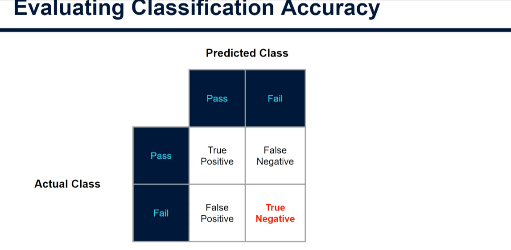
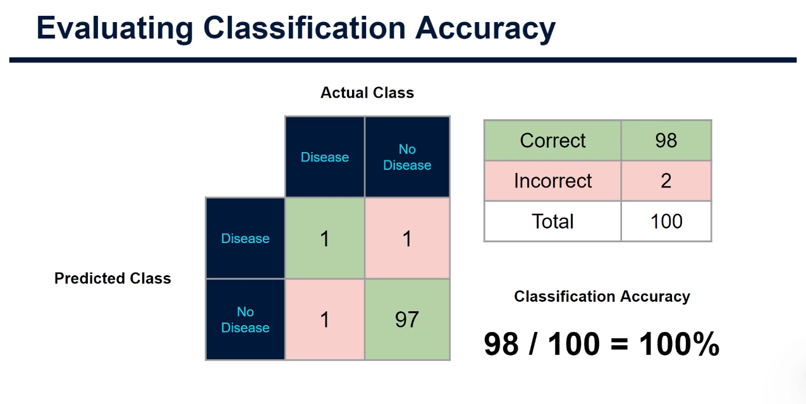
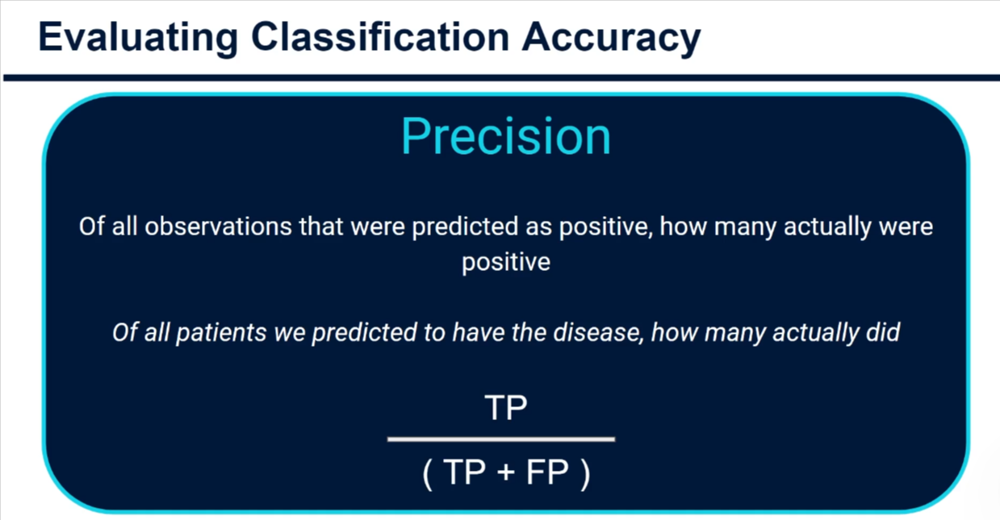
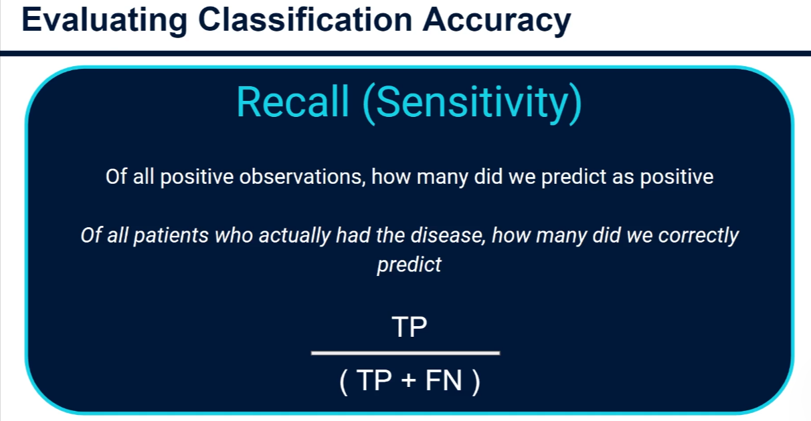
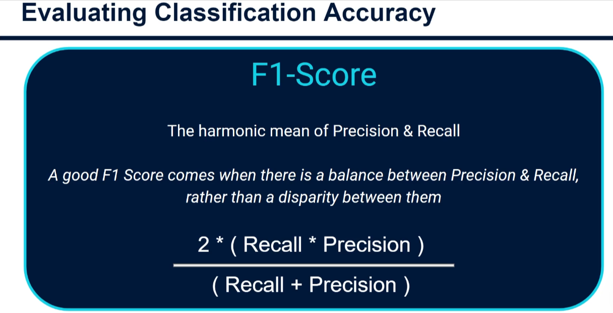
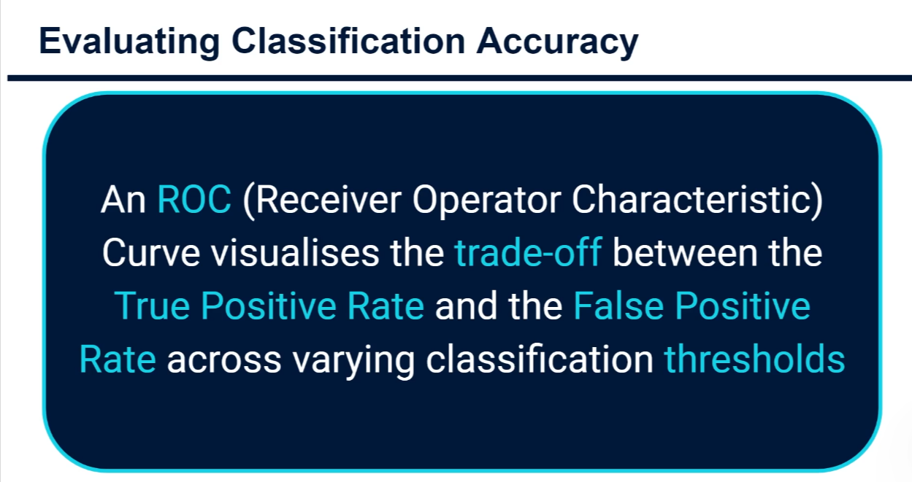

# Evaluating Classification Accuracy 📊

## Introduction

When you build a **classification model** (like predicting Pass/Fail on an exam), you need to know: **How well does it actually work?**

This guide teaches you the standard methods to evaluate classification models - the same techniques used for:

- Logistic Regression
- Decision Trees
- Random Forests
- Any classification model!

---

## The Confusion Matrix: Your Starting Point

The **Confusion Matrix** is a simple 2×2 table that shows all possible prediction outcomes:


_Visualization: A 2×2 confusion matrix showing the four possible classification outcomes_

### The Four Outcomes Explained

When your model makes a prediction, one of four things happens:

| Outcome                 | What Happened      | Example        |
| ----------------------- | ------------------ | -------------- | ------------------------------- |
| **True Positive (TP)**  | ✅ Predicted: Pass | Actually: Pass | Model was RIGHT saying "Pass"   |
| **True Negative (TN)**  | ✅ Predicted: Fail | Actually: Fail | Model was RIGHT saying "Fail"   |
| **False Positive (FP)** | ❌ Predicted: Pass | Actually: Fail | Model was WRONG (Type I Error)  |
| **False Negative (FN)** | ❌ Predicted: Fail | Actually: Pass | Model was WRONG (Type II Error) |

### Real Example: Student Exam Prediction

Let's say you built a model to predict if 100 students pass an exam:

```
                 PREDICTED
           Pass        Fail
          ╔════════╦════════╗
ACTUAL Pass║  90   ║   10   ║ ← 90 correct, 10 false negatives
          ╠════════╬════════╣
       Fail║   5   ║  150   ║ ← 5 false positives, 150 correct (didn't reach 100!)
          ╚════════╩════════╝
```

From this matrix, we can calculate everything!

---

## Accuracy Metrics Explained

### 1. **Accuracy** - The Simplest Metric

**Definition:** Out of all predictions, how many were correct?

```
Accuracy = (True Positives + True Negatives) / Total Predictions
         = Correct predictions / All predictions
         = (TP + TN) / (TP + TN + FP + FN)
```

**Example:**

```
Correct predictions: 90 Pass + 150 Fail = 240 ✓
Total predictions: 100 + 100 = 200
Accuracy = 240 / 200 = WAIT, this doesn't work in this example!

Let me use correct numbers:
Correct predictions: 90 + 150 = 240
Total: 90 + 10 + 5 + 150 = 255... let me simplify:

Correct: TP (90) + TN (150) = 240
Total: 240 + 10 + 5 = 255
Accuracy = 240/255 = 94%
```

**When to use it:** When classes are balanced (similar number of Pass and Fail)

**⚠️ When NOT to use it:**

- **Imbalanced data** - If 99% have disease and 1% don't, a model that predicts "no disease" for everyone gets 99% accuracy! That's useless.

---

### 2. **Precision** - "When I Say YES, Am I Right?"

**Definition:** Of all positive predictions I made, how many were actually correct?

```
Precision = True Positives / (True Positives + False Positives)
          = TP / (TP + FP)
```

**Real-world example:** A disease detection model

```
I predicted 95 people have the disease:
- 90 actually had it ✓ (True Positive)
- 5 didn't have it ✗ (False Positive)

Precision = 90 / (90 + 5) = 90/95 = 94.7%

→ When I predict "disease", I'm correct 94.7% of the time
```

**When to use it:**

- ✅ Email spam detection (don't want false positives - legitimate emails marked spam)
- ✅ Disease diagnosis (don't want to tell healthy people they're sick)
- ✅ Fraud detection (don't want to block legitimate transactions)

**Question precision answers:** "Of the positive predictions I made, how many were correct?"

---

### 3. **Recall** - "Did I Catch All the Positives?"

**Definition:** Of all actual positives, how many did I correctly predict?

```
Recall = True Positives / (True Positives + False Negatives)
       = TP / (TP + FN)

Also called: Sensitivity, Hit Rate, True Positive Rate
```

**Real-world example:** A disease detection model

```
Out of 200 people who actually have the disease:
- I correctly caught 180 ✓ (True Positive)
- I missed 20 ✗ (False Negative)

Recall = 180 / (180 + 20) = 180/200 = 90%

→ I'm catching 90% of actual disease cases
→ I'm missing 10% of diseased people
```

**When to use it:**

- ✅ Disease detection (must catch all sick people, even if some false alarms)
- ✅ Cancer screening (missing a cancer = bad, false alarm = not so bad)
- ✅ Airport security (catch all threats, even false positives okay)

**Question recall answers:** "Of all actual positives, how many did I catch?"

---

### 4. **Precision vs. Recall Trade-off**

These two metrics fight each other! Here's why:

```
PRECISION focus:
→ Only say "positive" when very confident
→ Fewer false positives
→ But might miss some real positives (low recall)

RECALL focus:
→ Say "positive" often to catch all real cases
→ Catch all real positives
→ But get more false positives (low precision)
```

**Example: Disease Detection**

```
Conservative Model (High Precision, Low Recall):
- Only predicts disease if very sure
- Precision: 95% (almost never wrong)
- Recall: 50% (misses many actual cases) ❌

Aggressive Model (Low Precision, High Recall):
- Predicts disease easily
- Precision: 60% (lots of false alarms)
- Recall: 95% (catches almost all cases) ✓

Which is better?
→ For disease: Better to over-predict (save lives)
→ For spam: Better to under-predict (don't block real emails)
```

---

### 5. **F1-Score** - The Balanced Compromise

**Definition:** The harmonic mean of precision and recall (balances both)

```
F1-Score = 2 × (Precision × Recall) / (Precision + Recall)
         = Harmonic mean of precision and recall
```

**Score range:** 0 to 1 (higher is better)

**Example:**

```
Model A:
- Precision: 90%
- Recall: 50%
- F1 = 2 × (0.9 × 0.5) / (0.9 + 0.5) = 0.643 = 64.3%

Model B:
- Precision: 75%
- Recall: 75%
- F1 = 2 × (0.75 × 0.75) / (0.75 + 0.75) = 0.75 = 75%

→ Model B is better balanced!
```

**When to use it:**

- ✅ When you care about both precision AND recall equally
- ✅ For imbalanced datasets
- ✅ When comparing models

**Why "harmonic mean"?** It penalizes extremes - a model with 95% precision and 10% recall gets a low F1!

---

## ROC Curve & AUC: Advanced Evaluation

### What is an ROC Curve?

**ROC = Receiver Operating Characteristic**

It's a graph that shows the trade-off between:

- **True Positive Rate (TPR)** = Recall = "Did I catch the positives?"
- **False Positive Rate (FPR)** = "How many false alarms did I have?"


_Visualization: ROC curve showing the relationship between True Positive Rate and False Positive Rate at different classification thresholds_

### Understanding the ROC Curve

```
ROC Curve Basics:

      TPR (Sensitivity)
      1.0 │     ╱╱╱╱
          │    ╱
          │   ╱  ← Good model (above diagonal)
         0.5│  ╱───── Diagonal = Useless model
          │╱
          └─────────────────── FPR (1 - Specificity)
          0              1.0
```

**Key Points:**

| Position              | Meaning                     |
| --------------------- | --------------------------- |
| **Above diagonal**    | Better than random guessing |
| **On diagonal**       | Same as randomly guessing   |
| **Below diagonal**    | Worse than random guessing  |
| **Upper left corner** | Perfect model!              |

**Real interpretation:**

```
Each point on curve = different decision threshold

Threshold = 0.9 (only predict positive if 90%+ confident):
- Fewer false positives ✓
- More false negatives ✗
- Point: Lower left (high precision, low recall)

Threshold = 0.1 (predict positive even if 10% confident):
- More false positives ✗
- Fewer false negatives ✓
- Point: Upper right (low precision, high recall)
```


_Visualization: ROC curves comparing multiple models - curves further to the upper left indicate better performance_

---

### AUC: Area Under the Curve

**AUC** measures the total performance: the area under the ROC curve

```
AUC Score Range: 0 to 1

1.0 = Perfect model
0.9 = Excellent
0.8 = Good
0.7 = Fair
0.6 = Poor
0.5 = No better than random guessing
```

**Example: Comparing Two Models**

```
Logistic Regression Model:
- ROC curve area = 0.75 AUC

Random Forest Model:
- ROC curve area = 0.82 AUC

→ Random Forest is better! (0.82 > 0.75)
```


_Visualization: Comparing AUC scores of different models side-by-side_

---

## Quick Reference: Which Metric to Use?


_Visualization: Decision tree or guide for selecting appropriate evaluation metrics_

| Your Situation                                   | Use This Metric |
| ------------------------------------------------ | --------------- |
| Balanced classes (50/50 Pass/Fail)               | **Accuracy**    |
| Don't want false positives (spam, blocked users) | **Precision**   |
| Don't want false negatives (disease, threats)    | **Recall**      |
| Care equally about both                          | **F1-Score**    |
| Want single score to compare models              | **AUC**         |
| Want visual understanding of trade-offs          | **ROC Curve**   |

---

## Practical Example: Disease Prediction Model

Let's evaluate a model predicting a disease in 1000 patients:

```
Confusion Matrix:

                    PREDICTED
              Disease    No Disease
ACTUAL
Disease       │   TP=180    FN=20   │  (200 actual cases)
              ├────────────────────┤
No Disease    │   FP=50     TN=750  │  (800 actual cases)
              └────────────────────┘

Calculations:

Accuracy = (180 + 750) / 1000 = 93%
→ Overall: 93% of predictions correct

Precision = 180 / (180 + 50) = 78.3%
→ Of the 230 "disease" predictions, 78% were right

Recall = 180 / (180 + 20) = 90%
→ Of the 200 actual cases, we caught 90%

F1 = 2 × (0.783 × 0.90) / (0.783 + 0.90) = 0.837 = 83.7%
→ Good balance between precision and recall

AUC = 0.85
→ Excellent model performance!
```

**Interpretation:**

- ✅ Model is good overall (93% accuracy)
- ✅ Catches 90% of diseased patients (good recall)
- ⚠️ Has some false alarms (78% precision)
- ✅ Overall excellent performance (AUC 0.85)

---

## Common Errors to Avoid 🚫

1. **Using accuracy for imbalanced data**
   - ❌ Wrong: 99% accuracy on 99% negative class
   - ✅ Correct: Use F1-Score or AUC

2. **Focusing only on precision**
   - ❌ Wrong: Detecting 20% of diseases if all predictions are perfect
   - ✅ Correct: Balance precision and recall with F1

3. **Ignoring the type of error**
   - ❌ Wrong: Treating false positives and false negatives equally
   - ✅ Correct: Decide which matters more for your problem

4. **Comparing models without AUC**
   - ❌ Wrong: Comparing at one probability threshold
   - ✅ Correct: Use AUC or ROC curve for full picture

---

## Key Takeaways 📌

✅ **Confusion Matrix** = Foundation for all metrics (TP, TN, FP, FN)

✅ **Accuracy** = Simple, but fails on imbalanced data

✅ **Precision** = "When I predict positive, am I right?" (Avoid false positives)

✅ **Recall** = "Do I catch all actual positives?" (Avoid false negatives)

✅ **F1-Score** = Balanced trade-off between precision and recall

✅ **ROC Curve** = Visual tool showing performance at all thresholds

✅ **AUC** = Single number (0-1) to compare models fairly

---

## Practice Steps 🎯

1. **Calculate metrics manually** - Pick a confusion matrix, compute all metrics
2. **Identify your priority** - What matters more: precision or recall?
3. **Plot ROC curves** - Visualize model performance
4. **Compare models** - Use AUC to pick the best one
5. **Make decisions** - Choose threshold based on your precision/recall needs

---

## Decision Tree: Choosing Your Metric

```
START: How will this model be used?

  ├─ Rare disease diagnosis?
  │  └─→ Use RECALL (catch all cases, false alarms okay)
  │
  ├─ Email spam filter?
  │  └─→ Use PRECISION (avoid blocking real emails)
  │
  ├─ Balanced dataset, equal priorities?
  │  └─→ Use F1-SCORE or ACCURACY
  │
  ├─ Need to compare multiple models?
  │  └─→ Use AUC-ROC
  │
  └─ Need to understand all trade-offs?
     └─→ Use ROC CURVE
```


_Visualization: Comprehensive guide showing when to use each metric_

---

## Summary Table

| Metric        | Formula         | Ideal For                | Range |
| ------------- | --------------- | ------------------------ | ----- |
| **Accuracy**  | (TP+TN)/(Total) | Balanced classes         | 0-1   |
| **Precision** | TP/(TP+FP)      | Minimize false positives | 0-1   |
| **Recall**    | TP/(TP+FN)      | Minimize false negatives | 0-1   |
| **F1-Score**  | 2(P×R)/(P+R)    | Balance both errors      | 0-1   |
| **AUC**       | Area under ROC  | Model comparison         | 0-1   |

Now you're ready to evaluate any classification model! 🎓
