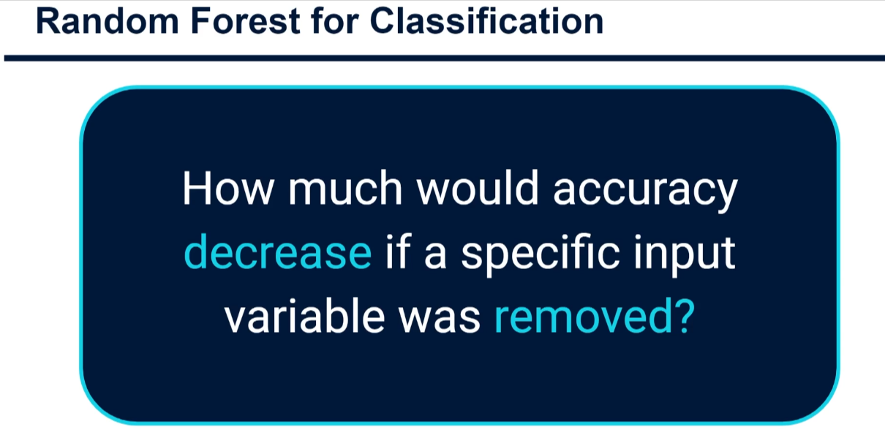
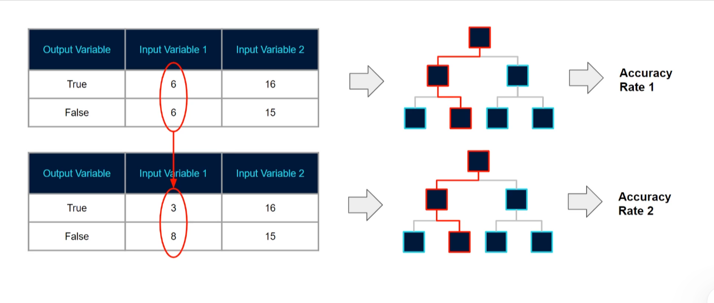

# Random Forest Feature Importance 🌲

## What is Feature Importance?

**Feature Importance** is a technique that tells us **which input variables (features) are most important for making predictions** in a Random Forest model.

Think of it like this:

- You have many features (columns) in your dataset
- Not all features are equally useful for predictions
- Feature Importance ranks them by how much they contribute to the model's accuracy
- Features that don't help much can be removed to simplify the model

---

## Why Should You Care?

✅ **Understand your model** - See which factors drive predictions  
✅ **Feature selection** - Remove unnecessary columns to simplify future models  
✅ **Business insights** - Identify which factors matter most in real-world scenarios  
✅ **Reduce complexity** - Smaller models are faster and easier to maintain

---

## Quick Review: What is a Random Forest?

A **Random Forest** is an ensemble (collection) of many decision trees:

- Each tree is trained on a random subset of the data
- Each split in a tree considers only a random subset of features
- The "randomness" makes each tree different and unique
- Because they're all different, they give us special insights into which features matter most


_Visualization: Multiple decision trees combined into a Random Forest - each tree is built with randomness in data selection and feature selection at each split point_

---

## How Does Feature Importance Work?

### **Method 1: Gini Impurity Decrease** (Simpler to understand)

**What is Gini Impurity?**

- A score measuring how "mixed up" a group of data points is
- Lower impurity = purer groups = better predictions
- Goes from 0 (all same class) to 0.5 (perfectly mixed)

**How it works:**

1. **Find all splits using a feature** - Go through entire forest and find every node where Feature X was used to split the data

2. **Measure impurity change**:
   - Before split: Calculate Gini impurity
   - After split: Calculate Gini impurity
   - Difference = how much this split improved purity

3. **Average all improvements** - Take average of all impurity decreases when using this feature

4. **Compare features** - Feature with largest average decrease = most important

**Example:**

```
Feature: "Age"
All nodes using Age in forest: 47 nodes
Average impurity decrease: 0.12 ← This is the importance score
```

**⚠️ Note for advanced learners:** This method can overvalue numerical/continuous features

---

### **Method 2: Permutation Importance** (More reliable)

**Bootstrap & Out-of-Bag Samples:**

- When Random Forest trains, it uses _bootstrap samples_ (random rows with replacement)
- Some rows are NOT selected in each bootstrap sample
- These unused rows = **Out-of-Bag (OOB) rows** - free test data!

**How Permutation Importance works:**

1. **Test tree on OOB rows** - Run all out-of-bag rows through the decision tree and measure accuracy
   - Original Accuracy = 92% ✓

2. **Shuffle one feature** - Randomly mix up the values in Feature X for OOB rows
   - Randomly shuffling destroys the relationship between Feature X and the target
   - Feature X becomes "useless noise"

3. **Test again** - Run modified OOB rows through same tree
   - New Accuracy = 85% ❌
   - Accuracy dropped by 7%!

4. **Calculate importance** - The difference shows how important that feature was
   - If accuracy drops a lot → feature is very important
   - If accuracy barely drops → feature isn't important

5. **Repeat for each feature** - Do this for all features in all trees

**Example:**

```
Original Accuracy: 92%
Accuracy after shuffling "Age": 85%
Feature Importance for "Age" = 92% - 85% = 7% importance

Original Accuracy: 92%
Accuracy after shuffling "Color": 91.9%
Feature Importance for "Color" = 92% - 91.9% = 0.1% importance

→ Age is much more important than Color!
```


_Visualization: Out-of-bag data used for permutation testing - shows how shuffling one feature at a time reveals its importance_

---

## Comparison: Which Method to Use?

| Method            | Pros                                | Cons                                         | Best For                   |
| ----------------- | ----------------------------------- | -------------------------------------------- | -------------------------- |
| **Gini Decrease** | Fast, built-in, simple              | Can overvalue categorical/numerical features | Quick initial insights     |
| **Permutation**   | Reliable, realistic, standard in ML | Slightly slower                              | Production models, reports |

**💡 Recommendation:** Use **Permutation Importance** - it's the industry standard and more trustworthy.

---

## Practical Example: Predicting House Prices

**Dataset features:**

- Square footage
- Number of rooms
- Age of house
- Color of house
- Location
- Number of trees in yard

**Random Forest Feature Importance Results:**

```
Square footage    ████████████████ 0.45 (45% importance)
Location          ██████████       0.28 (28% importance)
Number of rooms   ████████         0.18 (18% importance)
Age of house      ██               0.07 (7% importance)
Trees in yard     █                0.01 (1% importance)
Color of house    █                0.01 (1% importance)
```

**Insights:**

- Square footage is by far the most important (makes sense!)
- Location matters a lot (also makes sense!)
- Color of house barely matters (good to know!)
- Could remove "Color" to simplify the model

---

## How to Use Feature Importance

### 1. **Improve Model Understanding**

```python
# In scikit-learn
importances = model.feature_importances_
for feature, importance in zip(feature_names, importances):
    print(f"{feature}: {importance:.3f}")
```

### 2. **Select Better Features** (Feature Selection)

- Keep top 5-10 most important features
- Train a new, simpler model
- Results: Faster training, smaller model, easier to understand

### 3. **Remove Noise**

- Eliminate features with very low importance
- Reduces overfitting
- Makes model generalize better to new data

### 4. **Business Insights**

- Show stakeholders what matters most
- Make data-driven business decisions
- Justify why certain factors influence outcomes

---

## Key Takeaways 📌

✅ **Feature Importance** = Ranking of how much each feature helps predictions  
✅ **Two main methods**: Gini Impurity (fast) & Permutation (reliable)  
✅ **Permutation Importance** is better: shuffle one feature, measure accuracy drop  
✅ **Why it matters**: Understand models, select features, reduce complexity  
✅ **Random Forest advantage**: Built-in feature importance calculation

---

## Next Steps

1. Practice calculating feature importance on a toy dataset
2. Compare Gini vs Permutation importance on real data
3. Use feature selection to build simpler, faster models
4. Always validate that removed features don't hurt performance
