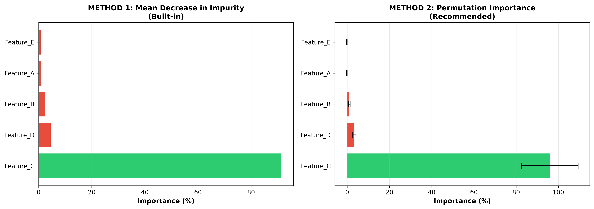

# 🎯 START HERE - Day-28 Feature Importance Module

Welcome! This guide helps you navigate the complete Feature Importance learning module.

## ⚡ Quick Navigation

### If you have **5 minutes**:

→ Read [README.md](./README.md)

### If you have **20 minutes**:

→ 1. Read [Feature_Importance_Explained.md](./Feature_Importance_Explained.md)
→ 2. Look at [feature_importance_comparison.png](./feature_importance_comparison.png)

### If you have **1 hour**:

→ 1. Read [REFACTORING_GUIDE.md](./REFACTORING_GUIDE.md)
→ 2. Study [Feature_Importance_Explained.md](./Feature_Importance_Explained.md)
→ 3. Run `python feature_importance_demo.py`

### If you need **code right now**:

→ Copy from [Cheat_Sheet.md](./Cheat_Sheet.md) or [feature_importance_demo.py](./feature_importance_demo.py)

### If you need to **present to stakeholders**:

→ Show [feature_importance_comparison.png](./feature_importance_comparison.png) + use explanation from [Cheat_Sheet.md](./Cheat_Sheet.md)

---

## 📚 Complete File Guide

| File                                                                     | Purpose                       | Read Time    |
| ------------------------------------------------------------------------ | ----------------------------- | ------------ |
| [README.md](./README.md)                                                 | Quick overview & summary      | 5 min        |
| [SUMMARY.md](./SUMMARY.md)                                               | What you created & learned    | 5 min        |
| [Feature_Importance_Explained.md](./Feature_Importance_Explained.md)     | Detailed beginner guide       | 15 min       |
| [Cheat_Sheet.md](./Cheat_Sheet.md)                                       | Ready-to-use code & reference | 10 min       |
| [REFACTORING_GUIDE.md](./REFACTORING_GUIDE.md)                           | Original sentence breakdown   | 10 min       |
| [feature_importance_demo.py](./feature_importance_demo.py)               | Working Python code           | 10 min (run) |
| [feature_importance_comparison.png](./feature_importance_comparison.png) | Visual chart                  | 1 min        |

---

## 🎓 What You'll Learn

✓ What feature importance measures
✓ Two methods: Impurity Decrease vs Permutation Importance  
✓ Which method is better and why
✓ How to code both methods in Python
✓ How to explain to non-technical people
✓ How to visualize findings

---

## 🔑 Key Takeaway

**Use Permutation Importance.** It's easier to explain:

> "We scrambled each input and measured how much predictions got worse. Features that hurt the most are most important."

---

## 🚀 Get Started Now

### Option A: Quick Learning

1. Click [README.md](./README.md)
2. View chart [feature_importance_comparison.png](./feature_importance_comparison.png)
3. Done! ✓

### Option B: Hands-On Learning

1. Copy code from [Cheat_Sheet.md](./Cheat_Sheet.md)
2. Run it with your data
3. Create your own visualization ✓

### Option C: Deep Understanding

1. Read [REFACTORING_GUIDE.md](./REFACTORING_GUIDE.md) to understand the original sentence
2. Study [Feature_Importance_Explained.md](./Feature_Importance_Explained.md) for concepts
3. Run [feature_importance_demo.py](./feature_importance_demo.py)
4. Practice with your own data ✓

---

## 💡 The Original Sentence (Simplified)

**Before (Complex):**

> "Feature importance of the top is based on mean decrease in Gini impurity score and permutation importance down the bottom is based upon decrease when we randomize values..."

**After (Simple):**

> Method 1: How much better do tree splits get using this feature?
> Method 2: How much worse do predictions get when we scramble this feature?
> Choice: Use Method 2 - it's easier to explain!

Full explanation: [REFACTORING_GUIDE.md](./REFACTORING_GUIDE.md)

---

## 📊 Visual Guide

### Both Methods at a Glance



**Green bars** = Important features
**Red bars** = Less important features
**Error bars** = Confidence in measurement

---

## ✅ Success Checklist

After working through this module, you should be able to:

- [ ] Explain what feature importance is
- [ ] Describe both methods (Impurity & Permutation)
- [ ] Know which method to use (Permutation)
- [ ] Write Python code to calculate it
- [ ] Interpret the results
- [ ] Explain to non-technical people
- [ ] Create visualizations
- [ ] Use on your own data

---

## 🎯 Common Questions Answered

**Q: Which method should I use?**
A: Permutation Importance (see [Cheat_Sheet.md](./Cheat_Sheet.md) for decision matrix)

**Q: How do I run the code?**
A: See [feature_importance_demo.py](./feature_importance_demo.py) or copy from [Cheat_Sheet.md](./Cheat_Sheet.md)

**Q: How do I explain to my boss?**
A: Use the explanation from [Feature_Importance_Explained.md](./Feature_Importance_Explained.md) + show [feature_importance_comparison.png](./feature_importance_comparison.png)

**Q: What does the original sentence mean?**
A: Full breakdown in [REFACTORING_GUIDE.md](./REFACTORING_GUIDE.md)

---

## 🔗 Navigation Quick Links

- Need theory? → [Feature_Importance_Explained.md](./Feature_Importance_Explained.md)
- Need code? → [Cheat_Sheet.md](./Cheat_Sheet.md) or [feature_importance_demo.py](./feature_importance_demo.py)
- Need visuals? → [feature_importance_comparison.png](./feature_importance_comparison.png)
- Need reference? → [Cheat_Sheet.md](./Cheat_Sheet.md)
- Need summary? → [README.md](./README.md) or [SUMMARY.md](./SUMMARY.md)
- Need context? → [REFACTORING_GUIDE.md](./REFACTORING_GUIDE.md)

---

## 📝 Files At a Glance

```
Day-28/
├── 👇 START HERE
│   ├── README.md ........................ Quick summary (5 min)
│   └── INDEX.md ........................ This file (navigation)
│
├── 📚 LEARNING MATERIALS
│   ├── Feature_Importance_Explained.md .. Detailed guide (15 min)
│   ├── REFACTORING_GUIDE.md ............ Original sentence explained (10 min)
│   ├── Cheat_Sheet.md ................. Code templates & reference (10 min)
│   └── SUMMARY.md ..................... Complete summary (5 min)
│
├── 💻 CODE & DATA
│   └── feature_importance_demo.py ...... Working Python example
│
└── 📊 VISUALIZATION
    └── feature_importance_comparison.png Side-by-side chart
```

---

## 🌟 Next Steps After Learning

1. **Apply It**: Use code on your own data
2. **Visualize It**: Create charts like the example
3. **Present It**: Show findings to stakeholders
4. **Optimize It**: Use feature importance to guide improvements

---

## 💬 Ready?

Pick a file above and start learning!

**Most popular starting point:** [README.md](./README.md) (5 min quick read)

**Want hands-on immediately?** [feature_importance_demo.py](./feature_importance_demo.py) (just run it!)

**Need full understanding?** [Feature_Importance_Explained.md](./Feature_Importance_Explained.md) (detailed guide)

---

**Happy Learning! 🚀**

_Last Updated: November 7, 2026_
