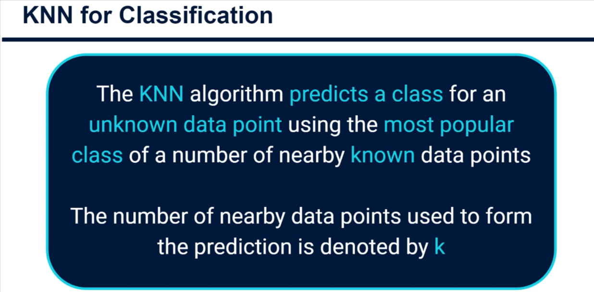
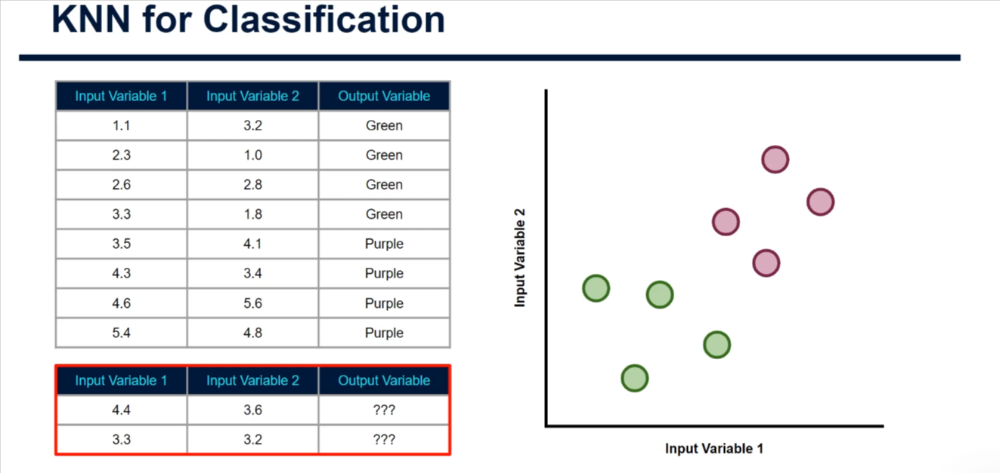
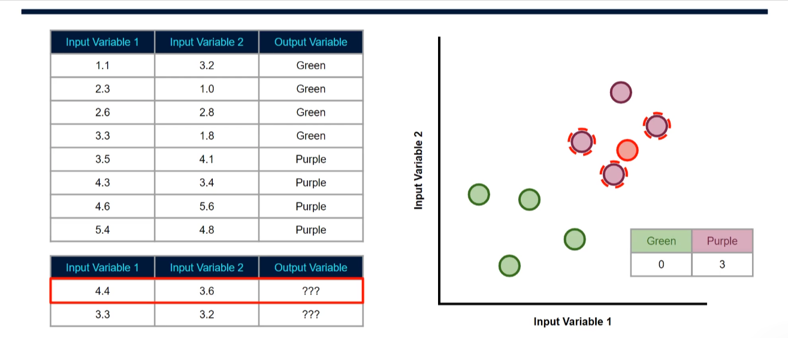
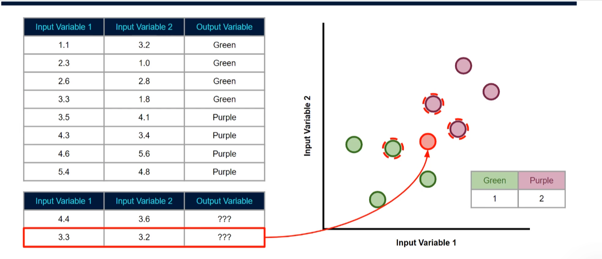

# K-Nearest Neighbors (KNN) - Classification and Regression

## Introduction

Welcome to this tutorial on the theory and intuition behind applying a KNN model for classification. While this technique is often referred to as just "KNN," it actually stands for **K-Nearest Neighbors**.

K-Nearest Neighbors is a popular technique that can actually be used for both:

- **Regression problems** (predicting continuous values)
- **Classification problems** (predicting categories/classes)

However, it's far more common to see it applied to **classification problems** in practice. It's a really intuitive technique, and much of what we learn here will actually be relevant when we look at techniques like K-Means Clustering in unsupervised machine learning tutorials.

### What We've Covered Before

We've explored the KNN algorithm a little bit before in the tutorial on feature selection, where we looked at and applied KNN within Scikit-Learn as a way to cleverly impute somewhat realistic values for data points where the value was missing.

In this section, we're going to go into more detail on how this all works under the hood. This will be really exciting! Let's get stuck into the theory behind what this algorithm is and how it works.

---

## How KNN Algorithm Works

### Core Definition

**The KNN algorithm predicts a class for an unknown data point using the most popular class among a number of nearby known data points.** The number of nearby data points used to form the prediction is denoted by **K**.

### Visual Example - First Scenario

The best way to explain this further is with an example. We start with some data like this, which contains one or more input variables. In our example, we've got two:

- **Input Variable 1** (X-axis)
- **Input Variable 2** (Y-axis)

We also have an **output variable** (denoted by color), and the values for this are known since this is a supervised learning task.

When we plot our data, we get something like this with:

- Input variable 1 along the X-axis
- Input variable 2 along the Y-axis
- The class of each data point denoted using its color (green or purple)

### Task: Predicting New Data Points

Our task is to use the KNN algorithm to predict the class for new data as it comes in. The new data contains values for the input variables, but at this point we don't know what class each data point would belong to.

**Question:** Should they be classified as green or purple?

---

## Example 1: Straightforward Case

Let's plot the first of these two new data points. Based on those input values, it should probably sit around here on our plot.

### Human Intuition

As a human, you'd probably be quite confident in your guess as to whether this new data point should be classified as green or purple. It's surrounded by other purple data points, so intuitively you'd probably suggest that it should be classified as purple—and chances are you'd be correct!

### How KNN Works

A computer, however, doesn't really see the data like we do. It has to rely on some metrics and measurements to understand this for itself. That's exactly what happens with K-Nearest Neighbors.

**Step 1: Provide K Value**
The only thing we need to provide to the KNN algorithm is a number for K. Remember our high-level definition: K is the **number of nearby data points used to form the prediction**.

In our example, let's say we gave the algorithm a value of **K = 3**.

**Step 2: Find Nearest Neighbors**
The algorithm would find the **closest 3 neighbors** to our new data point.

**Step 3: Analyze Classes**
The algorithm analyzes these closest neighbors, specifically looking at:

- How many were of the **green class**
- How many were of the **purple class**

**Step 4: Vote (Majority Rule)**
Whichever class had the majority would be the winner, and that class would be assigned to the new data point.

### Result

For this particular data point, there is an **overwhelming victory**: all three nearest neighbors were purple, so the new data point would therefore be classified as **purple** as well.

---

## Example 2: Less Straightforward Case

Now let's look at our second data point, which based on its input variable values would exist about here on our plot.

### Situation

It's not quite so straightforward—there are both greens and purples nearby.

### Application of KNN

Using a value of **K = 3** and based on the straight-line distance from our new data point, we find that the **3 closest neighbors are**:

- **2 purple points**
- **1 green point**

### Decision

Therefore, we can say that when **K equals 3**, our data point is classified as **purple**.

---

## Finding the Optimal K Value

### The Question

At this point, you may well be asking: **"How did you know the best value to use for K?"**

### The Answer

The truth is: **I don't, and there isn't a specific method that will tell you directly.**

It often depends on the nuance within the data you're working with.

### Best Practice Approach

Something as simple as **testing different K values and then assessing the classification accuracy on your test or hold-out set** can give you a pretty good idea of what values are better than others.

### Important Considerations

There are some other important considerations when selecting K, and we'll be talking about those in more depth in the advanced tutorials. For now, that's all we'll cover to get us started.

---

## Summary

1. **KNN is simple and intuitive** - Classify based on nearest neighbors
2. **K is critical** - The number of neighbors affects accuracy
3. **Voting mechanism** - Majority class among K neighbors wins
4. **Tuning is important** - Test different K values to find optimal performance
5. **Works for both classification and regression** - Though classification is more common

---

## Next Steps

In the next tutorial, we will:

1. Code up a basic version of this model in Python (super exciting!)
2. Return to learn about the advanced theory behind it
3. Explore practical implementations with real datasets

I will see you in the next tutorial! 🎓
