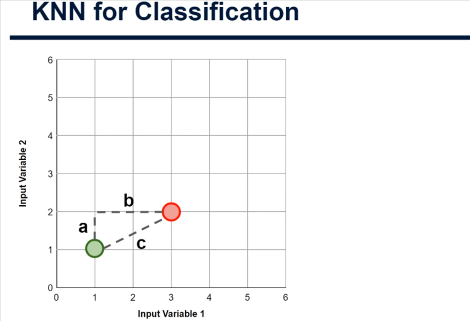
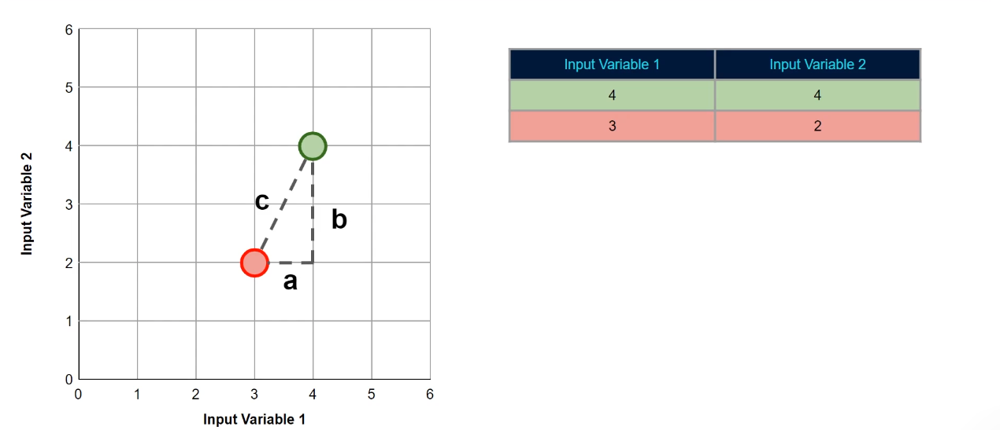
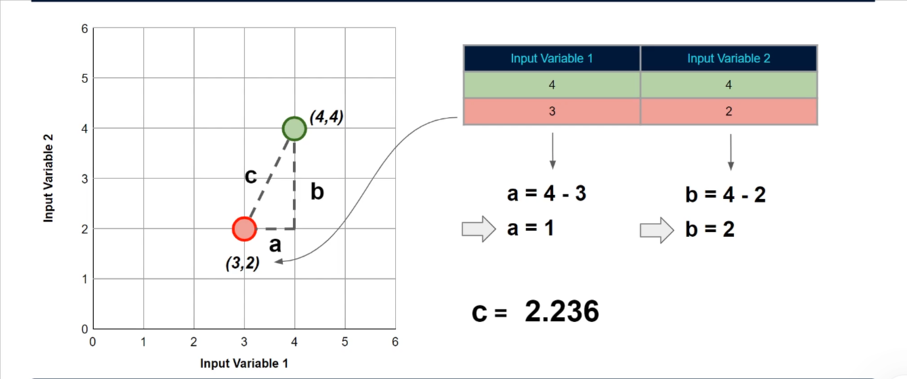
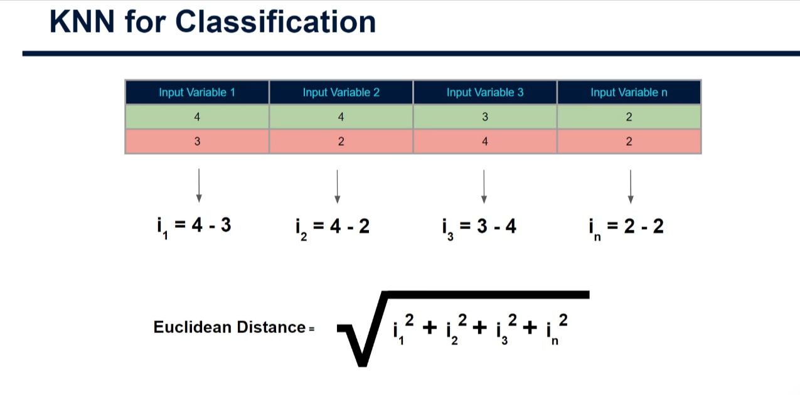

# Measuring Distances in Multi-Dimensional Space

## Advanced KNN - Understanding Distance Calculations

---

## Introduction

Welcome to this advanced tutorial on the theory behind KNN for classification!

In the introductory tutorial, we looked at simple examples of how the KNN algorithm classifies new data points. We discussed how:

1. Given a value for K
2. It finds the K nearest neighbors
3. Within those neighbors, the class with the highest count is deemed the winner
4. The new data point is tagged with this class

### The Missing Detail

As we ran through this, I mentioned that the algorithm finds the nearest neighbors using the **straight-line distance** between them. Well, in this tutorial, I want to go into a little bit more detail on that so you know exactly what it's doing under the hood.

This is crucial for understanding how KNN actually works and why it's so powerful!

---

## Part 1: Calculating Distance Between Two Points



### The Setup

Here we have a similar concept as before:

- **Red circle in the center** = the new data point we're looking to classify
- **Green circle** = a data point with a known class

### From "Straight-Line Distance" to "Euclidean Distance"

Let's forget about the number of neighbors we want to use for a minute and just focus on calculating the distance between our red data point and our green data point.

Instead of saying "straight-line distance," let's now start using the term **Euclidean Distance**. While it's the same thing as straight-line distance, this is what you'll see referred to in mathematics and data science.

**The aim here:** Calculate the Euclidean distance between our new data point (red) and the other data point (green).

---

## Part 2: Euclidean Distance Formula

### The Formula (Based on Pythagoras' Theorem)

The formula for Euclidean distance is the same as **Pythagoras' theorem**, where we want to find the length of the hypotenuse of a right triangle.

```
c = √(a² + b²)
```

Where:

- **a** = difference in first dimension (input variable 1)
- **b** = difference in second dimension (input variable 2)
- **c** = Euclidean distance (what we're calculating)

### Why This Works

In this image, the hypotenuse is the side denoted as **C**. In order to do this, we simply take the square root of a² + b².

**This works perfectly for us because:**

- No matter where our data points are, we can always think of them in terms of the three sides of a right triangle (A, B, and C)
- All we need are the values for A and B
- If we have these values, we can always calculate C
- Luckily for us, we always have these values!

---

## Part 3: Worked Example - Step by Step



Let's go back to the first position of the green data point and think about the table of data that we would have for all data points.

### Data Table

We have:

- **Input variables** (these values dictate the position of the points on our plot)
- **Known classes** (for training data)
- **Unknown classes** (for new data we're trying to predict)

### Coordinate Positions

**Green Data Point:**

- Input Variable 1: **4**
- Input Variable 2: **4**
- **Position on plot: (4, 4)**

**Unknown/New Data Point (Red):**

- Input Variable 1: **3**
- Input Variable 2: **2**
- **Position on plot: (3, 2)**

### Calculating Component A

To work out the value of **A** on our triangle, we just need to subtract one data point's input variable one value from the other:

```
a = 4 - 3 = 1
```

### Calculating Component B

Working out the value for **B** is the same except we use the values from input variable two:

```
b = 4 - 2 = 2
```

### Calculating Component C (The Distance)

Now we have these values for A and B, we just plug them into our formula:

```
c = √(a² + b²)
c = √(1² + 2²)
c = √(1 + 4)
c = √5
c = 2.236
```

**Result:** The Euclidean distance between the red and green points is approximately **2.236 units**.

### Why Sign Doesn't Matter

One thing to note: Since we square the values of A and B, **it doesn't matter which data point's values we take away from the other** when calculating A and B. They'll always turn out to be positive due to the squaring that occurs in the formula to find C.

For example:

```
a = 3 - 4 = -1
a² = (-1)² = 1  (positive)
```

---

## Part 4: Working with Multiple Data Points



### The Process

If we had many, many more data points, the same approach would be applied to each pair of points. We could then select the K closest data points (the K nearest neighbors) based on this distance metric.

### Algorithm Flow

1. **Calculate distance** from the new point to every training point using Euclidean distance
2. **Sort distances** from smallest to largest
3. **Select K smallest** distances (these are the K nearest neighbors)
4. **Count classes** among these K neighbors
5. **Predict** the class with the highest count

---

## Part 5: Extending to 3+ Dimensions



### Important Note About Higher Dimensions

Lastly, I just like to mention that this formula, or a slightly tweaked version of this formula, **still works even with many more dimensions**.

In practice, you're likely to have **more than two input variables**, and therefore just as we've done here, each will be plotted on its own dimension.

### Visualizing Multi-Dimensional Space

- **2D:** We can easily visualize on a 2D plot (x, y)
- **3D:** We can visualize in 3D space (x, y, z)
- **4D+:** We can't easily visualize, but we can still think of each as an added dimension

**Rest assured, this all still works!**

### The Extended Formula

**For 2 dimensions (what we've been doing):**

```
distance = √(x₁² + x₂²)
```

**For 3 dimensions:**

```
distance = √(x₁² + x₂² + x₃²)
```

**For N dimensions (general formula):**

```
distance = √(x₁² + x₂² + x₃² + ... + xₙ²)
```

Where x₁, x₂, etc. are the differences in each dimension.

---

## Code Examples for Beginners

Now let's see how to calculate Euclidean distance using Python!

### Example 1: Manual Calculation (From Scratch)

```python
import math

# Define two data points
point_1 = (4, 4)  # Green point
point_2 = (3, 2)  # Red point

# Calculate differences
diff_x = point_1[0] - point_2[0]  # 4 - 3 = 1
diff_y = point_1[1] - point_2[1]  # 4 - 2 = 2

print(f"Difference in X (a): {diff_x}")
print(f"Difference in Y (b): {diff_y}")

# Calculate Euclidean distance using the formula
distance = math.sqrt(diff_x**2 + diff_y**2)

print(f"\nEuclidean Distance = √({diff_x}² + {diff_y}²)")
print(f"Euclidean Distance = √({diff_x**2} + {diff_y**2})")
print(f"Euclidean Distance = √{diff_x**2 + diff_y**2}")
print(f"Euclidean Distance = {distance:.3f}")
```

**Output:**

```
Difference in X (a): 1
Difference in Y (b): 2

Euclidean Distance = √(1² + 2²)
Euclidean Distance = √(1 + 4)
Euclidean Distance = √5
Euclidean Distance = 2.236
```

---

### Example 2: Function to Calculate Distance

```python
import math

def euclidean_distance(point1, point2):
    """
    Calculate Euclidean distance between two points.

    Args:
        point1: tuple of coordinates (x1, y1, z1, ...)
        point2: tuple of coordinates (x2, y2, z2, ...)

    Returns:
        float: The distance between the two points
    """
    # Ensure both points have the same number of dimensions
    if len(point1) != len(point2):
        raise ValueError("Points must have the same number of dimensions!")

    # Calculate sum of squared differences
    sum_of_squares = 0
    for i in range(len(point1)):
        difference = point1[i] - point2[i]
        sum_of_squares += difference**2

    # Return the square root
    distance = math.sqrt(sum_of_squares)
    return distance

# Test with 2D points
point_red = (3, 2)
point_green = (4, 4)
dist_2d = euclidean_distance(point_red, point_green)
print(f"Distance between {point_red} and {point_green}: {dist_2d:.3f}")

# Test with 3D points
point_a = (1, 2, 3)
point_b = (4, 5, 6)
dist_3d = euclidean_distance(point_a, point_b)
print(f"Distance between {point_a} and {point_b}: {dist_3d:.3f}")

# Test with 4D points
point_c = (0, 0, 0, 0)
point_d = (1, 1, 1, 1)
dist_4d = euclidean_distance(point_c, point_d)
print(f"Distance between {point_c} and {point_d}: {dist_4d:.3f}")
```

**Output:**

```
Distance between (3, 2) and (4, 4): 2.236
Distance between (1, 2, 3) and (4, 5, 6): 5.196
Distance between (0, 0, 0, 0) and (1, 1, 1, 1): 2.000
```

---

### Example 3: Using NumPy (More Efficient)

```python
import numpy as np

# Define two points as numpy arrays
point_1 = np.array([4, 4])
point_2 = np.array([3, 2])

# Method 1: Using np.linalg.norm (easiest)
distance = np.linalg.norm(point_1 - point_2)
print(f"Distance using np.linalg.norm: {distance:.3f}")

# Method 2: Using numpy operations (educational)
distance = np.sqrt(np.sum((point_1 - point_2)**2))
print(f"Distance using manual numpy: {distance:.3f}")
```

**Output:**

```
Distance using np.linalg.norm: 2.236
Distance using manual numpy: 2.236
```

---

### Example 4: Finding K Nearest Neighbors

```python
import numpy as np
from sklearn.neighbors import NearestNeighbors

# Sample training data (with known classes)
training_data = np.array([
    [1, 1],  # Point 0
    [2, 2],  # Point 1
    [2, 4],  # Point 2
    [3, 3],  # Point 3
    [4, 4],  # Point 4
    [4, 2],  # Point 5
])

# Classes for each point
classes = np.array(['A', 'A', 'B', 'A', 'B', 'B'])

# New point to classify
new_point = np.array([[3, 2]])

# Create nearest neighbors model with K=3
k = 3
model = NearestNeighbors(n_neighbors=k)
model.fit(training_data)

# Find K nearest neighbors
distances, indices = model.kneighbors(new_point)

print(f"New point: {new_point[0]}")
print(f"\nK={k} Nearest Neighbors:")
print("-" * 50)

for i, (distance, index) in enumerate(zip(distances[0], indices[0]), 1):
    point = training_data[index]
    class_label = classes[index]
    print(f"{i}. Point {point} (Class: {class_label}, Distance: {distance:.3f})")

# Determine predicted class by majority vote
predicted_classes = classes[indices[0]]
from collections import Counter
vote_count = Counter(predicted_classes)
predicted_class = vote_count.most_common(1)[0][0]

print(f"\nClass votes: {dict(vote_count)}")
print(f"Predicted class for {new_point[0]}: {predicted_class}")
```

**Output:**

```
New point: [3 2]

K=3 Nearest Neighbors:
--------------------------------------------------
1. Point [2 2] (Class: A, Distance: 1.000)
2. Point [3 3] (Class: A, Distance: 1.000)
3. Point [4 2] (Class: B, Distance: 1.000)

Class votes: {'A': 2, 'B': 1}
Predicted class for [3 2]: A
```

---

### Example 5: Distance Comparison Matrix

```python
import pandas as pd
import numpy as np
from scipy.spatial.distance import cdist

# Training data points
points = {
    'Point 0': [1, 1],
    'Point 1': [2, 2],
    'Point 2': [2, 4],
    'Point 3': [3, 3],
    'Point 4': [4, 4],
    'Point 5': [4, 2],
}

# New point
new_point = [3, 2]

# Calculate distances from new point to all training points
distances = {}
for name, coords in points.items():
    dist = np.sqrt((coords[0] - new_point[0])**2 + (coords[1] - new_point[1])**2)
    distances[name] = dist

# Create a sorted distance DataFrame
distance_df = pd.DataFrame([
    {'Point': name, 'Distance': dist}
    for name, dist in distances.items()
]).sort_values('Distance')

print(f"Distances from new point {new_point} to all training points:")
print(distance_df.to_string(index=False))

print(f"\nK=3 Nearest Neighbors:")
print(distance_df.head(3).to_string(index=False))
```

**Output:**

```
Distances from new point [3, 2] to all training points:
    Point  Distance
 Point 0     2.236
 Point 1     1.414
 Point 5     1.000
 Point 3     1.000
 Point 2     2.236
 Point 4     3.162

K=3 Nearest Neighbors:
    Point  Distance
 Point 5     1.000
 Point 3     1.000
 Point 1     1.414
```

---

## Key Takeaways

✅ **Euclidean distance** is the straight-line distance between two points
✅ **Formula:** `distance = √(Δx₁² + Δx₂² + ... + Δxₙ²)`
✅ **Works in any number of dimensions** (2D, 3D, 4D, ...)
✅ **Basis of KNN** - algorithm finds K nearest neighbors using this distance
✅ **Squaring eliminates signs** - negative differences become positive
✅ **Simple but powerful** - foundation of many ML algorithms

---

## What's Different from Manual Calculation?

| Aspect               | Manual                            | NumPy                 | Scikit-Learn                      |
| -------------------- | --------------------------------- | --------------------- | --------------------------------- |
| **Simplicity**       | Most explicit, easy to understand | Concise, vectorized   | Highest level, built-in functions |
| **Speed**            | Slowest (loops)                   | Fast (optimized)      | Fastest (production-ready)        |
| **Use Case**         | Learning/understanding            | Data science projects | Production ML                     |
| **Error Handling**   | Manual                            | Limited               | Comprehensive                     |
| **K-NN Integration** | Build from scratch                | Build models          | Ready-to-use                      |

---

## Common Mistakes to Avoid

❌ **Forgetting to square differences** - Always use `(a - b)²`, not just `(a - b)`
❌ **Forgetting to take square root** - The final formula needs `√`
❌ **Mixing up dimensions** - Be consistent with coordinate ordering
❌ **Not scaling features** - Features with different ranges can dominate distance
❌ **Wrong K value** - Too small (overfitting) or too large (underfitting)

---

## Preview: Next Topic - Feature Scaling

A concept that goes **hand-in-hand with the distance measurements** we've discussed here is **Feature Scaling**.

**Feature scaling can often make or break a KNN-based approach**, so it's going to be really interesting to run through it!

### Why Feature Scaling Matters for Distance

Imagine you're measuring distance with:

- **Age:** ranges from 0-100 years
- **Income:** ranges from 0-1,000,000 dollars

Without scaling, income differences completely dominate the distance calculation! A $1,000 difference in income outweighs even a 50-year age difference. This is why **feature scaling is critical** for KNN.

---

## Summary

Well, it might seem scary thinking about calculating distance in multidimensional space, but it's actually quite an easy calculation to make once you know how!

We've reached the end of this tutorial explaining how the KNN algorithm assesses which data points are closest across any number of dimensions.

Like I said, it seems really complex at first, especially when thinking about high-dimensional spaces. But as you can hopefully see, it's all very intuitive when you break it down!

**Until then, keep having fun and keep learning!** 🚀

---

## Practice Exercises

1. **Calculate distances manually:**
   - Find distance between (0, 0) and (3, 4)
   - Find distance between (1, 2, 3) and (4, 5, 6)

2. **Code it up:**
   - Create a function to find 5 nearest neighbors to a new point
   - Test it with sample data

3. **Explore:** What happens to distances when you change a point's coordinates by 1 unit? How does the formula respond?

Happy learning! 🎓
