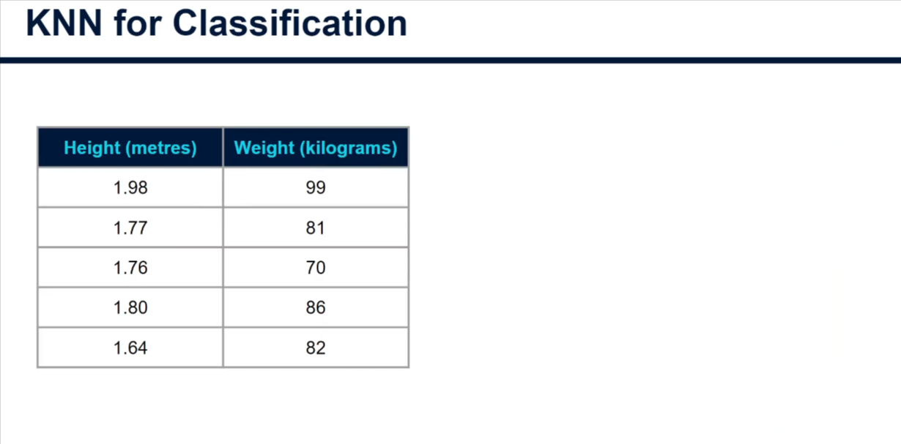
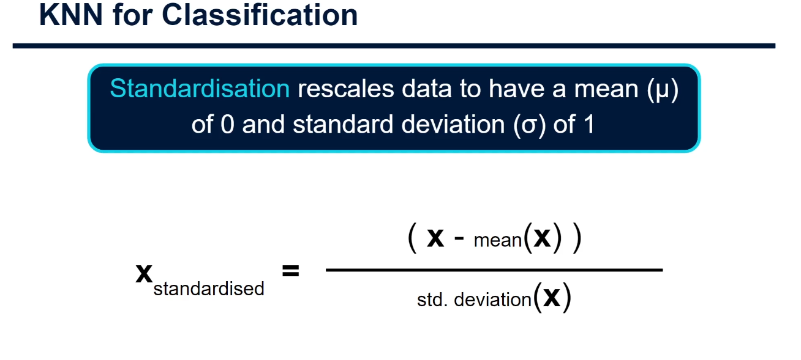
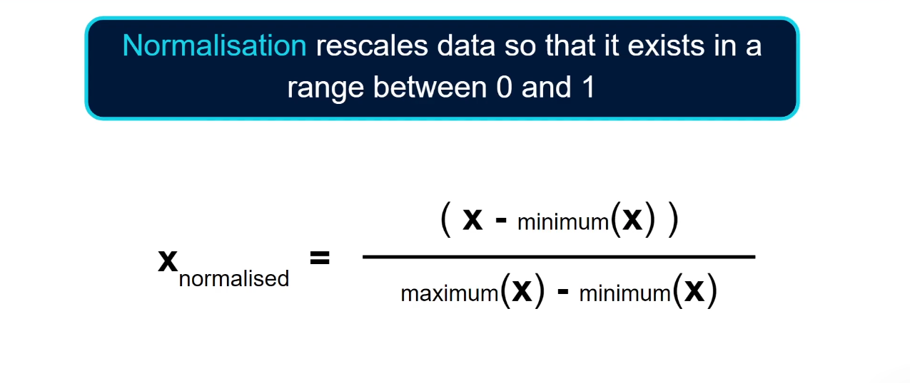
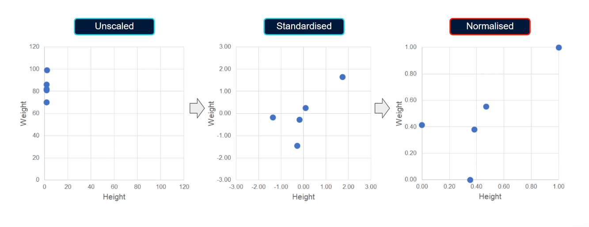

# The Importance of Feature Scaling for KNN

## Why Different Feature Ranges Break Distance-Based Algorithms

---

## Introduction

Welcome to this advanced tutorial on the theory behind KNN classification!

In the **last tutorial**, we looked at how the KNN algorithm measures the distance between data points to assess which ones are closest.

In **this tutorial**, I want to cover something **really important** when we're using a distance-based algorithm like KNN: **Feature Scaling**.

We covered this topic earlier in the course when looking at data preparation techniques. Here, we'll focus on a high-level overview and then discuss how it applies to KNN specifically.

> **Quick Note:** If you want to revisit the earlier tutorial for a refresher on the calculations themselves, feel free to do so!

---

## What is Feature Scaling?

### Definition

**Feature Scaling** is where we force the values from different columns or input variables to **exist on the same scale** in order to enhance the learning capabilities of a model.

### Why It Matters for KNN

KNN relies on **distance measurements** between data points:

- If features have different scales, one feature will dominate
- The algorithm won't properly compare all features
- Results will be biased and inaccurate

---

## The Problem: Unscaled Data

### Real-World Example: Heights and Weights



Here we have the heights and weights of five men:

| Person | Height (meters) | Weight (kg) |
| ------ | --------------- | ----------- |
| 1      | 1.75            | 70          |
| 2      | 1.80            | 85          |
| 3      | 1.65            | 65          |
| 4      | 1.90            | 95          |
| 5      | 1.70            | 72          |

**What's the problem here?**

- **Height range:** 1.65 to 1.90 (range of 0.25)
- **Weight range:** 65 to 95 (range of 30)

### Visualizing the Problem



If we plot this as a scatter plot with the **same scale on each axis**, we can clearly see:

- **Weight is much more spread out** than height
- **Height appears almost flat** (nearly identical)
- **Weight dominates** the distance calculations

### Why This Breaks KNN

When calculating distance, the algorithm uses:

```
distance = sqrt((height_diff)² + (weight_diff)²)
```

**Problem:** Weight differences (0-30 range) are MUCH larger than height differences (0-0.25 range)

Even a **0.1 meter difference in height** is far less important than a **1 kg difference in weight** in the distance calculation!

This means:

- ❌ Height is ignored
- ❌ Weight dominates
- ❌ Algorithm can't compare features fairly
- ❌ Predictions are biased and inaccurate

---

## Solution 1: Standardization

### What is Standardization?

**Standardization** rescales all data columns to have:

- **Mean (average):** 0
- **Standard Deviation:** 1

This means data points end up existing somewhere between about **-3 and +3** on a standard scale.

### The Formula

```
standardized_value = (value - column_mean) / column_standard_deviation
```

### What This Means

Each data point is now represented by **how many standard deviations it is away from the mean**.

The mean itself is represented as **zero**.

### Example: Standardization Calculation

```
Original height values: [1.65, 1.70, 1.75, 1.80, 1.90]
Mean height: 1.74 meters
Standard deviation: 0.094

Standardized 1.75 = (1.75 - 1.74) / 0.094 = 0.11 (slightly above average)
Standardized 1.90 = (1.90 - 1.74) / 0.094 = 1.70 (well above average)
Standardized 1.65 = (1.65 - 1.74) / 0.094 = -0.96 (below average)
```

### Result

All features now have:

- ✓ Mean of 0
- ✓ Standard deviation of 1
- ✓ Range roughly from -3 to +3
- ✓ On comparable scales

---

## Solution 2: Normalization (Min-Max Scaling)

### What is Normalization?

**Normalization** rescales data so that it exists in a range between **0 and 1**.

Also called **Min-Max Scaling**.

### The Formula

```
normalized_value = (value - column_min) / (column_max - column_min)
```

### What This Means

- **Minimum value** in the column → 0
- **Maximum value** in the column → 1
- **All other values** → placed proportionally between 0 and 1

### Example: Normalization Calculation

```
Original height values: [1.65, 1.70, 1.75, 1.80, 1.90]
Min height: 1.65
Max height: 1.90

Normalized 1.65 = (1.65 - 1.65) / (1.90 - 1.65) = 0.00 (minimum)
Normalized 1.90 = (1.90 - 1.65) / (1.90 - 1.65) = 1.00 (maximum)
Normalized 1.75 = (1.75 - 1.65) / (1.90 - 1.65) = 0.40 (40% of the way)
```

### Result

All features now have:

- ✓ Minimum value of 0
- ✓ Maximum value of 1
- ✓ Range exactly 0 to 1
- ✓ On comparable scales

---

## Comparison: Standardization vs Normalization



### Side-by-Side Comparison

| Aspect                   | Standardization     | Normalization           |
| ------------------------ | ------------------- | ----------------------- |
| **Range**                | Roughly -3 to +3    | Exactly 0 to 1          |
| **Mean**                 | 0                   | Variable                |
| **Std Dev**              | 1                   | Variable                |
| **Formula**              | (x - mean) / std    | (x - min) / (max - min) |
| **Affected by outliers** | Less                | More                    |
| **Interpretability**     | Standard deviations | Percentages             |

### Visual Comparison



Notice that:

- **Normalized data:** All values tightly bounded between 0-1
- **Standardized data:** More spread (roughly -3 to +3)
- **Both:** Much more comparable than original unscaled data!

---

## Which Method Should We Use for KNN?

### The Recommendation: **Use Normalization**

Here's why:

### Reason 1: Consistent Fixed Range

```
With normalization:
  ALL input variables → range [0, 1]

With standardization:
  Different features → different ranges
  (some might be -2 to +2, others -3 to +3)
```

**Advantage:** KNN can judge every column in exactly the same way.

### Reason 2: Handles Categorical Variables Better

```
If you have categorical variables encoded as 0 and 1:
  One-hot encoding → values are 0 or 1

Normalization puts numeric features → also [0, 1]
Standardization → might go to -3 to +3

Result: All features on the same scale!
```

---

## Practical Comparison

### Before Scaling

```
Height: 1.65 to 1.90 meters (range = 0.25)
Weight: 65 to 95 kg (range = 30)

Distance = sqrt((height_diff)² + (weight_diff)²)
Problem: Weight dominates (30 >> 0.25)
```

### After Normalization

```
Height: 0.0 to 1.0 (normalized)
Weight: 0.0 to 1.0 (normalized)

Distance = sqrt((height_diff)² + (weight_diff)²)
Solution: Both features equal importance!
```

---

## Impact on KNN Predictions

### Without Feature Scaling

```
KNN finds neighbors based primarily on:
  ❌ Weight differences (dominates)
  ❌ Height almost ignored

Result: Poor predictions, biased toward weight
```

### With Feature Scaling

```
KNN finds neighbors based equally on:
  ✓ Weight differences
  ✓ Height differences

Result: Accurate predictions using all features
```

---

## Summary: When to Scale

### Always Use Feature Scaling for KNN

**Golden Rule:** Always use scaling when applying a KNN model!

### Recommended Approach

```
FOR KNN:
1. Prepare your data
2. Split into training/test sets (IMPORTANT: before scaling!)
3. Apply normalization to training data
4. Apply same transformation to test data
5. Train KNN on scaled data
6. Make predictions on scaled data
```

### Important: Don't Scale Before Split!

⚠️ **Common Mistake:**

```python
# WRONG: Scale first, then split
scaler.fit_transform(all_data)
X_train, X_test = train_test_split(scaled_data)

# RIGHT: Split first, then scale
X_train, X_test = train_test_split(raw_data)
scaler.fit(X_train)  # Calculate on training data only!
X_train = scaler.transform(X_train)
X_test = scaler.transform(X_test)
```

---

## Code Examples: Feature Scaling in Python

### Example 1: Manual Normalization

```python
# Manual normalization for one feature
def normalize(values):
    """Normalize values to range [0, 1]"""
    min_val = min(values)
    max_val = max(values)
    return [(x - min_val) / (max_val - min_val) for x in values]

# Heights: [1.65, 1.70, 1.75, 1.80, 1.90]
heights = [1.65, 1.70, 1.75, 1.80, 1.90]
normalized_heights = normalize(heights)
print(f"Original: {heights}")
print(f"Normalized: {[round(x, 2) for x in normalized_heights]}")
# Output: [0.0, 0.33, 0.67, 1.0, 1.0]
```

### Example 2: Using Scikit-Learn (Normalization)

```python
from sklearn.preprocessing import MinMaxScaler
import numpy as np

# Your data
heights = np.array([1.65, 1.70, 1.75, 1.80, 1.90]).reshape(-1, 1)
weights = np.array([65, 70, 75, 85, 95]).reshape(-1, 1)

# Create scaler
scaler = MinMaxScaler()

# Fit and transform
normalized_heights = scaler.fit_transform(heights)
normalized_weights = scaler.fit_transform(weights)

print("Normalized Heights:", normalized_heights.flatten())
print("Normalized Weights:", normalized_weights.flatten())
# Output:
# Normalized Heights: [0.   0.33 0.67 1.   1.  ]
# Normalized Weights: [0.   0.17 0.33 0.67 1.  ]
```

### Example 3: Using Scikit-Learn (Standardization)

```python
from sklearn.preprocessing import StandardScaler
import numpy as np

# Your data
data = np.array([
    [1.65, 65],
    [1.70, 70],
    [1.75, 75],
    [1.80, 85],
    [1.90, 95]
])

# Create scaler
scaler = StandardScaler()

# Fit and transform
standardized_data = scaler.fit_transform(data)

print("Standardized Data:")
for row in standardized_data:
    print(f"  Height: {row[0]:6.2f}, Weight: {row[1]:6.2f}")
# Output (approximate):
#   Height: -1.48, Weight: -1.43
#   Height: -0.74, Weight: -0.71
#   Height:  0.00, Weight:  0.00
#   Height:  0.74, Weight:  0.71
#   Height:  1.48, Weight:  1.43
```

### Example 4: KNN with and Without Scaling

```python
from sklearn.neighbors import KNeighborsClassifier
from sklearn.preprocessing import MinMaxScaler
from sklearn.model_selection import train_test_split
import numpy as np

# Sample data
X = np.array([
    [1.65, 65],  # Height (m), Weight (kg)
    [1.70, 70],
    [1.75, 75],
    [1.80, 85],
    [1.90, 95]
])
y = np.array([0, 0, 1, 1, 1])  # Classes

# Split data
X_train, X_test, y_train, y_test = train_test_split(X, y, test_size=0.2)

# WITHOUT SCALING
knn_unscaled = KNeighborsClassifier(n_neighbors=3)
knn_unscaled.fit(X_train, y_train)
accuracy_unscaled = knn_unscaled.score(X_test, y_test)

# WITH SCALING
scaler = MinMaxScaler()
X_train_scaled = scaler.fit_transform(X_train)
X_test_scaled = scaler.transform(X_test)

knn_scaled = KNeighborsClassifier(n_neighbors=3)
knn_scaled.fit(X_train_scaled, y_train)
accuracy_scaled = knn_scaled.score(X_test_scaled, y_test)

print(f"Accuracy WITHOUT scaling: {accuracy_unscaled:.2%}")
print(f"Accuracy WITH scaling: {accuracy_scaled:.2%}")
```

### Example 5: Complete Workflow with Scaling

```python
from sklearn.datasets import load_iris
from sklearn.preprocessing import MinMaxScaler
from sklearn.model_selection import train_test_split
from sklearn.neighbors import KNeighborsClassifier
from sklearn.metrics import accuracy_score

# Load data
iris = load_iris()
X = iris.data
y = iris.target

# IMPORTANT: Split BEFORE scaling!
X_train, X_test, y_train, y_test = train_test_split(
    X, y, test_size=0.2, random_state=42
)

# Scale only training data
scaler = MinMaxScaler()
X_train_scaled = scaler.fit_transform(X_train)
X_test_scaled = scaler.transform(X_test)  # Use training scaler!

# Train KNN on scaled data
knn = KNeighborsClassifier(n_neighbors=5)
knn.fit(X_train_scaled, y_train)

# Predict
y_pred = knn.predict(X_test_scaled)

# Evaluate
accuracy = accuracy_score(y_test, y_pred)
print(f"Accuracy: {accuracy:.2%}")
```

---

## Common Mistakes to Avoid

❌ **Mistake 1: Scaling before train/test split**

```python
# WRONG
scaler.fit_transform(X)  # Fits on ALL data
X_train, X_test = train_test_split(scaled_X)
```

✅ **Correct:**

```python
X_train, X_test = train_test_split(X)
scaler.fit(X_train)  # Fit on training data only
X_train = scaler.transform(X_train)
X_test = scaler.transform(X_test)
```

❌ **Mistake 2: Not scaling test data the same way**

```python
# WRONG
X_train_scaled = scaler1.fit_transform(X_train)
X_test_scaled = scaler2.fit_transform(X_test)  # Different scaler!
```

✅ **Correct:**

```python
scaler = MinMaxScaler()
X_train_scaled = scaler.fit_transform(X_train)
X_test_scaled = scaler.transform(X_test)  # Same scaler!
```

❌ **Mistake 3: Forgetting to scale for KNN**

```python
# WRONG
knn = KNeighborsClassifier()
knn.fit(X_train, y_train)  # Unscaled data
```

✅ **Correct:**

```python
# Scale first
X_train_scaled = scaler.fit_transform(X_train)
X_test_scaled = scaler.transform(X_test)

knn = KNeighborsClassifier()
knn.fit(X_train_scaled, y_train)
```

---

## Key Takeaways

### The Problem

- Different features have different scales/ranges
- KNN uses distance, which is dominated by larger-scale features
- Smaller-scale features are ignored
- Results are biased and inaccurate

### The Solution

- **Normalization (Min-Max Scaling):** Scale to [0, 1] range
- **Standardization:** Scale to mean=0, std=1
- **For KNN:** Use normalization!

### The Rule

✅ **Always scale features for KNN**
✅ **Use Normalization** (unless you have a specific reason for standardization)
✅ **Scale AFTER train/test split**
✅ **Use same scaler for train and test**

### Impact on Results

| Situation    | Accuracy | Issue                              |
| ------------ | -------- | ---------------------------------- |
| No scaling   | Low      | Features dominated by large ranges |
| With scaling | High     | All features weighted equally      |

---

## When to Use Standardization vs Normalization for KNN

### Use **Normalization (Min-Max)** when:

- ✓ Building KNN models (recommended)
- ✓ You have mixed feature types (numeric + one-hot encoded)
- ✓ You want predictable [0, 1] range
- ✓ Features have different units (meters vs kg)

### Use **Standardization** when:

- ✓ Using algorithms like Linear Regression, Logistic Regression
- ✓ Features are normally distributed
- ✓ You want to identify outliers (values > 3 std dev)
- ✓ Working with neural networks

### For KNN: **Normalization is the better choice!**

---

## Summary: Feature Scaling Best Practices

### Checklist Before Training KNN

- [ ] Load your data
- [ ] Split into training and test sets
- [ ] Create MinMaxScaler
- [ ] Fit scaler on **training data only**
- [ ] Transform training data
- [ ] Transform test data using **same scaler**
- [ ] Train KNN on scaled training data
- [ ] Predict on scaled test data
- [ ] Evaluate results

### Quick Reference

```python
# The right way to scale for KNN
from sklearn.preprocessing import MinMaxScaler
from sklearn.neighbors import KNeighborsClassifier

# 1. Split first
X_train, X_test, y_train, y_test = train_test_split(X, y)

# 2. Scale
scaler = MinMaxScaler()
X_train = scaler.fit_transform(X_train)
X_test = scaler.transform(X_test)

# 3. Train KNN
knn = KNeighborsClassifier()
knn.fit(X_train, y_train)

# 4. Predict
predictions = knn.predict(X_test)
```

---

## Next Steps

After understanding feature scaling, you should:

1. ✅ Know why scaling is critical for KNN
2. ✅ Understand normalization vs standardization
3. ✅ Be able to scale data using Scikit-Learn
4. ✅ Avoid common scaling mistakes
5. ✅ Ready for: Choosing the K value

**Next Tutorial:** Choosing K - What value should I use for K?

---

## Questions to Test Your Understanding

1. **Why do we need feature scaling for KNN?**
   - A: Features with larger ranges dominate distance calculations

2. **What range does normalization produce?**
   - A: [0, 1]

3. **What range does standardization produce?**
   - A: Roughly [-3, +3]

4. **When should we fit the scaler?**
   - A: On training data only, before fitting KNN

5. **Which scaling method is recommended for KNN?**
   - A: Normalization (Min-Max scaling)

---

## Additional Resources

- Previous Tutorial: Day-130 Euclidean Distance
- Next Tutorial: Choosing the K Value
- Scikit-Learn Documentation: https://scikit-learn.org/
- Feature Scaling Techniques: Many algorithms require scaling!

---

## Summary

**Feature Scaling** is essential for KNN because:

✓ KNN uses **distance calculations**
✓ Unscaled features have **different ranges**
✓ Large-range features **dominate** the distance
✓ Scaling puts all features on **comparable scales**
✓ Results are **more accurate and unbiased**

**Use Normalization for KNN** - scale to [0, 1] range!

Happy learning! 🎓📚
