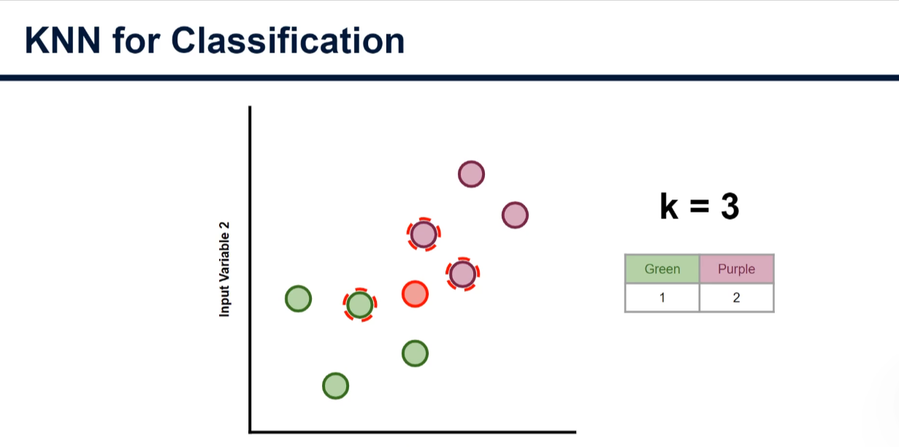
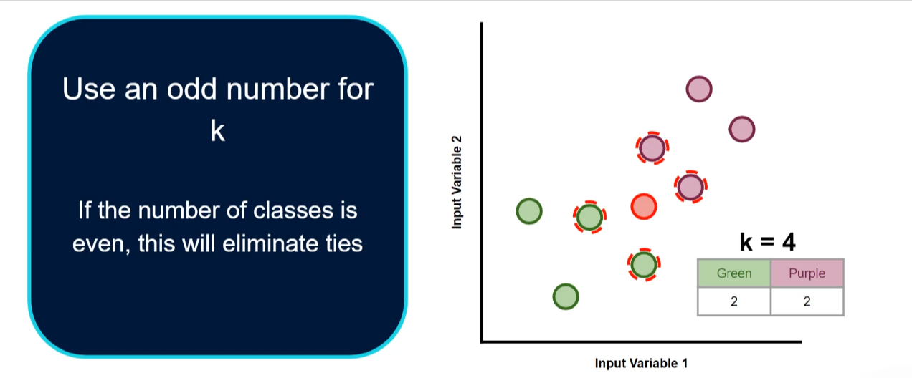
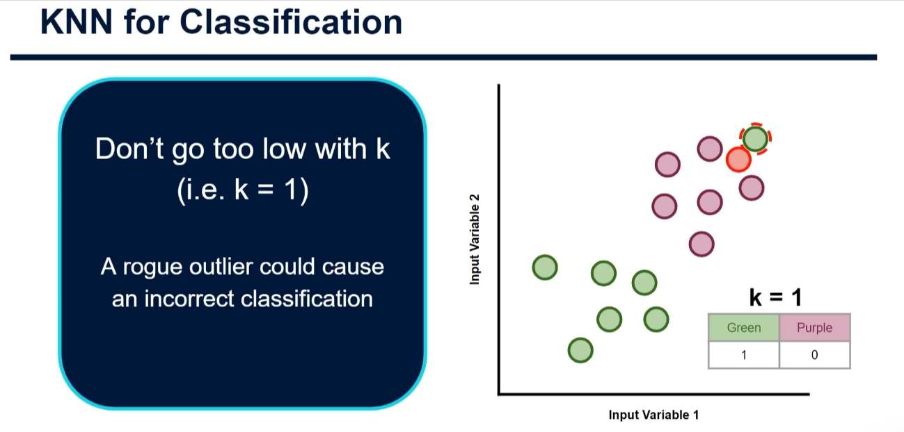
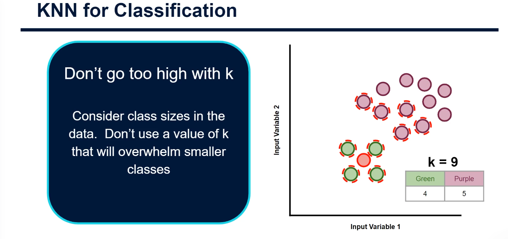
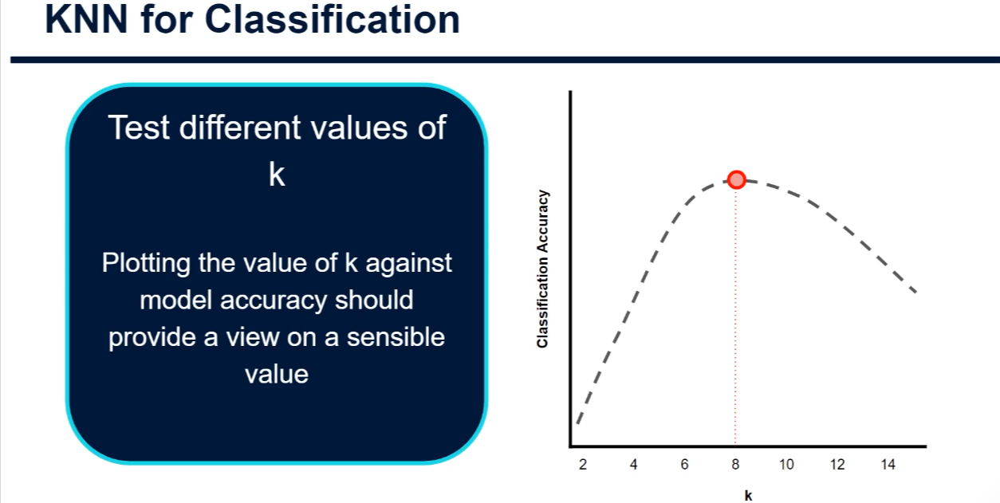

# Choosing the Best K Value for KNN Classification - Beginner Tutorial

## Introduction

Welcome to this comprehensive tutorial on selecting the optimal **K value** for K-Nearest Neighbours classification!

In the previous tutorials, we learned how KNN works: it finds the K nearest neighbors to a new data point and assigns it the class that appears most frequently among those neighbors. But here's a critical question that many beginners struggle with:

**"What value of K should I actually use?"**

This tutorial explores this question in depth and provides practical guidance for choosing K that works best for your specific dataset.

---

## Part 1: How K Affects Classification

### The Impact of Different K Values

Let's start with a practical example. Imagine we're trying to classify a new data point using KNN:



**Scenario 1: K = 3**

- The algorithm finds the 3 nearest neighbors
- Among these 3 neighbors, the class with the highest count "wins"
- Our new data point is assigned that class
- Result: The point might be classified as **Purple**

**Scenario 2: K = 5**

- The algorithm finds the 5 nearest neighbors
- Among these 5 neighbors, we count again
- A different class might now have the majority
- Result: The same data point might be classified as **Green**

**Key Insight:** Even small changes in K can cause the algorithm to completely change its prediction! This shows why choosing K carefully is important.

---

## Part 2: The Problem of Choosing K - Visual Guide

### Understanding the Trade-offs



When selecting K, we need to balance two competing concerns:

**1. K Too Low (Overfitting)**

- Low K means we're only looking at the very closest neighbors
- The algorithm becomes too sensitive to individual data points
- Outliers in your data can cause incorrect classifications
- The model doesn't generalize well to new data

**2. K Too High (Underfitting)**

- High K means we're looking at many neighbors
- The algorithm might miss important patterns
- Less common classes get "drowned out" by more common ones
- The model becomes too rigid and loses important detail

**The Goal:** Find the sweet spot that balances these two extremes.

---

## Part 3: The Outlier Problem



### When K is Too Low

Imagine you have:

- **Mostly purple data points** in a region
- **One green data point** that's slightly closer than other purple points (an outlier)

**What happens with K = 1:**

- The algorithm only looks at the single closest neighbor
- That closest neighbor happens to be the outlier (green)
- Your new data point gets misclassified as green
- But intuitively, it should probably be purple!

**Solution:** Use a higher K value to avoid being fooled by individual outliers. K = 3, 5, or 7 would be more robust.

---

## Part 4: When K is Too High

### Overwhelming Minority Classes



Imagine you have:

- **Dataset composition:** 80% purple data points, 20% green data points
- **New data point:** Visually closer to green points
- **But you choose K = 50**

**What happens:**

- Looking at 50 neighbors means considering lots of both colors
- Purple class (more numerous) might have 35 neighbors, green only 15
- The algorithm classifies as purple, even though the data point was visually closer to green
- Minority classes never get considered!

**Solution:** Use a K value that doesn't overwhelm smaller classes. Test different values and see what works.

---

## Part 5: Practical Rules for Choosing K

### Rule 1: Always Use Odd Numbers



**Why odd?** If your dataset has an even number of classes (like 2 classes: purple and green), using an odd K prevents ties.

Example with K = 4 (Even - BAD):

- 2 neighbors are purple
- 2 neighbors are green
- TIE! Which class wins? Undefined behavior!

Example with K = 3 (Odd - GOOD):

- 2 neighbors are purple
- 1 neighbor is green
- Purple wins clearly. No ambiguity!

**Rule:** Use K = 1, 3, 5, 7, 9, 11, ... (odd numbers)

### Rule 2: Start with a Heuristic

A common starting point suggested by practitioners:

```
K = √(n_samples)
```

Where `n_samples` is the number of training examples.

**Examples:**

- If you have 100 training samples: K = √100 = 10
- If you have 25 training samples: K = √25 = 5
- If you have 144 training samples: K = √144 = 12

**Important:** This is just a starting point! You still need to test.

### Rule 3: Test Different Values

The best way to find the optimal K is empirical testing:

1. Split your data into training and testing sets
2. Loop through different K values (3, 5, 7, 9, 11, ...)
3. For each K, train KNN and measure accuracy on the test set
4. Choose the K that gives the highest accuracy

---

## Part 6: Finding Optimal K - Practical Example


### The Accuracy vs K Curve

When you test different K values, you typically see a pattern like this:

| K Value | Test Accuracy            |
| ------- | ------------------------ |
| 1       | 87% (overfitting)        |
| 3       | 91%                      |
| 5       | 94%                      |
| 7       | 96%                      |
| 8       | 97%                      |
| 9       | 96% (overfitting starts) |
| 11      | 95%                      |
| 15      | 92%                      |
| 21      | 88% (too high)           |

**Key observations:**

- Accuracy improves as K increases from 1
- It peaks at K = 8
- Then accuracy decreases as K gets too high
- **Optimal K = 8** (the peak of the curve)

### The V-shaped Pattern

```
Accuracy
   |
97%|           *
96%|         *   *
95%|       *       *
94%|     *           *
93%|   *               *
92%| *                   *
91%|*                       *
   |__________________________ K
   1    5    10    15    20

   Overfitting    |    Underfitting
   (K too low)    |    (K too high)
```

---

## Part 7: Step-by-Step Workflow

### How to Find Your Optimal K

```
Step 1: Prepare Your Data
├─ Load dataset
├─ Explore class distribution
└─ Check for heavily imbalanced classes

Step 2: Split Data (IMPORTANT!)
├─ Training set (70-80%)
└─ Testing set (20-30%)

Step 3: Test Multiple K Values
├─ Start with K = 1, 3, 5, 7, ..., 21
├─ For each K:
│  ├─ Create KNN model with that K
│  ├─ Train on training data
│  ├─ Evaluate on test data
│  └─ Record accuracy
└─ Store all results

Step 4: Visualize Results
├─ Plot K vs Accuracy
└─ Find the peak

Step 5: Select Optimal K
├─ Choose K at the peak
├─ Verify it's an odd number
└─ Double-check with cross-validation

Step 6: Use This K in Production
└─ Train final model with optimal K
```

---

## Part 8: Common Mistakes to Avoid

### ❌ MISTAKE 1: Using K = 1

```python
# BAD
knn = KNeighborsClassifier(n_neighbors=1)  # Too sensitive to noise!
```

- Overfits immediately
- Outliers cause problems
- No generalization

### ❌ MISTAKE 2: Using Even K Values

```python
# BAD
knn = KNeighborsClassifier(n_neighbors=4)  # Can create ties!
```

- Creates ambiguity in voting
- Unpredictable behavior

### ❌ MISTAKE 3: Not Checking Class Distribution

```python
# BAD - ignoring that we have 5% minority class
classes = [0, 0, 0, 0, 0, 1]  # 5% class 1
knn = KNeighborsClassifier(n_neighbors=20)  # Minority gets ignored
```

- Minority classes never get predicted
- Biased toward majority class

### ❌ MISTAKE 4: Using Training Data to Find K

```python
# BAD - evaluating K on the same data used for training
X_train, y_train = ...
for k in range(1, 20):
    knn = KNeighborsClassifier(n_neighbors=k)
    knn.fit(X_train, y_train)
    score = knn.score(X_train, y_train)  # WRONG! Use test data!
```

- Will always pick K=1 (perfect training accuracy)
- Doesn't reflect real-world performance
- Always use a separate test set

---

## Part 9: Key Takeaways

### Summary of K Selection

| Aspect              | Rule                                                      |
| ------------------- | --------------------------------------------------------- |
| **Format**          | Always use odd numbers (3, 5, 7, 9, ...)                  |
| **Starting Point**  | K = √(n_samples)                                          |
| **Avoid**           | K = 1 (overfits), K too high (underfits)                  |
| **Finding Optimal** | Test K values 3-21, find peak accuracy on test set        |
| **Consider**        | Class distribution - high K might ignore minority classes |
| **Special Case**    | If you have few samples, use smaller K values             |

---

## Part 10: Quick Decision Tree

### When to Use Which K

```
Do you have class imbalance?
│
├─ YES → Use smaller K (3, 5, 7)
│        to avoid drowning out minority classes
│
└─ NO → Use K = √(n_samples)
       and then test nearby values (±2-3)

Large K values good for:
├─ Smooth decision boundaries
├─ Noise-robust predictions
└─ Underfitting problems

Small K values good for:
├─ Complex decision boundaries
├─ Capturing nuanced patterns
└─ Overfitting problems (be careful!)
```

---

## Part 11: Code Examples Preview

In the accompanying Python file (`finding_optimal_k.py`), you'll find complete examples showing:

1. **Visualizing the K effect** - See how different K values classify the same point
2. **Testing K values systematically** - Loop through and record accuracies
3. **Finding the optimal K** - Automatic identification of best K
4. **Cross-validation approach** - More robust method than train/test split
5. **Class imbalance handling** - Choosing K when classes are unbalanced
6. **Visualizing the optimization curve** - Plot accuracy vs K
7. **Heuristic starting point** - Using K = √(n_samples)
8. **Edge cases** - What to do with very small datasets
9. **Comparison** - Different K values side-by-side
10. **Complete workflow** - Full end-to-end K selection process

---

## Part 12: Remember

The choice of K is **not** a one-time decision - it's something you should:

✓ Think about carefully based on your data  
✓ Test with multiple values  
✓ Visualize the results  
✓ Validate with cross-validation  
✓ Consider your problem's specific constraints (class imbalance, noise, etc.)

Different datasets will have different optimal K values. What works perfectly for one dataset might not work for another. That's why testing is so important!

---

## Next Steps

In the next tutorial, we'll write Python code to:

- Systematically test different K values
- Visualize how K affects accuracy
- Implement cross-validation for robust K selection
- Handle edge cases and special scenarios

Get ready for some practical, hands-on examples that bring all these concepts to life!

---

**Happy learning! Remember: Testing different K values is not just recommended - it's essential to building a good KNN model.** 🎯
