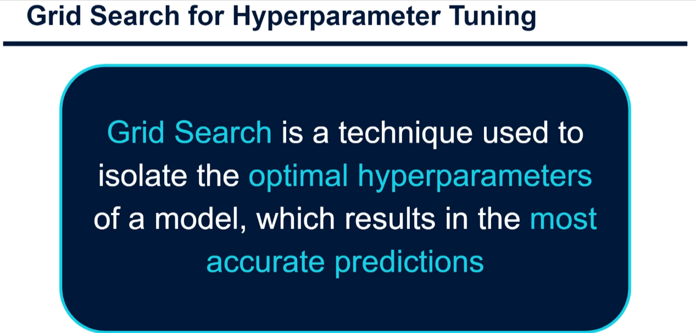
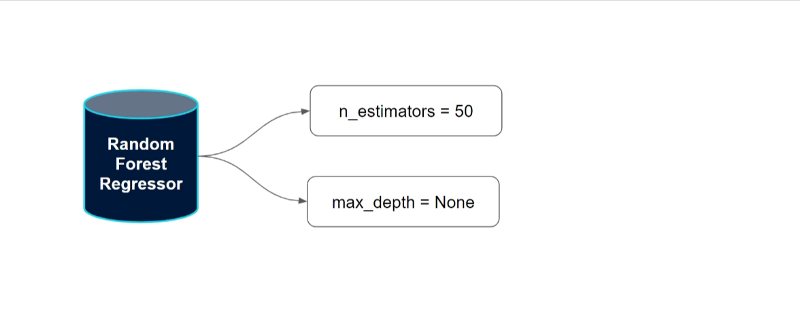
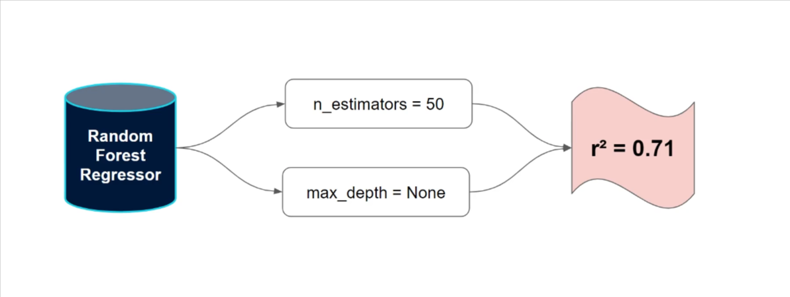
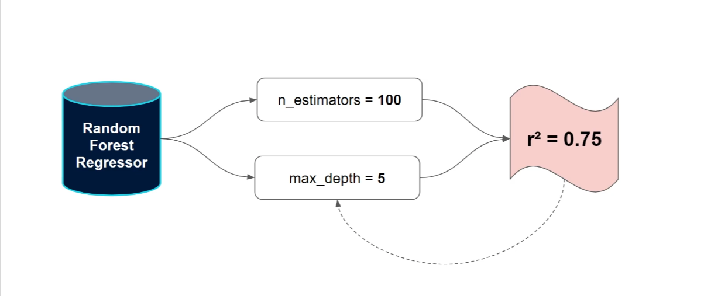
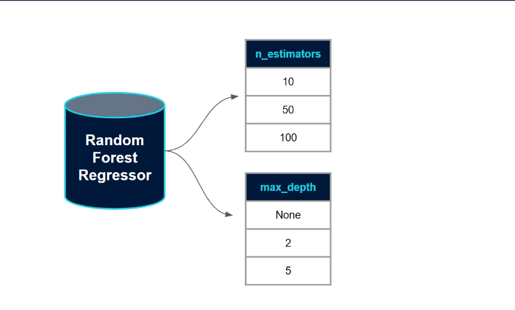
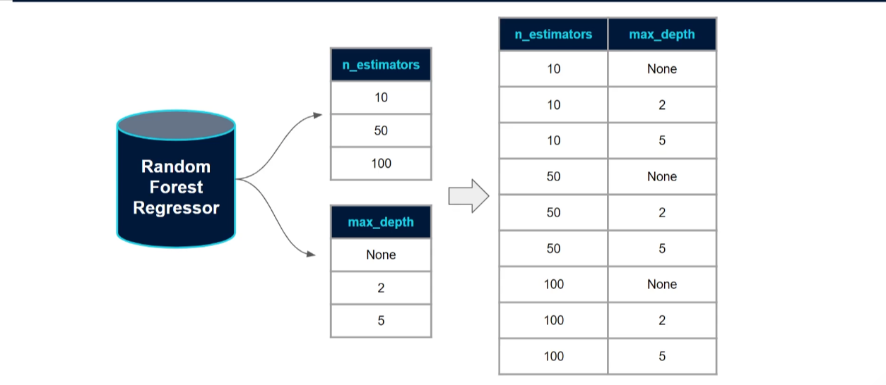
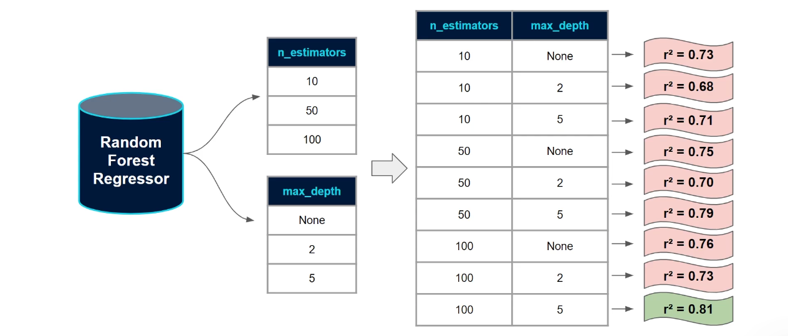

# Grid Search for Hyperparameter Tuning

## What is Grid Search?

`Grid Search` is an `automated technique` in machine learning used to find the optimal **hyperparameters** for a model to `achieve` the most `accurate predictions`. Instead of manually testing different parameter combinations, Grid Search systematically tests all specified combinations and returns the best-performing set.

### Key Concept

**Hyperparameters** are model settings applied _before_ training. Unlike model parameters learned during training, hyperparameters must be set manually.

---

## Understanding Hyperparameters

### Common Examples:

- **K in K-Nearest Neighbors (KNN)**: Number of neighbors to consider
- **Max Depth in Decision Trees**: Controls tree growth (prevents overfitting)
- **Number of Trees in Random Forests**: How many trees to build
- **Learning Rate in Neural Networks**: Step size for optimization

**Challenge**: Data scientists traditionally guess hyperparameter values based on experience or default settings, even though optimal values vary with different datasets.

---

## The Traditional Approach vs. Grid Search

### Before Grid Search (Manual Tuning):

1. Set hyperparameters manually
2. Train model
3. Evaluate on test set
4. If accuracy is poor, adjust and repeat
5. Time-consuming and inefficient

### With Grid Search (Automated):

✓ Define a list of values to test  
✓ Grid Search automatically creates and tests all combinations  
✓ Cross-validates each combination  
✓ Returns the best-performing hyperparameters

---

## How Grid Search Works: A Step-by-Step Example

### Scenario: Random Forest for Regression

Let's say we want to optimize:

- **n_estimators** (number of trees): Test 10, 50, 100
- **max_depth** (tree depth limit): Test None, 2, 5

This creates **3 × 3 = 9 total models** to evaluate.

### Grid Search Process:

1. **Define Parameter Grid**
   

2. **Create All Combinations**
   Grid Search builds 9 different models, each with a unique hyperparameter combination:
   - (10, None), (10, 2), (10, 5)
   - (50, None), (50, 2), (50, 5)
   - (100, None), (100, 2), (100, 5)

3. **Cross-Validation Assessment**
   

   Each model is evaluated using cross-validation to ensure robust accuracy estimates.

4. **Performance Comparison**
   

   Example results:
   - (10, None): R² = 0.71
   - (50, 5): R² = 0.75 ✓ **BEST**
   - (100, 5): R² = 0.73

5. **Select Optimal Hyperparameters**
   

   Use the hyperparameters with the highest cross-validation score for your final model.

---

## Key Insights

### ⚠️ Important Considerations:

**Exponential Growth Problem**

- 2 parameters × 3 values each = 9 models
- 3 parameters × 3 values each = 27 models
- 4 parameters × 3 values each = 81 models
- The number grows exponentially!

**Computational Cost**

- Grid Search uses **brute force** to test all combinations
- Works well for small parameter spaces
- Can be time-consuming with:
  - Many hyperparameters to tune
  - Large datasets
  - Complex models

---

## Best Practices

### When Using Grid Search:

✓ Start with 2-3 critical hyperparameters  
✓ Use a reasonable number of test values (3-5 per parameter)  
✓ Consider computational resources and time available  
✓ Use cross-validation for robust performance estimates  
✓ Document which parameters had the most impact

### Workflow:

1. Identify key hyperparameters for your model
2. Define a reasonable range of test values
3. Run Grid Search with cross-validation
4. Analyze results to understand parameter sensitivity
5. Train final model with optimal hyperparameters
6. Evaluate on hold-out test set

---

## Visual Summary

---

## Next Steps

In practical tutorials, you'll learn how to implement Grid Search using scikit-learn's `GridSearchCV` in Python. This powerful tool handles all the complexity automatically, making hyperparameter optimization accessible and efficient for machine learning practitioners.

Grid Search is an essential tool in your machine learning toolkit that removes guesswork and ensures your models are optimized for the best possible performance! 🚀
