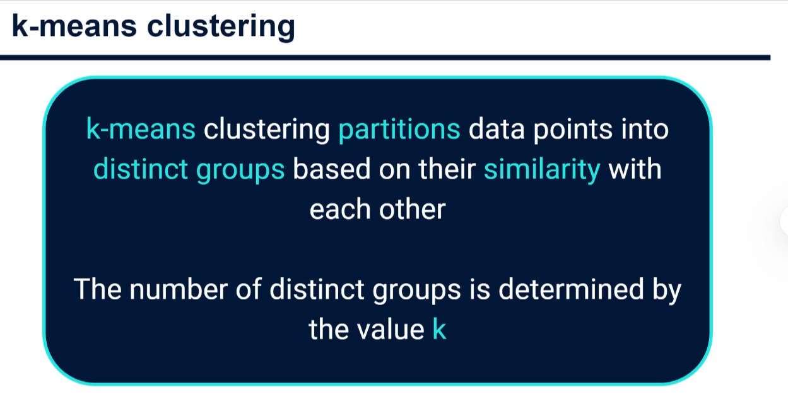
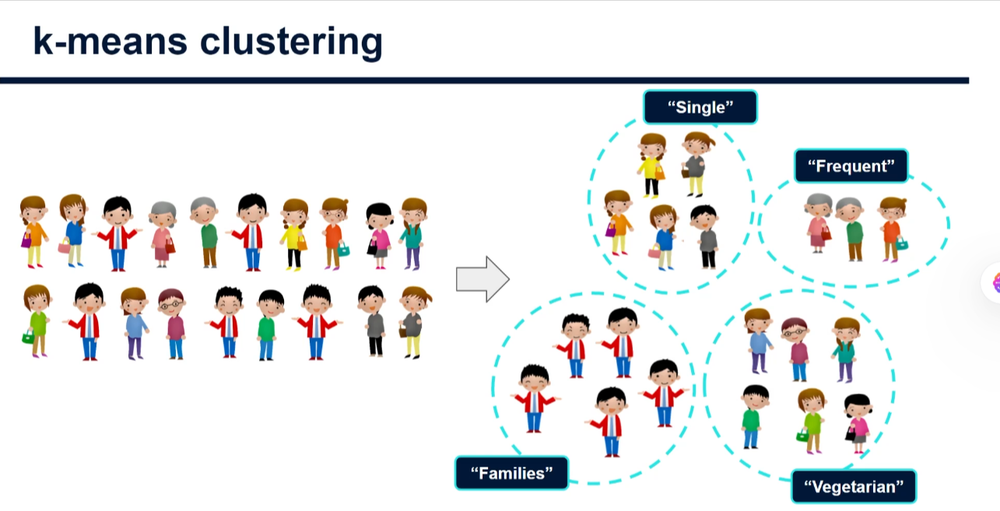
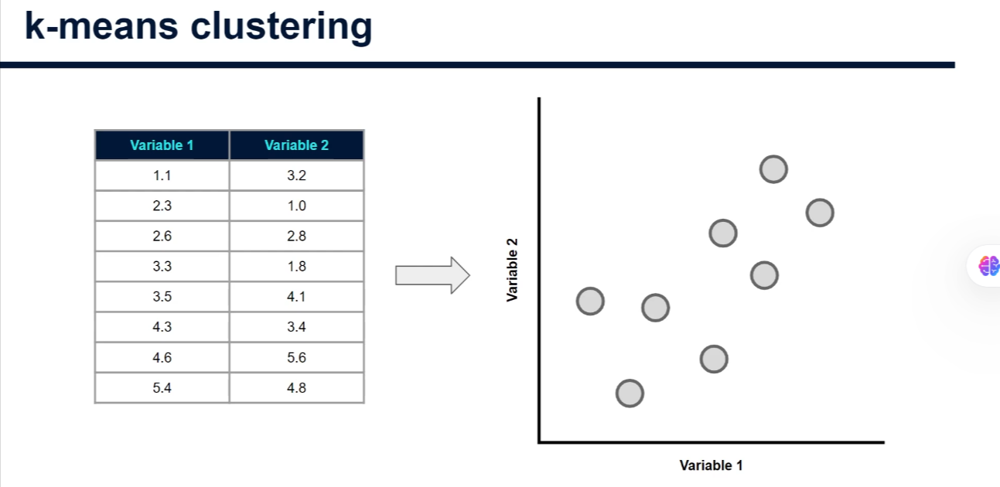
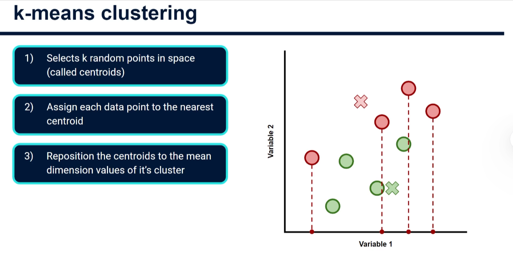
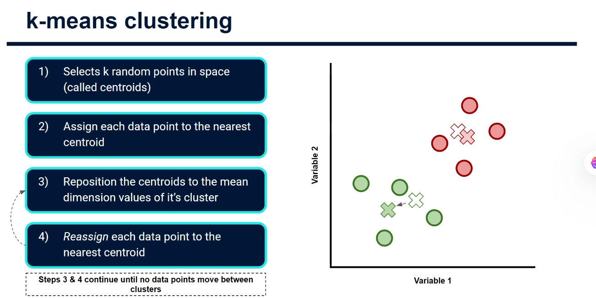
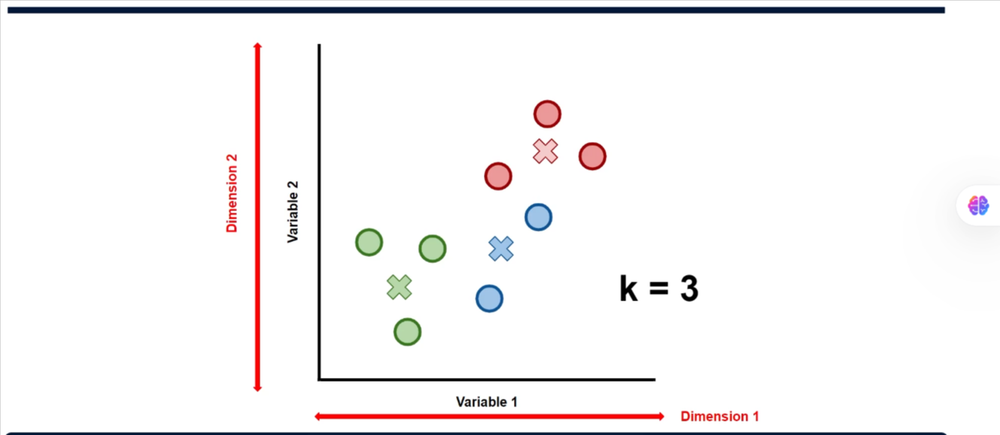

# Unsupervised Learning: K-Means Clustering

## Introduction to Unsupervised Learning

Unsupervised learning differs fundamentally from supervised learning. While supervised learning uses labeled data with both input and output variables, unsupervised learning works with unlabeled data. The goal is to discover underlying structure and patterns within the data itself, rather than predicting or classifying a target variable.

K-Means clustering is one of the most widely-used unsupervised learning algorithms and is essential in any data scientist's toolkit.

## What is K-Means Clustering?

K-Means clustering partitions data points into K distinct groups (clusters) based on their similarity to each other. The algorithm groups together data points that are close to one another while keeping dissimilar points in different clusters.

### Real-World Application: Customer Segmentation

A common use case is supermarket customer segmentation. By analyzing customer data such as:

- Types of products purchased
- Purchase frequency
- Time of day of purchases
- Spending patterns

K-Means can divide the customer base into distinct segments. Customers within the same cluster share similar behaviors, enabling targeted marketing strategies and personalized business approaches.

## The K-Means Algorithm: Step-by-Step

### Understanding the Parameter K

Before running K-Means, you must decide how many clusters (K) you want. The algorithm requires this value upfront. The choice of K is crucial—too few clusters oversimplify your data, while too many can fragment meaningful groups.

### The Three-Step Process

#### Step 1: Initialize K Centroids Randomly

The algorithm begins by randomly placing K centroids (cluster centers) in your data space. These centroids represent the center point of each cluster.

#### Step 2: Assign Points to Nearest Centroid

For each data point, the algorithm calculates the distance to each centroid and assigns the point to the nearest one. This creates K initial clusters based purely on proximity.

Note: These initial clusters are typically imperfect because centroids were placed randomly. This is expected and normal.

#### Step 3: Recalculate Centroids (Mean Position)

The algorithm now computes the centroid of each cluster by finding the mean (average) position of all points in that cluster along each dimension:

- For each cluster, calculate the mean of all data points' values along each feature/dimension
- Move the centroid to this new mean position

### Iteration Until Convergence

After repositioning the centroids:

1. **Reassign points**: Each data point is reassigned to the nearest new centroid
2. **Check for changes**: Some points may switch to a different cluster
3. **Repeat**: Steps 3 and 2 are repeated until the algorithm reaches convergence

The algorithm stops when **no data points switch clusters** between iterations, meaning the solution is stable. At this point, the clusters are finalized.

## Multi-Dimensional Data

The example shown here uses 2 dimensions (2 features) for easy visualization. However, K-Means works seamlessly with higher-dimensional data:

- 3D data: Three features
- 4D data: Four features
- N-dimensional data: N features

The algorithm scales to many dimensions, following the exact same process: initialize centroids, assign points, recalculate means, and repeat until convergence.

## Key Takeaways

- **Unsupervised Learning**: K-Means works with unlabeled data to discover natural groupings
- **Simplicity & Power**: Despite its simplicity, K-Means is widely used across industries
- **Deterministic Convergence**: The algorithm is guaranteed to converge to a solution
- **Interpretability**: The resulting clusters are easy to understand and explain
- **Scalability**: Works with any number of dimensions

## Next Steps

The theoretical foundation is now clear. In practical implementations, you'll:

- Determine optimal K values using methods like the elbow method or silhouette analysis
- Preprocess and normalize your data appropriately
- Run the algorithm in Python or other data science tools
- Interpret and visualize the results for business insights
