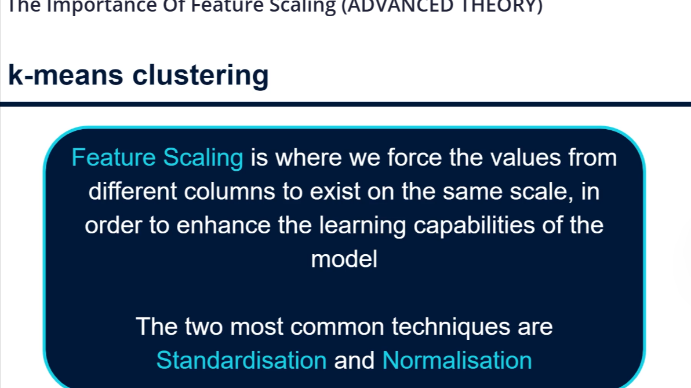
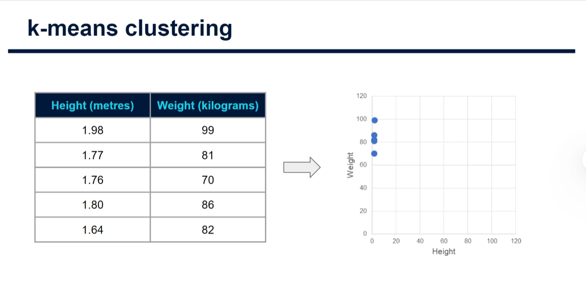
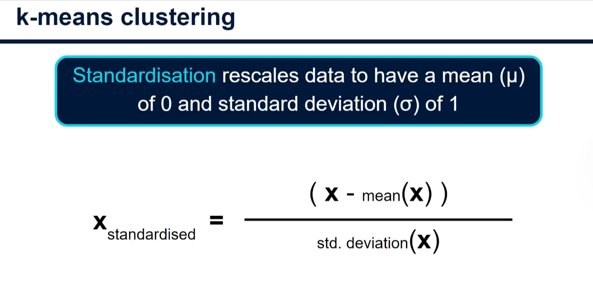
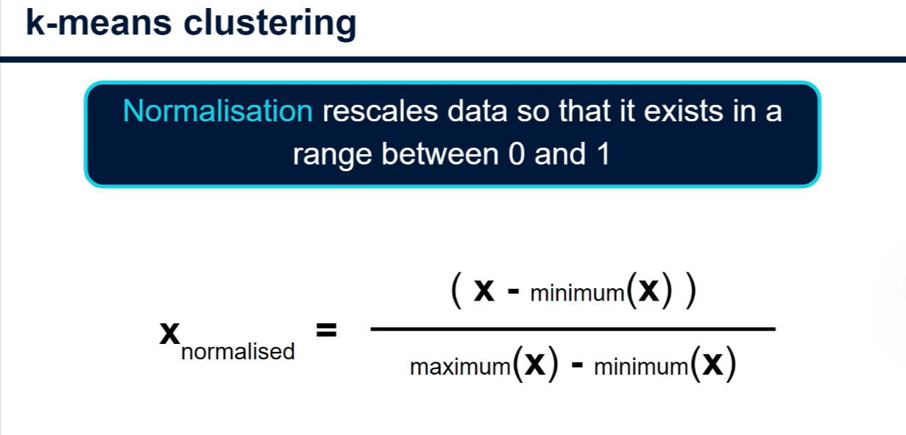
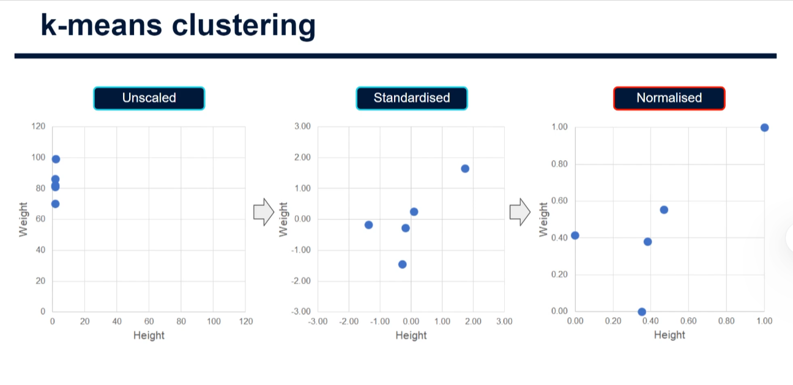

# The Importance of Feature Scaling in K-Means

## What Is Feature Scaling?



A **feature** is an input variable, such as height or weight. **Feature scaling** transforms the values of features so that their numerical scales are more comparable.

This matters for K-means because it groups data points using distances from **centroids**, the centers of the clusters. If one feature has much larger numerical differences than another, it can dominate the distance calculation, even if it is not more important.

Two common scaling techniques are **standardization** and **min-max scaling**, also called **normalization** in this tutorial. Similar considerations apply to other distance-based algorithms, such as K-nearest neighbors.

## Why Does Scale Matter?



The image shows these measurements:

| Person | Height (meters) | Weight (kilograms) |
|---|---:|---:|
| A | 1.98 | 99 |
| B | 1.77 | 81 |
| C | 1.76 | 70 |
| D | 1.80 | 86 |
| E | 1.64 | 82 |

Although both measurements vary, their numerical ranges are very different: height varies by **0.34**, while weight varies by **29**. On the plot, height differences look tiny because both axes use the same numerical scale.

For example, compare B and E using Euclidean distance:

$$
d = \sqrt{(1.77 - 1.64)^2 + (81 - 82)^2}
  = \sqrt{0.0169 + 1}
  \approx 1.008
$$

The weight difference contributes far more to the squared distance than the height difference. K-means does not know that the features use different units; it simply works with the numbers provided. Changing height from meters to centimeters would also change the result, even though the people have not changed.

Scaling changes the geometry used by K-means, allowing us to choose a more meaningful balance between the features.

## Standardization



Standardization, or **z-score scaling**, subtracts a feature's mean and divides by its standard deviation:

$$
z = \frac{x - \mu}{\sigma}
$$

- $x$: an original feature value.
- $\mu$: the mean of that feature.
- $\sigma$: its standard deviation, a measure of how spread out its values are.

For the heights above, the mean is **1.79 m** and the population standard deviation is approximately **0.110 m**. Person B's standardized height is:

$$
z = \frac{1.77 - 1.79}{0.110} \approx -0.18
$$

This means B's height is approximately 0.18 standard deviations below the mean. For a non-constant feature, the values used to fit the scaler have a mean of 0 and a standard deviation of 1. Standardized values are **not guaranteed** to lie between -3 and 3.

## Min-Max Scaling (Normalization)



Min-max scaling subtracts the minimum and divides by the range:

$$
x_{\text{scaled}} = \frac{x - x_{\min}}{x_{\max} - x_{\min}}
$$

For the heights above, the minimum is **1.64 m** and the maximum is **1.98 m**. Person B's scaled height is:

$$
\frac{1.77 - 1.64}{1.98 - 1.64}
= \frac{0.13}{0.34}
\approx 0.382
$$

In the data used to fit the scaler, the minimum becomes 0, the maximum becomes 1, and other values fall proportionally between them. New observations outside the original range can produce values below 0 or above 1.

For B and E, the scaled height difference is approximately **0.382**, while their scaled weight difference is $1 / 29 \approx 0.034$. Both features now influence distance on the basis of their observed ranges rather than their original units.

## Comparing the Results



The three plots show the same people, but the coordinates and the distances between them change:

| Approach | How it scales each feature | Important consideration |
|---|---|---|
| Unscaled | Keeps the original units | Larger numerical differences can dominate. |
| Standardization | Centers on 0 and scales to unit standard deviation | Features can have different ranges; outliers affect the mean and standard deviation. |
| Min-max scaling | Maps the observed minimum and maximum to 0 and 1 | Outliers can compress most other values into a small part of the range. |

The tutorial suggests min-max scaling as a starting point for K-means because each feature then has the same observed range. That is a reasonable option, **not a universal rule**: standardization can be more appropriate when variation around the mean is more meaningful. Both are sensitive to outliers. Inspect the data, consider the meaning of each feature, and compare the resulting clusters.

The same range does not guarantee equal importance: feature distributions, correlations, and the number of columns all affect distances. For example, one-hot encoding a categorical feature creates multiple 0/1 columns. Scaling numerical features to 0-1 makes their ranges comparable to those columns, but does **not** automatically give the categorical feature an appropriate overall weight. Consider feature weighting or a method designed for mixed numerical and categorical data when necessary.

## Practical Example: K-Means Before and After Scaling

This example uses the five people from the image. It compares K-means on the original data, standardized data, and min-max scaled data. It requires Python, NumPy, and scikit-learn in your project's Python environment.

```python
import numpy as np
from sklearn.cluster import KMeans
from sklearn.pipeline import make_pipeline
from sklearn.preprocessing import MinMaxScaler, StandardScaler

# Columns: height in meters, weight in kilograms.
people = np.array([
    [1.98, 99],
    [1.77, 81],
    [1.76, 70],
    [1.80, 86],
    [1.64, 82],
])
names = ["A", "B", "C", "D", "E"]

# Check for missing values before fitting. This example has none.
if np.isnan(people).any():
    raise ValueError("Handle missing values before clustering.")

approaches = [
    ("Unscaled", "passthrough"),
    ("Standardized", StandardScaler()),
    ("Min-max scaled", MinMaxScaler()),
]

for name, scaler in approaches:
    model = make_pipeline(
        scaler,
        KMeans(n_clusters=2, random_state=42, n_init=10),
    )
    labels = model.fit_predict(people)
    centers = model.steps[-1][1].cluster_centers_

    # Convert scaled centroids back to meters and kilograms.
    if scaler != "passthrough":
        centers = scaler.inverse_transform(centers)

    print(f"\n{name}")
    for cluster in range(2):
        members = [person for person, label in zip(names, labels) if label == cluster]
        print(f"  Cluster {cluster}: {', '.join(members)}")
        print(f"  Center (height, weight): {centers[cluster].round(2)}")
```

### How to Read the Output

1. Each row represents one person; the two columns are the input features.
2. The pipeline applies the selected scaling method before K-means calculates distances. `passthrough` leaves the original values unchanged.
3. `n_clusters=2` asks for two groups. It is an illustrative choice, not proof that two is the best number of clusters.
4. Compare the **members of each group** across the three approaches. Scaling may change the assignments because it changes distances. Cluster numbers are arbitrary: cluster 0 in one run does not necessarily correspond to cluster 0 in another.
5. The displayed centers are converted back to meters and kilograms for easier interpretation. The clustering itself still uses the selected scaled or unscaled values.

`random_state=42` makes initialization reproducible, and `n_init=10` tries multiple initializations. This tiny dataset is useful for learning, but it is too small to support meaningful conclusions about people.

## Practical Tips

- **Handle missing values first.** Check how many are missing and why; choose a suitable imputation method or remove rows when justified.
- **Watch for outliers.** They can strongly affect both scaling and K-means; investigate them rather than automatically deleting them.
- **Constant features need care.** Their standard deviation and range are zero, so the formulas above cannot be applied directly. Scikit-learn's scalers handle them without division by zero, but such features do not help distinguish the training points.
- **Reuse the fitted scaler.** When assigning new observations, transform them using the scaler fitted to the original training data. A pipeline helps keep preprocessing and clustering together. If evaluating on held-out data, split first and fit preprocessing only on the training portion.
- **Choose K deliberately.** Try several values and use tools such as the elbow method or silhouette score alongside domain knowledge. Scaling and K can both affect the clusters.
- **Scaling is a choice, not a guarantee of better clusters.** If the original units or a deliberate feature weighting already express meaningful relative importance, preserving that weighting may be preferable.

## Summary

K-means relies on distances, so feature units and ranges can strongly affect its results. Standardization measures values relative to a feature's mean and standard deviation; min-max scaling maps the observed range to 0-1. Compare both where appropriate, inspect outliers and feature importance, and interpret the resulting groups in the context of the problem.
