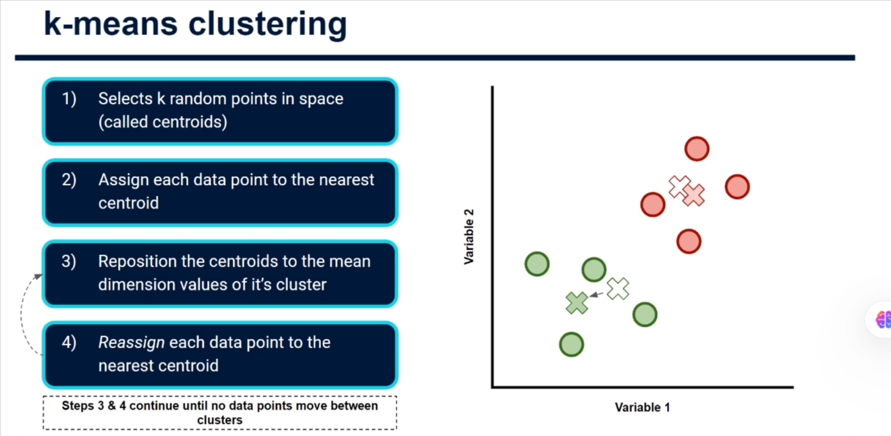
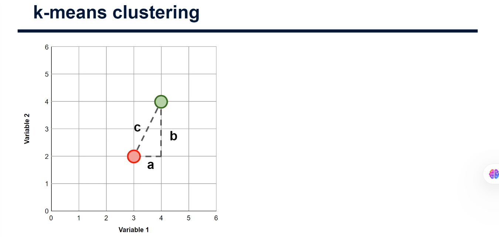
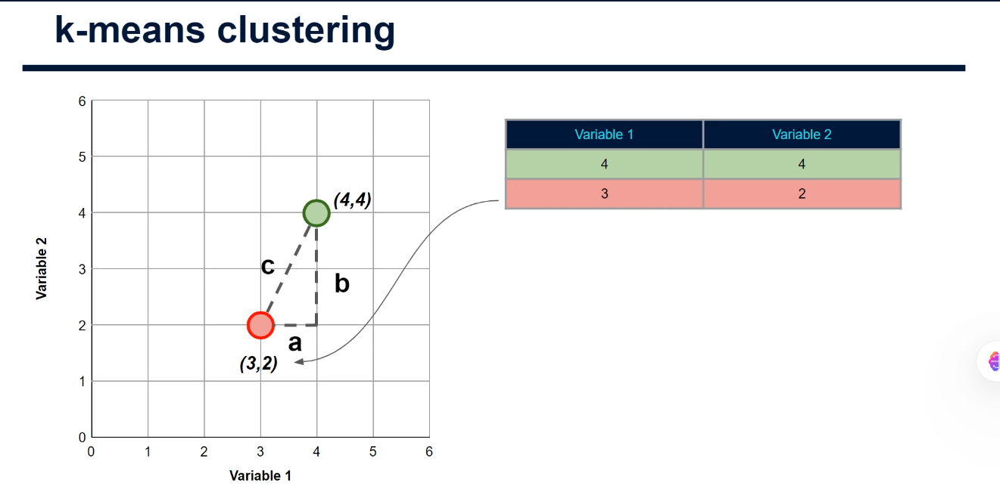
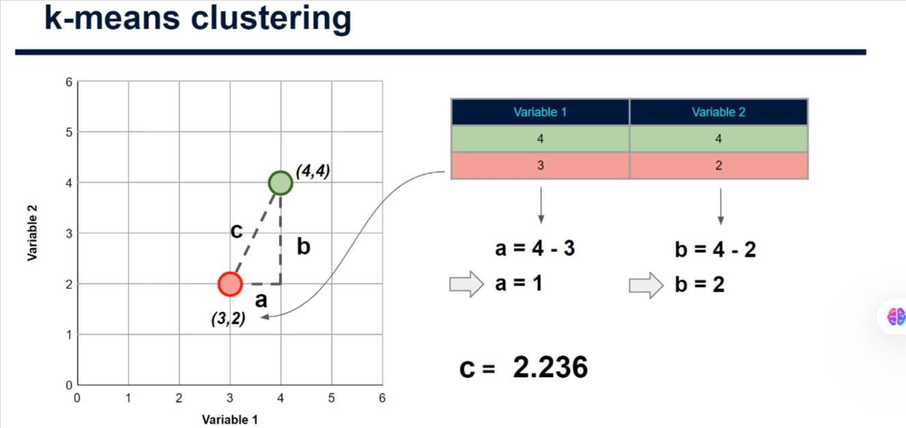
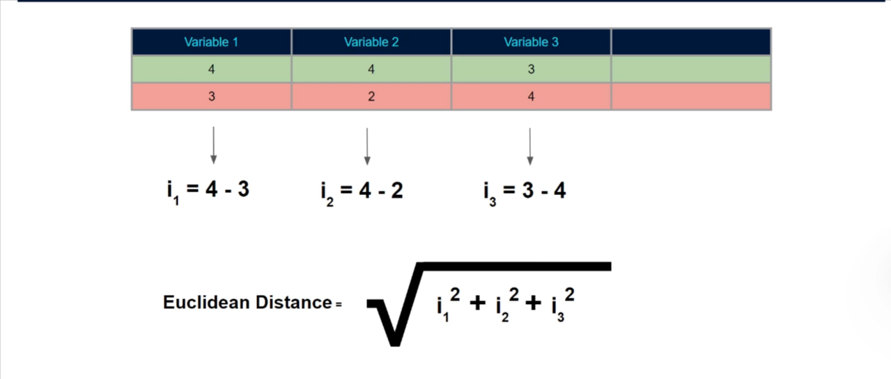

# Measuring Distances in Multi-Dimensional Space

## Introduction

Welcome to this advanced tutorial on the theory behind K-means clustering. In the introductory tutorial, we looked at a simple example of how the K-means clustering algorithm partitions data points into clusters. We discussed how, given a value for K, the algorithm first assigns randomly placed centroids, then assigns each data point to the nearest of these centroids.

From there, the algorithm repositions these centroids based on the mean values across each dimension for the data points in the cluster. Following this, the algorithm reassigns each data point to the nearest new centroids based on which is closest. It continues to repeat these last two steps until no data points switch allegiance, meaning the clusters are stable.

**In this tutorial**, I want to cover how the algorithm calculates the distance between a data point and each centroid.

> **Disclaimer**: We've covered the material in this tutorial once already in the theory for K-nearest neighbors. If you're comfortable with Euclidean distance, feel free to move past this tutorial. Otherwise, quickly review this information as it's key to how this algorithm works.

---

## Understanding Euclidean Distance

### The Basic Concept

Let's simplify this down to just two points in space:

- The **red circle** in the center represents a data point
- The **green circle** represents a centroid position

For calculating the distance between our data point and the centroid, we use **Euclidean distance**. While this is the same as straight-line distance, it's also referred to as what you'll see in mathematics and data science.

**The aim**: Calculate the Euclidean distance between the red data point and the green centroid.

### The Formula: Pythagorean Theorem

The formula for Euclidean distance is the same as **Pythagoras' theorem**, where we want to find the length of the hypotenuse of a right triangle.

In the formula denoted with the letter C, to find this we simply take:

$$C = \sqrt{A^2 + B^2}$$

This works quite nicely for us because no matter where our data points are, we can always think of them in terms of the three sides of a right triangle (A, B, and C).

**Key insight**: All we need are the values for A and B. If we have those, we can always calculate C.

---

## Step-by-Step Example: Two Dimensions

### Setting Up the Data

Let's look at a table of data showing the coordinates of both the data point and the centroid in terms of Variable 1 and Variable 2. The coordinates dictate the position of the points on the plot.

**From our example:**

- The **centroid** (green) has a value of **4** for both Variable 1 and Variable 2 → located at coordinate (4, 4)
- The **data point** (red) is located at coordinate **(3, 2)**

### Calculating the Distance

#### Step 1: Find A (horizontal distance)

To work out the value for A of our triangle, we subtract one data point's Variable 1 value from the other:

$$A = 4 - 3 = 1$$

#### Step 2: Find B (vertical distance)

Working out the value for B uses the values for Variable 2:

$$B = 4 - 2 = 2$$

#### Step 3: Apply the Euclidean Distance Formula

Now we have the values for A and B, we plug them into our formula:

$$C = \sqrt{A^2 + B^2}$$

$$C = \sqrt{1^2 + 2^2}$$

$$C = \sqrt{1 + 4}$$

$$C = \sqrt{5}$$

$$C ≈ 2.236$$

**Result**: The Euclidean distance between our data point and centroid is approximately **2.236**.

---

## Scaling to Multiple Data Points

### Application in K-means

If we had many more data points (as we wouldn't in this simple practice example), the same approach would be applied. The algorithm would use this distance calculation to understand which data points are closest to which centroids, making assignments accordingly.

### Important Property

Since we square the values of A and B, it **doesn't actually matter which data point's values we subtract from the other** when calculating A and B. They will always turn out positive due to the squaring that occurs in the formula to find C.

---

## Extending to Higher Dimensions

### Two Dimensions Formula

In two dimensions, the Euclidean distance is:

$$C = \sqrt{I_1^2 + I_2^2}$$

Where I₁ and I₂ represent the differences along each dimension.

### Three Dimensions Formula

If we had a third variable, the formula extends to:

$$C = \sqrt{I_1^2 + I_2^2 + I_3^2}$$

### General Formula (n Dimensions)

This pattern continues for any number of variables:

$$C = \sqrt{I_1^2 + I_2^2 + I_3^2 + ... + I_n^2}$$

**Key Point**: It's really important to mention that this formula, or a slightly tweaked formula, still works with many more dimensions. In practice, you're likely to have more than two variables and therefore, just as we've done here, each will be plotted in its own dimension.

We can still visualize this in three dimensions, but after three, we just have to think of each as an added dimension. Rest assured, this all still works with the formula simply extending to take any extra input variables.

---

## Conclusion

The type of thing can always seem complex at first, especially when thinking about high-dimensional spaces. But hopefully, you can now see that it's all very intuitive when you break it down step by step.

**Key Takeaways**:

- Euclidean distance is based on the Pythagorean theorem
- The formula extends to any number of dimensions
- K-means uses these distances to determine cluster assignments
- Understanding distance measurement is fundamental to the algorithm's function

### What's Next?

In the next tutorial, we'll be discussing **feature scaling** — a concept that goes hand-in-hand with the distance measurement we've been discussing here. Feature scaling can often make or break a clustering approach using K-means, so it's going to be really important to run through this.

See you there!
