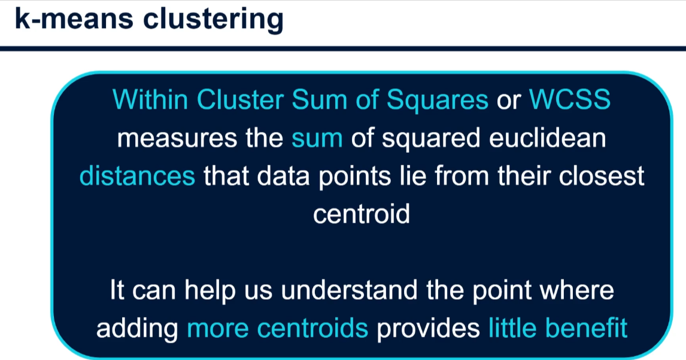
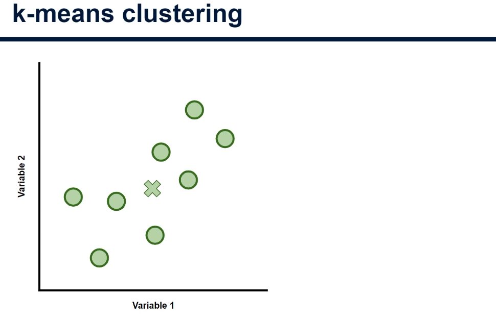
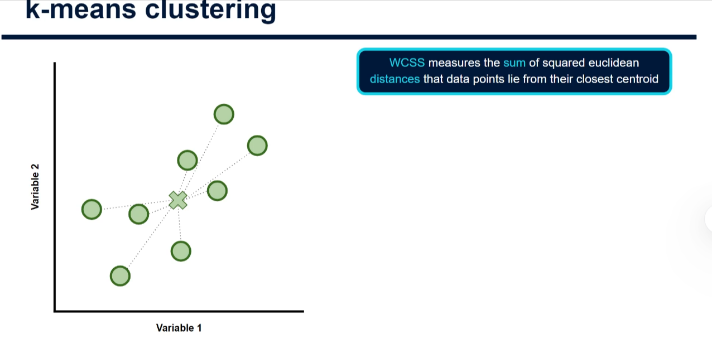
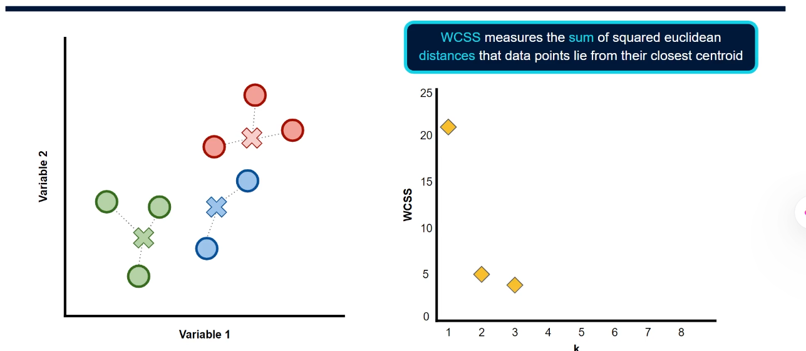
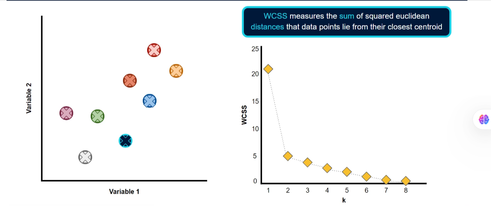
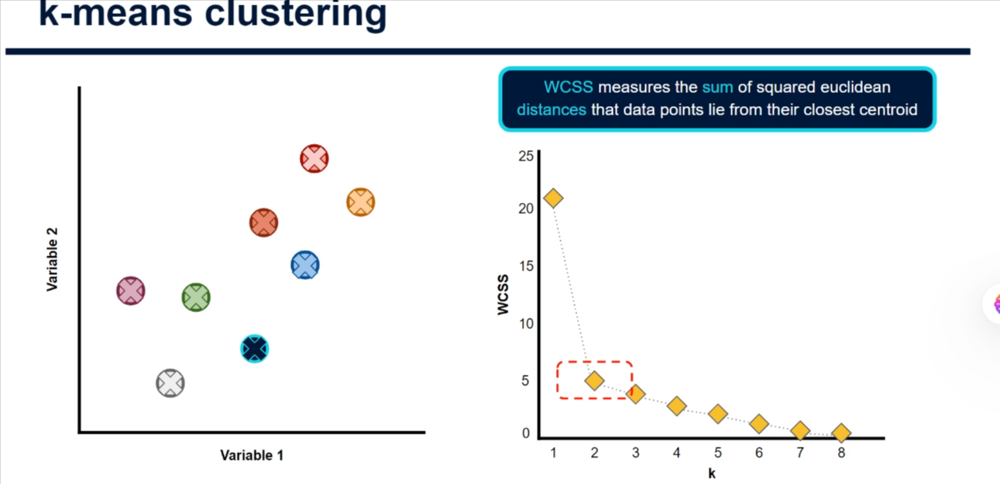

# What Value of K Should You Use in K-Means?

## The Question

In K-means, **K** is the number of clusters the algorithm attempts to create. A cluster is a group of similar data points, and each cluster has a **centroid**, or center

There is no single best value of K for every dataset. The choice depends on both the data and the purpose of the analysis. For example, a business may prefer a few understandable customer segments over many small groups that are difficult to act on.

K-means is an **unsupervised** algorithm: the dataset generally does not provide correct cluster labels to check against. Nevertheless, we can use measurements and visualizations to guide our choice.

## Within-Cluster Sum of Squares (WCSS)



**Within-cluster sum of squares (WCSS)** measures how far points are from their assigned centroids, using squared Euclidean distances. It is also called **within-cluster sum of squares (WSS)** or **inertia**; scikit-learn exposes it as `inertia_`.

To calculate it:

1. Find each point's distance to its cluster's centroid.
2. Square that distance.
3. Add the squared distances for all points across all clusters.

For two features, the squared distance between a point $(x, y)$ and its centroid $(c_x, c_y)$ is:

$$
(x - c_x)^2 + (y - c_y)^2
$$

A smaller WCSS means that, **under the chosen feature representation and scale**, points are generally closer to their assigned centers. WCSS measures compactness; it does not by itself tell us whether the groups are useful or well separated.

### Why Square the Distance?

Squaring gives more weight to points that are far from their centroids. It is also central to the objective that K-means minimizes: the centroid that minimizes the sum of squared distances for a fixed cluster is the arithmetic mean of its points.

The square root in Euclidean distance cancels when the distance is squared, but WCSS is **not** simply the sum of ordinary distances with a computational shortcut. Summing squared distances can produce different results from summing ordinary distances.

## Following the Slides

### K = 1: One Cluster



With K = 1, all eight points belong to one cluster. The cross represents its centroid.



The dotted lines illustrate the distances to that centroid. Square each distance and add them to obtain WCSS. The slides use an illustrative WCSS of approximately **21** for K = 1.

### K = 2 and K = 3

For K = 2, the slides give an illustrative WCSS of approximately **5**. Each point contributes its squared distance to its nearest centroid; add the contributions from both clusters.



With K = 3, the image shows three centroids and three groups. The illustrative WCSS is approximately **4**.

|   K | Illustrative WCSS | Decrease from previous K |
| --: | ----------------: | -----------------------: |
|   1 |                21 |                        - |
|   2 |                 5 |                       16 |
|   3 |                 4 |                        1 |

Going from one to two clusters provides a much larger improvement in this example than going from two to three.

### K Equals the Number of Points



For the eight distinct points in the slide, choosing K = 8 allows a centroid at each point, yielding a WCSS of **0**. However, a separate cluster for every observation usually does not provide a useful summary of the data.

For the globally optimal K-means solution, WCSS cannot increase when K increases: an extra centroid can always leave the previous solution unchanged or improve it. In practice, K-means can settle in a local minimum, so independently fitted runs may occasionally show a higher WCSS for a larger K. Trying multiple initializations reduces this risk.

### Finding the Elbow



Plot K on the horizontal axis and WCSS on the vertical axis. Look for an **elbow**: a bend where the large initial reductions in WCSS begin to give way to smaller improvements.

In the slide, **K = 2** is a reasonable candidate because WCSS drops sharply from 21 to 5 and then much less from 5 to 4. The elbow is a **heuristic**, not a guarantee: a curve may have multiple plausible bends or none at all, and the reductions do not have to get smaller at every step.

## A Small Calculation by Hand

Consider four one-dimensional points: **0, 2, 10, and 12**.

### One cluster

The centroid is the mean: $(0 + 2 + 10 + 12) / 4 = 6$.

$$
\text{WCSS} = (0-6)^2 + (2-6)^2 + (10-6)^2 + (12-6)^2
= 36 + 16 + 16 + 36 = 104
$$

### Two clusters

Group 0 and 2 around centroid 1; group 10 and 12 around centroid 11:

$$
\text{WCSS} = (0-1)^2 + (2-1)^2 + (10-11)^2 + (12-11)^2
= 1 + 1 + 1 + 1 = 4
$$

Adding a second centroid dramatically reduces WCSS here. For these points, the optimal WCSS is 2 for K = 3 and 0 for K = 4, so K = 2 is a natural elbow candidate.

## Practical Python Example

The following example uses a **different, made-up dataset** from the slides. Each row represents a customer using two numerical features:

- **Monthly visits:** how often the customer visits.
- **Monthly spend:** spending in arbitrary currency units.

It compares WCSS and silhouette scores for several values of K, then plots an illustrative three-cluster solution. The example requires NumPy, Matplotlib, and scikit-learn in your Python environment.

```python
import matplotlib.pyplot as plt
import numpy as np
from sklearn.cluster import KMeans
from sklearn.metrics import silhouette_score
from sklearn.preprocessing import StandardScaler

# Columns: monthly visits, monthly spend.
customers = np.array([
    [1, 10], [2, 12], [2, 8], [3, 10],
    [5, 50], [6, 48], [6, 52], [7, 50],
    [10, 90], [11, 88], [11, 92], [12, 90],
], dtype=float)

missing_counts = np.isnan(customers).sum(axis=0)
print("Missing values per feature:", missing_counts)
if missing_counts.any():
    raise ValueError("Investigate and handle missing values before clustering.")

# Fit once so every K is compared using the same feature representation.
scaler = StandardScaler()
scaled = scaler.fit_transform(customers)

ks = range(1, 7)
inertias = []
silhouettes = []

for k in ks:
    model = KMeans(n_clusters=k, random_state=42, n_init=10)
    labels = model.fit_predict(scaled)
    inertias.append(model.inertia_)
    if k >= 2:
        score = silhouette_score(scaled, labels)
        silhouettes.append(score)
        print(f"K={k}: WCSS={model.inertia_:.2f}, silhouette={score:.3f}")
    else:
        print(f"K={k}: WCSS={model.inertia_:.2f}, silhouette=not defined")

fig, axes = plt.subplots(1, 2, figsize=(10, 4))
axes[0].plot(list(ks), inertias, marker="o")
axes[0].set(xlabel="Number of clusters (K)", ylabel="WCSS",
            title="Elbow method", xticks=list(ks))
axes[1].plot(list(ks)[1:], silhouettes, marker="o")
axes[1].set(xlabel="Number of clusters (K)", ylabel="Silhouette score",
            title="Silhouette scores", xticks=list(ks)[1:])
plt.tight_layout()
plt.show()

# K=3 is an illustrative choice; compare it with the plots before deciding.
chosen_k = 3
model = KMeans(n_clusters=chosen_k, random_state=42, n_init=10)
labels = model.fit_predict(scaled)
centers = scaler.inverse_transform(model.cluster_centers_)

for cluster in range(chosen_k):
    members = customers[labels == cluster]
    print(f"Cluster {cluster}: {len(members)} customers; "
          f"center (visits, spend) = {centers[cluster].round(2)}")

plt.figure(figsize=(6, 4))
plt.scatter(customers[:, 0], customers[:, 1], c=labels, cmap="viridis")
plt.scatter(centers[:, 0], centers[:, 1], c="red", marker="X", s=150,
            label="Centroids")
plt.xlabel("Monthly visits")
plt.ylabel("Monthly spend")
plt.title("Customer clusters (K=3)")
plt.legend()
plt.tight_layout()
plt.show()
```

### Interpreting the Example

1. The missing-value check reports zero for both features. For real data, investigate missingness and choose an appropriate treatment, such as imputation, before scaling.
2. `StandardScaler` makes the two features comparable before clustering. Because it changes distances, the WCSS values apply to the **scaled** data, not directly to visits or currency.
3. The elbow plot shows how WCSS changes as K increases. Look for the point beyond which extra clusters provide relatively little improvement.
4. The **silhouette score** compares how close points are to their own cluster with how close they are to another cluster. Values range from -1 to 1; higher values generally indicate better separation. It is not defined for K = 1 and requires fewer clusters than samples. It is another guide, not proof of a best answer.
5. In this deliberately simple dataset, K = 3 is a natural candidate: the groups have roughly low, medium, and high visit and spending values. The last plot colors their assignments and displays centroids in the original units. Cluster numbers are arbitrary.
6. `random_state=42` supports reproducibility, while `n_init=10` tries multiple initializations. If a silhouette score and the elbow suggest different choices, inspect both solutions and consider which is more useful.

## Practical Considerations

- **Scale and inspect the features.** Different units can dominate distance; see [The Importance of Feature Scaling](./Importance_Of_Feature_Scaling.md). Outliers can also strongly affect WCSS.
- **Compare K values on the same data and scale.** WCSS is a sum, so its magnitude also depends on the number of observations. Avoid comparing raw WCSS across differently sized or differently scaled datasets.
- **Check cluster usefulness and stability.** Look at cluster sizes, typical feature values, and whether results remain similar across initializations or reasonable data changes. A statistically compact group may still be too small or impractical to use.
- **Remember the shape assumption.** K-means favors compact, roughly spherical groups under Euclidean distance. An elbow does not prove that K-means is appropriate for irregularly shaped or overlapping groups.
- **Include domain knowledge.** Select a manageable number of clusters that supports the actual decision, rather than automatically picking the lowest WCSS or the highest silhouette score.

## Summary

Use the elbow method to identify candidate K values where additional clusters give diminishing practical improvements in WCSS. Combine that evidence with silhouette scores, inspection of the clusters, stability, and the needs of the problem. The slides suggest **K = 2** for their illustrative data; the separate Python example demonstrates why a different dataset may suggest **K = 3**.
