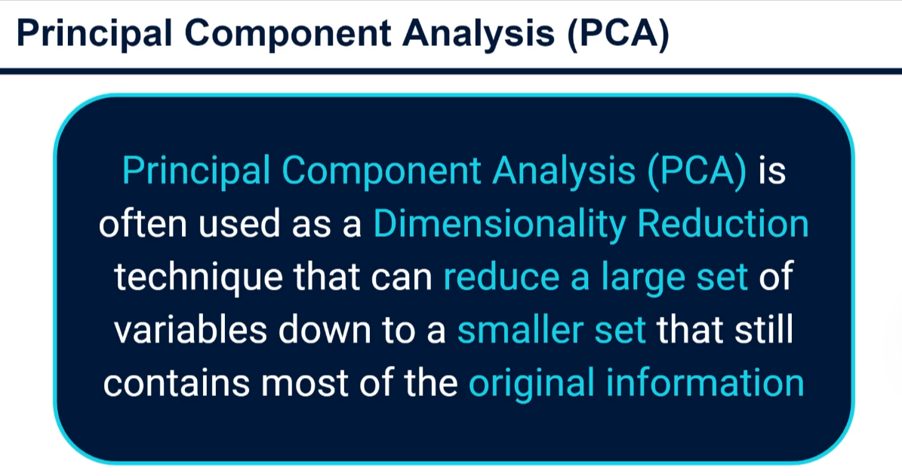
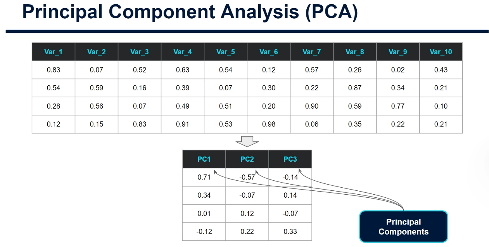
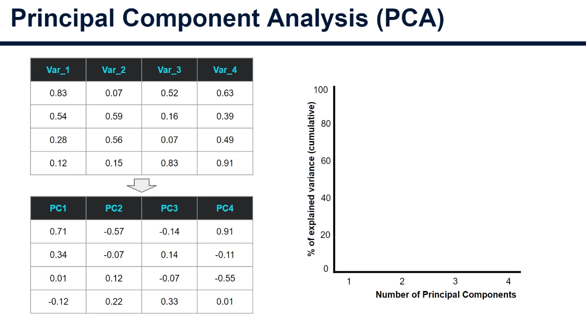
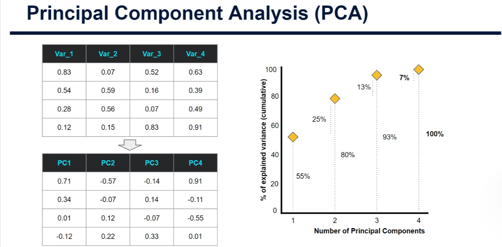
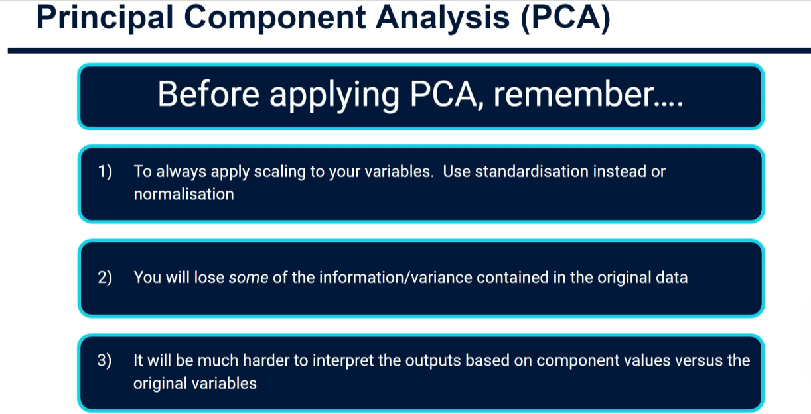

# Principal Component Analysis (PCA) - Complete Tutorial

## Introduction

Principal Component Analysis (PCA) is a fundamental unsupervised learning technique used to identify structure and patterns within data. As discussed in K-means clustering, the goal of unsupervised learning is to discover hidden patterns without labeled outcomes. PCA serves a similar purpose to feature selection from supervised learning, but instead of removing variables, it creates a smaller number of new variables that preserve much of the original information.

## What is PCA?

**Dimensionality Reduction** is the primary application of PCA. It compresses a large set of variables or features down to a smaller set while retaining most of the original information.

### Key Concept: From High to Low Dimensions

PCA takes a high number of dimensions (which could be hundreds or thousands of variables in practice) and reduces them to a vastly smaller number of new variables called **Principal Components**.

For example, instead of working with 10 features, PCA might reduce them to 3 principal components. These new features are abstract and represent a blend of the original features where correlations were discovered by the algorithm.

## Why Use PCA?

### 1. **Computational Efficiency**

Applying algorithms like K-means across hundreds of thousands of features can be computationally expensive. PCA reduces this complexity while maintaining key information.

### 2. **Data Visualization**

PCA can bring high-dimensional data down to 2 or 3 dimensions, making it possible to visualize data that originally existed in much higher dimensions, helping us understand patterns our brains couldn't comprehend otherwise.

### 3. **Noise Reduction**

By focusing on components that explain the most variance, PCA helps filter out noise and captures the signal in your data.

### 4. **Applications Beyond Unsupervised Learning**

While particularly useful in unsupervised learning, PCA can also be applied to:

- Input variable reduction in supervised learning
- Feature extraction for classification and regression problems
- Data preprocessing for any machine learning pipeline

## Understanding Principal Components

The PCA algorithm doesn't automatically decide how many components to create—**you, the data scientist, must specify this**. Just like K-means, you need to tell it how many components you want. Otherwise, it will construct one component for every original variable.

### Variance Explained

To decide how many components to use, we examine how much **variance** is explained by each component.

**Example with 4 Original Variables:**

- **Component 1**: Explains 55% of the variance
- **Component 2**: Explains 25% of the variance (cumulative: 80%)
- **Component 3**: Explains 13% of the variance (cumulative: 93%)
- **Component 4**: Explains 7% of the variance (cumulative: 100%)

### Trade-off Decision

As a data scientist, you must balance two competing goals:

1. **Reduction**: How much do we want to reduce the number of variables?
2. **Preservation**: How much original information do we want to keep?

In the example above, you might decide that 2 components explaining 80% of the variance is sufficient for your task. However, this requires testing—apply these components to your clustering or supervised learning task and observe the impact on model performance.

**Special Case for Visualization**: If your purpose is purely to visualize data in two dimensions, simply select 2 components. Be aware that in many real-world cases, 2 components might explain far less (e.g., only 15% of variance), and you'll need to assess whether this is acceptable for your use case.

## Important Considerations Before Applying PCA

### 1. **Always Apply Scaling**

Before applying PCA, **scale your variables** to have comparable units and magnitudes. This is a general consensus in the data science community and is essential for meaningful results.

### 2. **Information Loss**

Be aware that some information will always be lost when reducing dimensions. Especially when reducing to 2 dimensions for visualization, you might retain significantly less variance. You must assess whether this loss is acceptable for your specific use case.

### 3. **Interpretability Trade-off** ⚠️ **Most Important**

PCA components are abstract blends of original variables, making them **much harder to interpret**. While this might not matter if you only care about model performance, it becomes critical in business contexts where you need to:

- Explain results to stakeholders
- Make decisions based on model outputs
- Understand which original features drive the results

**Alternative Approach**: Consider using feature selection techniques instead of PCA to remove unnecessary variables while maintaining interpretability of original features.

## Practical Workflow

### Step-by-Step Process:

1. **Load and explore your data** - Understand the dimensions and structure
2. **Apply scaling** - Standardize features to have mean=0, std=1
3. **Fit PCA** - Determine components and variance explained
4. **Decide on components** - Choose based on:
   - Cumulative variance explained
   - Computational constraints
   - Model performance
   - Visualization needs
5. **Transform data** - Project data onto selected components
6. **Apply your model** - Use reduced-dimension data in clustering or prediction
7. **Evaluate** - Test performance and adjust component count if needed

## Key Takeaways

- ✅ PCA reduces dimensionality while preserving information
- ✅ The number of components is a hyperparameter you control
- ✅ Examine variance explained to decide component count
- ✅ Always scale features before applying PCA
- ✅ Be mindful of the interpretability-performance trade-off
- ✅ Test different component numbers to find the optimal balance for your use case

## Next Steps

Ready to implement PCA in Python? The `scikit-learn` library makes it remarkably easy to apply PCA to your projects with the `PCA` class. In the next tutorial, we'll walk through practical code examples and see how to apply this technique to real datasets.

---

**Remember**: There's no magic answer in data science. Your decisions about when and how to apply PCA should be driven by your specific problem, data characteristics, and business requirements.
