# Association Rule Learning - Comprehensive Study Notes

## Table of Contents

1. [Overview](#overview)
2. [Real-World Applications](#real-world-applications)
3. [Core Concepts](#core-concepts)
4. [Key Metrics](#key-metrics)
5. [The Apriori Algorithm](#the-apriori-algorithm)
6. [Practical Example](#practical-example)
7. [Important Considerations](#important-considerations)
8. [Key Takeaways](#key-takeaways)

---

## Overview

**What is Association Rule Learning?**

- An unsupervised learning approach that discovers the **strength of relationships** between different data points
- Identifies patterns in data to understand which items/products are frequently purchased together
- Powers real-world applications like Amazon's "Customers who bought A also bought B" recommendations

**Why is it important?**

- Widely used in industry for discovering valuable business insights
- Helps understand customer behavior and purchasing patterns
- Enables data-driven decision making for marketing and operations

---

## Real-World Applications

### Business Use Cases:

1. **Bundled Promotions**
   - "Buy Product A, get Product B half price"
   - Leverages frequently purchased combinations

2. **Retail Store Layout**
   - Place related products near each other
   - Improves customer shopping experience
   - Reduces customer journey friction

3. **Content Recommendation**
   - Used by digital content providers to cluster programs/films
   - Helps customers find similar content to what they've watched
   - Applications: streaming services, video platforms

4. **Marketing Strategy**
   - Guide promotional decisions on which products to advertise together or separately
   - Understand if products should be promoted simultaneously or sequentially
   - Inform pricing strategies and discount structures

### Strategic Value:

- Provides "gold dust" insights for senior management and stakeholders
- Data scientists demonstrating this capability become invaluable team members

---

## Core Concepts

### What are Association Rules?

Association rules take the form: **If Item A is purchased → Then Item B is likely purchased**

**Example:** If someone buys **beer** → Then they're likely to buy **bananas**

### The Data Structure

Typical transaction data in a grocery store scenario:

| Transaction ID | Products Purchased         |
| -------------- | -------------------------- |
| 1              | Bananas, Bread             |
| 2              | Bananas                    |
| 3              | Bananas, Bread, Wine, Beer |
| 4              | Wine, Beer                 |
| ...            | ...                        |
| 1000           | Wine                       |

**Challenge:** With thousands/millions of transactions and vast product catalogs, we can't manually identify patterns. We need algorithmic approaches.

---

## Key Metrics

Association rule learning uses **four key metrics** to quantify relationships. These metrics allow us to fairly compare the strength of different item relationships.

### 1. **Support** 📊

**Definition:** The percentage of ALL transactions that contain BOTH Item A and Item B

**Formula:**

```
Support(A, B) = Count(transactions with both A and B) / Total transactions
```

**Interpretation:**

- Baseline metric for how common or popular a particular item pair is
- Indicates how frequently the combined item set appears in the data
- Helps identify which item pairs occur often enough to be meaningful

**Example:**

- Transactions with both Beer AND Bananas: 100
- Total transactions: 1,000
- **Support = 100/1,000 = 0.10 (10%)**
- Meaning: 10% of all transactions contain both beer and bananas

**Use Cases:**

- Filtering out extremely rare item pairs
- Understanding overall frequency of combinations

---

### 2. **Confidence** 🎯

**Definition:** Of all transactions that included Item A, what proportion ALSO included Item B?

**Formula:**

```
Confidence(A → B) = Count(transactions with both A and B) / Count(transactions with A)
```

**Interpretation:**

- Measures the **conditional probability** that B is purchased given A is purchased
- Shows the strength of the rule "If A then B"
- **IMPORTANT:** This is directional - Confidence(A → B) ≠ Confidence(B → A)

**Example:**

- Transactions with both Beer AND Bananas: 100
- Transactions with Beer: 150
- **Confidence(Beer → Bananas) = 100/150 = 0.67 (67%)**
- Meaning: 67% of customers who bought beer also bought bananas

**Critical Issue:**
Confidence can be misleading because it doesn't account for the overall popularity of Item B. If bananas are purchased in almost all transactions, they'll show high confidence with most items, even if there's no real relationship.

---

### 3. **Expected Confidence** (Baseline)

**Definition:** The percentage of ALL transactions that contained Item B (i.e., the baseline probability of buying B)

**Formula:**

```
Expected Confidence(B) = Count(transactions with B) / Total transactions
```

**Interpretation:**

- Provides a **baseline** for what confidence would be if there were NO relationship between A and B
- Represents the probability of buying B regardless of whether A was purchased
- Controls for the popularity of Item B

**Example:**

- Transactions with Bananas: 800
- Total transactions: 1,000
- **Expected Confidence(Bananas) = 800/1,000 = 0.80 (80%)**
- Meaning: 80% of all customers buy bananas (it's a popular item)

---

### 4. **Lift** 🚀

**Definition:** The factor by which confidence exceeds expected confidence; indicates how much more (or less) likely Item B is purchased when Item A is purchased, controlling for how popular Item B is overall.

**Formula:**

```
Lift(A → B) = Confidence(A → B) / Expected Confidence(B)
```

**Interpretation:**

- Tells us the **actual relationship** between items, independent of their individual popularity
- Eliminates bias from items that are naturally very popular

**Example Calculation:**

- Confidence(Beer → Bananas) = 0.67
- Expected Confidence(Bananas) = 0.80
- **Lift = 0.67 / 0.80 = 0.83**

**What does the Lift score mean?**

| Lift Value   | Interpretation            | Meaning                                                               |
| ------------ | ------------------------- | --------------------------------------------------------------------- |
| **Lift > 1** | More likely than expected | A and B appear together MORE frequently than if they were independent |
| **Lift = 1** | No correlation            | A and B appear together exactly as expected by chance                 |
| **Lift < 1** | Less likely than expected | A and B appear together LESS frequently than if they were independent |

**In our example:**

- Lift = 0.83 (less than 1)
- Beer and Bananas appear together **slightly LESS** than expected based on how frequently bananas are purchased independently
- Interpretation: While 67% of beer buyers also buy bananas, bananas are so common (80% of all transactions) that the combination is actually **less frequent than random chance would suggest**

**Why Lift is Important:**

- Reveals TRUE relationships between items
- Prevents misinterpreting correlations driven by popularity alone
- Crucial for making business decisions about bundling, placement, or promotions

---

## The Apriori Algorithm

### What is Apriori?

**Apriori** is the most commonly used algorithm for association rule learning because it's both powerful and intuitive.

**Key Characteristics:**

- Iterative approach that progressively builds larger itemsets
- Uses "pruning" to eliminate infrequent itemsets early
- Efficient for large datasets
- Foundation for many modern association rule mining techniques

### How It Works:

1. **Set a minimum support threshold** (e.g., 1%, 2%, etc.)
2. **Find all itemsets** that meet this minimum support
3. **Generate rules** from these frequent itemsets
4. **Calculate metrics** (confidence, lift) for each rule
5. **Filter rules** based on confidence and lift thresholds

### Advantages:

- Intuitive and easy to understand
- Computationally efficient
- Allows setting support threshold to ensure robust relationships
- Widely implemented and well-documented

---

## Practical Example

### Grocery Store Scenario:

**Setup:**

- 4 products: Bananas, Bread, Wine, Beer
- 1,000 transactions analyzed
- Transaction matrix created showing which items appear together

### Key Findings:

#### Beer and Bananas Relationship:

| Metric                            | Value      | Calculation                    |
| --------------------------------- | ---------- | ------------------------------ |
| **Support**                       | 0.10 (10%) | 100 transactions / 1,000 total |
| **Confidence (Beer → Bananas)**   | 0.67 (67%) | 100 / 150 (beer transactions)  |
| **Expected Confidence (Bananas)** | 0.80 (80%) | 800 / 1,000 (all bananas)      |
| **Lift**                          | 0.83       | 0.67 / 0.80                    |

### Interpretation:

- The relationship is **negative** (Lift < 1)
- Bananas and beer appear together LESS frequently than random chance
- Conclusion: These products should probably NOT be bundled together, nor placed near each other in the store

### Scaling to Production:

In real scenarios:

- Calculate these metrics for **ALL pairs** of products
- Sort relationships by Lift score (highest to lowest)
- Use results to inform business decisions
- Repeat analysis at different time periods to track changes

---

## Important Considerations

### ⚠️ Critical Warning: High Lift with Low Support

**The Problem:**

- When sorting all item relationships by Lift score, top results may have **high Lift BUT low Support**
- A seemingly impressive relationship might be occurring **by random chance**
- Can lead to false conclusions and poor business decisions

**Example:**

- Item pair: "Luxury caviar" AND "Organic truffles"
- Lift: 5.0 (5 times more likely together than expected)
- Support: 0.001 (only appears in 0.1% of transactions)
- **Problem:** The high lift might just be random coincidence due to the rarity of these items

### Best Practices:

1. **Always Set a Support Threshold**
   - Ensure relationships are based on a meaningful number of transactions
   - Example: Only consider rules where Support ≥ 1% or 2%
   - Filters out spurious correlations

2. **Use Support as a Filter**
   - Python libraries (like `mlxtend`) allow setting minimum support bounds
   - Ensures you're finding **robust** relationships, not random coincidences

3. **Combine All Four Metrics**
   - Don't rely on Lift alone
   - Check Support, Confidence, and Expected Confidence
   - Look at the complete picture before drawing conclusions

4. **Domain Knowledge**
   - Validate algorithmic findings with business knowledge
   - Ask: "Does this relationship make business sense?"
   - Consider seasonality, promotions, or other external factors

### When to Be Cautious:

- High Lift but low Support → Likely coincidence
- Very high Confidence with average Lift → Item B is just naturally popular
- Relationships that don't align with business intuition → Investigate further

---

## Implementation Framework

### Python Implementation Steps:

1. **Data Preparation**
   - Load transaction data (market basket format)
   - Ensure transactions are in appropriate format (one-hot encoded or list of items)

2. **Calculate Support**
   - Count frequency of itemsets
   - Filter by minimum support threshold (typically 1-5%)

3. **Generate Association Rules**
   - Create rules from frequent itemsets
   - Format: A → B (antecedent → consequent)

4. **Calculate Metrics**
   - Compute Confidence, Expected Confidence, and Lift for each rule
   - Store results in a dataframe

5. **Sort and Filter**
   - Sort by Lift (descending)
   - Apply minimum support and confidence filters
   - Review top rules

6. **Business Application**
   - Validate findings with domain experts
   - Implement recommendations (bundling, placement, promotion)
   - Monitor results and iterate

---

## Key Takeaways

### Core Understanding:

✅ Association rule learning discovers relationships between items in large datasets
✅ The **Apriori algorithm** is the standard approach for this task
✅ Four metrics work together to quantify relationship strength

### The Four Metrics:

- **Support:** How common is the item pair? (Baseline frequency)
- **Confidence:** If A is bought, what's the probability B is bought? (Conditional probability)
- **Expected Confidence:** Overall probability of buying B regardless of A (Baseline)
- **Lift:** How much more/less likely is B bought with A, controlling for B's popularity? (True relationship strength)

### Critical Rules:

⚠️ Always check Support when interpreting Lift results
⚠️ High Lift + Low Support = Likely random coincidence
⚠️ Use confidence as a direction indicator, not a strength indicator
⚠️ Combine all metrics before making business decisions

### Business Impact:

💡 Results inform bundled promotions, store layout, content recommendation, and marketing strategies
💡 Provides actionable insights that are valuable to stakeholders and senior management
💡 Can be calculated at different time periods to identify changing patterns

### Next Steps:

→ Implement in Python using libraries like `mlxtend` or `apyori`
→ Apply to real business datasets
→ Validate findings with domain expertise
→ Iterate and refine based on business outcomes

---

## Visual Summary

```
Transaction Data
      ↓
Apply Apriori Algorithm (with min support threshold)
      ↓
Find Frequent Itemsets
      ↓
Generate Rules (A → B)
      ↓
Calculate Metrics (Support, Confidence, Expected Confidence, Lift)
      ↓
Sort by Lift & Apply Filters
      ↓
Business Decisions
   (Bundling, Placement, Promotions, Recommendations)
```

---

## Related Images

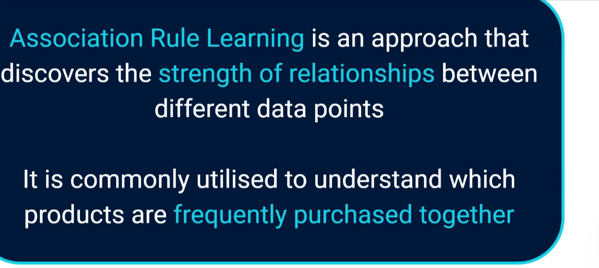
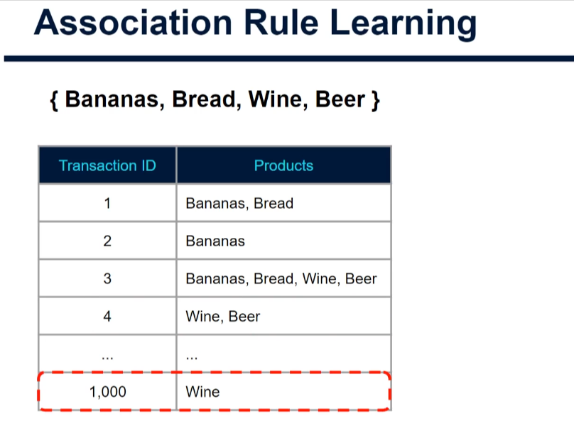
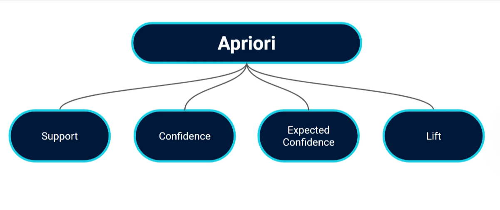
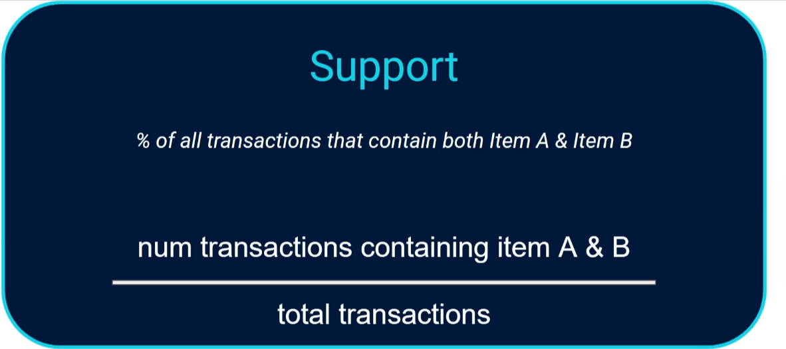
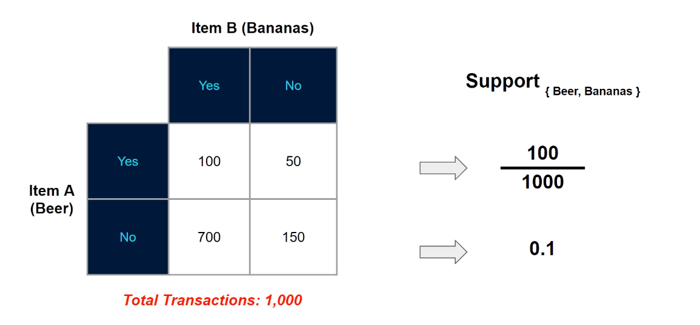
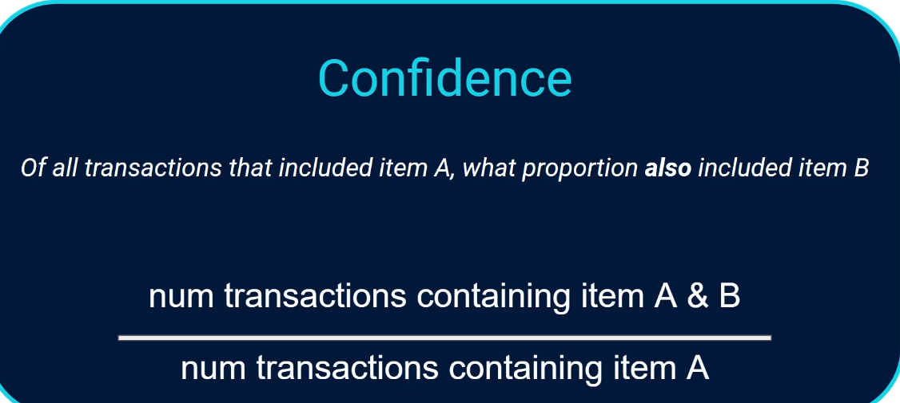
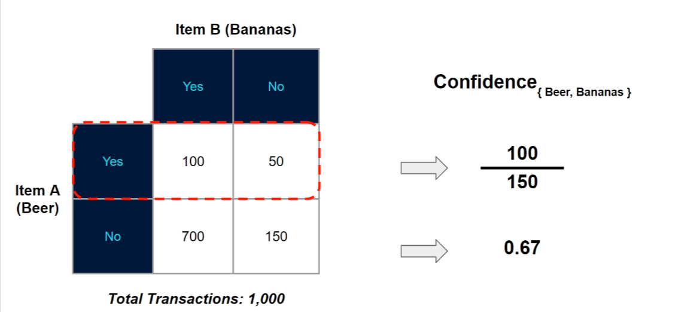
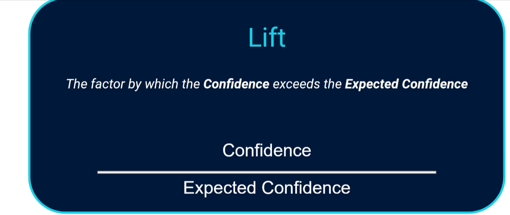
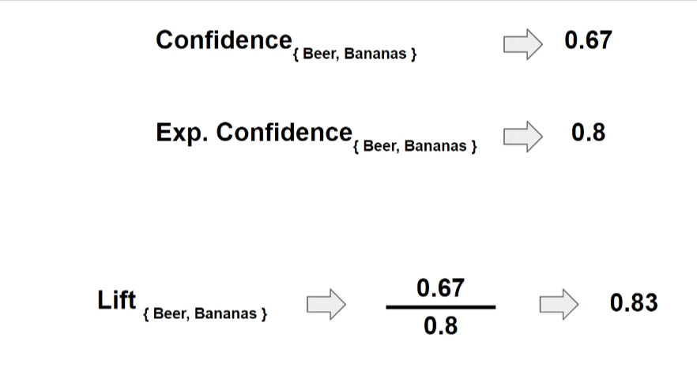
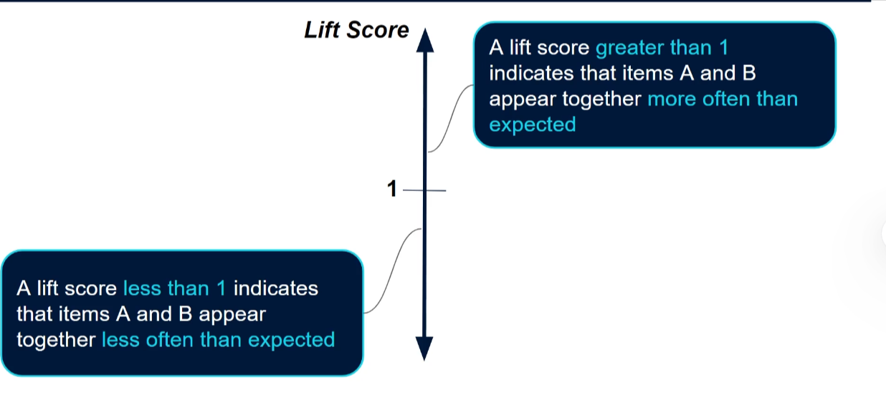
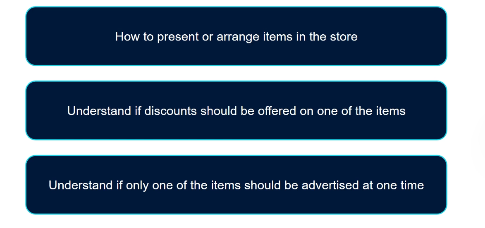
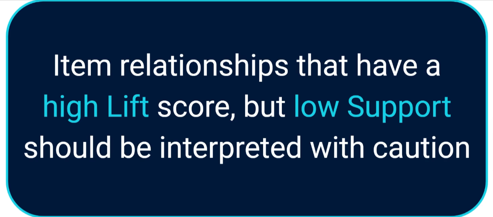
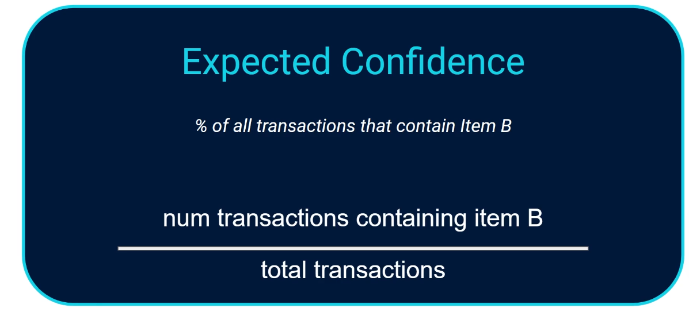
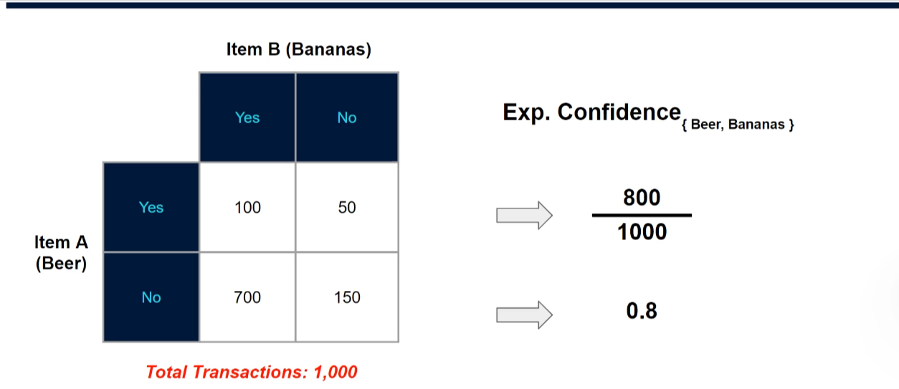
