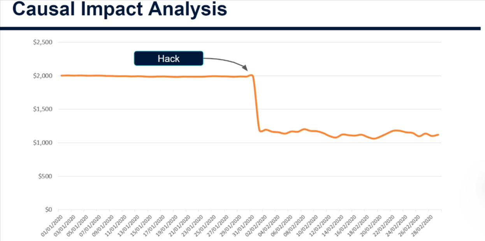
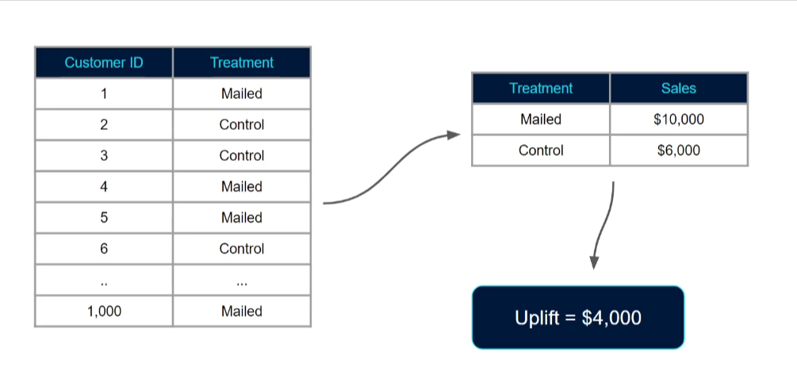
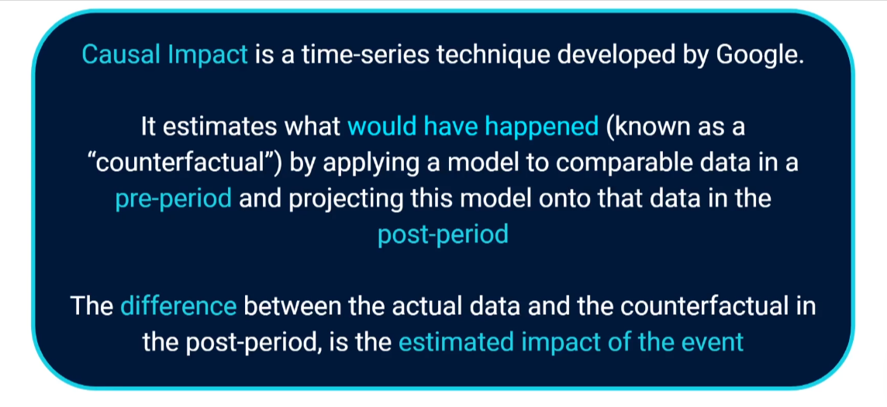
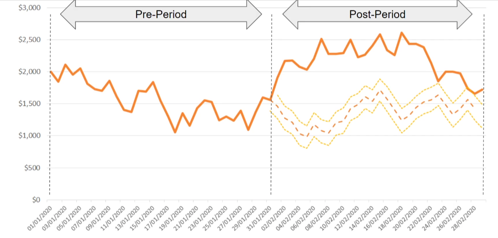
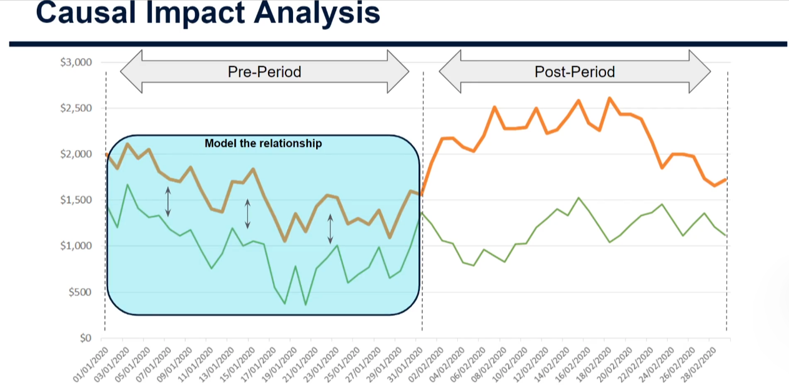
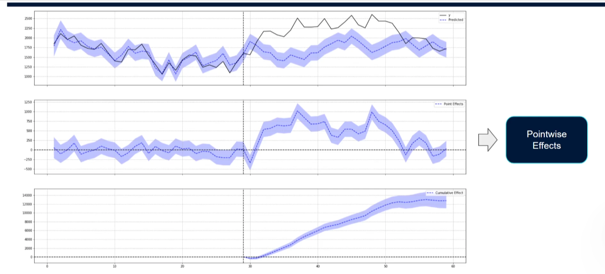

# Causal Impact Analysis

## Measuring the effect of an event

Businesses often want to know how much an event changed a metric: for example, sales after a promotion, signups after an advertising campaign, or a share price after a market event. The challenge is that we observe what happened **with** the event, but not what would have happened at the same time **without** it. This unobserved alternative is the **counterfactual**.

In this entirely fictional example, an imagined hack occurs around February 1, 2020, and the share price falls from roughly $2,000 to $1,200. If we assume the price would otherwise have stayed at $2,000, the estimated immediate effect is approximately **-$800 per share**. This assumption is convenient for illustration, not proof: real prices fluctuate, and other events may also affect them. The example does not describe an actual Amazon hack or actual share-price data.

## Randomized experiments

Suppose a pizza shop randomly sends a buy-one-get-one-free coupon to half its customers and keeps the other half as a control group. In the example, mailed customers generate $10,000 in revenue and control customers generate $6,000. With equal-sized groups, the difference is **$4,000** in group revenue, or $8 per customer if each group contains 500 customers.

Random assignment helps make the groups comparable, but the observed difference is still subject to sampling uncertainty. If group sizes differ, compare revenue per customer rather than raw totals. Revenue uplift is not necessarily profit uplift: coupon costs and other costs also matter.

Some events cannot be randomized, and a direct control group may not be available. Causal impact analysis offers a model-based alternative, and can also be used with data from a randomized control group.

## The causal impact approach

Causal impact analysis estimates a counterfactual time series using data from before the intervention and then compares it with the observed outcome after the intervention:

**Estimated effect at time t = observed outcome at t - estimated counterfactual at t**

Google's CausalImpact approach commonly uses a Bayesian structural time-series model to estimate the counterfactual and its uncertainty. The causal interpretation depends on the data and assumptions, not merely on the model.

### Pre-period and post-period

The intervention separates the series into a **pre-period**, used to fit the model, and a **post-period**, used to estimate the effect. In the illustration, the solid orange line is the observed outcome; the dashed line is the estimated counterfactual, with surrounding uncertainty bounds. The gap between observed and predicted values in the post-period is the estimated effect.

The counterfactual can differ substantially from a flat extension of the last pre-intervention value, especially when the outcome has trends, seasonality, or other fluctuations.

### Using a comparison series

The orange series is the outcome of interest; the green series is a potential comparison or control series. The model learns their relationship during the pre-period and uses the comparison series in the post-period to help estimate the outcome without the intervention. Multiple comparison series can be used.

For example, the control group in the pizza experiment may provide a comparison series. Without a randomized control, another store's sales might be useful, but only if it was not affected by the promotion and its relationship with the treated store is expected to remain stable.

Important conditions and checks:

- Comparison series should predict the outcome before the intervention and remain unaffected by it, including indirect spillovers.
- The pre-period relationship should remain stable after the intervention in the absence of treatment. Other simultaneous changes can undermine this assumption.
- Use a sufficiently informative pre-period and inspect pre-period fit; good fit alone does not prove a causal effect.
- Check data quality, missing values, seasonality, and the intervention date. Where practical, test predictions on a held-out pre-period or run placebo interventions.
- Report uncertainty and limitations. A credible interval that excludes zero supports an effect under the model and its assumptions, but does not establish causality on its own.

## Interpreting the output

The typical output includes three charts:

1. **Observed and predicted:** actual values alongside the estimated counterfactual and its uncertainty interval. The vertical line marks the intervention.
2. **Pointwise effect:** the difference between observed and counterfactual values at each time point. Zero means no estimated difference at that point.
3. **Cumulative effect:** the running sum of post-period pointwise effects, with uncertainty. For a flow such as daily sales, the final value estimates total incremental sales over the period. For a stock or level such as a share price, summing daily differences has different units (dollar-days per share) and is not the total financial loss.

Summary statistics and a narrative report can show the average and cumulative effects, their uncertainty, and model-based significance measures. Interpret these in the context of the chosen time window and comparison data.

## Python implementation

Python packages such as `pycausalimpact` implement this workflow. After installing a suitable package in the project environment, prepare a time-indexed outcome and any comparison series, define the pre- and post-periods, fit the model, and inspect its plots and summary report. Python implementations differ in their APIs and modeling details, so consult the documentation for the specific package and version used.
