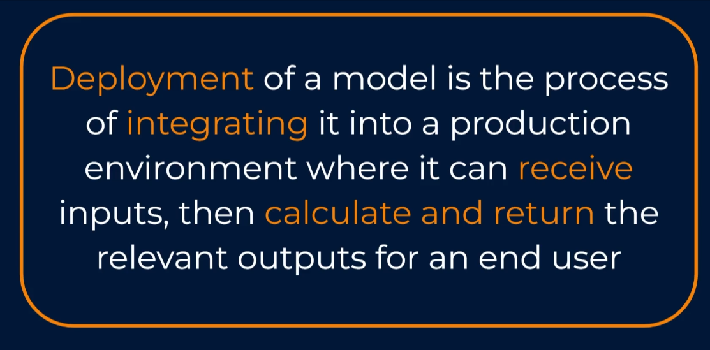
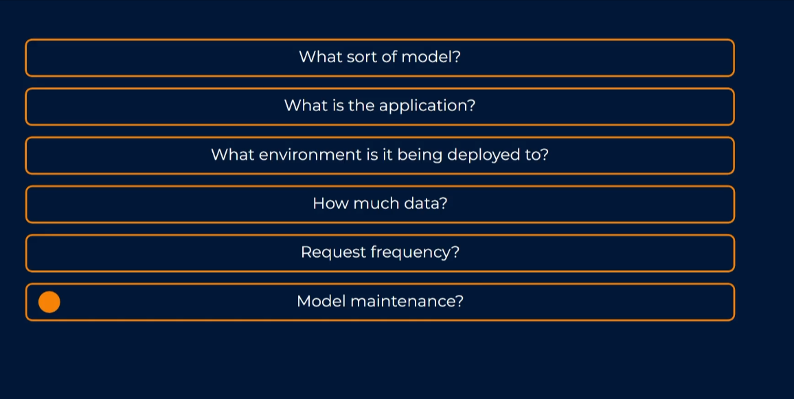

# Machine Learning Model Deployment

## What is model deployment?

Model deployment is the process of integrating a trained model, pipeline, or its logic into an environment where it can receive inputs, make predictions, and return useful outputs to end users or other systems.

For example, an online retailer can use a recommendation model to update suggested products as a customer browses. A model like this needs to be available to the website and respond automatically to requests.

Not every model needs a production service. A business might instead use a model to score a recent customer list, then have a marketing team contact the highest-scoring prospects. That workflow can be run manually and still provide value.

## Planning a deployment

The right deployment approach depends on the use case. Scope questions include:

- **Model type:** What model or pipeline is being deployed?
- **Application:** Who or what will use its predictions, and how?
- **Environment:** Is it for internal use, a mobile app, a website, or another system?
- **Data volume:** How much data will the model need to process?
- **Request frequency:** Does it handle occasional requests or high traffic, such as thousands of requests per second?
- **Maintenance:** How often must the model be updated, and how will the team monitor for model drift?

These are only starting points; deployment design depends on the system’s requirements.

## Who handles deployment?

The division of responsibility varies by organization. Data scientists focus on exploring data, finding insights, and developing and validating models. Data engineers and machine learning engineers often take a larger role in production systems, deployment, and ongoing maintenance.

These teams should work closely together and understand one another’s needs. A data scientist does not necessarily need to own every production engineering detail, but should be able to collaborate effectively with the people who do.

## Course project

In this course, we will build a simple web app around a machine learning pipeline:

1. Use **Streamlit** to create the app and its input form.
2. Run the app locally and check that the inputs reach the pipeline and its predictions appear as expected.
3. Deploy the app using **Streamlit Community Cloud** so others can access it.

The course previously used Flask for the web app and Heroku for hosting; this project uses Streamlit instead. The goal is to learn the basic structure of a model-powered web app and one way to deploy it—not to cover every deployment or production-maintenance topic in depth.
