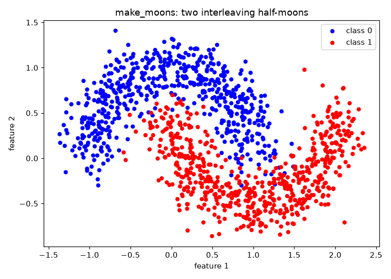
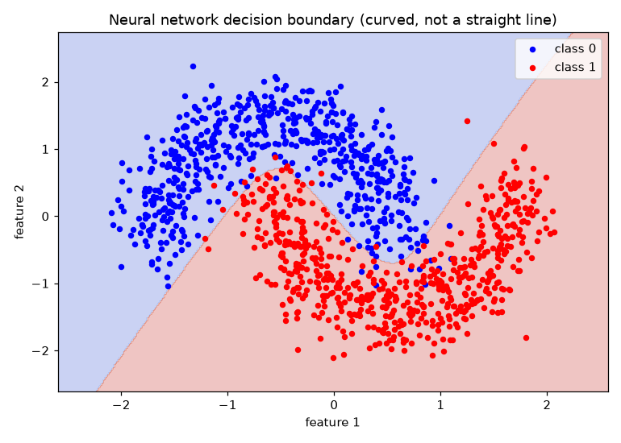

# Deep Learning — Artificial Neural Networks (Practical)

> A beginner-friendly tutorial. Companion code: `neural_network_from_scratch.py`
> (build a neural network from scratch in NumPy, then redo it with scikit-learn).

---

## 1. What Is a Neural Network? (Intuition First)

A **neural network** is a machine learning model loosely inspired by the brain.
But forget the biology — here is the practical truth:

> A neural network is a stack of simple math operations (multiply, add, squash)
> with a bunch of adjustable numbers (weights). "Learning" means automatically
> tuning those numbers so the network's output matches the right answer.

### Why do we need it?

Classic models like **linear regression** and **logistic regression** can only
draw **straight lines** (or flat planes) between classes. Many real problems
are **not** separable by a straight line.

Look at this dataset — two interleaving half-moons:



A straight line cannot separate the blue from the red points. No matter how you
tilt it, you misclassify a chunk. But a neural network can carve a **curved**
boundary that wraps around one moon:



That curved boundary is the whole point. Neural networks are **universal
approximators**: with enough hidden units they can approximate almost any
shape. This is why they dominate image recognition, speech, language, and
recommendation systems.

### The "deep" in deep learning

"Deep" just means **many layers** stacked on top of each other. Each layer
transforms its input a little, and the next layer builds on that. Early layers
learn simple patterns (edges, tones), deeper layers combine them into complex
concepts (faces, words).

```
Input -> [Layer 1] -> [Layer 2] -> [Layer 3] -> ... -> Output
        simple      combines      abstract
        patterns    into shapes   concepts
```

---

## 2. The Building Block: A Single Neuron

A single artificial neuron does three things:

1. **Weighted sum** — multiply each input by its weight, add them up, add a bias.
2. **Activation** — squash the result through a non-linear function.
3. **Output** — pass the result to the next layer.

$$z = w_1x_1 + w_2x_2 + \dots + w_nx_n + b$$

$$a = f(z)$$

| Symbol | Meaning                              |
| ------ | ------------------------------------ |
| $x_i$  | input value                          |
| $w_i$  | weight (how important this input is) |
| $b$    | bias (shifts the result up/down)     |
| $z$    | weighted sum (pre-activation)        |
| $f$    | activation function                  |
| $a$    | neuron output (activation)           |

### The activation function — why it matters

If we only did weighted sums, stacking layers would collapse into one big
linear function — no more powerful than logistic regression. The **activation
function adds non-linearity**, which is what lets the network learn curves.

| Activation  | Formula        | Shape   | When to use                                 |
| ----------- | -------------- | ------- | ------------------------------------------- |
| **Sigmoid** | $1/(1+e^{-z})$ | 0 to 1  | Output layer for binary classification      |
| **Tanh**    | $\tanh(z)$     | -1 to 1 | Hidden layers (common default)              |
| **ReLU**    | $\max(0, z)$   | 0 to ∞  | Hidden layers (most popular in modern nets) |

---

## 3. The Architecture We Will Build

Our toy network for the two-moons problem:

```
   x1 ──┐
        ├── [ 8 hidden neurons, tanh ] ──┐
   x2 ──┘                              ├── [ 1 output neuron, sigmoid ] -> P(class 1)
```

- **Input layer:** 2 neurons (the two coordinates).
- **Hidden layer:** 8 neurons with **tanh** — this is where the curve is learned.
- **Output layer:** 1 neuron with **sigmoid** — gives a probability between 0 and 1.

### Shape bookkeeping (very important)

In the math convention we use, **samples are columns**:

| Object | Shape    | Meaning                           |
| ------ | -------- | --------------------------------- |
| `X`    | (2, 900) | 2 features × 900 training samples |
| `W1`   | (8, 2)   | weights from input → hidden       |
| `b1`   | (8, 1)   | bias for each hidden neuron       |
| `W2`   | (1, 8)   | weights from hidden → output      |
| `b2`   | (1, 1)   | output bias                       |

---

## 4. How Learning Works: The Training Loop

Neural networks learn with **gradient descent**. The loop has four steps,
repeated thousands of times:

```
    ┌──────────────────────────────────────────────┐
    │  1. FORWARD PASS   -> make a prediction       │
    │  2. COMPUTE LOSS   -> how wrong is it?        │
    │  3. BACKPROPAGATE  -> compute gradients       │
    │  4. UPDATE         -> nudge weights downhill  │
    └──────────────────────────────────────────────┘
                     (repeat until loss stops dropping)
```

### Step 1 — Forward pass (prediction)

Feed the inputs through the layers: weighted sums, activations, until you get
an output probability.

```python
Z1 = W1 @ X + b1      # linear step
A1 = np.tanh(Z1)      # activation
Z2 = W2 @ A1 + b2     # linear step
A2 = sigmoid(Z2)      # output probability
```

### Step 2 — Compute the loss

The **binary cross-entropy** loss measures how far the predictions are from the
true labels:

$$\text{Loss} = -\frac{1}{m}\sum \left[ y\log(\hat{y}) + (1-y)\log(1-\hat{y}) \right]$$

- If true label is 1 and we predict 0.9 → small loss. Good.
- If true label is 1 and we predict 0.1 → huge loss. Bad.

### Step 3 — Backpropagation (the magic)

**Backpropagation** computes the **gradient** of the loss with respect to every
weight and bias — i.e. _"if I nudge this weight up or down, which way makes the
loss smaller?"_ It works by applying the **chain rule** of calculus, propagating
the error backward from output to input.

For sigmoid + cross-entropy, the output gradient simplifies beautifully:

$$\frac{\partial \text{Loss}}{\partial Z_2} = A_2 - Y$$

Then, moving backward:

- `dW2 = (A2 - Y) @ A1.T / m` → gradient for `W2`
- `dA1 = W2.T @ (A2 - Y)` → send error to the hidden layer
- `dZ1 = dA1 * (1 - A1**2)` → tanh derivative is `1 - tanh²`
- `dW1 = dZ1 @ X.T / m` → gradient for `W1`

### Step 4 — Gradient descent update

Nudge every parameter in the direction that **reduces** the loss:

$$W \leftarrow W - \alpha \cdot \frac{\partial \text{Loss}}{\partial W}$$

where $\alpha$ is the **learning rate** — how big a step to take.

| Learning rate         | Effect                           |
| --------------------- | -------------------------------- |
| Too small (0.0001)    | Learns painfully slowly          |
| Just right (0.01–0.1) | Smooth, steady convergence       |
| Too large (10)        | Bounces around, may never settle |

---

## 5. The Loss Curve — Watching Learning Happen

Each time we record the loss, we see it **go down**. That downward curve is the
visual proof the network is learning:

```
loss
 |*
 | *
 |  *
 |    *
 |       *  *
 |            *   *   *
 |                    *  *   *  *
 |_______________________________ epoch
```

- **Steep drop at first** = the network quickly fixes its worst mistakes.
- **Gradual flattening** = fine-tuning the details.
- **If loss goes up or oscillates** = learning rate too high.
- **If loss barely moves** = learning rate too low, or a bug.

---

## 6. Practical Examples

### 6.1 The problem: `make_moons`

```python
from sklearn.datasets import make_moons
X, y = make_moons(n_samples=1200, noise=0.18, random_state=42)
```

- `X` → shape (1200, 2): the two coordinates of each point.
- `y` → shape (1200,): the label (0 = bottom moon, 1 = top moon).
- `noise=0.18` adds random scatter so the problem is realistic, not trivially clean.

### 6.2 Preprocessing (do this every time)

```python
from sklearn.model_selection import train_test_split
from sklearn.preprocessing import StandardScaler

X_train, X_test, y_train, y_test = train_test_split(
    X, y, test_size=0.25, random_state=42, stratify=y
)

scaler = StandardScaler()
X_train = scaler.fit_transform(X_train)  # learn mean/std from TRAIN only
X_test  = scaler.transform(X_test)       # reuse the SAME transform on test
```

**Why scale?** Neural networks train far better when all features share a
similar range (mean 0, std 1). Without scaling, large-valued features dominate
and gradients bounce around.

**Why fit on train only?** To avoid **data leakage** — the scaler must not
"peek" at test data, or your evaluation is dishonest.

### 6.3 Build it from scratch (NumPy only)

```python
import numpy as np

def initialize_parameters(n_x, n_hidden, n_y):
    W1 = np.random.randn(n_hidden, n_x) * 0.5
    b1 = np.zeros((n_hidden, 1))
    W2 = np.random.randn(n_y, n_hidden) * 0.5
    b2 = np.zeros((n_y, 1))
    return W1, b1, W2, b2

def sigmoid(z):
    return 1 / (1 + np.exp(-z))

def forward_propagation(parameters, X):
    W1, b1, W2, b2 = parameters
    Z1 = W1 @ X + b1
    A1 = np.tanh(Z1)
    Z2 = W2 @ A1 + b2
    A2 = sigmoid(Z2)
    return A2, (X, Z1, A1, Z2, A2)

def compute_loss(A2, Y):
    m = Y.shape[1]
    return -np.sum(Y * np.log(A2 + 1e-8) + (1 - Y) * np.log(1 - A2 + 1e-8)) / m

def backward_propagation(parameters, cache, Y):
    W1, b1, W2, b2 = parameters
    X, Z1, A1, Z2, A2 = cache
    m = X.shape[1]
    dZ2 = A2 - Y
    dW2 = dZ2 @ A1.T / m
    db2 = np.sum(dZ2, axis=1, keepdims=True) / m
    dA1 = W2.T @ dZ2
    dZ1 = dA1 * (1 - A1 ** 2)
    dW1 = dZ1 @ X.T / m
    db1 = np.sum(dZ1, axis=1, keepdims=True) / m
    return dW1, db1, dW2, db2
```

Then the training loop:

```python
parameters = initialize_parameters(2, 8, 1)
X = X_train.T                      # (2, 900)
Y = y_train.reshape(1, -1)         # (1, 900)

for epoch in range(6000):
    A2, cache = forward_propagation(parameters, X)
    loss = compute_loss(A2, Y)
    dW1, db1, dW2, db2 = backward_propagation(parameters, cache, Y)
    W1, b1, W2, b2 = parameters
    parameters = (W1 - 0.1 * dW1, b1 - 0.1 * db1,
                  W2 - 0.1 * dW2, b2 - 0.1 * db2)
```

### 6.4 The same thing with scikit-learn (production)

```python
from sklearn.neural_network import MLPClassifier

mlp = MLPClassifier(
    hidden_layer_sizes=(8,),   # one hidden layer, 8 neurons
    activation="tanh",         # same as Part A
    solver="adam",             # smarter optimizer than plain gradient descent
    max_iter=2000,
    random_state=42,
)
mlp.fit(X_train, y_train)
```

### 6.5 The results

| Approach             | Test accuracy |
| -------------------- | ------------- |
| From scratch (NumPy) | **97.7%**     |
| scikit-learn MLP     | **97.3%**     |

They match — proving the library is doing exactly what you coded by hand, just
faster and with extras (Adam optimizer, early stopping, regularization).

---

## 7. Production Example: A Real Classifier

For real tabular data you rarely build from scratch. You scale up with a
framework. Here is the **Keras** equivalent of the same network:

```python
# pip install tensorflow
from tensorflow import keras

model = keras.Sequential([
    keras.layers.Input(shape=(2,)),          # 2 input features
    keras.layers.Dense(8, activation="tanh"),# hidden layer, 8 neurons
    keras.layers.Dense(1, activation="sigmoid")  # output probability
])

model.compile(optimizer="adam",
              loss="binary_crossentropy",
              metrics=["accuracy"])

model.fit(X_train, y_train, epochs=200, batch_size=32, validation_split=0.1)
```

And the **PyTorch** equivalent:

```python
# pip install torch
import torch.nn as nn

model = nn.Sequential(
    nn.Linear(2, 8), nn.Tanh(),
    nn.Linear(8, 1), nn.Sigmoid()
)
# ... (define loss = nn.BCELoss(), optimizer = torch.optim.Adam(...))
```

**The recipe never changes:** choose architecture → pick a loss → pick an
optimizer → loop forward/loss/backward/update → evaluate. Keras and PyTorch
just handle the plumbing.

---

## 8. Key Hyperparameters (the knobs you tune)

| Hyperparameter            | What it controls                       | Typical starting point                 |
| ------------------------- | -------------------------------------- | -------------------------------------- |
| **Hidden layers / units** | Model capacity (how much it can learn) | 1–3 layers, 8–128 units each           |
| **Learning rate**         | Step size                              | 0.001 (Adam), 0.01–0.1 (SGD)           |
| **Batch size**            | Samples per update                     | 32 or 64                               |
| **Epochs**                | Passes over the data                   | 50–500 (use early stopping)            |
| **Activation**            | Non-linearity                          | ReLU (hidden), sigmoid (binary output) |
| **Optimizer**             | How weights are updated                | Adam (default), SGD                    |

---

## 9. Common Beginner Mistakes

| Mistake                     | Symptom                                  | Fix                                         |
| --------------------------- | ---------------------------------------- | ------------------------------------------- |
| **No feature scaling**      | Loss oscillates / won't converge         | `StandardScaler` first                      |
| **Learning rate too high**  | Loss explodes or bounces                 | Lower it (÷10)                              |
| **Learning rate too low**   | Loss barely moves                        | Raise it (×10)                              |
| **Too many epochs**         | Great train accuracy, poor test accuracy | Early stopping / regularization             |
| **Too few hidden units**    | Underfitting, low accuracy both sets     | Add units/layers                            |
| **Data leakage**            | Suspiciously perfect scores              | Fit scalers on train only                   |
| **Wrong output activation** | Probabilities outside [0,1]              | sigmoid for binary, softmax for multi-class |
| **Not shuffling data**      | Biased gradient steps                    | Shuffle each epoch                          |

---

## 10. How Neural Networks Compare

| Model                               | Strengths                                                                | Weaknesses                             |
| ----------------------------------- | ------------------------------------------------------------------------ | -------------------------------------- |
| **Logistic regression**             | Simple, interpretable, fast                                              | Only linear boundaries                 |
| **Decision trees / Random Forest**  | Handle tabular data, no scaling needed                                   | Struggle with raw images/text          |
| **Neural networks**                 | Learn complex non-linear patterns; state of the art on images/audio/text | Need lots of data, compute, and tuning |
| **Deep nets (CNN/RNN/Transformer)** | Specialized architectures for vision/sequence/language                   | Complex, data-hungry                   |

**Rule of thumb:** for small tabular datasets, try gradient-boosted trees first.
For images, audio, text, or huge datasets, reach for neural networks.

---

## 11. Cheat Sheet

```
Goal:        Learn a non-linear mapping from inputs to outputs
Core loop:   forward -> loss -> backprop -> update  (repeat)
Building:    linear (Wx+b) -> activation (tanh/relu/sigmoid)
Loss:        binary cross-entropy (classification)
Optimizer:   gradient descent / Adam
Must-do:     scale features, fit on train only, stratify the split
From scratch: init -> forward -> loss -> backward -> loop   (you did this!)
Production:  sklearn MLPClassifier, Keras, PyTorch
Watch:       the loss curve going down; if it doesn't, check LR + scaling
```

---

## 12. One-Line Takeaway

**A neural network is layers of weighted sums and non-linear squashes, and
"deep learning" is the repeated loop of predict → measure error → compute
gradients → nudge the weights — which turns a straight-line model into one that
can learn curved, complex patterns like the two moons above.**
