# Introduction to Artificial Neural Networks

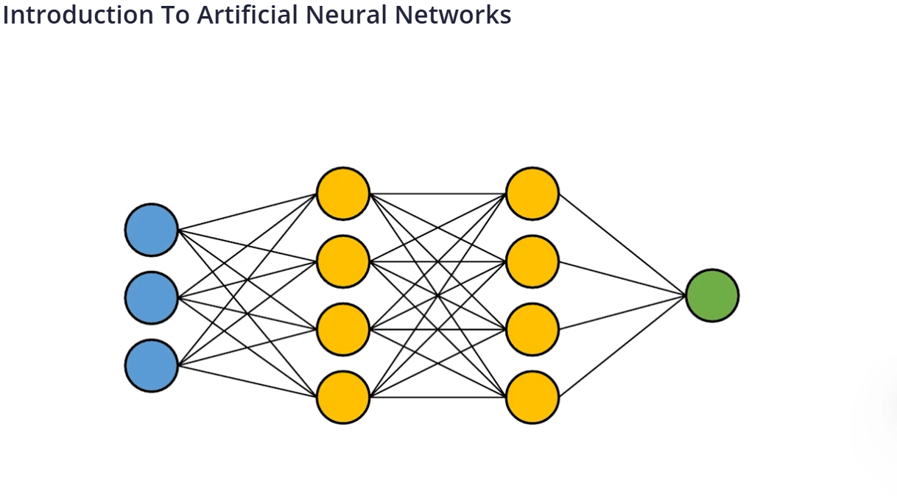

An **artificial neural network (ANN)** is a model made up of connected computational units called neurons. It is loosely inspired by biological brains, but it does not operate like a real brain.

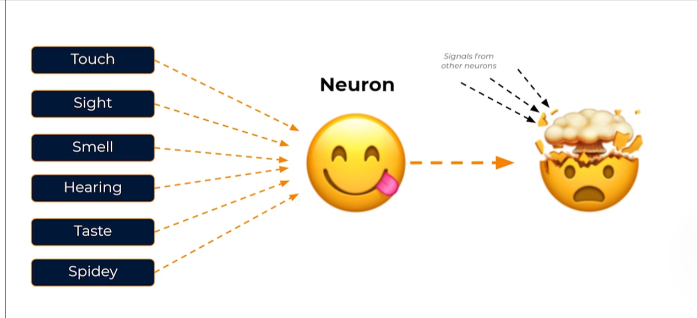

A biological neuron receives signals and can influence other neurons. Similarly, an artificial neuron combines inputs and produces an output that can be passed to other neurons.

## The Data

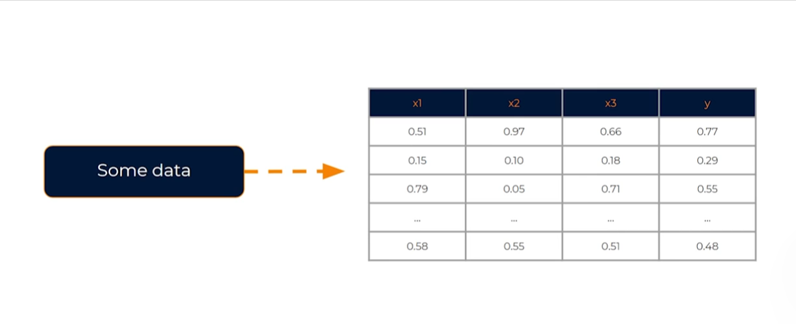

In this supervised learning example, each row is an observation:

- $x_1$, $x_2$, and $x_3$ are **features**, or inputs.
- $y$ is the known **target** we want to predict.
- The first row has inputs $(0.51, 0.97, 0.66)$ and target $0.77$.

Because the target is numerical, this is a **regression** example. Neural networks can also be used for binary and multiclass classification.

## Step 1: Input Layer

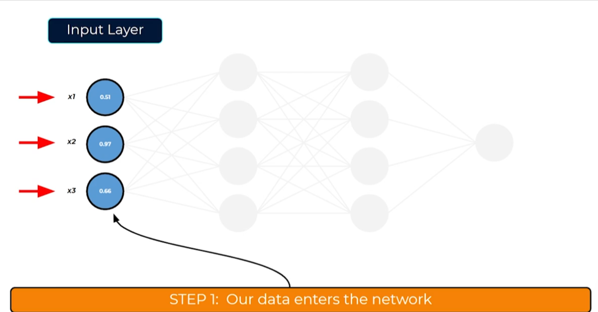

The three feature values enter the network through three input units. In this example, there is one input unit for each numerical feature.

## Step 2: Hidden Layers

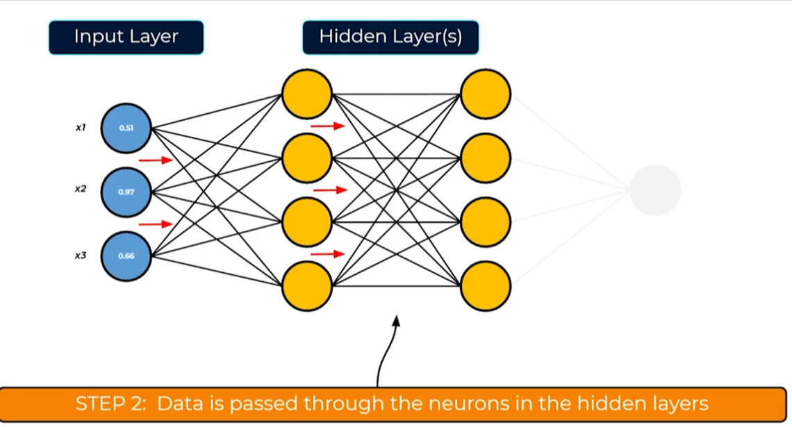

The network has two **hidden layers**, each containing four neurons. The number of layers and neurons is chosen when designing the model. More hidden layers make a network **deeper**; more neurons in a layer make it **wider**.

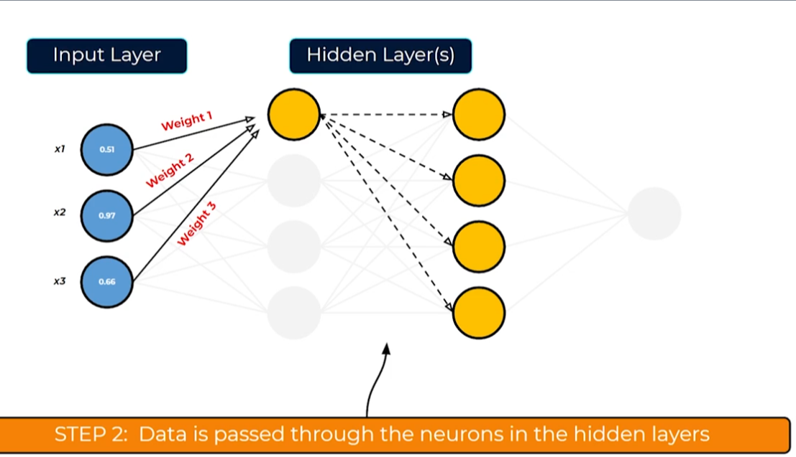

Each connection has a **weight**. A neuron combines its inputs with their weights, adds a **bias**, and applies an **activation function**:

$$a = f(w_1x_1 + w_2x_2 + w_3x_3 + b)$$

Activation functions such as ReLU introduce nonlinearity, helping the network learn complex relationships. Passing values from input to output is called **forward propagation**.

## Step 3: Prediction

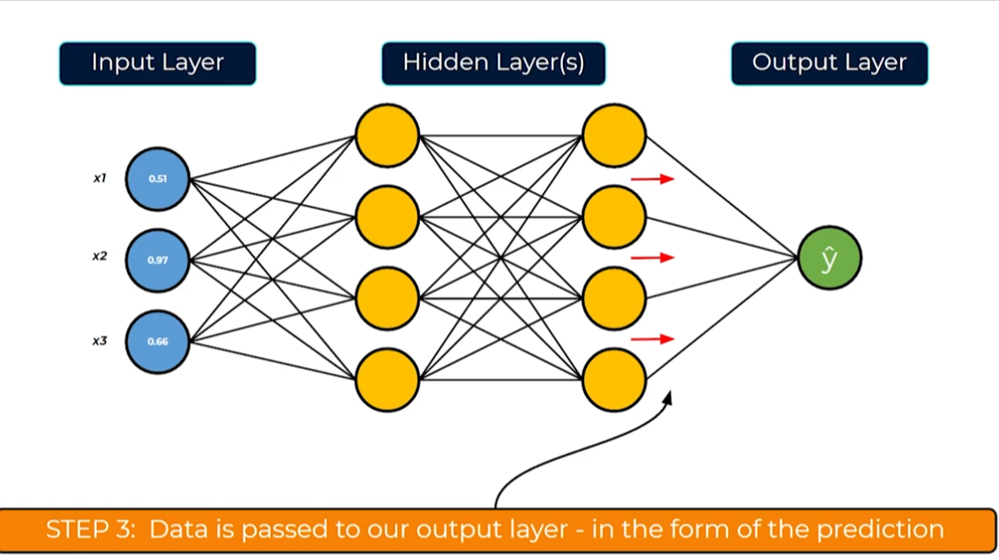

For this regression task, the output layer has one neuron that produces a predicted numerical value, written as $\hat{y}$. A binary classifier often uses one output, while a multiclass classifier commonly uses one output per class.

## Step 4: Calculate Loss

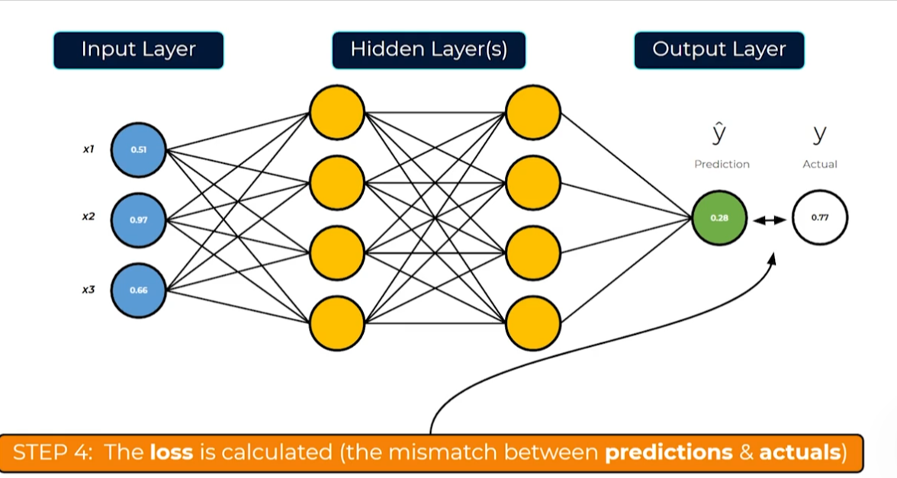

Suppose the first prediction is $\hat{y}=0.28$, while the actual value is $y=0.77$. Their absolute difference is $0.49$.

A **loss function** measures prediction error. For example, squared error for this observation is:

$$(y-\hat{y})^2 = (0.77-0.28)^2 = 0.2401$$

## Step 5: Learn From the Loss

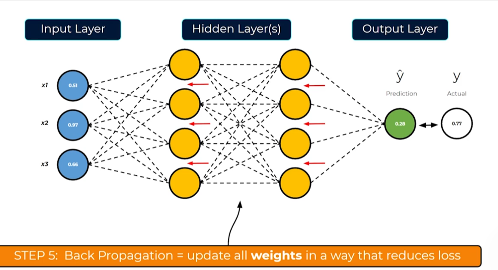

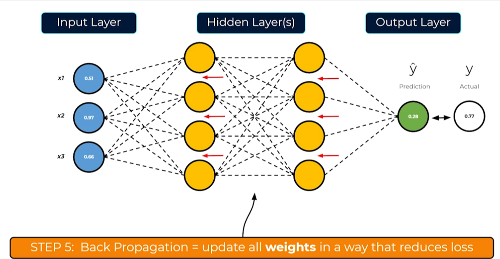

**Backpropagation** uses the chain rule to calculate how the loss changes with each weight and bias. An optimizer, such as **gradient descent**, then uses those gradients to update the parameters. The **learning rate** controls the size of the update.

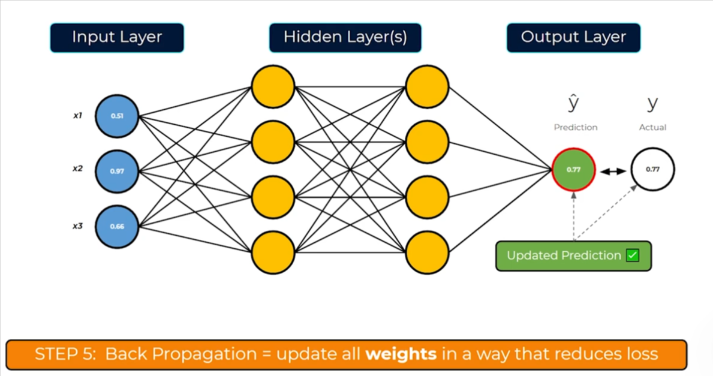

The image shows an updated prediction matching the target exactly. This is illustrative: updates do not guarantee zero loss, and training normally aims to reduce loss across the dataset, not perfectly fit one row before moving to the next.

## Epochs and Batch Size

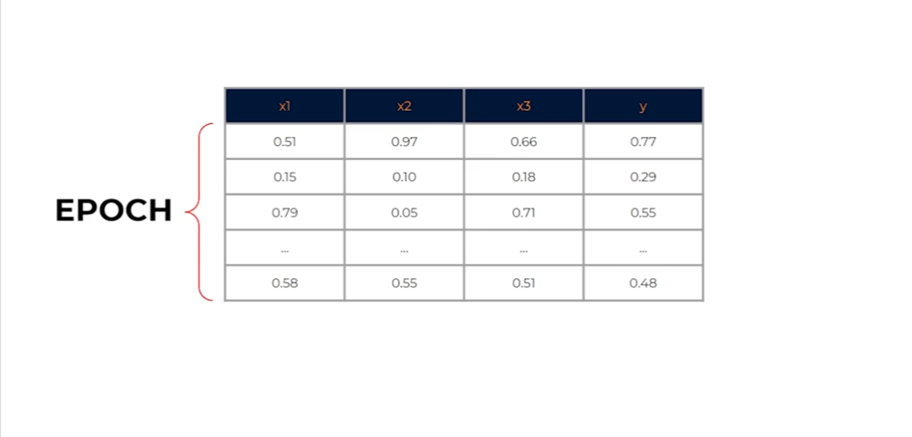

An **epoch** is one complete pass through the training dataset. Training usually involves multiple epochs.

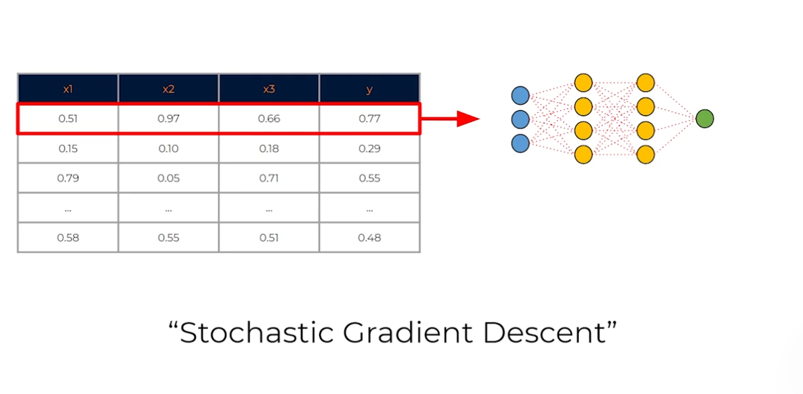

**Stochastic gradient descent** updates parameters using one observation at a time. **Batch gradient descent** uses the entire training dataset for each update.

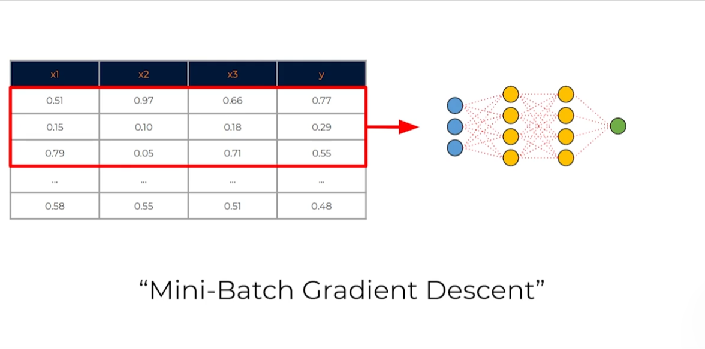

**Mini-batch gradient descent** uses a subset of observations per update. With 1,000 training observations and a batch size of 50, there are $1{,}000/50=20$ updates per epoch, assuming every batch is used.

## Checking Performance

The goal is to make good predictions on **unseen data**, not just memorize training examples. Split data into training, validation, and test sets; fit preprocessing such as scaling on the training set only, then apply it to the other sets. Compare training and validation performance to help identify overfitting.
