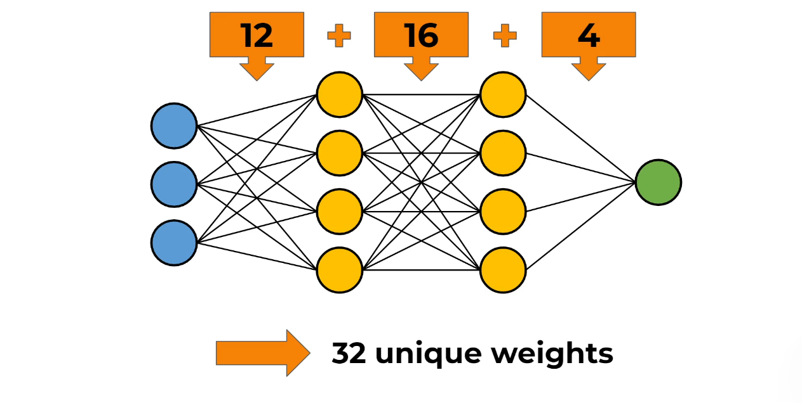
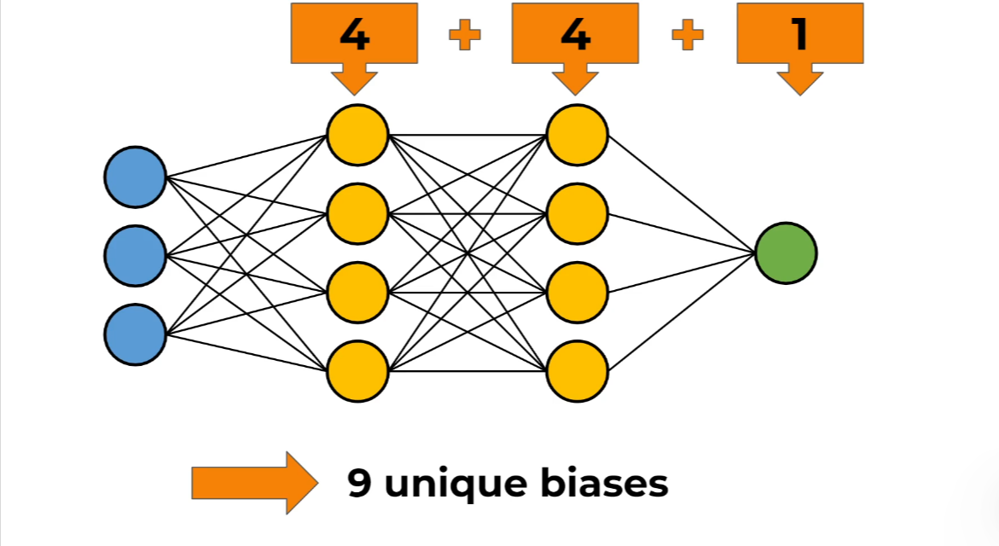
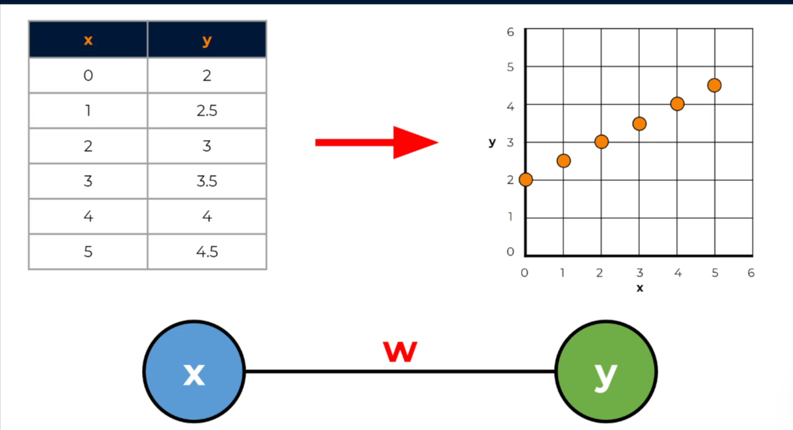
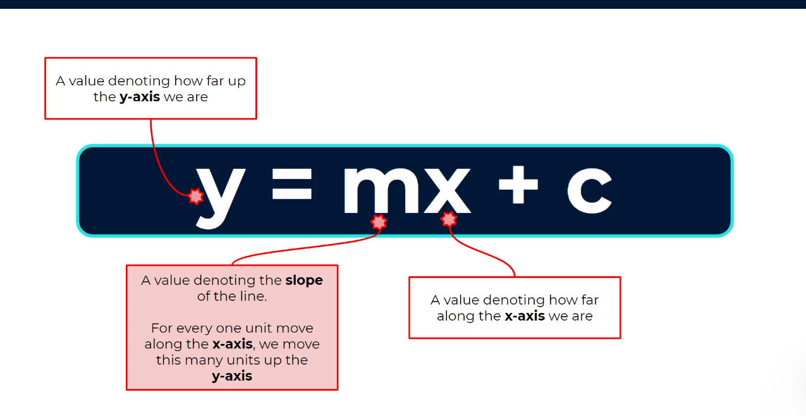
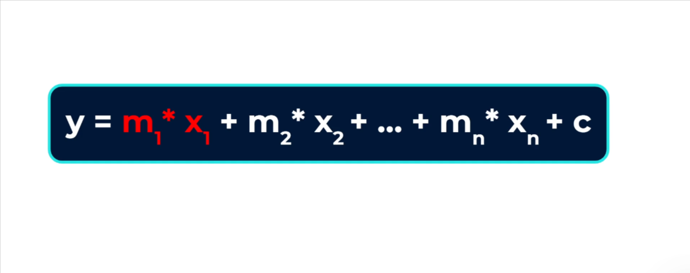
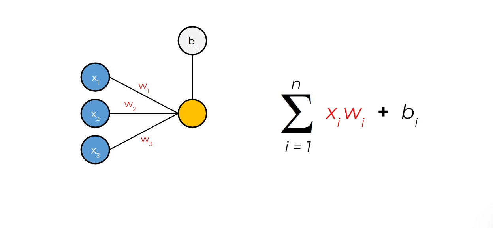
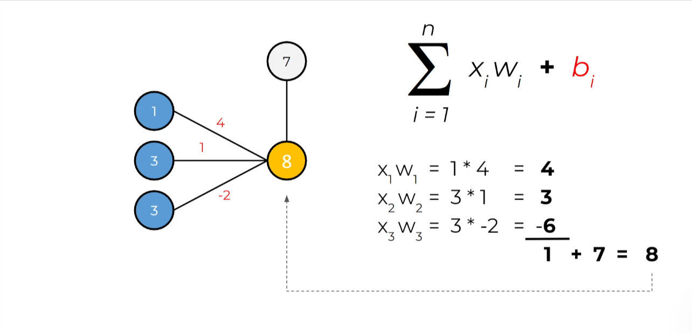

# Weights and Biases

Weights and biases are **learnable parameters** that help a neural network map inputs to predictions. During training, the network computes a prediction, measures its error with a loss function, and adjusts these parameters to reduce the loss.

## Counting Weights

A **weight** scales the value passed along a connection. Its sign and magnitude affect how that input contributes to the receiving neuron: a positive weight increases the weighted sum as the input increases, while a negative weight decreases it.

In the illustrated fully connected network, each connection has its own weight parameter:

| Connection                           |  Calculation | Weights |
| ------------------------------------ | -----------: | ------: |
| 3 inputs to 4 hidden neurons         | $3 \times 4$ |      12 |
| 4 hidden neurons to 4 hidden neurons | $4 \times 4$ |      16 |
| 4 hidden neurons to 1 output         | $4 \times 1$ |       4 |
| **Total**                            |              |  **32** |

These are separate parameters, although their numerical values can happen to be equal. Weights are commonly initialized using a suitable random initialization method; their updates are determined by training. Large networks may have millions or billions of parameters. Not all architectures have a separate weight for every connection: for example, convolutional networks share weights.

## Counting Biases

A **bias** is an additional learnable value added to a neuron's weighted input sum. In this example, each hidden and output neuron has its own bias; the input units simply supply feature values.

- First hidden layer: 4 biases.
- Second hidden layer: 4 biases.
- Output layer: 1 bias.

That gives **9 biases** and **41 learnable parameters** in total: 32 weights plus 9 biases. Biases are often initialized to zero. Some architectures omit or share biases, so this count applies to the illustrated network.

## A Single Input and Output

Consider a simple regression model with one input $x$ and one output prediction $\hat{y}$. The table shows training examples: for instance, $x=0$ has target $y=2$, and $x=5$ has target $y=4.5$. The points lie on a straight line.

With an identity output activation, this single-neuron model predicts:

$$\hat{y} = wx + b$$

Here $w$ is the connection's weight and $b$ is the output neuron's bias. The diagram shows the weight but does not draw the bias. For these particular points, $w=0.5$ and $b=2$ fit every observation exactly: $\hat{y}=0.5x+2$.

## Connection to a Straight Line

The familiar line equation $y=mx+c$ has the same form as $\hat{y}=wx+b$:

- $m$, or $w$, is the **slope**: the change in output for a one-unit increase in $x$.
- $c$, or $b$, is the **intercept**: the output when $x=0$.

Without a bias, the line $\hat{y}=wx$ must pass through the origin. Adding a bias shifts the line up or down, allowing it to fit relationships with a nonzero intercept.

## Multiple Inputs

The same idea extends to multiple inputs:

$$z = w_1x_1 + w_2x_2 + \cdots + w_nx_n + b$$

Each input has its own weight, while the receiving neuron has one bias added to the sum. With two inputs, this equation describes a plane; with more inputs, it describes a higher-dimensional hyperplane. This is the same weighted-sum structure used in multiple linear regression.

## Inside a Neuron

The weighted sum can be written more compactly using summation notation:

$$z = \sum_{i=1}^{n} x_iw_i + b$$

For each input index $i$, multiply $x_i$ by its corresponding weight $w_i$. Add all those products, then add the neuron's bias **once**. In the image, the bias is labelled $b_1$ on the neuron and $b_i$ in the formula; it is the bias of the receiving neuron, not a separate bias for each input.

The weighted sum $z$ is the neuron's **pre-activation**. Its output is $a=f(z)$, where $f$ is the activation function. Hidden layers commonly use nonlinear activations such as ReLU, enabling the network to model nonlinear relationships. Without nonlinear activations, stacked linear layers are equivalent to a single linear transformation.

The bias shifts the input to the activation function. For example, with ReLU, $a=\max(0,z)$, so the bias helps determine whether $z$ is above zero and the output is positive. Other activation functions do not necessarily have a hard firing threshold.

## Worked Example

For inputs $(1,3,3)$, weights $(4,1,-2)$, and bias $7$:

$$z = (1 \times 4) + (3 \times 1) + (3 \times -2) + 7$$
$$z = 4 + 3 - 6 + 7 = 8$$

The result **8 is the pre-activation value**. The final neuron output depends on the activation function: ReLU and the identity function both return 8 in this example.

## How the Parameters Learn

1. **Forward pass:** Calculate each neuron's weighted sum and activation, layer by layer, to produce a prediction.
2. **Loss:** Compare predictions with targets using an appropriate loss function.
3. **Backpropagation:** Apply the chain rule to calculate the gradient of the loss with respect to each weight and bias.
4. **Update:** An optimizer such as gradient descent adjusts the parameters using those gradients and a learning rate. For example, $w \leftarrow w-\eta\frac{\partial L}{\partial w}$; biases are updated similarly.

These steps repeat over training batches and epochs. Lower training loss does not guarantee good predictions on unseen data, so evaluate the model on held-out data as well.
