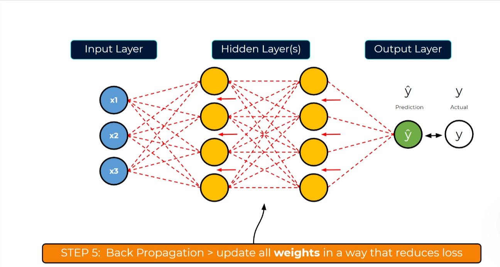
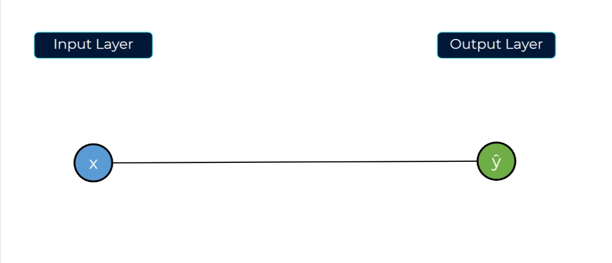
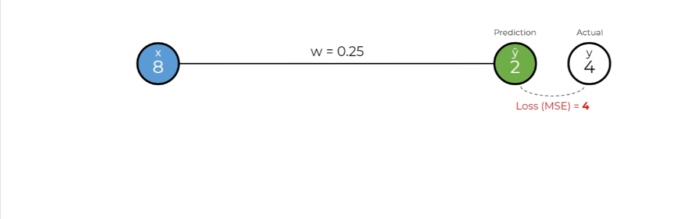
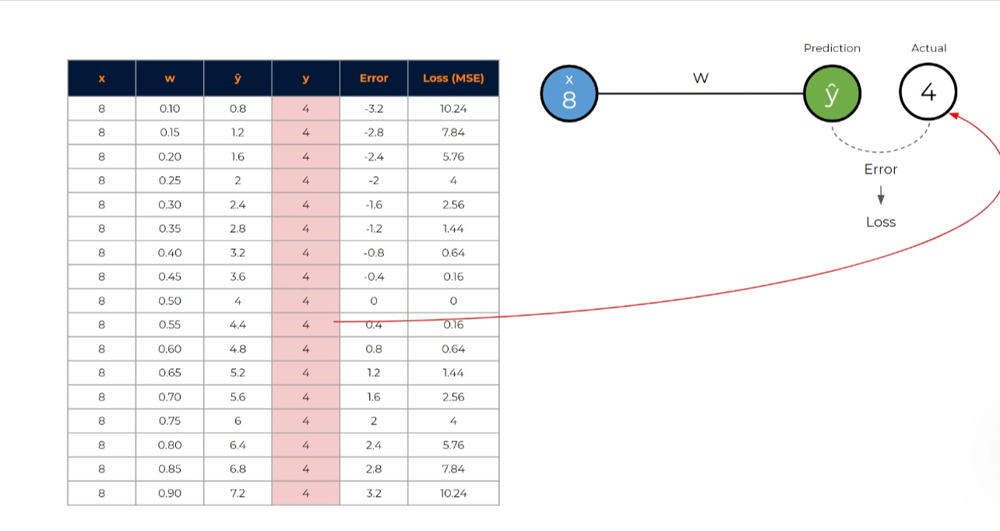
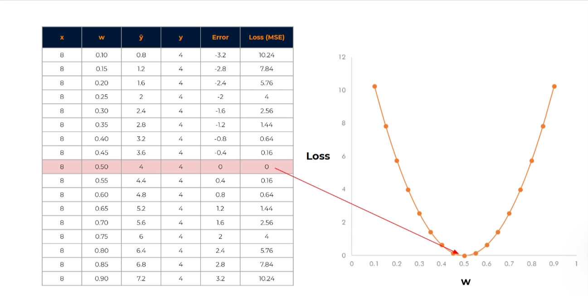
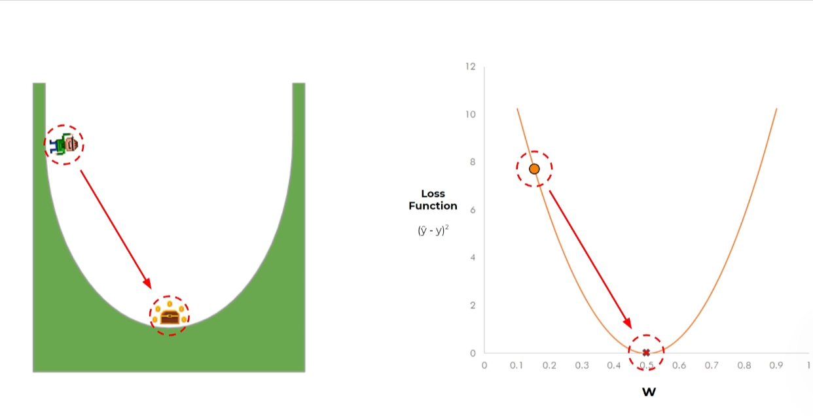

# Backpropagation and Gradient Descent: The Learning Process

## Introduction

This tutorial focuses on the most crucial aspect of neural networks—the learning process itself. We've previously explored **forward propagation**, where data flows left-to-right through the network. Now we'll dive deep into **backpropagation** and **gradient descent**, the mechanisms that enable neural networks to learn.

### The Learning Pipeline

1. **Forward Propagation**: Data enters via the input layer with random initial weights and biases; activation functions process values through hidden layers to produce a prediction.
2. **Loss Calculation**: The prediction is compared to the actual value using a loss function (e.g., Mean Squared Error).
3. **Backpropagation**: The network propagates error signals backward (right-to-left) through the layers.
4. **Gradient Descent**: Using the computed gradients, we iteratively adjust weights and biases to minimize loss.
5. **Optimization**: This process repeats until we find the optimal set of parameters that best maps inputs to outputs.

Essentially, **training a neural network is an optimization problem**—finding the best combination of weights and biases across the entire network to achieve accurate predictions on new, unseen data.

---

## Understanding with a Simple Example

To build intuition, let's start with the simplest possible network: **one input neuron, one output neuron, and one weight (no bias, no activation function)**.

### Network Architecture

### The Forward Pass

For a single data point with:

- **Input**: x = 8
- **Weight**: w = 0.25 (randomly initialized)
- **Actual output**: y = 4

The prediction is calculated as:
$$\hat{y} = x \cdot w = 8 \cdot 0.25 = 2$$

### Measuring Error

Using Mean Squared Error (MSE) for this single data point:
$$\text{Loss} = (\hat{y} - y)^2 = (2 - 4)^2 = 4$$

The network's prediction is incorrect. We need to adjust the weight to minimize this loss.

---

## The Brute Force Approach (Why It Doesn't Scale)

### Testing Different Weight Values

Let's test weight values from 0.1 to 0.9 and observe how loss changes:

| Input (x) | Weight (w) | Prediction (ŷ) | Actual (y) | Error | Loss (MSE) |
| --------- | ---------- | -------------- | ---------- | ----- | ---------- |
| 8         | 0.10       | 0.8            | 4          | -3.2  | 10.24      |
| 8         | 0.25       | 2.0            | 4          | -2.0  | **4.00**   |
| 8         | 0.40       | 3.2            | 4          | -0.8  | 0.64       |
| 8         | **0.50**   | **4.0**        | 4          | 0.0   | **0.00**   |
| 8         | 0.60       | 4.8            | 4          | 0.8   | 0.64       |
| 8         | 0.90       | 7.2            | 4          | 3.2   | 10.24      |

The optimal weight is **w = 0.5**, which produces **zero error**.

### Visualizing the Loss Function

### The Combinatorial Explosion

For a more rigorous search with 100 possible weight values and our simple network with one weight, we'd need to test 100 scenarios. But consider a network with just 41 parameters (32 weights + 9 biases):

$$100^{41} \approx 10^{82}$$

This is **larger than the estimated number of atoms in the universe**! Clearly, we cannot test every possible combination.

**Solution: Gradient Descent**

---

## Gradient Descent: The Blindfolded Treasure Hunt

### The Intuition

Imagine **Jumpie Jack**, a blindfolded person searching for treasure at the bottom of a hill. He can't see where the treasure is, but he can feel the slope of the ground beneath his feet. He uses this information to decide:

- **Which direction to move** (uphill or downhill)
- **How large a step to take** (steeper slope = bigger step)

This is exactly what **gradient descent** does for neural networks.

### Visual Analogy

### Key Concepts

1. **Gradient**: The slope of the loss function at any point. Mathematically, it's the derivative of the loss with respect to each parameter.
2. **Step Size (Learning Rate α)**: How large a step to take in the direction of the gradient. When the slope is steep, the gradient is large, so we take a bigger step. When the slope is gentle, the gradient is small, so we take a smaller step.
3. **Direction**: If the gradient is negative, we move in the positive direction (and vice versa).

### The Update Rule

For each parameter w:
$$w_{\text{new}} = w_{\text{old}} - \alpha \cdot \frac{\partial \text{Loss}}{\partial w}$$

Where:

- α (alpha) is the learning rate
- ∂Loss/∂w is the gradient (slope of the loss function)

---

## From 1D to Multi-Dimensional Descent

Our simple example showed **1D descent** (moving along a single weight dimension). Real networks operate in **multi-dimensional spaces** with hundreds or millions of parameters.

### 2D Example

If we had two adjustable parameters (Parameter A and Parameter B), gradient descent would move across **both dimensions simultaneously**, always heading toward the region with lower loss:

The gradient in multiple dimensions is called the **gradient vector**, and it always points toward the direction of steepest descent.

---

## Why Gradient Descent Matters

✓ **Computationally efficient**: Instead of testing billions of combinations, we iteratively move toward the optimal solution.

✓ **Scalable**: Works for networks with thousands, millions, or even billions of parameters.

✓ **Principled approach**: Uses calculus (derivatives and gradients) rather than brute force.

✓ **Adaptive step sizes**: Larger steps on steep slopes, smaller steps on gentle slopes, automatically preventing overshooting.

---

## The Loss Function: Central to Everything

The loss function is the landscape we're traversing. In our example, we used **Mean Squared Error (MSE)**:

$$\text{MSE} = \frac{1}{n} \sum_{i=1}^{n} (\hat{y}_i - y_i)^2$$

Different loss functions create different landscapes:

- **Regression**: MSE, Mean Absolute Error (MAE)
- **Classification**: Cross-entropy loss, focal loss

The shape of this landscape determines how "easy" it is for gradient descent to find the global minimum.

---

---

## Summary

**Backpropagation and gradient descent are the core learning mechanisms** in neural networks:

1. We calculate the **loss** using a loss function (MSE for regression).
2. We compute **gradients** (derivatives of loss with respect to each parameter).
3. We perform **gradient descent**—iteratively updating parameters in the direction that reduces loss.
4. The process repeats until convergence (or a stopping condition is met).

This elegant solution transforms the impossible task of testing 10^82 combinations into an efficient, scalable learning algorithm.

---

## Next Steps

The next tutorial will dive deeper into:

- **The chain rule**: How gradients are computed through layers
- **Backpropagation in detail**: The mathematical mechanics
- **Multiple layers**: How gradients flow backward through deep networks
- **Practical considerations**: Learning rates, convergence, and common pitfalls

Stay tuned to unlock the mathematical foundations of neural network learning!
