# Calculating Loss in Neural Networks

## Overview

Loss is a quantified measure of how much mismatch exists between a neural network's predicted outputs and the actual outputs. During training, loss calculation is essential—it's the only way the network can understand how to better map the relationship between inputs and outputs.

**Key Point:** Loss calculation happens in **Step 2** of the neural network training process, right before **Step 5** (backpropagation), where weights and biases are adjusted using the calculated loss.

---

## Loss Functions by Problem Type

The choice of loss function depends on the type of problem you're solving:

| Problem Type                   | Loss Function                 | Activation Function |
| ------------------------------ | ----------------------------- | ------------------- |
| **Regression**                 | Mean Squared Error (MSE)      | Linear              |
| **Binary Classification**      | Binary Cross-Entropy          | Sigmoid             |
| **Multi-class Classification** | Categorical Cross-Entropy     | Softmax             |
| **Multi-label Classification** | Sum of Binary Cross-Entropies | Sigmoid per neuron  |

---

## 1. Mean Squared Error (MSE) - Regression

### Definition

For regression problems with a single continuous output, Mean Squared Error is the most commonly used loss function.

**Formula:**
$$\text{MSE} = \frac{1}{n} \sum_{i=1}^{n} (y_{\text{pred},i} - y_{\text{actual},i})^2$$

Where:

- $n$ = number of observations
- $y_{\text{pred},i}$ = predicted value for observation $i$
- $y_{\text{actual},i}$ = actual value for observation $i$

### How It Works

1. Calculate the error for each prediction: `error = predicted - actual`
2. Square each error to ensure positive values
3. Take the mean (average) of all squared errors

### Example

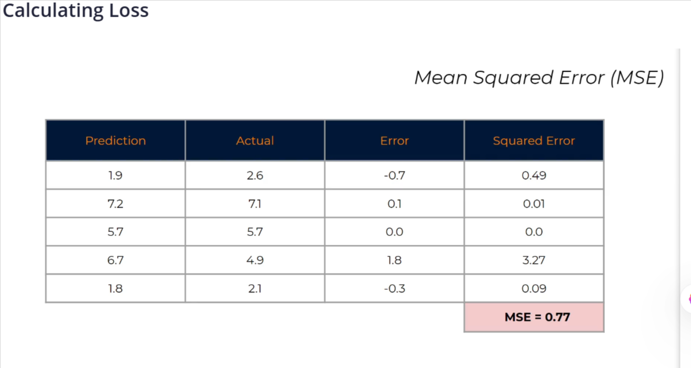

Suppose we have 5 data points with the following predictions and actuals:

| Observation | Predicted | Actual | Error | Squared Error |
| ----------- | --------- | ------ | ----- | ------------- |
| 1           | 2.5       | 2.0    | 0.5   | 0.25          |
| 2           | 3.1       | 3.2    | -0.1  | 0.01          |
| 3           | 1.8       | 2.0    | -0.2  | 0.04          |
| 4           | 4.2       | 4.0    | 0.2   | 0.04          |
| 5           | 2.9       | 3.0    | -0.1  | 0.01          |

**MSE = (0.25 + 0.01 + 0.04 + 0.04 + 0.01) / 5 = 0.35 / 5 = 0.07**

### Python Implementation

```python
import numpy as np

def mean_squared_error(y_actual, y_pred):
    """
    Calculate Mean Squared Error

    Args:
        y_actual: Array of actual values
        y_pred: Array of predicted values

    Returns:
        MSE value
    """
    return np.mean((y_pred - y_actual) ** 2)

# Example usage
y_actual = np.array([2.0, 3.2, 2.0, 4.0, 3.0])
y_pred = np.array([2.5, 3.1, 1.8, 4.2, 2.9])
mse = mean_squared_error(y_actual, y_pred)
print(f"MSE Loss: {mse:.4f}")  # Output: 0.0700
```

### Interpretation

- **Lower MSE = Better predictions** (network is learning well)
- **Higher MSE = Worse predictions** (network needs improvement)
- After backpropagation updates, the goal is to reduce MSE on the next batch

---

## 2. Binary Cross-Entropy - Binary Classification

### Definition

For binary classification problems (two possible classes), we use Binary Cross-Entropy to measure the difference between predicted and actual probabilities.

**Formula:**
$$H(p, q) = -\left[ p \log(q) + (1-p) \log(1-q) \right]$$

Where:

- $p$ = actual probability (0 or 1)
- $q$ = predicted probability (between 0 and 1)
- $\log$ = natural logarithm

### Understanding the Formula

**In Words:**

> Loss = -(actual probability of class 1 × log(predicted probability class 1) + actual probability of class 2 × log(predicted probability class 2))

### Example: Cat vs. Dog Classification

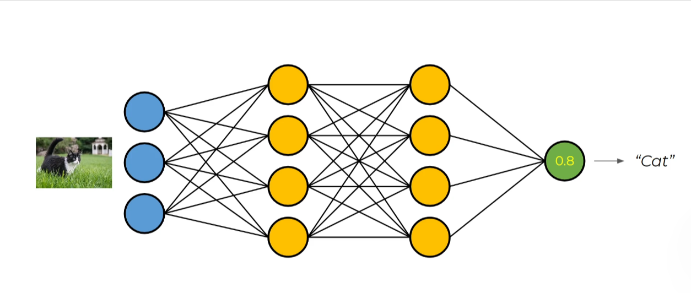

**Scenario:** A model predicts whether an image is a cat with 80% confidence.

**Data:**

- Actual label: Cat (probability = 1.0 for cat, 0.0 for dog)
- Predicted: 0.8 for cat, 0.2 for dog

**Calculation Table:**

| Class         | Actual Probability | Predicted Probability | Contribution          |
| ------------- | ------------------ | --------------------- | --------------------- |
| Cat (Class 1) | 1.0                | 0.8                   | $1.0 \times \ln(0.8)$ |
| Dog (Class 2) | 0.0                | 0.2                   | $0.0 \times \ln(0.2)$ |

**Step-by-step:**

```
Loss = -[1.0 × ln(0.8) + 0.0 × ln(0.2)]
     = -[1.0 × (-0.223) + 0.0]
     = -(-0.223)
     = 0.223
```

### Why Natural Log?

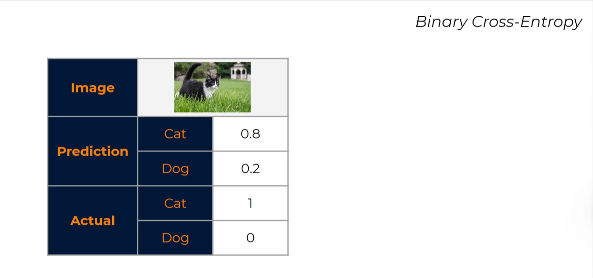

The natural logarithm of predicted probabilities creates a loss that:

- Is **low when predictions are confident and correct** (probability close to 1)
- Is **high when predictions are confident and wrong** (probability close to 0)

### Why Negate?

We want:

- **Good predictions → Low positive loss** (near 0)
- **Bad predictions → High positive loss** (larger values)

Taking the negative of the sum flips negative log values to positive.

### Poor Prediction Example

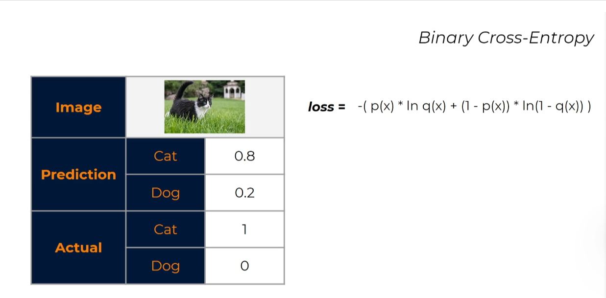

If the model predicted only 50% confidence for the cat:

```
Loss = -[1.0 × ln(0.5) + 0.0 × ln(0.5)]
     = -(-0.693)
     = 0.693
```

This is worse (higher) than 0.223, correctly reflecting lower prediction accuracy.

### Batch Loss Calculation

For a batch of 3 images:

| Image   | Actual | Predicted | Loss  |
| ------- | ------ | --------- | ----- |
| 1 (Cat) | Cat    | 0.80      | 0.223 |
| 2 (Dog) | Dog    | 0.14      | 0.150 |
| 3 (Cat) | Cat    | 0.27      | 1.309 |

**Batch Binary Cross-Entropy = (0.223 + 0.150 + 1.309) / 3 = 0.56**

### Python Implementation

```python
import numpy as np

def binary_cross_entropy(y_actual, y_pred):
    """
    Calculate Binary Cross-Entropy Loss

    Args:
        y_actual: Array of actual binary labels (0 or 1)
        y_pred: Array of predicted probabilities (0 to 1)

    Returns:
        Binary cross-entropy loss
    """
    epsilon = 1e-7  # Small value to avoid log(0)
    y_pred = np.clip(y_pred, epsilon, 1 - epsilon)
    return -np.mean(y_actual * np.log(y_pred) + (1 - y_actual) * np.log(1 - y_pred))

# Example: Single prediction
y_actual = np.array([1])  # Actual: Cat
y_pred = np.array([0.8])  # Predicted: 80% cat
loss = binary_cross_entropy(y_actual, y_pred)
print(f"Binary Cross-Entropy Loss: {loss:.4f}")  # Output: ~0.2231

# Example: Batch of predictions
y_actual = np.array([1, 0, 1])
y_pred = np.array([0.80, 0.14, 0.27])
batch_loss = binary_cross_entropy(y_actual, y_pred)
print(f"Batch Loss: {batch_loss:.4f}")  # Output: ~0.5600
```

---

## 3. Categorical Cross-Entropy - Multi-class Classification

### Definition

For multi-class classification (more than 2 mutually exclusive classes), Categorical Cross-Entropy extends binary cross-entropy to handle multiple outputs.

**Formula:**
$$H(p, q) = -\sum_{c=1}^{C} p_c \log(q_c)$$

Where:

- $C$ = number of classes
- $p_c$ = actual probability for class $c$ (one-hot encoded: 1 or 0)
- $q_c$ = predicted probability for class $c$

### How It Works

For each class:

1. Multiply actual probability by log of predicted probability
2. Sum across all classes
3. Negate the result
4. Average across the batch

### Example: Cat vs. Dog vs. Cow Classification

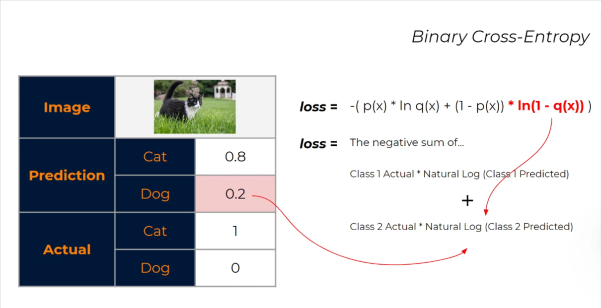

**Scenario:** Model classifies an image as one of three animals.

**Data:**

- Actual label: Cat (one-hot: [1, 0, 0])
- Predicted: Cat=0.89, Dog=0.10, Cow=0.01

**Calculation Table:**

| Class | Actual | Predicted | Contribution         |
| ----- | ------ | --------- | -------------------- |
| Cat   | 1      | 0.89      | $1 \times \ln(0.89)$ |
| Dog   | 0      | 0.10      | $0 \times \ln(0.10)$ |
| Cow   | 0      | 0.01      | $0 \times \ln(0.01)$ |

**Step-by-step:**

```
Loss = -[1.0 × ln(0.89) + 0.0 × ln(0.10) + 0.0 × ln(0.01)]
     = -[1.0 × (-0.1166) + 0 + 0]
     = -(-0.1166)
     = 0.1166
```

### Batch Calculation

For a batch of 3 images:

| Image | Actual | Predicted Probs    | Loss  |
| ----- | ------ | ------------------ | ----- |
| 1     | Cat    | [0.89, 0.10, 0.01] | 0.117 |
| 2     | Dog    | [0.05, 0.88, 0.07] | 0.128 |
| 3     | Cow    | [0.10, 0.20, 0.70] | 0.357 |

**Batch Categorical Cross-Entropy = (0.117 + 0.128 + 0.357) / 3 = 0.20**

### Python Implementation

```python
import numpy as np

def categorical_cross_entropy(y_actual_onehot, y_pred_probs):
    """
    Calculate Categorical Cross-Entropy Loss

    Args:
        y_actual_onehot: One-hot encoded actual labels (batch_size × num_classes)
        y_pred_probs: Predicted probabilities (batch_size × num_classes)

    Returns:
        Categorical cross-entropy loss
    """
    epsilon = 1e-7  # Small value to avoid log(0)
    y_pred_probs = np.clip(y_pred_probs, epsilon, 1 - epsilon)
    return -np.mean(np.sum(y_actual_onehot * np.log(y_pred_probs), axis=1))

# Example: Single prediction
y_actual = np.array([[1, 0, 0]])  # Cat
y_pred = np.array([[0.89, 0.10, 0.01]])
loss = categorical_cross_entropy(y_actual, y_pred)
print(f"Categorical Cross-Entropy Loss: {loss:.4f}")  # Output: ~0.1166

# Example: Batch of predictions
y_actual = np.array([
    [1, 0, 0],  # Cat
    [0, 1, 0],  # Dog
    [0, 0, 1]   # Cow
])
y_pred = np.array([
    [0.89, 0.10, 0.01],
    [0.05, 0.88, 0.07],
    [0.10, 0.20, 0.70]
])
batch_loss = categorical_cross_entropy(y_actual, y_pred)
print(f"Batch Loss: {batch_loss:.4f}")  # Output: ~0.2007
```

---

## 4. Multi-label Classification

### Definition

When an instance can belong to multiple classes simultaneously (e.g., an image containing both a cat AND a dog), we use multiple independent binary cross-entropy calculations.

**Formula:**
$$\text{Loss} = \sum_{i=1}^{n} \text{BCE}_i$$

For each label: $\text{BCE}_i = -[p_i \log(q_i) + (1-p_i) \log(1-q_i)]$

### Key Differences

- **Activation:** Sigmoid on **each output neuron** (not softmax)
- **Loss:** Sum of binary cross-entropy losses for each class independently
- **Probabilities:** Don't have to sum to 1

### Python Implementation

```python
import numpy as np

def multilabel_cross_entropy(y_actual, y_pred):
    """
    Calculate Multi-label Cross-Entropy Loss (sum of BCE for each label)

    Args:
        y_actual: Binary matrix of actual labels (batch_size × num_labels)
        y_pred: Predicted probabilities (batch_size × num_labels)

    Returns:
        Multi-label cross-entropy loss
    """
    epsilon = 1e-7
    y_pred = np.clip(y_pred, epsilon, 1 - epsilon)
    bce_per_label = -(y_actual * np.log(y_pred) + (1 - y_actual) * np.log(1 - y_pred))
    return np.mean(np.sum(bce_per_label, axis=1))

# Example: Image with cat AND dog
y_actual = np.array([
    [1, 1, 0],  # Has cat, has dog, no cow
    [0, 1, 1]   # No cat, has dog, has cow
])
y_pred = np.array([
    [0.9, 0.85, 0.1],
    [0.2, 0.75, 0.8]
])
loss = multilabel_cross_entropy(y_actual, y_pred)
print(f"Multi-label Loss: {loss:.4f}")
```

---

## Quick Reference Guide

### Choosing Your Loss Function

```
Is your output a continuous number?
├─ YES → Use Mean Squared Error (MSE)
└─ NO (Classification problem)

   How many possible classes?
   ├─ 2 (Binary)
   │  └─ Each sample belongs to exactly ONE class?
   │     ├─ YES → Use Binary Cross-Entropy
   │     └─ NO → Use sum of Binary Cross-Entropy per label
   │
   └─ >2 (Multi-class)
      └─ Each sample belongs to exactly ONE class?
         ├─ YES → Use Categorical Cross-Entropy
         └─ NO → Use sum of Binary Cross-Entropy per label
```

---

## Training Loop: Loss in Action

After calculating loss, the network:

1. **Calculate Loss** (Step 2) → Uses one of the functions above
2. **Perform Backpropagation** (Step 5) → Computes gradients
3. **Update Weights & Biases** → Adjusts parameters to reduce loss
4. **Repeat** → Process next batch and calculate new loss
5. **Monitor Progress** → Lower loss values indicate learning

**Goal:** Minimize loss on training data while monitoring test data to ensure good generalization.

---

## Visualizations

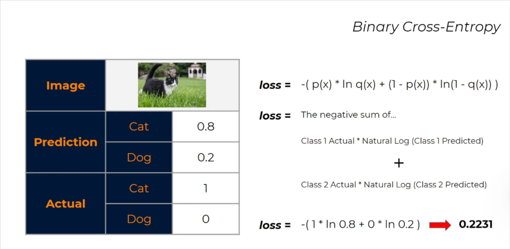

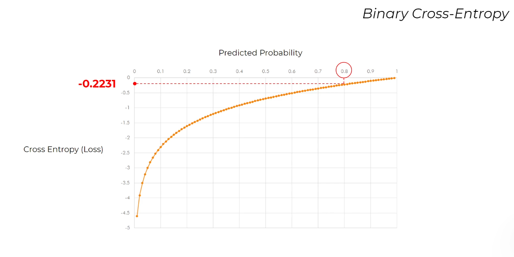

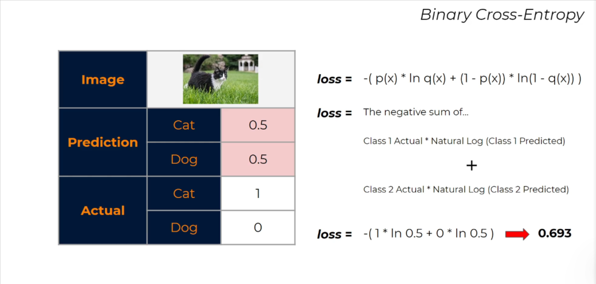

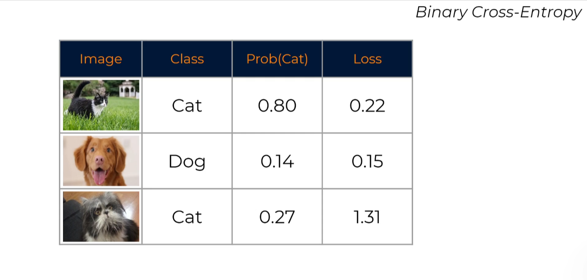

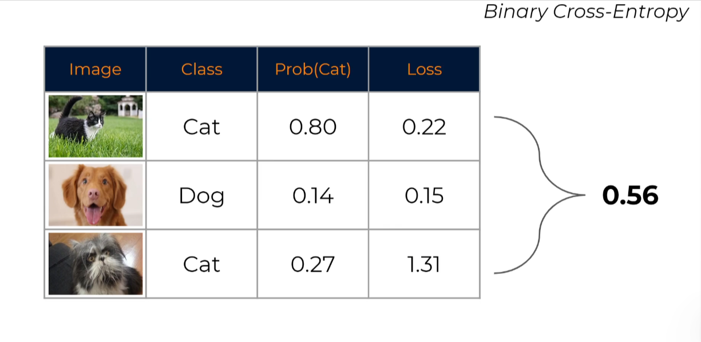

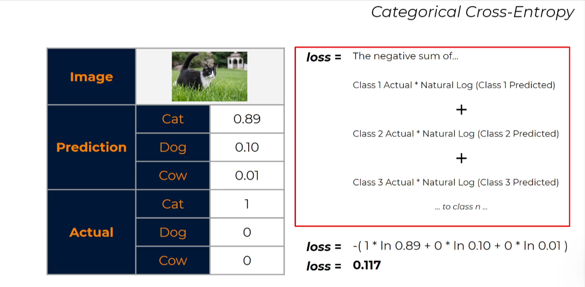

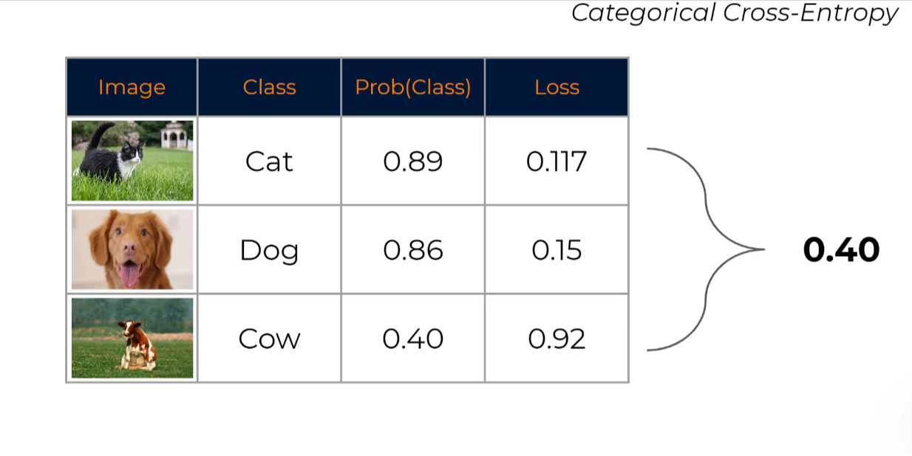

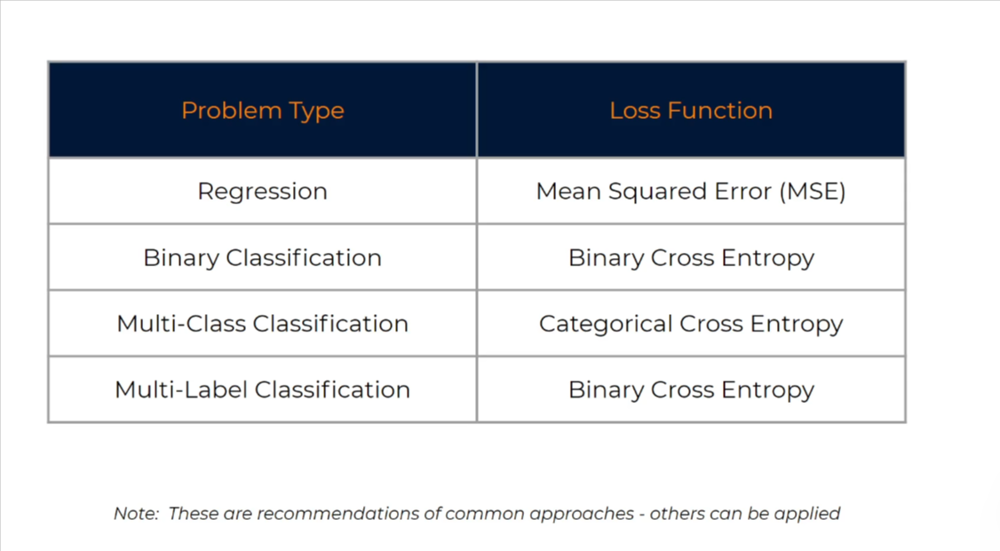

---

## Summary

| Aspect               | MSE                       | Binary CE                         | Categorical CE                    |
| -------------------- | ------------------------- | --------------------------------- | --------------------------------- |
| **Use Case**         | Regression                | 2 classes                         | 3+ classes                        |
| **Formula**          | Average of squared errors | Negative sum of probability logs  | Negative sum across classes       |
| **Activation**       | Linear                    | Sigmoid                           | Softmax                           |
| **Output Range**     | 0 to ∞                    | 0 to ∞                            | 0 to ∞                            |
| **Interpretability** | Average squared deviation | Average probability divergence    | Average probability divergence    |
| **Sensitive to**     | Large errors              | High-confidence wrong predictions | High-confidence wrong predictions |

Remember: **The loss function is your neural network's report card.** A lower score means the network is learning better. Through backpropagation and gradient descent, the network uses this loss signal to improve its weights and biases, gradually making better predictions.
