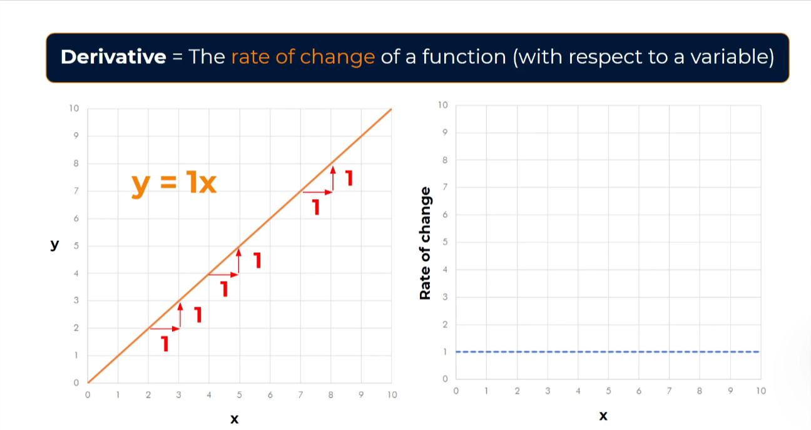
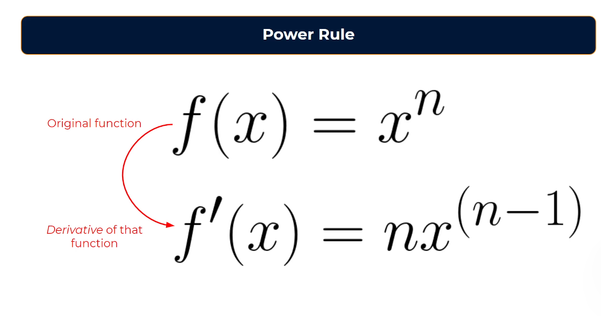
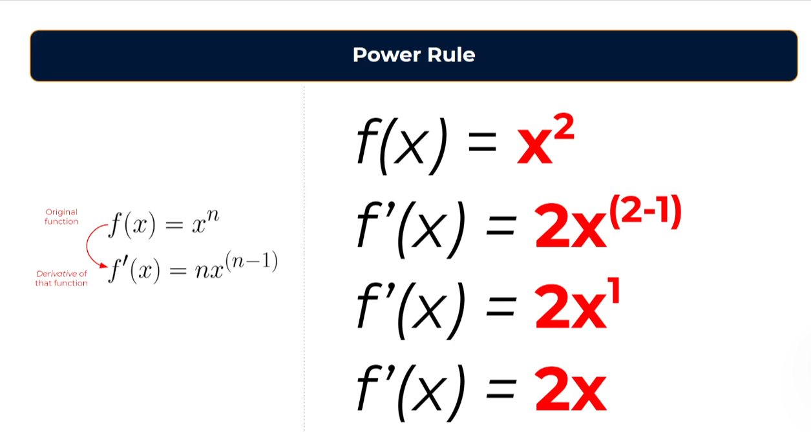
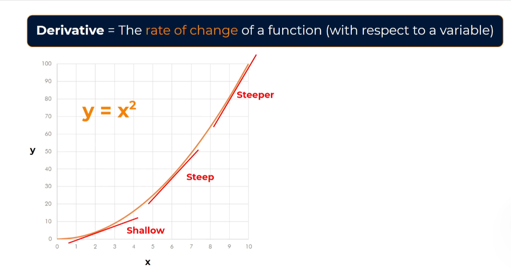
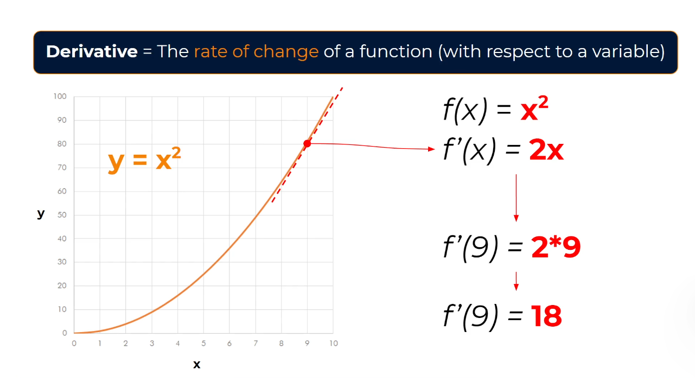

# Understanding Derivatives

Derivatives describe how a function changes with respect to a variable. They
are useful for understanding gradient descent and, ultimately, the chain rule
in neural networks.

## Rate of Change and Slope



A **derivative** is the instantaneous rate of change of a function. On a
graph, it is the slope of the tangent line at a particular point.

For the straight line `y = x`, every increase of one unit in `x` increases
`y` by one unit. Its slope is therefore `1` everywhere:

```text
f(x) = x
f'(x) = 1
```

The right-hand graph shows this constant derivative at every value of `x`.
For a curved function, however, the slope can change from point to point.

## The Power Rule



The power rule lets us differentiate a function of the form `f(x) = x^n`,
where `n` is a constant:

```text
f(x)  = x^n
f'(x) = n * x^(n - 1)
```

Here, `f(x)` means the value of the function for input `x`, and `f'(x)`
denotes its derivative. The rule applies where the function and derivative
are defined.

### Example: Squaring a Number



For `f(x) = x^2`, the exponent is `n = 2`. Applying the power rule and
simplifying gives:

```text
f'(x) = 2 * x^(2 - 1)
      = 2 * x^1
      = 2x
```

This derivative gives the slope of `x^2` at any chosen value of `x`.

## Interpreting the Derivative of a Curve



The function `y = x^2` gives an output for each input: for example, `x = 2`
gives `y = 4`, and `x = 5` gives `y = 25`. In the positive portion of the
graph, the curve becomes steeper as `x` increases. The red tangent lines
illustrate the changing slope.



Substituting a value into `f'(x) = 2x` gives the instantaneous rate of change
at that point:

- At `x = 6`, `f'(6) = 12`.
- At `x = 9`, `f'(9) = 18`, as shown above.
- At `x = -5`, `f'(-5) = -10`: increasing `x` slightly decreases `y`.
- At `x = 0`, `f'(0) = 0`: the tangent is flat at the minimum.

For example, a slope of `12` at `x = 6` means that for a **small** increase
in `x`, the change in `y` is approximately `12` times that increase. It does
not mean that `y` increases by exactly `12` over a full one-unit interval:
the slope itself changes along the curve.

## Why This Matters for Gradient Descent

Gradient descent uses derivatives to help reduce a loss function. For a single
parameter, a positive derivative indicates that a small decrease in the
parameter locally decreases loss; a negative derivative indicates that a
small increase locally decreases loss.

In a neural network, the loss depends on many weights and biases. The
gradient collects the partial derivatives with respect to those parameters,
and gradient descent moves in the opposite direction:

```text
parameter_new = parameter_old - learning_rate * derivative
```

The derivative's magnitude and the learning rate together determine the
update size. A larger gradient produces a larger update for a fixed learning
rate, but an update that is too large can overshoot.

Derivatives provide the foundation for the
[chain rule](Using_The_Chain_Rule.md), which connects changes in network
parameters to changes in the final loss.
